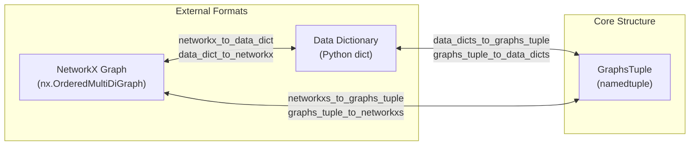
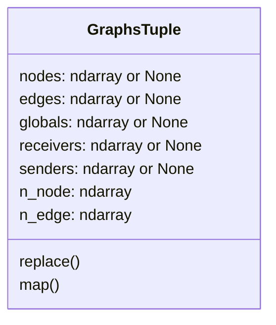
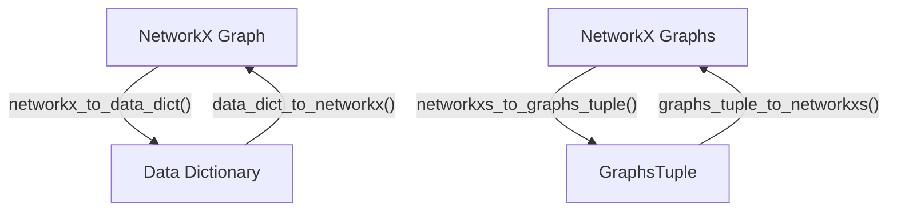

<!-- source: DeepWiki mcp.deepwiki.com · repo google-deepmind/graph_nets · page 4.1 NumPy Utilities · fetched 2026-10-26 -->

# NumPy Utilities

<details>
<summary>Relevant source files</summary>

The following files were used as context for generating this wiki page:

- [graph_nets/graphs.py](graph_nets/graphs.py)
- [graph_nets/tests/utils_np_test.py](graph_nets/tests/utils_np_test.py)
- [graph_nets/utils_np.py](graph_nets/utils_np.py)
- [setup.py](setup.py)

</details>


## Introduction

This document covers the NumPy-based utilities for graph manipulation in the `graph_nets` library. These utilities provide functionality for converting between different graph representations, manipulating graph structures, and performing batch operations on multiple graphs.

For TensorFlow-specific utilities, see [TensorFlow Utilities](#4.2).

The NumPy utilities operate on the core `GraphsTuple` data structure (see [Core Data Structure: GraphsTuple](#2)) and enable conversions between:
- NetworkX graphs
- Data dictionaries (Python dictionaries with graph data)
- `GraphsTuple` objects containing NumPy arrays

Sources: [graph_nets/utils_np.py:15-35]()

## Graph Data Representations

The Graph Nets library uses several representations for graph data:



Sources: [graph_nets/utils_np.py:37-61](), [graph_nets/graphs.py:16-102]()

### Data Dictionary Format

A data dictionary is a Python dictionary containing graph data with the following keys:

- `nodes`: Node features (shape `[n_nodes, node_feature_size]`)
- `edges`: Edge features (shape `[n_edges, edge_feature_size]`) 
- `globals`: Graph-level features (shape `[global_feature_size]`)
- `receivers`: Receiver node indices for each edge (shape `[n_edges]`)
- `senders`: Sender node indices for each edge (shape `[n_edges]`)
- `n_node`: Number of nodes (scalar)
- `n_edge`: Number of edges (scalar)

Fields can be `None` if the corresponding data is not present, but there are consistency requirements (e.g., if `receivers` is `None`, then `senders` must also be `None`).

Sources: [graph_nets/utils_np.py:65-73](), [graph_nets/graphs.py:27-82]()

### GraphsTuple Structure

The `GraphsTuple` is a named tuple with the following structure:



The `GraphsTuple` has validation logic to ensure graph consistency, such as making sure that if `receivers` is `None`, then `senders` is also `None`.

Sources: [graph_nets/graphs.py:103-196]()

## Conversion Functions

### NetworkX Conversions



Sources: [graph_nets/utils_np.py:117-307]()

#### NetworkX to Data Dictionary

`networkx_to_data_dict` converts a NetworkX `OrderedMultiDiGraph` to a data dictionary:

- Takes node/edge features from the "features" attribute in NetworkX nodes/edges
- Handles optional shape hints for nodes and edges
- Ensures consistent node indices (keys must match order)

```python
data_dict = networkx_to_data_dict(graph_nx, node_shape_hint=None, 
                                  edge_shape_hint=None, 
                                  data_type_hint=np.float32)
```

Sources: [graph_nets/utils_np.py:117-236]()

#### Data Dictionary to NetworkX

`data_dict_to_networkx` converts a data dictionary to a NetworkX `OrderedMultiDiGraph`:

- Creates nodes with indices as keys
- Places node features in the "features" attribute
- Adds edges with "features" and "index" attributes
- Sets graph-level features in the graph's "features" attribute

```python
graph_nx = data_dict_to_networkx(data_dict)
```

Sources: [graph_nets/utils_np.py:245-307]()

### GraphsTuple Conversions

#### Data Dictionaries to GraphsTuple

`data_dicts_to_graphs_tuple` converts multiple data dictionaries to a single `GraphsTuple`:

- Batches multiple graphs into a single `GraphsTuple`
- Concatenates node and edge features
- Adjusts sender/receiver indices to account for batching
- Handles `None` values consistently

```python
graphs_tuple = data_dicts_to_graphs_tuple(data_dicts)
```

Sources: [graph_nets/utils_np.py:380-404]()

#### GraphsTuple to Data Dictionaries

`graphs_tuple_to_data_dicts` converts a `GraphsTuple` back to individual data dictionaries:

- Splits the batched `GraphsTuple` into individual graph dictionaries
- Corrects sender/receiver indices for each graph
- Handles `None` fields properly

```python
data_dicts = graphs_tuple_to_data_dicts(graphs_tuple)
```

Sources: [graph_nets/utils_np.py:407-446]()

## Graph Manipulation Functions

### Getting Subgraphs

The `get_graph` function allows extracting a single graph or a subset of graphs from a `GraphsTuple`:

```python
# Get a single graph
single_graph = get_graph(graphs_tuple, index=0)

# Get a slice of graphs
subset_graphs = get_graph(graphs_tuple, slice(1, 3))
```

This function:
- Takes an index (integer) or a slice
- Returns a new `GraphsTuple` containing only the selected graph(s)
- Adjusts node and edge indices appropriately

Sources: [graph_nets/utils_np.py:541-568]()

### Internal Helper Functions

The module includes several helper functions that support the main conversion and manipulation operations:

- `_compute_stacked_offsets`: Calculates offsets for stacked arrays when batching graphs
- `_concatenate_data_dicts`: Combines multiple data dictionaries into one for batching
- `_populate_number_fields`: Fills in N_NODE and N_EDGE fields if missing
- `_to_compatible_data_dicts`: Ensures consistent data types (e.g., int32 for indices)
- `_unstack`: Similar to TensorFlow's unstack, splits arrays by the first dimension
- `_check_valid_keys`: Validates consistency of graph data fields

Sources: [graph_nets/utils_np.py:89-116](), [graph_nets/utils_np.py:239-243](), [graph_nets/utils_np.py:449-537]()

## Usage Examples

### Converting from NetworkX to GraphsTuple

```python
# Create a NetworkX graph
graph_nx = nx.OrderedMultiDiGraph()
graph_nx.add_node(0, features=np.array([1.0, 2.0]))
graph_nx.add_node(1, features=np.array([3.0, 4.0]))
graph_nx.add_edge(0, 1, features=np.array([5.0, 6.0]))
graph_nx.graph["features"] = np.array([7.0, 8.0])

# Convert to GraphsTuple
graphs_tuple = networkxs_to_graphs_tuple([graph_nx])
```

### Extracting a Subgraph

```python
# Assuming a GraphsTuple with multiple graphs
# Extract the second graph
second_graph = get_graph(graphs_tuple, 1)

# Extract a slice of graphs
subset = get_graph(graphs_tuple, slice(1, 3))
```

### Converting Back to NetworkX

```python
# Convert GraphsTuple to NetworkX graphs
graph_nxs = graphs_tuple_to_networkxs(graphs_tuple)
```

## Common Patterns and Best Practices

1. **Handling None Fields**: Many fields in graphs can be `None`. Use caution when working with them and always check for `None` values.

2. **Node and Edge Indexing**: When batching graphs, node and edge indices are adjusted automatically. Be aware of this when working with indices.

3. **Type Consistency**: The conversion functions automatically handle type conversions for indices (to int32) and features.

4. **Validation**: The utilities include various validation steps to ensure graph consistency. Pay attention to error messages which often provide helpful information.

Sources: [graph_nets/utils_np.py:65-86](), [graph_nets/graphs.py:149-171]()

---

