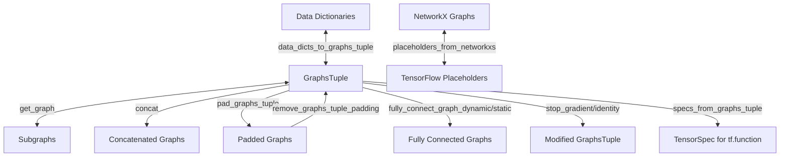
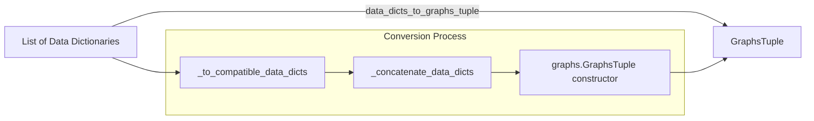
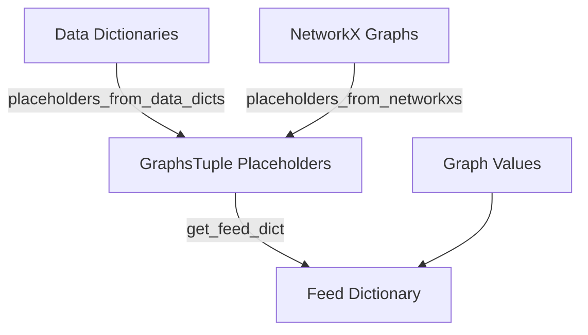
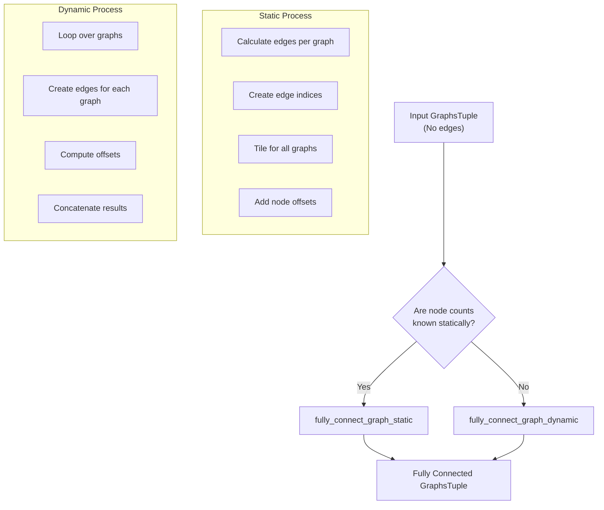
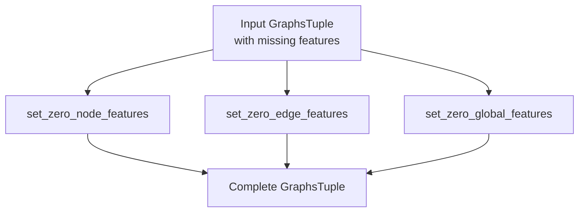
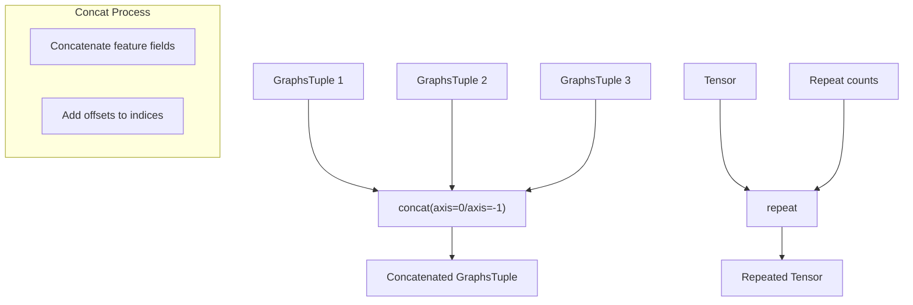
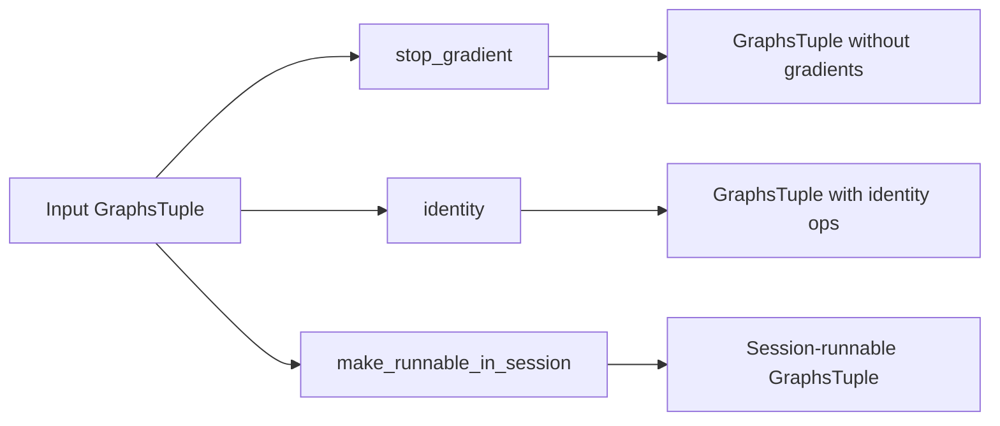
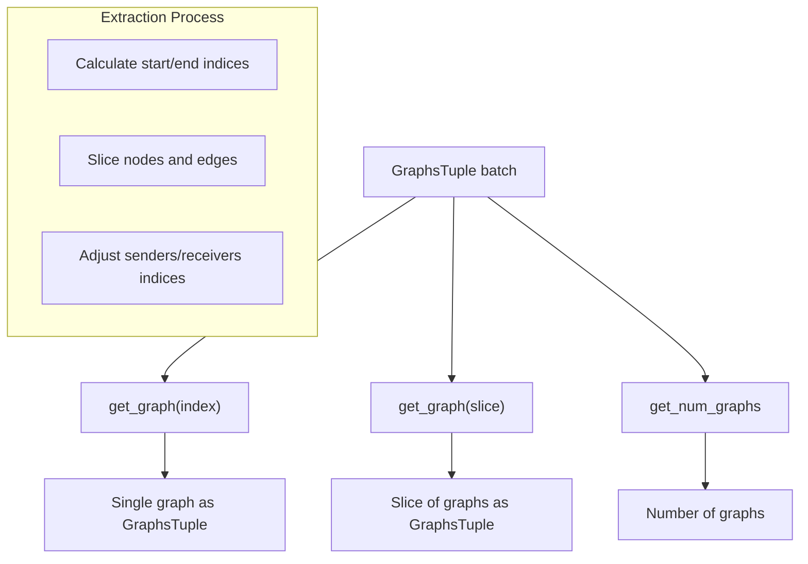
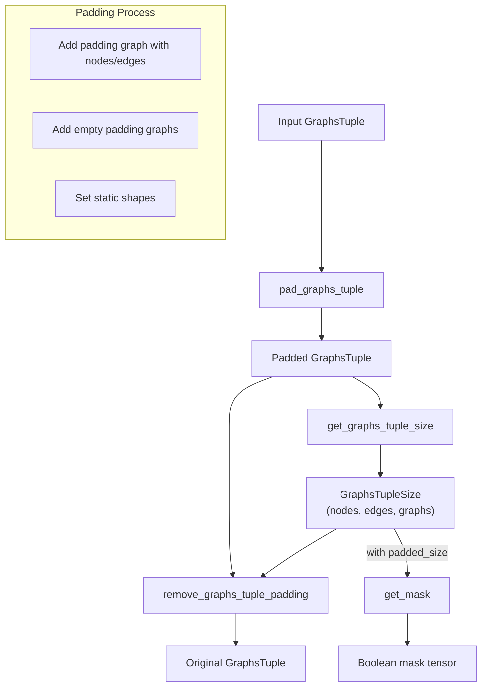
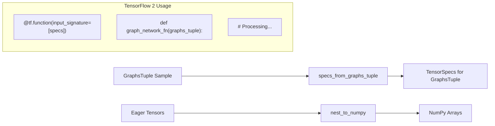

<!-- source: DeepWiki mcp.deepwiki.com · repo google-deepmind/graph_nets · page 4.2 TensorFlow Utilities · fetched 2026-10-26 -->

# TensorFlow Utilities

Relevant source files

The following files were used as context for generating this wiki page:

- [graph_nets/tests/utils_tf_test.py](graph_nets/tests/utils_tf_test.py)
- [graph_nets/tests_tf2/utils_tf_test.py](graph_nets/tests_tf2/utils_tf_test.py)
- [graph_nets/utils_tf.py](graph_nets/utils_tf.py)

This page documents the TensorFlow utilities provided in the Graph Nets library. These utilities enable the manipulation and transformation of graph data structures within TensorFlow's computational framework. The utilities complement the NumPy-based utilities (see [NumPy Utilities](#4.1)) but operate on TensorFlow tensors rather than NumPy arrays.

## Overview of TensorFlow Utilities

The TensorFlow utilities (`utils_tf`) provide functions for:

1. Converting between different graph representations
2. Creating TensorFlow placeholders for graphs
3. Manipulating graph structures (concatenation, padding, etc.)
4. Accessing and indexing into graphs
5. Handling batches of graphs
6. Facilitating integration with TensorFlow sessions and functions

Sources: 
[graph_nets/utils_tf.py:16-58]()

## Data Conversion and Placeholder Creation

### Converting Data Dictionaries to GraphsTuple

The `data_dicts_to_graphs_tuple` function converts a list of data dictionaries to a `GraphsTuple` containing TensorFlow tensors.

Sources:
[graph_nets/utils_tf.py:938-967]()
[graph_nets/utils_tf.py:577-600]()
[graph_nets/utils_tf.py:603-647]()

### Creating Placeholders

These functions create TensorFlow placeholders for graph data:

- **placeholders_from_data_dicts**: Creates placeholders compatible with a list of data dictionaries
- **placeholders_from_networkxs**: Creates placeholders compatible with a list of NetworkX graphs
- **get_feed_dict**: Creates a feed dictionary for feeding values into graph placeholders

Sources:
[graph_nets/utils_tf.py:223-241]()
[graph_nets/utils_tf.py:244-290]()
[graph_nets/utils_tf.py:179-220]()

## Graph Construction and Manipulation

### Building Complete Graphs

Two functions for creating fully connected graphs:

- **fully_connect_graph_static**: Used when node count is known at graph construction time
- **fully_connect_graph_dynamic**: Used when node count is not known until runtime

Sources:
[graph_nets/utils_tf.py:710-776]()
[graph_nets/utils_tf.py:778-832]()
[graph_nets/utils_tf.py:650-707]()

### Setting Default Feature Values

Functions for filling missing features with zeros:

- **set_zero_node_features**: Sets node features to zeros
- **set_zero_edge_features**: Sets edge features to zeros
- **set_zero_global_features**: Sets global features to zeros

Sources:
[graph_nets/utils_tf.py:835-864]()
[graph_nets/utils_tf.py:867-904]()
[graph_nets/utils_tf.py:907-935]()

## Graph Operations

### Concatenation and Repetition

- **concat**: Concatenates multiple GraphsTuples along a specified axis
- **repeat**: Repeats elements of a tensor with custom repeat counts

Sources:
[graph_nets/utils_tf.py:327-387]()
[graph_nets/utils_tf.py:482-550]()

### Tensor-like Operations

- **stop_gradient**: Stops gradient flow through specific fields
- **identity**: Passes each field through `tf.identity`
- **make_runnable_in_session**: Replaces None fields with no-ops for session running

Sources:
[graph_nets/utils_tf.py:390-432]()
[graph_nets/utils_tf.py:435-457]()
[graph_nets/utils_tf.py:460-479]()

## Indexing and Accessing

- **get_graph**: Extracts a single graph or slice of graphs from a batch
- **get_num_graphs**: Returns the number of graphs in a GraphsTuple

Sources:
[graph_nets/utils_tf.py:993-1071]()
[graph_nets/utils_tf.py:1074-1086]()

## Padding and Shape Management

### Padding Graphs

- **pad_graphs_tuple**: Pads a GraphsTuple to fixed dimensions
- **remove_graphs_tuple_padding**: Removes padding from a padded GraphsTuple
- **get_graphs_tuple_size**: Gets the size information (nodes, edges, graphs)
- **get_mask**: Creates a boolean mask for valid elements in padded data

Sources:
[graph_nets/utils_tf.py:1456-1584]()
[graph_nets/utils_tf.py:1343-1378]()
[graph_nets/utils_tf.py:1282-1296]()
[graph_nets/utils_tf.py:1305-1340]()

### TensorFlow 2 Support

- **specs_from_graphs_tuple**: Creates TensorFlow specs for use with `tf.function`
- **nest_to_numpy**: Converts eager tensors to NumPy arrays

Sources:
[graph_nets/utils_tf.py:1110-1217]()
[graph_nets/utils_tf.py:1089-1107]()

## Function Reference Table

| Function | Description | Source |
|----------|-------------|--------|
| `data_dicts_to_graphs_tuple` | Converts data dictionaries to a GraphsTuple | [utils_tf.py:938-967]() |
| `placeholders_from_data_dicts` | Creates placeholders from data dicts | [utils_tf.py:223-241]() |
| `placeholders_from_networkxs` | Creates placeholders from NetworkX graphs | [utils_tf.py:244-290]() |
| `get_feed_dict` | Creates feed dict for placeholders | [utils_tf.py:179-220]() |
| `concat` | Concatenates GraphsTuples | [utils_tf.py:327-387]() |
| `repeat` | Repeats tensor elements | [utils_tf.py:482-550]() |
| `stop_gradient` | Stops gradients in a GraphsTuple | [utils_tf.py:390-432]() |
| `identity` | Applies tf.identity to GraphsTuple fields | [utils_tf.py:435-457]() |
| `make_runnable_in_session` | Makes GraphsTuple runnable in session | [utils_tf.py:460-479]() |
| `fully_connect_graph_static` | Creates fully connected graph (static) | [utils_tf.py:710-776]() |
| `fully_connect_graph_dynamic` | Creates fully connected graph (dynamic) | [utils_tf.py:778-832]() |
| `set_zero_node_features` | Sets node features to zeros | [utils_tf.py:835-864]() |
| `set_zero_edge_features` | Sets edge features to zeros | [utils_tf.py:867-904]() |
| `set_zero_global_features` | Sets global features to zeros | [utils_tf.py:907-935]() |
| `get_graph` | Extracts a graph or slice | [utils_tf.py:993-1071]() |
| `get_num_graphs` | Gets the number of graphs | [utils_tf.py:1074-1086]() |
| `pad_graphs_tuple` | Pads a GraphsTuple | [utils_tf.py:1456-1584]() |
| `remove_graphs_tuple_padding` | Removes padding | [utils_tf.py:1343-1378]() |
| `get_graphs_tuple_size` | Gets GraphsTuple size info | [utils_tf.py:1282-1296]() |
| `get_mask` | Creates validity mask | [utils_tf.py:1305-1340]() |
| `specs_from_graphs_tuple` | Creates TensorSpecs | [utils_tf.py:1110-1217]() |
| `nest_to_numpy` | Converts eager tensors to NumPy arrays | [utils_tf.py:1089-1107]() |

Sources:
[graph_nets/utils_tf.py]()

---

