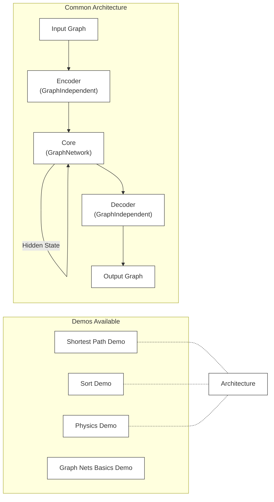
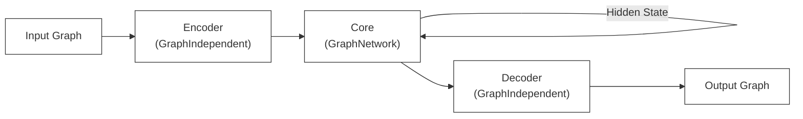
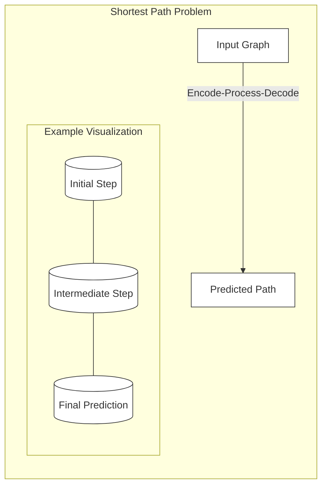
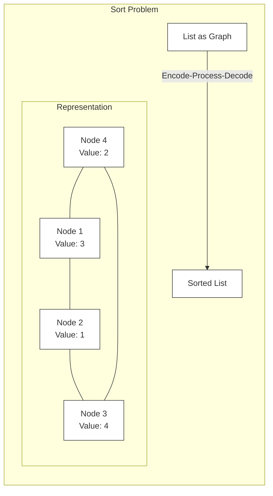
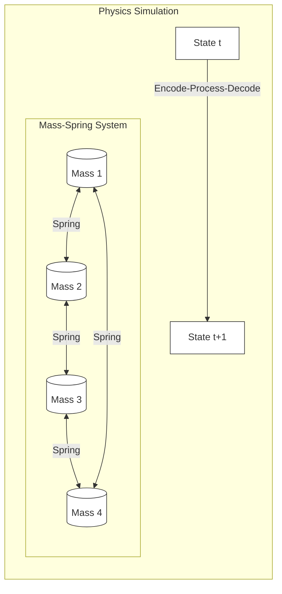
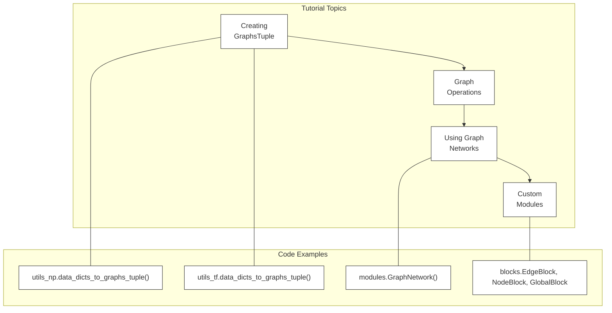
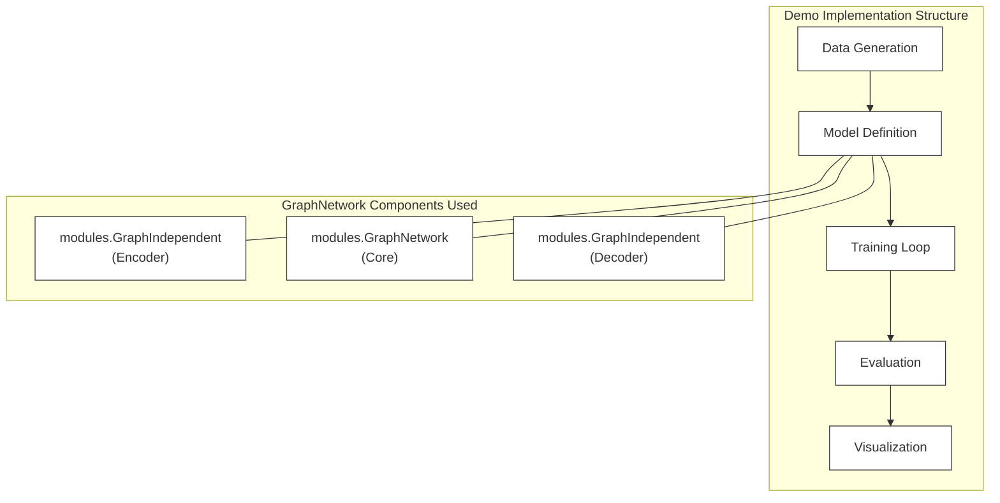

<!-- source: DeepWiki mcp.deepwiki.com · repo google-deepmind/graph_nets · page 5 Demos and Examples · fetched 2026-10-26 -->

# Demos and Examples

<details>
<summary>Relevant source files</summary>

The following files were used as context for generating this wiki page:

- [README.md](README.md)
- [graph_nets/demos/graph_nets_basics.ipynb](graph_nets/demos/graph_nets_basics.ipynb)

</details>


This document provides an overview of the demonstration applications included in the Graph Nets library. These demos showcase the library's capabilities across different problem domains while illustrating how the same graph network architecture can be applied to various tasks.

## Overview

The Graph Nets library includes several demos that demonstrate how to create, manipulate, and train graph networks to reason about graph-structured data. These demos serve both as educational resources and as examples of practical applications of graph neural networks.



Sources: [README.md:79-85]()

## Common Architecture: Encode-Process-Decode

All three task-based demos (shortest path, sort, physics) use the same graph network architecture, which highlights the flexibility of the approach. This architecture follows an Encode-Process-Decode pattern:



1. **Encoder**: The input graph is first processed by a `GraphIndependent` module, which transforms node, edge, and global features independently without message passing.

2. **Core**: The encoded graph is then processed through multiple iterations by a `GraphNetwork` module, which performs message passing to update node, edge, and global features based on the graph structure.

3. **Decoder**: Finally, the processed graph is passed through another `GraphIndependent` module to produce the output graph.

This architecture allows the model to iteratively refine its representations through the core message-passing steps before producing the final output.

Sources: [README.md:83-85]()

## Shortest Path Demo

The shortest path demo trains a graph network to label the nodes and edges that form the shortest path between any two nodes in a graph.



Features:
- Creates random graphs for training
- Over multiple message-passing steps, the model refines its prediction of the shortest path
- Visualizes how the prediction evolves at each step

The demo illustrates how graph networks can learn to solve classic graph algorithms through neural message passing.

Sources: [README.md:95-102]()

## Sort Demo

The sort demo trains a graph network to sort a list of random numbers. The model learns to determine the correct order of elements in a sequence.



Features:
- Represents lists as fully-connected graphs where each node contains a value
- After multiple message-passing steps, the model predicts which elements come next after each other
- The output is visualized as a matrix showing the predicted ordering relationships

This demo shows how graph networks can learn to reason about relational properties in data that isn't naturally graph-structured.

Sources: [README.md:106-113]()

## Physics Demo

The physics demo trains a graph network to predict the state of a mass-spring physical system in the next timestep.



Features:
- Creates random mass-spring physical systems for training
- Learns to predict the next state of the system given the current state
- The model's predictions can be fed back as input to create a rollout of future trajectories
- Visualizes true and predicted system states over multiple steps

This demo is similar to the "interaction networks" model described in Battaglia et al. (2016) and demonstrates how graph networks can model physical systems and their dynamics.

Sources: [README.md:117-126]()

## Graph Nets Basics Demo

Unlike the task-specific demos, the Graph Nets Basics demo is a tutorial that introduces fundamental concepts of the library.



This tutorial contains step-by-step examples covering:
1. How to create and manipulate graphs
2. How to feed graphs into graph networks
3. How to build custom graph network modules

The tutorial serves as a comprehensive introduction to the Graph Nets library and its core concepts.

Sources: [README.md:130-134](), [graph_nets/demos/graph_nets_basics.ipynb:40-47]()

## Running the Demos

### In Browser with Colaboratory

The easiest way to try the demos is through Google Colaboratory, which allows you to run the notebooks in your browser without installing anything locally.

| Demo | Colaboratory Link |
|------|-------------------|
| Shortest Path | [Run in browser](https://colab.research.google.com/github/deepmind/graph_nets/blob/master/graph_nets/demos/shortest_path.ipynb) |
| Sort | [Run in browser](https://colab.research.google.com/github/deepmind/graph_nets/blob/master/graph_nets/demos/sort.ipynb) (or [TF2 version](https://colab.research.google.com/github/deepmind/graph_nets/blob/master/graph_nets/demos_tf2/sort.ipynb)) |
| Physics | [Run in browser](https://colab.research.google.com/github/deepmind/graph_nets/blob/master/graph_nets/demos/physics.ipynb) |
| Graph Nets Basics | [Run in browser](https://colab.research.google.com/github/deepmind/graph_nets/blob/master/graph_nets/demos/graph_nets_basics.ipynb) (or [TF2 version](https://colab.research.google.com/github/deepmind/graph_nets/blob/master/graph_nets/demos_tf2/graph_nets_basics.ipynb)) |

To run a demo in Colaboratory:
1. Click on the corresponding link
2. Follow the instructions in the notebook

Sources: [README.md:87-135]()

### On Local Machine

To run the demos locally:

1. Install the necessary dependencies:
```
pip install jupyter matplotlib scipy
```

2. Navigate to the demos directory:
```
cd <path-to-graph-nets-library>/demos
```

3. Launch Jupyter Notebook:
```
jupyter notebook
```

4. Open a demo through the Jupyter notebook interface.

Sources: [README.md:138-151]()

## Demo Implementation Details

For those interested in the internal workings of the demos, each follows a similar implementation pattern:



Each demo uses `modules.GraphIndependent` for the encoder and decoder, and `modules.GraphNetwork` for the core processing steps. The demos showcase how to:

1. Structure graph data for different types of problems
2. Define appropriate network architectures
3. Train models on graph-structured data
4. Visualize and interpret the results

For detailed information about the Encode-Process-Decode architecture used in these demos, see the [EncodeProcessDecode Architecture](#6.1) page.

Sources: [README.md:82-85]()

---

