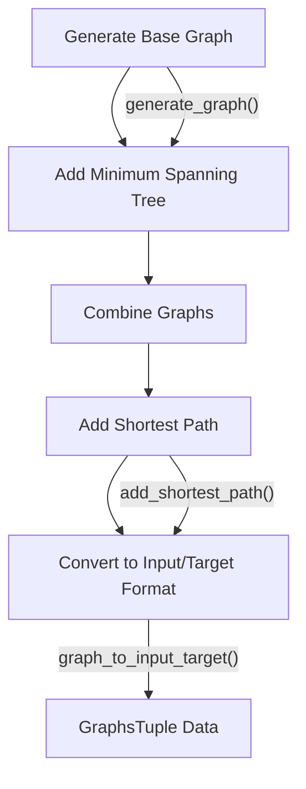
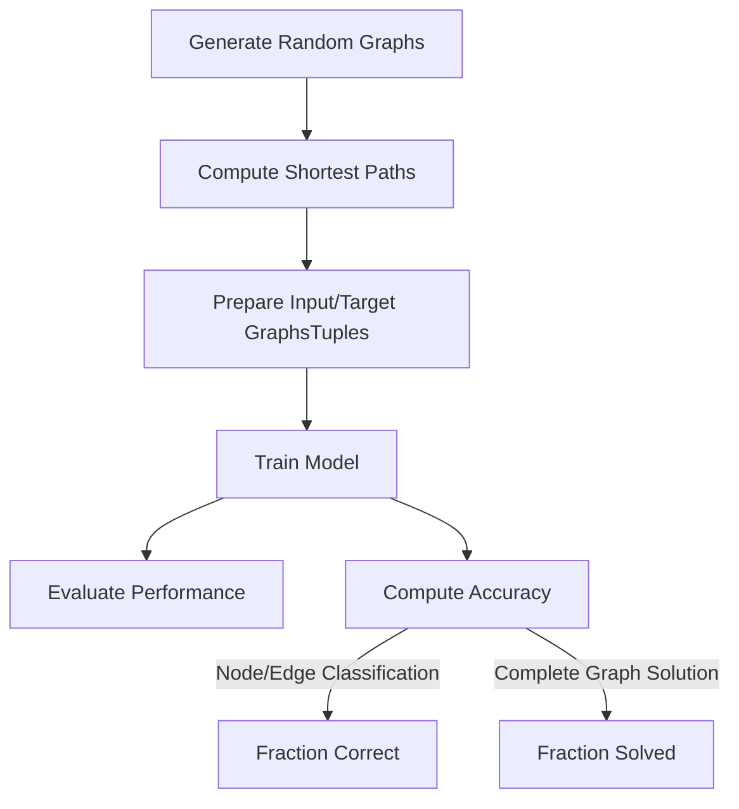

<!-- source: DeepWiki mcp.deepwiki.com · repo google-deepmind/graph_nets · page 5.1 Shortest Path Demo · fetched 2026-10-26 -->

# Shortest Path Demo

<details>
<summary>Relevant source files</summary>

The following files were used as context for generating this wiki page:

- [graph_nets/demos/shortest_path.ipynb](graph_nets/demos/shortest_path.ipynb)

</details>


## Overview

The Shortest Path Demo illustrates how Graph Neural Networks (GNNs) can be applied to solve combinatorial graph problems—specifically, finding the shortest path between two nodes in a graph. This demonstration showcases the ability of GNNs to learn and predict the nodes and edges that constitute the shortest path between designated start and end nodes.

For a broader understanding of the general architecture used in this demo, see [EncodeProcessDecode Architecture](#6.1).

Sources: [graph_nets/demos/shortest_path.ipynb:37-44]()

## Problem Definition

The shortest path problem is formulated as follows:

1. Input: A graph with nodes and edges, where exactly one node is marked as the start and exactly one node is marked as the end
2. Task: Predict which nodes and edges belong to the shortest path between the start and end nodes
3. Output: Node and edge classifications, where each node and edge is labeled as either part of the shortest path (1) or not (0)

This is implemented as a binary classification task for each node and edge in the graph.

Sources: [graph_nets/demos/shortest_path.ipynb:37-44](), [graph_nets/demos/shortest_path.ipynb:292-338]()

## Graph Generation and Representation

### Graph Generation Process



The demo generates graphs through the following process:

1. **Graph Generation**: Creates a geographic threshold graph with randomly positioned nodes and weighted edges based on node distances
2. **Connectivity**: Ensures all nodes are connected by adding a minimum spanning tree to the graph
3. **Shortest Path Labeling**: 
   - Randomly selects start and end nodes 
   - Computes the shortest path between them
   - Labels the nodes and edges along this path

The generated graphs are converted into the library's `GraphsTuple` format, with separate structures for input features and target labels.

Sources: [graph_nets/demos/shortest_path.ipynb:175-199](), [graph_nets/demos/shortest_path.ipynb:229-265](), [graph_nets/demos/shortest_path.ipynb:292-338]()

### Input and Target Features

The graph data is structured as follows:

| Graph Component | Input Features | Target Labels |
|-----------------|----------------|---------------|
| Nodes | Position, weight, start/end indicators (0/1) | Binary indicator (on path=1, off path=0) |
| Edges | Distance | Binary indicator (on path=1, off path=0) |
| Global | Zero vector | Proportion of nodes on the shortest path |

Each node and edge in the graph contains both features (used as input to the model) and solution labels (used as training targets).

Sources: [graph_nets/demos/shortest_path.ipynb:292-338]()

## Model Architecture

The demo uses an Encode-Process-Decode architecture for learning and predicting shortest paths.

```mermaid
flowchart LR
    Input["Input Graph"] --> Encoder
    subgraph Encoder["GraphIndependent Encoder"]
        E_N["Node Encoder"]
        E_E["Edge Encoder"]
        E_G["Global Encoder"]
    end
    
    Encoder --> Core
    
    subgraph Core["Core (GraphNetwork)"]
        direction LR
        MP1["Message Passing Step 1"]
        MP2["Message Passing Step 2"]
        MPN["Message Passing Step N"]
        MP1 --> MP2
        MP2 --> "..." --> MPN
    end
    
    Core --> Decoder
    
    subgraph Decoder["GraphIndependent Decoder"]
        D_N["Node Decoder"]
        D_E["Edge Decoder"]
        D_G["Global Decoder"]
    end
    
    Decoder --> Output["Output Graph\n(Path Predictions)"]
```

Key components:

1. **Encoder**: A `GraphIndependent` module that independently processes node, edge, and global features without message passing
2. **Core**: A `GraphNetwork` module that performs multiple rounds of message passing to propagate information across the graph
3. **Decoder**: Another `GraphIndependent` module that transforms the processed graph back into output predictions

The model processes the input graph through multiple message-passing steps, with the output from each step being supervised during training. This encourages the model to solve the problem in as few steps as possible.

Sources: [graph_nets/demos/shortest_path.ipynb:736-778](), [graph_nets/demos/shortest_path.ipynb:809-811]()

## Training Process

### Data Generation and Model Setup



The training process consists of:

1. Generating batches of random graphs with shortest paths labeled
2. Feeding these through the model
3. Computing loss by comparing predictions with true labels
4. Updating model parameters through backpropagation

The model is trained to predict both node and edge classifications simultaneously.

Sources: [graph_nets/demos/shortest_path.ipynb:736-778](), [graph_nets/demos/shortest_path.ipynb:876-932]()

### Loss and Evaluation Metrics

Training employs softmax cross-entropy loss on both node and edge predictions. Performance is evaluated using two metrics:

1. **Accuracy**: Fraction of nodes and edges correctly classified
2. **Solved Rate**: Fraction of graphs where all nodes and edges are correctly classified

The model performance is tracked on both training graphs and generalization (test) graphs that are larger than those seen during training.

Sources: [graph_nets/demos/shortest_path.ipynb:422-463](), [graph_nets/demos/shortest_path.ipynb:466-472]()

## Visualization and Results

The demo visualizes:

1. **Training Progress**: Graphs showing loss, accuracy, and solved rate over training iterations
2. **Predictions Visualization**: Color-coded graphs showing the model's confidence in its predictions about which nodes are on the shortest path
3. **Processing Steps**: Visualization of how predictions evolve through multiple message-passing steps

After sufficient training (around 2000-5000 iterations), the model typically achieves near-perfect performance on graphs with 8-16 nodes. The model can also generalize to larger graphs (up to twice the size) with reasonable accuracy.

Sources: [graph_nets/demos/shortest_path.ipynb:946-1049](), [graph_nets/demos/shortest_path.ipynb:781-789]()

## Implementation Details

### Key Functions

Several key functions implement the shortest path demo:

- `generate_graph()`: Creates a connected graph using geographic threshold and minimum spanning tree algorithms
- `add_shortest_path()`: Samples a shortest path and adds attributes to indicate it
- `graph_to_input_target()`: Converts a graph with shortest path annotation into input and target graphs for training
- `compute_accuracy()`: Calculates model performance metrics
- `models.EncodeProcessDecode`: The model architecture (imported from the Graph Nets library)

Sources: [graph_nets/demos/shortest_path.ipynb:175-226](), [graph_nets/demos/shortest_path.ipynb:229-290](), [graph_nets/demos/shortest_path.ipynb:292-338](), [graph_nets/demos/shortest_path.ipynb:422-463](), [graph_nets/demos/shortest_path.ipynb:809-811]()

### Configuration Parameters

The demo's behavior can be controlled through several parameters:

| Parameter | Description | Default Value |
|-----------|-------------|---------------|
| `num_processing_steps_tr` | Number of message-passing steps for training | 10 |
| `num_processing_steps_ge` | Number of message-passing steps for testing | 10 |
| `num_nodes_min_max_tr` | Range of node counts for training graphs | (8, 17) |
| `num_nodes_min_max_ge` | Range of node counts for test graphs | (16, 33) |
| `theta` | Threshold parameter for graph generation | 20 |
| `batch_size_tr` | Batch size for training | 32 |
| `learning_rate` | Learning rate for optimizer | 1e-3 |

These parameters control the complexity of the generated graphs, the model's processing capacity, and the training dynamics.

Sources: [graph_nets/demos/shortest_path.ipynb:784-801]()

## Conclusion

The Shortest Path Demo effectively demonstrates how Graph Neural Networks can learn to solve combinatorial graph problems through supervised learning. By leveraging the message-passing paradigm, the model learns to propagate information across the graph and identify the shortest path between designated nodes. The demo showcases both the learning capability of GNNs on graph-structured data and their ability to generalize to larger problem instances.

---

