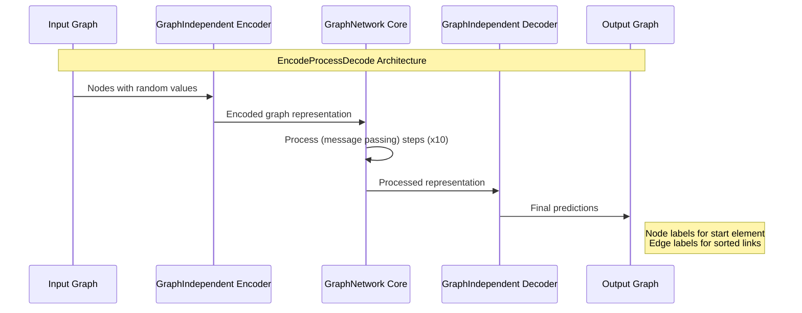

<!-- source: DeepWiki mcp.deepwiki.com · repo google-deepmind/graph_nets · page 5.2 Sort Demo · fetched 2026-10-26 -->

# Sort Demo

<details>
<summary>Relevant source files</summary>

The following files were used as context for generating this wiki page:

- [graph_nets/demos/sort.ipynb](graph_nets/demos/sort.ipynb)

</details>


## Purpose and Overview

This page documents the Sort Demo of the Graph Nets library, which demonstrates how Graph Neural Networks can be used to learn to sort a list of elements. The demo represents a list of numbers as a fully connected graph and trains a model to predict a linked list structure that represents the sorted order.

For information about other demos, see [Shortest Path Demo](#5.1) or [Physics Demo](#5.3). For details on the Encode-Process-Decode architecture used in this demo, see the [EncodeProcessDecode Architecture](#6.1) page.

Sources: [graph_nets/demos/sort.ipynb:37-50]()

## Problem Representation

The Sort Demo frames list sorting as a graph learning problem:

1. A list of random elements (values between 0 and 1) forms the input
2. Each element is represented as a node in a fully connected graph
3. The target output is a graph with:
   - A node label indicating the smallest element (start of the sorted list)
   - Edge labels indicating which element follows which in the sorted order

This representation transforms sorting from a sequential task into a graph structure prediction task.

```mermaid
flowchart LR
    subgraph "Input Graph (Unsorted List)"
        direction LR
        N1["Node 1\n(0.7)"]
        N2["Node 2\n(0.2)"]
        N3["Node 3\n(0.5)"]
        N4["Node 4\n(0.9)"]
        
        N1 --- N2
        N1 --- N3
        N1 --- N4
        N2 --- N3
        N2 --- N4
        N3 --- N4
    end
    
    subgraph "Output Graph (Sorted Linked List)"
        direction LR
        O2["Node 2\n(0.2)\nStart"]
        O3["Node 3\n(0.5)"]
        O1["Node 1\n(0.7)"]
        O4["Node 4\n(0.9)"]
        
        O2 --"Next"--> O3
        O3 --"Next"--> O1
        O1 --"Next"--> O4
    end
    
    Input["create_data_ops()"] --> "Input Graph (Unsorted List)"
    "Input Graph (Unsorted List)" --> Model["EncodeProcessDecode Model"]
    Model --> "Output Graph (Sorted Linked List)"
```

Sources: [graph_nets/demos/sort.ipynb:161-193](), [graph_nets/demos/sort.ipynb:285-303]()

## Data Generation

The demo generates random lists of elements for training and evaluation:

1. Each list contains a random number of elements within a specified range
2. Elements are random float values between 0 and 1
3. Training data uses smaller lists (8-16 elements)
4. Generalization testing uses larger lists (16-32 elements)

The system creates three main data structures:
- `inputs_op`: The graph with node features containing the random values
- `targets_op`: The target graph with labeled nodes and edges representing the sorted order
- `sort_indices_op`: Contains the sorting indices for evaluation

```mermaid
flowchart TD
    subgraph "Data Generation"
        createGraphs["create_graph_dicts_tf()"]
        fullyConnect["utils_tf.fully_connect_graph_dynamic()"]
        createTargets["create_linked_list_target()"]
        
        createGraphs --> |"inputs_op\nsort_indices_op\nranks_op"| fullyConnect
        fullyConnect --> |"fully connected graphs"| createTargets
        createTargets --> |"targets with softmax labels"| finalTargets["targets_op"]
    end
    
    subgraph "Target Structure"
        Nodes["Nodes:\n[1, 0] for start node\n[0, 1] for others"]
        Edges["Edges:\n[1, 0] for links in sorted list\n[0, 1] for other edges"]
    end
    
    "Data Generation" --> "Target Structure"
```

Sources: [graph_nets/demos/sort.ipynb:161-193](), [graph_nets/demos/sort.ipynb:285-303]()

## Model Architecture

The Sort Demo uses the Encode-Process-Decode architecture provided by the Graph Nets library:



Components:
- **Encoder**: Independently transforms node, edge, and global features
- **Core**: Performs multiple rounds of message passing with shared weights
- **Decoder**: Transforms the processed features into final predictions

The model is implemented using the `EncodeProcessDecode` class from the models module, configured to output 2-dimensional vectors for both nodes and edges to represent binary classification.

Sources: [graph_nets/demos/sort.ipynb:426-455](), [graph_nets/demos/sort.ipynb:499]()

## Message Passing Process

The central computation happens in the Core through message passing. During processing:

```mermaid
flowchart LR
    subgraph "Message Passing in Core"
        direction LR
        E["Edge Updates"]
        N["Node Updates"]
        G["Global Updates"]
        
        E -->|"Aggregate to nodes"| N
        E -->|"Aggregate to globals"| G
        N -->|"Aggregate to globals"| G
        G -->|"Broadcast to nodes"| N
        G -->|"Broadcast to edges"| E
        N -->|"Broadcast to edges"| E
    end
    
    subgraph "For Sorting Problem"
        direction TB
        Compare["Compare values between nodes"]
        Identify["Identify ordering relationships"]
        Integrate["Integrate global context"]
        Output["Output sorted linked list structure"]
        
        Compare --> Identify
        Identify --> Integrate
        Integrate --> Output
    end
    
    "Message Passing in Core" --- "For Sorting Problem"
```

Through multiple rounds of message passing:
1. Nodes exchange information about their values
2. The network learns to identify ordering relationships
3. Global features help coordinate the overall sorting process
4. The final output identifies the start node and the chain of "next" relationships

Sources: [graph_nets/demos/sort.ipynb:426-455]()

## Loss Computation

The training uses softmax cross-entropy loss computed on both node and edge predictions:

1. Node loss: Binary classification of whether a node is the start of the sorted list
2. Edge loss: Binary classification of whether an edge represents a "next" link in the sorted list
3. The combined loss is computed for each processing step
4. The final training loss is the average across all processing steps

Loss computation:
```
loss = tf.losses.softmax_cross_entropy(target_op.nodes, output_op.nodes) +
       tf.losses.softmax_cross_entropy(target_op.edges, output_op.edges)
```

The use of loss at each processing step encourages the model to solve the problem in as few steps as possible and makes intermediate results more interpretable.

Sources: [graph_nets/demos/sort.ipynb:319-327](), [graph_nets/demos/sort.ipynb:505-508]()

## Training and Evaluation

The demo uses the following training approach:

- **Training parameters**:
  - Training on lists with 8-16 elements
  - Batch size of 32
  - 10 processing steps
  - Adam optimizer with learning rate 1e-3
  - 10,000 training iterations

- **Evaluation metrics**:
  - Fraction of correctly labeled nodes and edges
  - Fraction of completely solved examples (100% correct)
  - Generalization performance on larger lists (16-32 elements)

```mermaid
flowchart TD
    subgraph "Training Loop"
        Create["Create data batch"]
        Forward["Forward pass"]
        Loss["Compute loss"]
        Backprop["Backpropagation"]
        Update["Update weights"]
        
        Create --> Forward --> Loss --> Backprop --> Update
    end
    
    subgraph "Evaluation"
        TrainingMetrics["Training metrics:<br>- Loss<br>- Accuracy<br>- Solved percentage"]
        GeneralizationMetrics["Generalization metrics:<br>- Loss<br>- Accuracy<br>- Solved percentage"]
    end
    
    "Training Loop" --> "Evaluation"
```

After around 2000-5000 training iterations, the model typically reaches near-perfect performance on the training distribution and demonstrates the ability to generalize to larger lists.

Sources: [graph_nets/demos/sort.ipynb:470-519](), [graph_nets/demos/sort.ipynb:567-618]()

## Visualization

The demo provides visualizations to understand model behavior:

1. **Input visualization**: Bar charts showing the input values
2. **Sorted visualization**: Bar charts showing the sorted values
3. **Link matrix visualization**: Matrix plots showing element-to-element links:
   - Rows represent elements in sorted order
   - Columns show which element they link to
   - A correct sorting shows a diagonal pattern offset by one

```mermaid
flowchart LR
    subgraph "Visualization Types"
        Inputs["Input Values<br>(Bar Chart)"]
        Sorted["Sorted Values<br>(Bar Chart)"]
        Links["Element-to-Element Links<br>(Matrix Plot)"]
    end
    
    subgraph "Link Matrix Interpretation"
        GT["Ground Truth:<br>Diagonal offset by 1"]
        Pred["Prediction:<br>Should match GT pattern"]
    end
    
    "Visualization Types" --> "Link Matrix Interpretation"
```

The link matrix is particularly important as it provides an intuitive way to verify if the model has correctly learned the sorting relationships.

Sources: [graph_nets/demos/sort.ipynb:357-409](), [graph_nets/demos/sort.ipynb:630-693]()

## Computational Functions

This section summarizes the key functions in the Sort Demo:

| Function | Purpose |
|----------|---------|
| `create_graph_dicts_tf()` | Generates input graphs with random values and their sort indices |
| `create_linked_list_target()` | Creates target graphs with labeled nodes and edges representing the sorted linked list |
| `create_data_ops()` | Combines graph creation and connectivity to produce the complete dataset |
| `compute_accuracy()` | Calculates the fraction of correctly labeled nodes/edges and completely solved examples |
| `create_loss_ops()` | Creates operations to compute the loss at each processing step |
| `plot_linked_list()` | Visualizes the element-to-element links as a matrix |

Sources: [graph_nets/demos/sort.ipynb:161-193](), [graph_nets/demos/sort.ipynb:196-227](), [graph_nets/demos/sort.ipynb:272-303](), [graph_nets/demos/sort.ipynb:231-270](), [graph_nets/demos/sort.ipynb:319-327](), [graph_nets/demos/sort.ipynb:334-344]()

## Key Insights

The Sort Demo demonstrates several important concepts:

1. **Graph Representation of Sorting**: Converting a sequential sorting problem into a graph prediction task
2. **Message Passing for Comparisons**: Using message passing to enable nodes to compare values and determine ordering
3. **Emergent Properties**: The model learns to construct a linked list structure without explicit programming of the sorting algorithm
4. **Generalization**: The model generalizes to larger lists than those seen during training

The demo showcases how Graph Neural Networks can learn to solve algorithmic problems by operating on appropriate graph structures.

Sources: [graph_nets/demos/sort.ipynb:37-50](), [graph_nets/demos/sort.ipynb:426-455](), [graph_nets/demos/sort.ipynb:470-482]()

---

