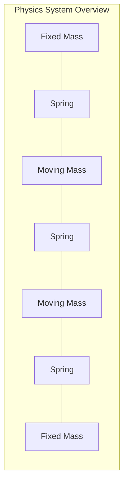
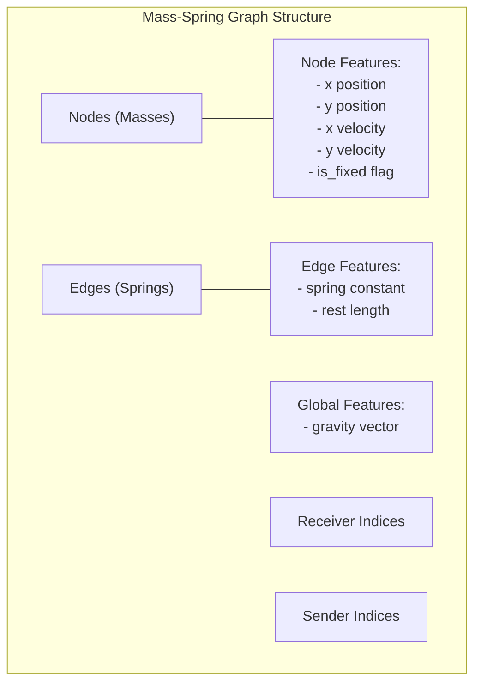
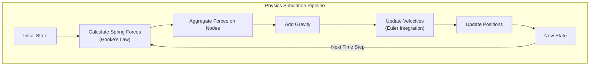
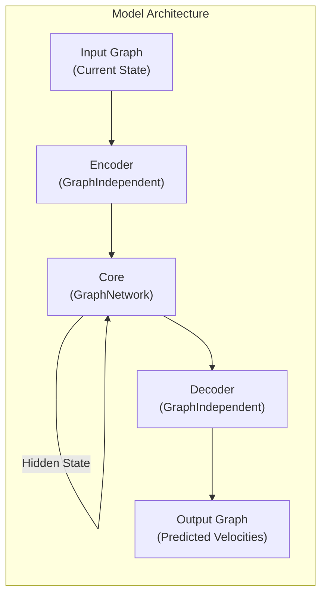
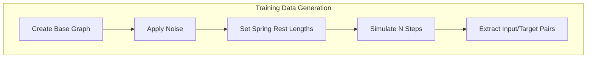
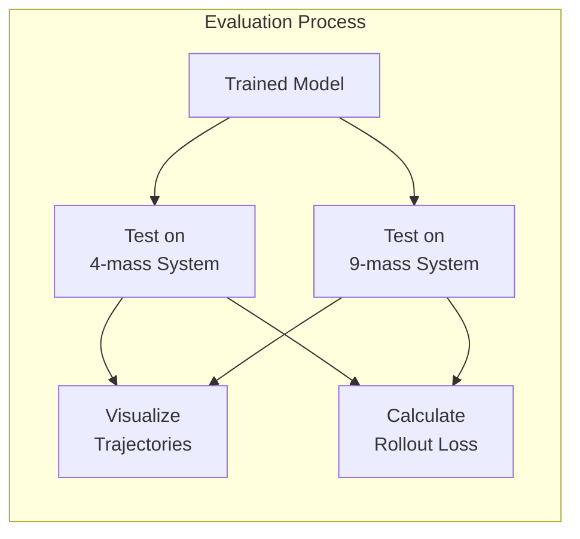

<!-- source: DeepWiki mcp.deepwiki.com · repo google-deepmind/graph_nets · page 5.3 Physics Demo · fetched 2026-10-26 -->

# Physics Demo

<details>
<summary>Relevant source files</summary>

The following files were used as context for generating this wiki page:

- [graph_nets/demos/physics.ipynb](graph_nets/demos/physics.ipynb)

</details>


## Introduction and Purpose

This document details the Physics Demo included in the Graph Nets library, which demonstrates how a graph neural network can learn to predict the physical dynamics of a mass-spring system. The demo shows how the library can be used to model physical simulations where objects interact according to physical laws, specifically focusing on chains of masses connected by springs under the influence of gravity.

The main goal of this demo is to show how Graph Neural Networks can:
1. Learn physical dynamics from simulated examples
2. Generalize this knowledge to similar but previously unseen configurations
3. Make accurate predictions of future system states

Sources: [graph_nets/demos/physics.ipynb:37-44]()

## System Overview

The physics demo simulates chains of masses connected by springs, with the following characteristics:
- Masses are connected in a linear chain-like structure
- The first and last masses are fixed in place
- Internal masses are subject to gravitational force
- All springs have specific spring constants and rest lengths
- The system follows Hooke's law and basic Newtonian physics



Sources: [graph_nets/demos/physics.ipynb:162-177]()

## Graph Representation

The mass-spring system is represented as a graph with the following components:



### Nodes (Masses)
Each node represents a mass with a 5-dimensional feature vector:
- Position coordinates (x, y)
- Velocity components (v_x, v_y)
- Fixed indicator (1 if fixed, 0 if movable)

### Edges (Springs)
Each edge represents a spring with a 2-dimensional feature vector:
- Spring constant (k)
- Rest length

### Global Attributes
Contains a 2-dimensional vector with:
- x-component of gravity (typically 0)
- y-component of gravity (typically -10)

### Connectivity
Senders and receivers arrays define the connectivity between masses, creating the spring structure.

Sources: [graph_nets/demos/physics.ipynb:162-213](), [graph_nets/demos/physics.ipynb:178-207]()

## Physics Simulation

The physics is simulated using two key physical laws:

### Hooke's Law
Springs exert forces proportional to their displacement from rest length:
```
F = -k * (|x| - rest_length) * (x / |x|)
```
Where:
- k is the spring constant
- x is the displacement vector between connected masses
- rest_length is the natural length of the spring

### Euler Integration
Simple numerical integration updates velocities and positions over time:
- Forces determine acceleration
- Acceleration updates velocity
- Velocity updates position



The `SpringMassSimulator` class implements this physics using Graph Nets blocks, particularly:
- ReceivedEdgesToNodesAggregator to sum forces on nodes
- Broadcast operations to distribute global attributes (gravity)

Sources: [graph_nets/demos/physics.ipynb:216-297](), [graph_nets/demos/physics.ipynb:256-297]()

## Neural Network Model

### Encode-Process-Decode Architecture

The model uses the Encode-Process-Decode architecture common in Graph Nets applications:



1. **Encoder**: Independently encodes node, edge, and global attributes
2. **Core**: Performs message-passing steps between graph components  
3. **Decoder**: Decodes attributes to produce predicted velocities

The model is trained to predict the next-step velocities of masses given their current state.

Sources: [graph_nets/demos/physics.ipynb:486-516]()

## Training Process

### Data Generation

Training data is generated using these steps:
1. Create base graph structures with different numbers of masses (5-9)
2. Apply noise to initial positions, spring constants, and gravity
3. Simulate the system using a true physics simulator
4. Use the states at time t as inputs and states at t+1 as targets



### Training Approach

The model is trained with supervised learning:
- Input: Graph representing current state of the system
- Target: Velocities at the next time step
- Loss: Mean squared error between predicted and target velocities
- The model is trained on systems with 5-9 masses

### Generalization Testing

After training, the model is tested for generalization:
- Tested on 4-mass systems (smaller than training examples)
- Tested on 9-mass systems (at the upper bound of training examples)
- Performance is measured by rollout loss over 50 timesteps

Sources: [graph_nets/demos/physics.ipynb:532-549](), [graph_nets/demos/physics.ipynb:554-637]()

## Key Implementation Components

### Main Functions

1. **base_graph**: Creates initial graph structure for a chain of masses
2. **hookes_law**: Implements Hooke's law for spring forces
3. **euler_integration**: Implements Euler integration for position/velocity updates
4. **SpringMassSimulator**: Class implementing physical simulation
5. **generate_trajectory**: Generates training/testing trajectories with noise
6. **roll_out_physics**: Simulates system evolution over multiple timesteps
7. **create_loss_ops**: Creates loss operations between targets and predictions

### Parameter Configuration

The demo uses these key parameters:
- Training iterations: 100,000
- Batch size: 256 (training), 100 (testing)
- Processing steps: 1 (both training and testing)
- Learning rate: 0.001
- Time steps for rollout: 50
- Integration step size: 0.1

Sources: [graph_nets/demos/physics.ipynb:159-470](), [graph_nets/demos/physics.ipynb:537-546]()

## Visualization and Evaluation

The demo includes visualization capabilities:
1. Loss curves for:
   - Next-step prediction loss
   - Rollout loss for 4-mass systems
   - Rollout loss for 9-mass systems
2. Trajectory visualization:
   - Side-by-side comparison of predicted vs. actual systems
   - Position coordinate plots over time

These visualizations help verify that the learned model accurately captures physical dynamics and generalizes to new configurations.



Sources: [graph_nets/demos/physics.ipynb:749-865]()

## Conclusion

The Physics Demo effectively showcases how Graph Neural Networks can:
1. Learn complex physical dynamics from examples
2. Encode physical laws through message-passing on graphs
3. Generalize to new system configurations
4. Make accurate multi-step predictions

This demonstrates the Graph Nets library's capability for modeling physical systems and potentially other domains with similar relational structures and dynamics.

Sources: [graph_nets/demos/physics.ipynb:37-44]()

---

