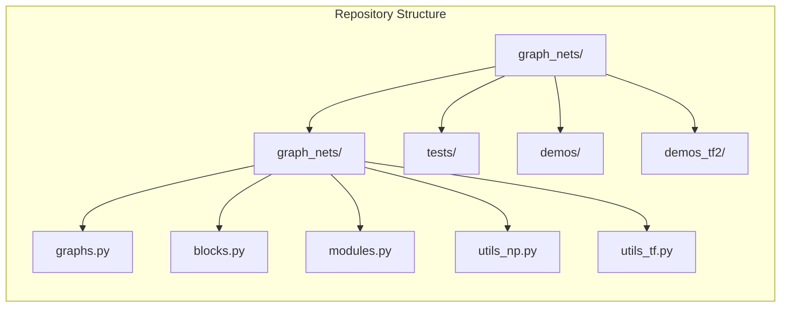
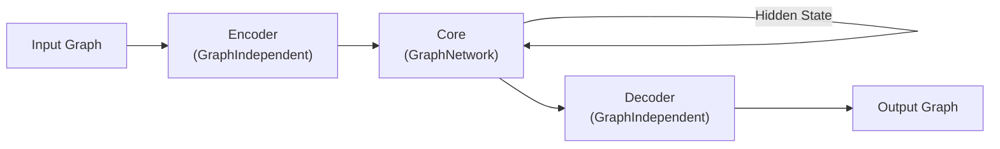
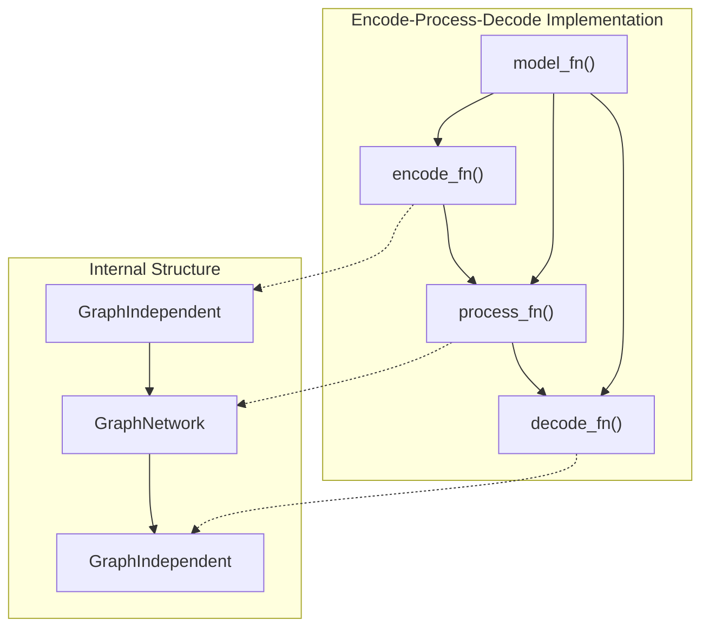
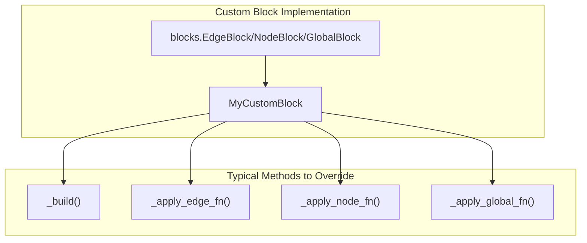
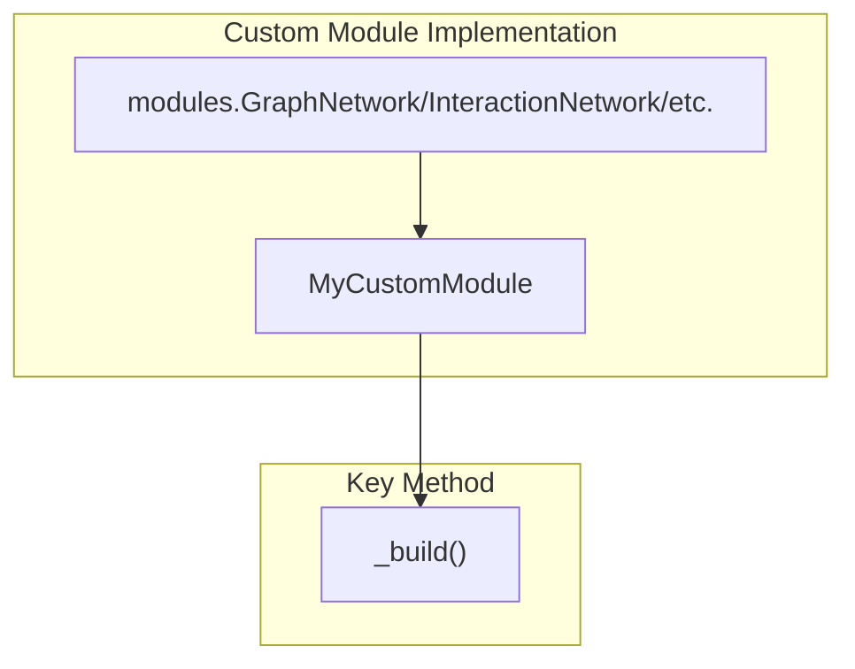
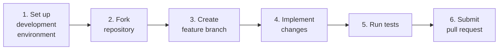

<!-- source: DeepWiki mcp.deepwiki.com · repo google-deepmind/graph_nets · page 6 Developer Guide · fetched 2026-10-26 -->

# Developer Guide

<details>
<summary>Relevant source files</summary>

The following files were used as context for generating this wiki page:

- [CONTRIBUTING.md](CONTRIBUTING.md)
- [LICENSE](LICENSE)
- [README.md](README.md)

</details>


This Developer Guide provides essential information for developers looking to use, extend, or contribute to the Graph Nets library. It covers the core development patterns, architectural approaches, testing infrastructure, and contribution guidelines. For information about the core data structures, see [GraphsTuple](#2), and for a high-level overview of the library, see [Overview](#1).

## Development Environment Setup

To begin development with the Graph Nets library, first install the required dependencies. The library supports both TensorFlow 1.x and 2.x environments.

### For TensorFlow 1.x Development

```bash
pip install graph_nets "tensorflow>=1.15,<2" "dm-sonnet<2" "tensorflow_probability<0.9"
pip install jupyter matplotlib scipy  # For demos
```

### For TensorFlow 2.x Development

```bash
pip install graph_nets "tensorflow>=2.1.0-rc1" "dm-sonnet>=2.0.0b0" tensorflow_probability
pip install jupyter matplotlib scipy  # For demos
```

Sources: [README.md:22-54]()

## Code Organization

Understanding the repository structure is essential for effective development. The Graph Nets library follows a modular design with clear separation of concerns.



**Key Components:**
- `graphs.py`: Contains the core `GraphsTuple` data structure
- `blocks.py`: Implements the fundamental building blocks (EdgeBlock, NodeBlock, GlobalBlock)
- `modules.py`: Higher-level graph network modules
- `utils_np.py`: NumPy utility functions for graph manipulation
- `utils_tf.py`: TensorFlow utility functions for graph manipulation
- `demos/`: Example implementations using TensorFlow 1.x
- `demos_tf2/`: Example implementations using TensorFlow 2.x
- `tests/`: Unit and integration tests

Sources: [README.md:3-8]()

## Encode-Process-Decode Architecture

The Graph Nets library demos use a common architectural pattern called Encode-Process-Decode, which is a powerful approach for working with graph-structured data.

### Architecture Overview



This architecture consists of three main stages:
1. **Encoder**: Transforms input features into latent representations (typically using `GraphIndependent`)
2. **Processor**: Performs message passing between graph elements (typically using `GraphNetwork`)
3. **Decoder**: Transforms processed features into output features (typically using `GraphIndependent`)

Sources: [README.md:79-85]()

### Implementation Pattern

The following pattern is common across the demo implementations:



Typically, you would implement three functions:
- `encode_fn`: Creates a `GraphIndependent` module to encode input features
- `process_fn`: Creates a `GraphNetwork` module for message passing
- `decode_fn`: Creates a `GraphIndependent` module to produce output features

These are then combined in a `model_fn` that connects them in sequence.

Sources: [README.md:86-101](), [README.md:106-114](), [README.md:118-126]()

## Testing Framework

The Graph Nets library includes a comprehensive testing framework to ensure the correctness of its implementations.

### Running Tests

To run the test suite:

```bash
cd <path-to-graph-nets-library>
python -m unittest discover
```

### Test Structure

Tests are organized to match the structure of the library, with specific test files for each component:

| Test File | Tested Component |
|-----------|------------------|
| `test_graphs.py` | Core `GraphsTuple` data structure |
| `test_blocks.py` | EdgeBlock, NodeBlock, GlobalBlock |
| `test_modules.py` | Graph network modules |
| `test_utils_np.py` | NumPy utilities |
| `test_utils_tf.py` | TensorFlow utilities |

### Testing Custom Extensions

When extending the library with custom components, follow these guidelines:

1. Create test cases that inherit from appropriate base classes
2. Test with various graph shapes and sizes
3. Test both NumPy and TensorFlow implementations
4. Verify graph transformations maintain the correct structure
5. Check that gradients flow as expected for TensorFlow implementations

## Custom Extensions

Developers can extend the Graph Nets library by implementing custom components.

### Creating Custom Blocks



When creating custom blocks, typically you'll inherit from one of the base block classes and override its methods to implement your specific behavior.

### Creating Custom Modules

Similarly, you can create custom modules by inheriting from existing module classes or implementing the required interfaces.



## Contributing Guidelines

Contributions to the Graph Nets library are welcome. Here's how to contribute effectively:

### Licensing

The Graph Nets library is licensed under the Apache License 2.0. All contributions must be compatible with this license.

Sources: [LICENSE:1-204]()

### Contributor License Agreements

Before contributing, you must sign a Contributor License Agreement (CLA):
- Individual CLA: For individuals who own the intellectual property
- Corporate CLA: For company employees contributing on behalf of their company

Sources: [CONTRIBUTING.md:5-25]()

### Contribution Workflow



1. Set up your development environment
2. Fork the repository
3. Create a feature branch
4. Implement your changes
5. Run tests to ensure everything works
6. Submit a pull request with a clear description of your changes

Sources: [CONTRIBUTING.md:27-32]()

## Best Practices

### Performance Optimization

When working with large graphs:

1. Use batched processing when possible
2. Consider padding graphs to uniform sizes for better parallelization
3. Profile your code to identify bottlenecks
4. For TensorFlow implementations, use `tf.function` decorators for better performance (TF2)

### Common Patterns

The following table summarizes common development patterns in the Graph Nets library:

| Pattern | Usage | Example |
|---------|-------|---------|
| Independent Processing | Update graph components without message passing | `GraphIndependent` |
| Message Passing | Share information between graph components | `GraphNetwork` |
| Aggregation | Combine features from multiple graph elements | `broadcast_*`, `*_aggregator` functions |
| Graph Manipulation | Convert between different graph representations | `graphs_tuple_to_networkxs`, `data_dicts_to_graphs_tuple` |

By following these patterns, you can extend the library while maintaining consistency with the existing codebase.

---

