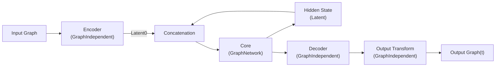
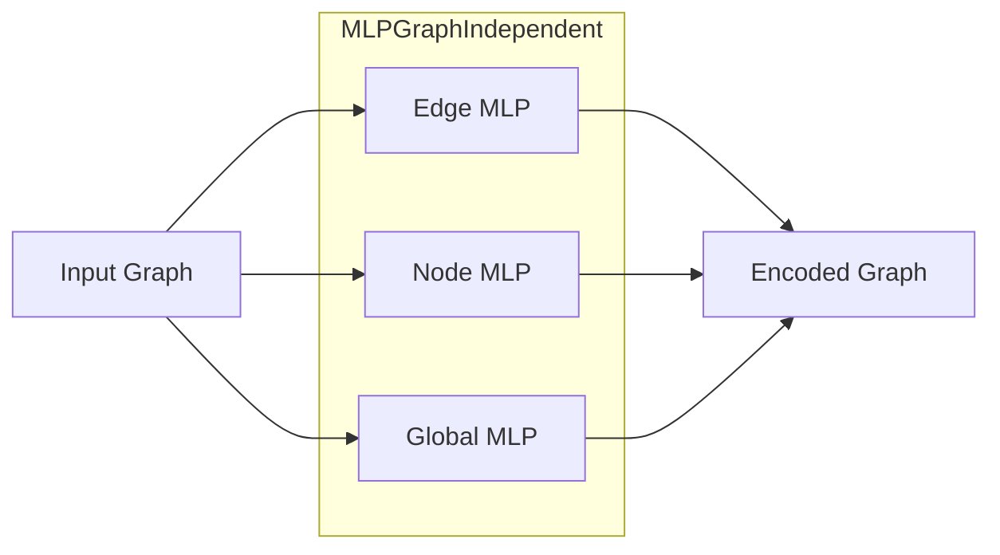
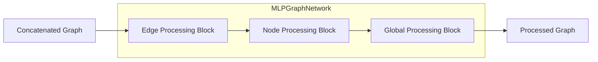
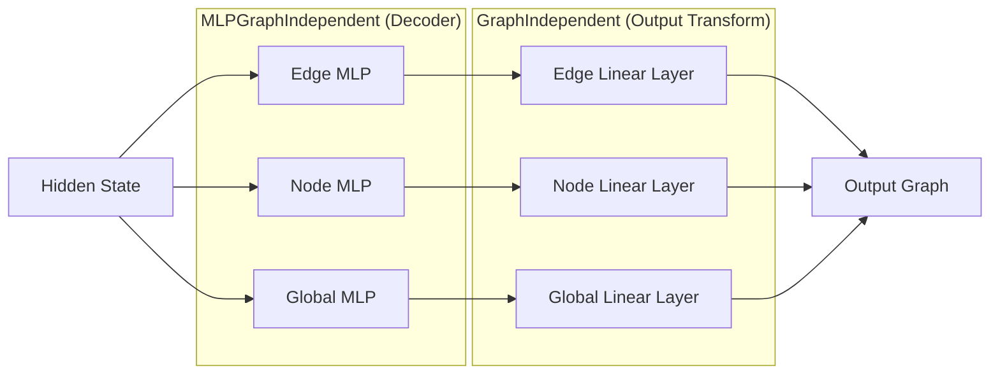
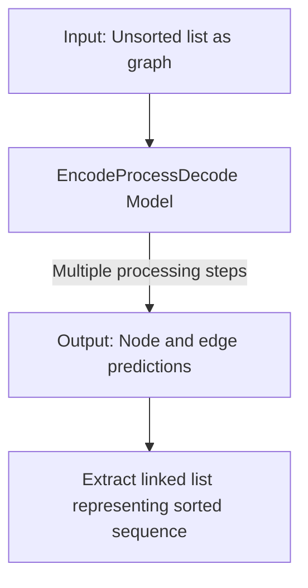

<!-- source: DeepWiki mcp.deepwiki.com · repo google-deepmind/graph_nets · page 6.1 EncodeProcessDecode Architecture · fetched 2026-10-26 -->

# EncodeProcessDecode Architecture

<details>
<summary>Relevant source files</summary>

The following files were used as context for generating this wiki page:

- [docs/index.md](docs/index.md)
- [graph_nets/__init__.py](graph_nets/__init__.py)
- [graph_nets/demos/__init__.py](graph_nets/demos/__init__.py)
- [graph_nets/demos/models.py](graph_nets/demos/models.py)
- [graph_nets/demos/sort.ipynb](graph_nets/demos/sort.ipynb)
- [graph_nets/demos_tf2/models.py](graph_nets/demos_tf2/models.py)

</details>


## Purpose and Scope

This document describes the EncodeProcessDecode architecture used throughout the graph_nets demos. This architecture provides a powerful and flexible approach for processing graph-structured data through a sequence of encoding, iterative message-passing, and decoding steps. The EncodeProcessDecode model is specifically designed to learn complex graph transformations by iteratively refining graph representations.

## Architecture Overview

The EncodeProcessDecode architecture consists of three main components that work together to process graph data:



The architecture follows this processing flow:
1. The **Encoder** independently processes the input graph's nodes, edges, and global features
2. The processed graph is used as both the initial hidden state and part of the input to the Core
3. The **Core** performs message-passing steps, taking the concatenation of the initial encoding and current hidden state
4. The **Decoder** converts the hidden representation into the desired output format
5. Steps 3-4 are repeated for a specified number of processing iterations

Sources: [graph_nets/demos/models.py:72-131](), [graph_nets/demos_tf2/models.py:72-130]()

## Component Details

### 1. Encoder



The Encoder is implemented as an `MLPGraphIndependent` module that independently processes each component of the graph:
- **Edge features**: processed by MLP + LayerNorm
- **Node features**: processed by MLP + LayerNorm
- **Global features**: processed by MLP + LayerNorm

No message-passing occurs in this stage - each component is processed independently.

Sources: [graph_nets/demos/models.py:44-56](), [graph_nets/demos_tf2/models.py:46-58]()

### 2. Core



The Core is implemented as an `MLPGraphNetwork` that performs full message-passing between all graph components:
- Takes the concatenation of the initial encoded graph and the current hidden state
- Performs edge-to-node, node-to-global, and edge-to-global message passing
- Updates the hidden state representation
- Each block (edge, node, global) uses MLP + LayerNorm

Sources: [graph_nets/demos/models.py:59-69](), [graph_nets/demos_tf2/models.py:60-70]()

### 3. Decoder and Output Transform



The Decoder consists of two stages:
1. **Decoder**: An `MLPGraphIndependent` that independently processes the hidden state 
2. **Output Transform**: A `GraphIndependent` with linear transformations that project to the desired output dimensions

The output transform is configured with target sizes for edge, node, and global features based on the task requirements.

Sources: [graph_nets/demos/models.py:104-120](), [graph_nets/demos_tf2/models.py:103-119]()

## Implementation Details

The EncodeProcessDecode model is implemented as a class that takes configuration parameters for the output sizes:

```python
def __init__(self,
             edge_output_size=None,
             node_output_size=None,
             global_output_size=None,
             name="EncodeProcessDecode"):
```

The model's core processing logic is contained in the `__call__` (TF2) or `_build` (TF1) method:

```python
def _build(self, input_op, num_processing_steps):
  latent = self._encoder(input_op)
  latent0 = latent
  output_ops = []
  for _ in range(num_processing_steps):
    core_input = utils_tf.concat([latent0, latent], axis=1)
    latent = self._core(core_input)
    decoded_op = self._decoder(latent)
    output_ops.append(self._output_transform(decoded_op))
  return output_ops
```

Key implementation notes:
- The model stores the initial encoded graph (`latent0`) to reuse in each processing step
- It performs `num_processing_steps` iterations of the Core processing
- Each step produces an output, collected in `output_ops`
- The model returns all intermediate outputs, enabling supervision at each step

Sources: [graph_nets/demos/models.py:121-130](), [graph_nets/demos_tf2/models.py:120-129]()

## Usage in Demos

The EncodeProcessDecode architecture is used in multiple demos, including the sorting demo:



In the sort demo:
1. A list of elements is represented as a fully connected graph with values as node features
2. The model is initialized with edge and node output sizes of 2 (for binary classification)
3. The model processes the graph through multiple steps (typically 10)
4. The model is trained to predict:
   - Which node is the start of the sorted list
   - Which edges represent the "next larger element" connections between nodes
5. Loss is computed at each processing step to encourage efficient solutions

Sources: [graph_nets/demos/sort.ipynb:423-455](), [graph_nets/demos/sort.ipynb:497-508]()

## Common Parameters and Constants

| Parameter | Default Value | Description |
|-----------|--------------|-------------|
| `NUM_LAYERS` | 2 | Number of layers in edge/node/global MLPs |
| `LATENT_SIZE` | 16 | Size of latent layers in MLPs |
| `num_processing_steps_tr` | 10 | Number of processing steps during training |
| `num_processing_steps_ge` | 10 | Number of processing steps during evaluation |

Sources: [graph_nets/demos/models.py:25-26](), [graph_nets/demos_tf2/models.py:27-28](), [graph_nets/demos/sort.ipynb:473-475]()

## Benefits of the Architecture

The EncodeProcessDecode architecture offers several advantages:

1. **Iterative refinement** - The model can progressively improve its predictions through multiple processing steps
2. **Supervision at every step** - Training can occur on intermediate outputs, encouraging faster convergence
3. **Flexible input/output sizes** - The architecture adapts to different input and output feature dimensions
4. **Shared weights** - The Core module reuses the same weights across all processing steps
5. **Generalization** - Models trained with this architecture can generalize to graphs larger than those seen during training

Sources: [graph_nets/demos/sort.ipynb:423-466]()

---

