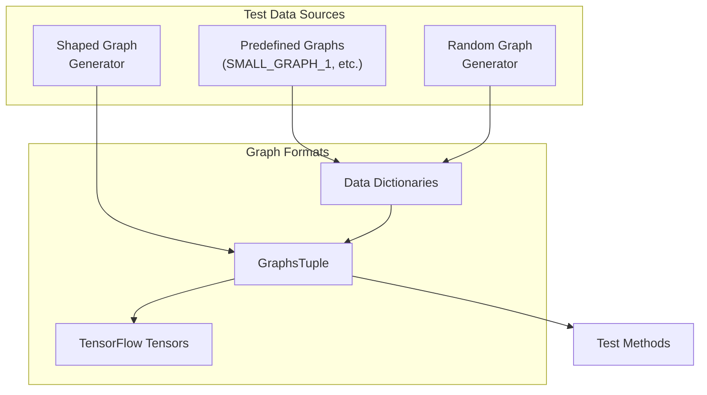
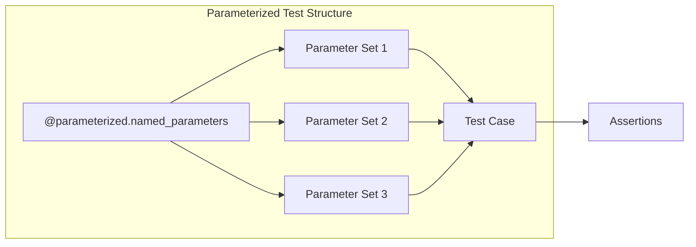
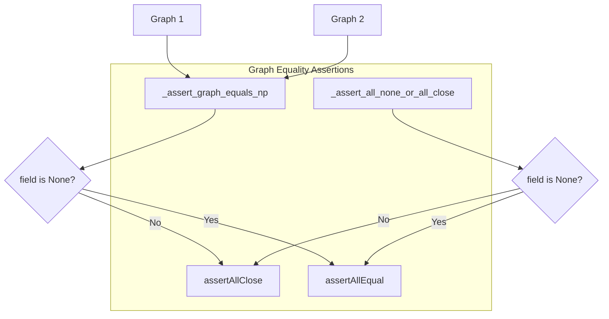
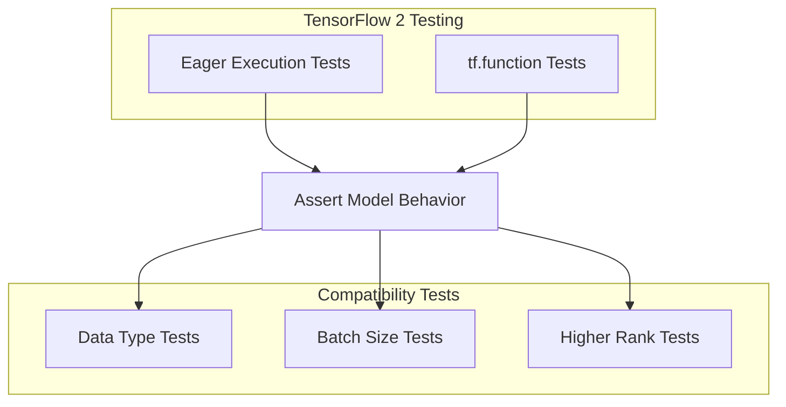
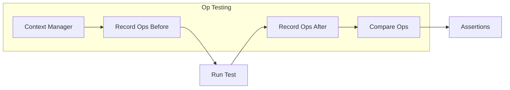
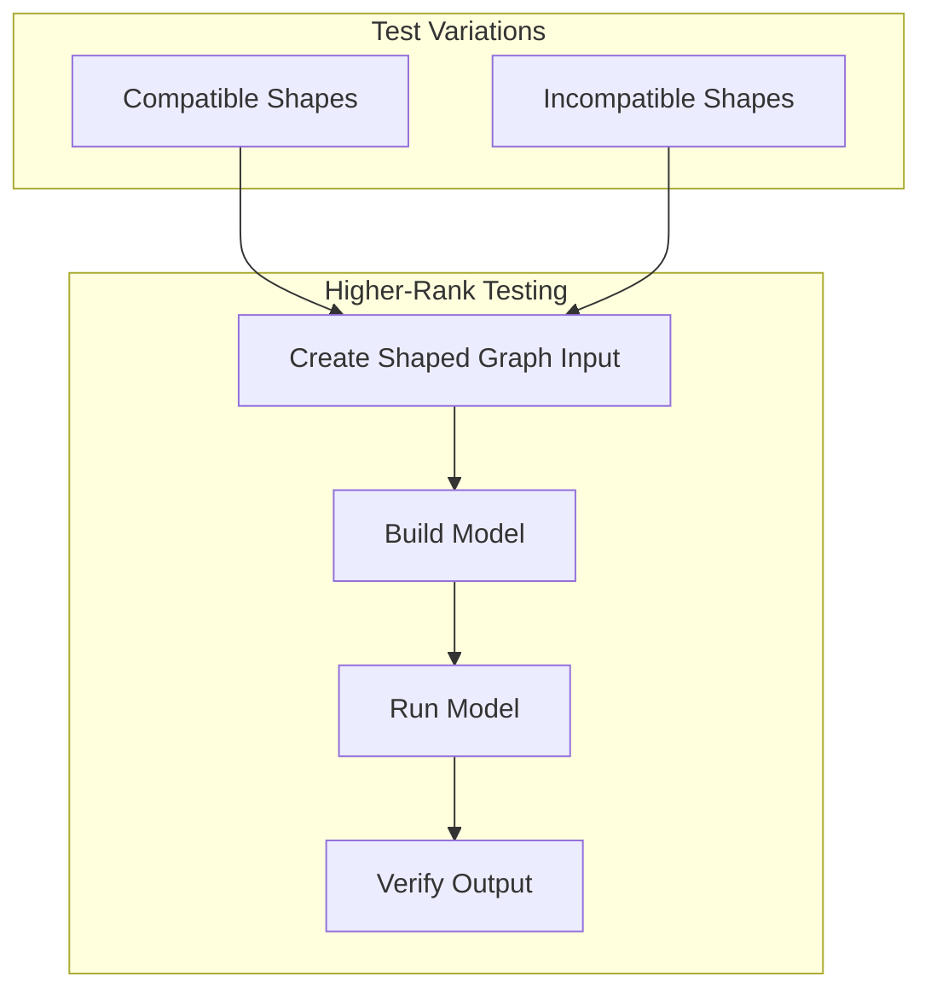
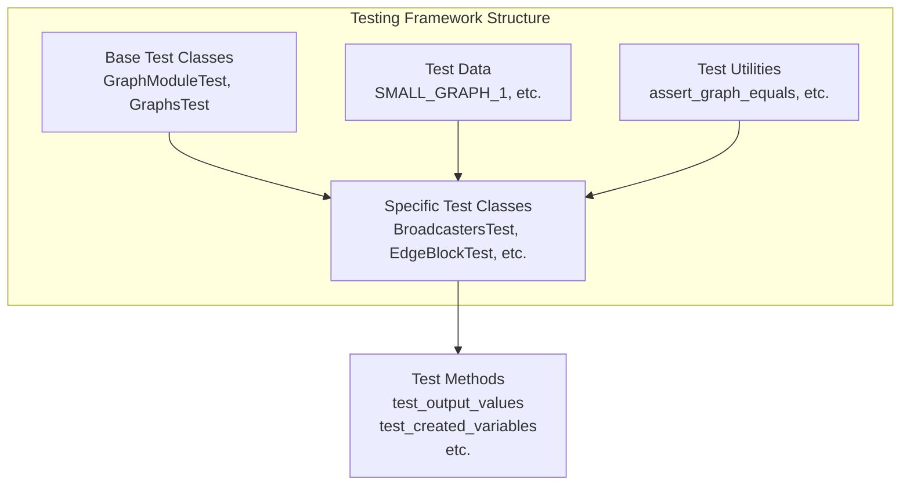

<!-- source: DeepWiki mcp.deepwiki.com · repo google-deepmind/graph_nets · page 6.2 Testing Framework · fetched 2026-10-26 -->

# Testing Framework

<details>
<summary>Relevant source files</summary>

The following files were used as context for generating this wiki page:

- [graph_nets/tests/test_utils.py](graph_nets/tests/test_utils.py)
- [graph_nets/tests_tf2/blocks_test.py](graph_nets/tests_tf2/blocks_test.py)
- [graph_nets/tests_tf2/modules_test.py](graph_nets/tests_tf2/modules_test.py)

</details>


This document describes the testing framework used in the Graph Nets library. It covers the base test classes, test data generation, assertion utilities, and testing patterns employed throughout the codebase to ensure functionality and correctness.

## Overview

The Graph Nets library uses a comprehensive testing framework built on top of TensorFlow's testing utilities and the `absl` testing library. Tests are organized into two main categories:
- TensorFlow 2 compatibility tests (in `tests_tf2/`)
- General functionality tests (in `tests/`)

The framework provides a structured way to test both individual components like blocks (edge, node, and global blocks) and higher-level modules (GraphNetwork, InteractionNetwork, etc.) with a variety of inputs and configurations.

Sources: [graph_nets/tests_tf2/blocks_test.py:15-20](), [graph_nets/tests_tf2/modules_test.py:15-20](), [graph_nets/tests/test_utils.py:16-21]()

## Test Architecture

### Base Test Classes

The testing framework is built around several base test classes that provide common functionality for specific types of tests:

```mermaid
classDiagram
    class "tf.test.TestCase" {
        +setUp()
        +tearDown()
        +assertAllClose()
        +assertAllEqual()
        +...()
    }
    
    class "parameterized.TestCase" {
        +parameterized tests
    }
    
    class "GraphsTest" {
        +_populate_test_data()
        +_assert_graph_equals_np()
        +setUp()
    }
    
    class "GraphModuleTest" {
        +setUp()
        +_get_input_graph()
        +_get_shaped_input_graph()
        +_assert_build_and_run()
    }
    
    class "Specific Test Classes" {
        +test_*()
    }
    
    tf.test.TestCase <|-- GraphsTest
    tf.test.TestCase <|-- GraphModuleTest
    parameterized.TestCase <|-- GraphModuleTest
    GraphModuleTest <|-- Specific Test Classes
```

- **GraphsTest**: Base class for tests involving graph data structures, including data population and equality assertion methods.
- **GraphModuleTest**: Base class for testing graph neural network modules, with methods for creating input graphs and testing model building and execution.

Sources: [graph_nets/tests/test_utils.py:77-81](), [graph_nets/tests_tf2/blocks_test.py:69-98](), [graph_nets/tests_tf2/modules_test.py:70-112]()

### Test Data Structure

The test framework uses standardized test data in the form of small, predefined graphs and methods to generate more complex test cases:



Sources: [graph_nets/tests_tf2/blocks_test.py:36-67](), [graph_nets/tests_tf2/modules_test.py:37-67](), [graph_nets/tests/test_utils.py:50-65]()

## Testing Patterns

### Parameterized Testing

The library extensively uses parameterized testing to run the same test method with different configurations:



Example parameterized test patterns include:
- Testing different model configurations (e.g., with/without edge features)
- Testing different reducers (sum, max, mean)
- Testing with different input types (float32/float64, int32/int64)
- Testing error conditions with different missing fields

Sources: [graph_nets/tests_tf2/blocks_test.py:131-158](), [graph_nets/tests_tf2/modules_test.py:143-146]()

### Test Types and Patterns

The testing framework employs several common test patterns:

| Test Type | Purpose | Example Methods |
|-----------|---------|-----------------|
| Output Validation | Verify that functions produce expected outputs | `test_output_values`, `test_same_as_subblocks` |
| Model Building | Verify that models can be built with various inputs | `test_created_variables`, `test_compatible_higher_rank_no_raise` |
| Error Handling | Verify that functions fail appropriately | `test_missing_field_raises_exception`, `test_incompatible_higher_rank_inputs_raises` |
| Data Flow | Verify gradient flow works as expected | `test_gradient_flow` |
| Edge Cases | Verify behavior with unusual inputs | `test_no_input_raises_exception`, `test_unused_field_can_be_none` |

Sources: [graph_nets/tests_tf2/blocks_test.py:141-147](), [graph_nets/tests_tf2/blocks_test.py:362-489](), [graph_nets/tests_tf2/modules_test.py:219-242]()

## Test Utilities

### Graph Equality Assertions

The framework provides methods to assert equality between graphs, handling both structured data and tensor types:



Sources: [graph_nets/tests/test_utils.py:152-195](), [graph_nets/tests_tf2/modules_test.py:77-80]()

### Test Data Generation

The framework includes utilities for generating test data, including:

- `generate_random_data_dict`: Creates random graph data with specified shapes
- `_populate_test_data`: Populates test class with a batch of test graphs
- `_get_input_graph`: Creates input graphs for testing modules
- `_get_shaped_input_graph`: Creates higher-rank input graphs for testing with complex inputs

Sources: [graph_nets/tests/test_utils.py:50-65](), [graph_nets/tests/test_utils.py:80-151](), [graph_nets/tests_tf2/blocks_test.py:76-93]()

## TensorFlow-Specific Test Components

### TensorFlow 2 Compatibility

The library includes specific tests for TensorFlow 2 compatibility, ensuring that all components work correctly with TF2's eager execution and `tf.function` decorators:



Sources: [graph_nets/tests_tf2/blocks_test.py:1149-1169](), [graph_nets/tests_tf2/modules_test.py:219-242]()

### Context Managers for Op Testing

The framework includes utilities like `assert_new_op_prefixes` to test that TensorFlow operations are created with the expected name prefixes:



Sources: [graph_nets/tests/test_utils.py:36-47]()

## Testing Higher-Rank Features

The Graph Nets library supports inputs with higher-rank features (e.g., 3D or 4D tensors instead of vectors), and includes specific tests for this functionality:



Key test methods include:
- `test_compatible_higher_rank_no_raise`: Tests that models work with compatible higher-rank inputs
- `test_incompatible_higher_rank_inputs_raises`: Tests that appropriate errors are raised with incompatible shapes
- `test_output_values_larger_rank`: Tests output values with higher-rank inputs

Sources: [graph_nets/tests_tf2/blocks_test.py:489-546](), [graph_nets/tests_tf2/modules_test.py:633-698]()

## Common Test Cases

The test framework thoroughly tests all components for:

1. **Correct Outputs**: Output values match expected values
2. **Error Conditions**: Appropriate errors are raised when inputs are invalid
3. **Model Building**: Models are correctly constructed with different configurations
4. **Variable Creation**: Variables are created with expected names and shapes
5. **Optional Arguments**: Models correctly handle optional arguments and keyword arguments
6. **Data Types**: Functions work with different data types (float32/64, int32/64)
7. **Dynamic Batch Sizes**: Models handle variable batch sizes correctly
8. **Higher-Rank Features**: Models work with higher-dimensional features

Sources: [graph_nets/tests_tf2/blocks_test.py:380-409](), [graph_nets/tests_tf2/blocks_test.py:443-465](), [graph_nets/tests_tf2/modules_test.py:126-194]()

## Code Structure Overview



The testing framework provides a comprehensive structure for testing all aspects of the Graph Nets library, ensuring that components work correctly individually and together, with a variety of inputs and configurations.

Sources: [graph_nets/tests_tf2/blocks_test.py:69-98](), [graph_nets/tests_tf2/blocks_test.py:128-196](), [graph_nets/tests_tf2/blocks_test.py:362-593]()

---

