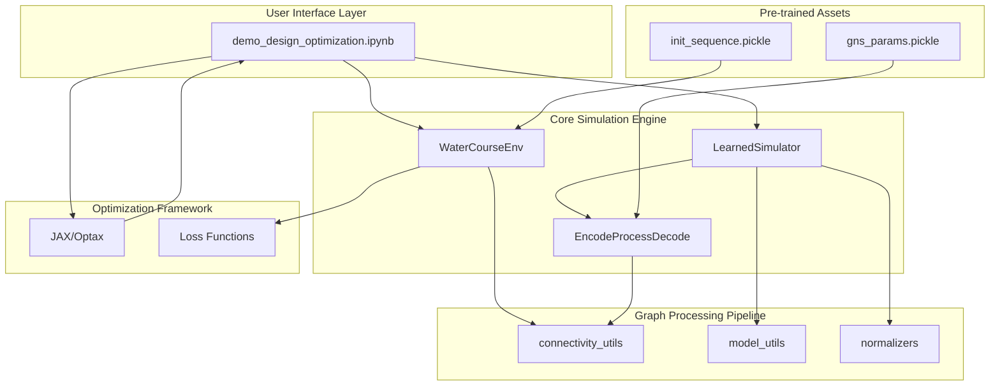

<!-- source: DeepWiki mcp.deepwiki.com · repo google-deepmind/inverse_design · page 1 Overview · fetched 2026-10-26 -->

# Overview

Relevant source files

The following files were used as context for generating this wiki page:

- [README.md](README.md)

This document provides an overview of the inverse design system for fluid-structure interactions using graph network simulators. The system enables gradient-based optimization of landscape designs to achieve desired water flow behaviors through differentiable physics simulation.

This page covers the system's purpose, architecture, and core components. For detailed installation instructions, see [Installation and Dependencies](#2.1). For hands-on usage examples, see [Demo Walkthrough](#2.2). For technical implementation details, see [Implementation Guide](#4).

## Purpose and Scope

The inverse design system solves the problem of automatically designing physical landscapes to control fluid flow patterns. Given a desired water flow behavior, the system optimizes landscape parameters through gradient-based methods using a learned physics simulator built on graph neural networks.

### Key Capabilities

| Capability | Description |
|------------|-------------|
| **Inverse Design** | Optimize landscape parameters to achieve target fluid behaviors |
| **Graph-based Physics** | Simulate particle dynamics using learned graph neural networks |
| **Differentiable Simulation** | Enable gradient-based optimization through JAX automatic differentiation |
| **3D Environment** | Support complex 3D landscape and water course simulations |

The system implements the Encode-Process-Decode graph network architecture trained on 3D WaterCourse environments, providing pre-trained model weights for immediate use in optimization tasks.

Sources: [README.md:1-88]()

## System Architecture

The system follows a layered architecture with clear separation between user interface, simulation engine, neural network processing, and optimization components.

### High-Level Component Architecture

Sources: [README.md:9-12]()

### Core Component Responsibilities

| Component | Primary Responsibility | Key Functions |
|-----------|----------------------|---------------|
| `demo_design_optimization.ipynb` | User interface and optimization orchestration | Run optimization loops, visualize results |
| `LearnedSimulator` | Physics simulation using neural networks | Integrate learned dynamics, manage simulation state |
| `EncodeProcessDecode` | Graph neural network architecture | Process graph-structured particle interactions |
| `WaterCourseEnv` | 3D environment simulation | Manage landscape geometry, particle dynamics |
| `connectivity_utils` | Graph connectivity computation | Calculate particle neighborhoods, edge features |
| `model_utils` | Feature engineering and preprocessing | Flatten graph features, prepare neural network inputs |
| `normalizers` | Data normalization and statistics | Normalize graph elements, accumulate training statistics |

Sources: [README.md:9-12]()

## Data Flow and Processing

The system processes information through a pipeline that transforms landscape parameters into optimized designs via learned physics simulation.

### Processing Pipeline

```mermaid
flowchart LR
    subgraph InputData["Input Data"]
        LandscapeParams["Landscape Parameters"]
        InitialState["Initial Graph State"]
    end
    
    subgraph FeatureEngineering["Feature Engineering"]
        FlattenFeatures["model_utils.flatten_features"]
        ComputeConnectivity["connectivity_utils"]
        NormalizeData["normalizers"]
    end
    
    subgraph NeuralSimulation["Neural Network Simulation"]
        GraphNetwork["EncodeProcessDecode"]
        PhysicsIntegration["LearnedSimulator"]
    end
    
    subgraph EnvironmentSim["Environment Simulation"]
        MultiStepRollout["WaterCourseEnv.rollout"]
        ParticleDynamics["Particle Position Updates"]
    end
    
    subgraph OptimizationLoop["Optimization Loop"]
        LossComputation["Loss Computation"]
        GradientCalculation["JAX Gradients"]
        ParameterUpdate["Optax Optimizer"]
    end
    
    LandscapeParams --> MultiStepRollout
    InitialState --> FlattenFeatures
    
    FlattenFeatures --> NormalizeData
    NormalizeData --> ComputeConnectivity
    ComputeConnectivity --> GraphNetwork
    
    GraphNetwork --> PhysicsIntegration
    PhysicsIntegration --> MultiStepRollout
    MultiStepRollout --> ParticleDynamics
    
    ParticleDynamics --> LossComputation
    LossComputation --> GradientCalculation
    GradientCalculation --> ParameterUpdate
    ParameterUpdate --> LandscapeParams
```

Sources: [README.md:9-12]()

## Technology Stack

The system is built on modern machine learning and scientific computing technologies optimized for differentiable programming.

### Core Technologies

| Technology | Purpose | Key Features |
|------------|---------|--------------|
| **JAX** | Automatic differentiation and compilation | GPU acceleration, gradient computation, JIT compilation |
| **Haiku** | Neural network library for JAX | Functional programming model, composable modules |
| **Jraph** | Graph neural network library | Graph processing utilities, message passing |
| **Optax** | Optimization library for JAX | Gradient-based optimizers, learning rate schedules |
| **NumPy** | Numerical computing | Array operations, mathematical functions |
| **Jupyter** | Interactive development environment | Notebook interface, visualization capabilities |

### Graph Neural Network Architecture

The system implements the Encode-Process-Decode architecture specifically designed for particle-based physics simulation:

- **Encoder**: Maps particle features to latent representations
- **Processor**: Performs message passing between connected particles
- **Decoder**: Predicts particle dynamics and position updates

This architecture enables learning complex fluid-structure interactions while maintaining differentiability for inverse design optimization.

Sources: [README.md:9-12]()

## Pre-trained Assets

The system includes pre-trained components that enable immediate use without training from scratch:

| Asset | File | Description |
|-------|------|-------------|
| **Model Weights** | `gns_params.pickle` | Trained parameters for the graph neural network |
| **Initial Conditions** | `init_sequence.pickle` | Pre-computed initial simulation states |

These assets are downloaded from Google Cloud Storage during setup and provide a foundation for optimization tasks in the 3D WaterCourse environment.

Sources: [README.md:42-46]()

---

