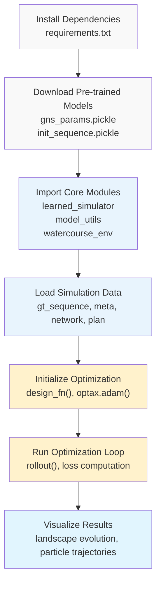
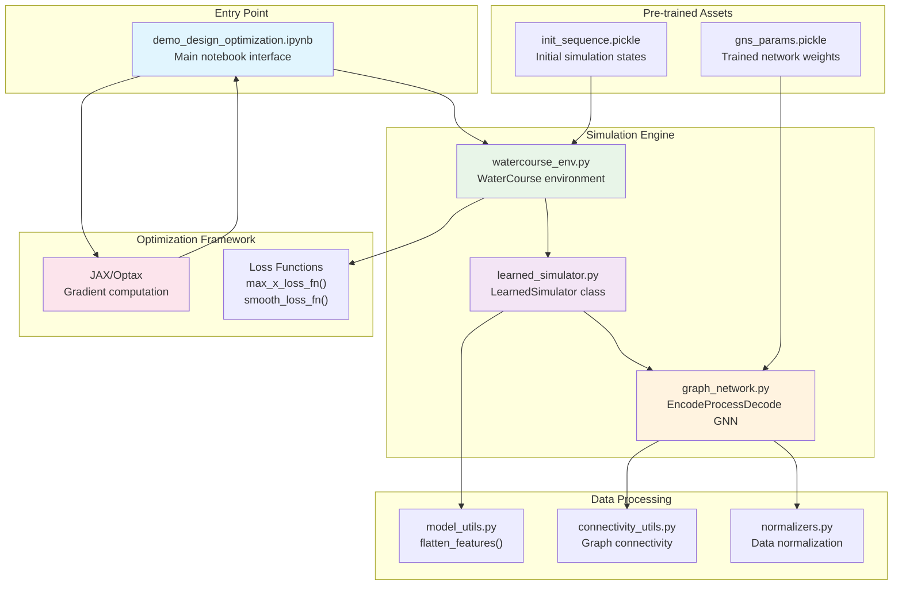

<!-- source: DeepWiki mcp.deepwiki.com · repo google-deepmind/inverse_design · page 2 Getting Started · fetched 2026-10-26 -->

# Getting Started

<details>
<summary>Relevant source files</summary>

The following files were used as context for generating this wiki page:

- [demo_design_optimization.ipynb](demo_design_optimization.ipynb)
- [requirements.txt](requirements.txt)

</details>


This guide provides a practical introduction to the inverse design system for fluid-structure interaction optimization. You will learn how to set up the environment, run the optimization demo, and understand the basic workflow for designing landscapes that achieve desired water flow behaviors using graph neural networks.

For detailed installation instructions, see [Installation and Dependencies](#2.1). For a comprehensive walkthrough of the demo notebook, see [Demo Walkthrough](#2.2). For architectural details about the system components, see [System Architecture](#3).

## Prerequisites and System Overview

The inverse design system requires Python 3.7+ with JAX ecosystem packages for automatic differentiation and graph neural network computation. The system uses pre-trained models that must be downloaded separately to perform physics-based fluid dynamics simulation.

### Core Dependencies

| Package | Version | Purpose |
|---------|---------|---------|
| `jax` | Latest | Automatic differentiation and JIT compilation |
| `dm-haiku` | 0.0.9 | Neural network building blocks |
| `optax` | 0.1.3 | Gradient-based optimization algorithms |
| `jraph` | ≥0.0.5.dev0 | Graph neural network operations |
| `numpy` | ≥1.21.0 | Numerical computing foundation |
| `matplotlib` | ≥3.6.0 | Visualization and plotting |

Sources: [requirements.txt:1-9]()

## Quick Start Workflow

The system follows a straightforward workflow from setup to optimization results:

### Workflow Overview



Sources: [demo_design_optimization.ipynb:41-56](), [demo_design_optimization.ipynb:85-88](), [demo_design_optimization.ipynb:194-226]()

### Core System Components

The system architecture centers around three main computational components that work together to enable differentiable landscape optimization:



Sources: [demo_design_optimization.ipynb:85-88](), [demo_design_optimization.ipynb:127-130](), [demo_design_optimization.ipynb:156-178]()

## Basic Usage Pattern

### 1. Environment Setup

The system requires both local dependencies and pre-trained model files. For Google Colab users, the notebook includes automated download scripts:

```python
# Local installation
pip install -r requirements.txt

# Download pre-trained models (varies by platform)
```

Sources: [demo_design_optimization.ipynb:41-56](), [demo_design_optimization.ipynb:67-74]()

### 2. Core Module Imports

The main functionality is accessed through three core modules:

```python
from inverse_design.src import learned_simulator
from inverse_design.src import model_utils  
from inverse_design.src import watercourse_env
```

Sources: [demo_design_optimization.ipynb:85-88]()

### 3. Optimization Setup

The optimization process requires loading pre-trained parameters and defining the objective function:

- **Model Loading**: Load `gns_params.pickle` containing the trained `LearnedSimulator` network weights
- **Initial Conditions**: Load `init_sequence.pickle` containing the starting particle configuration
- **Design Function**: Use `watercourse_env.design_fn()` to convert parameter vectors into landscape geometries
- **Loss Computation**: Combine `max_x_loss_fn()` for objective maximization with `smooth_loss_fn()` for regularization

Sources: [demo_design_optimization.ipynb:98-110](), [demo_design_optimization.ipynb:156-178]()

### 4. Optimization Execution

The optimization loop uses JAX's automatic differentiation with Optax optimizers:

```python
@jax.jit
def opt_step(params, opt_state):
  grads, aux = jax.grad(run, has_aux=True)(params)
  updates, opt_state = optimizer.update(grads, opt_state, params)
  params = optax.apply_updates(params, updates)
  return params, opt_state, aux
```

Sources: [demo_design_optimization.ipynb:209-214]()

## Expected Results

The optimization process produces:

- **Landscape Evolution**: Visualizes how the terrain height field changes over optimization steps
- **Loss Trajectories**: Tracks objective function and smoothness penalty reduction
- **Particle Dynamics**: Shows water flow behavior before and after optimization
- **3D Animations**: Demonstrates particle movement through optimized landscape

The typical optimization run takes 100 steps and shows convergence within minutes on modern hardware.

Sources: [demo_design_optimization.ipynb:217-226](), [demo_design_optimization.ipynb:237-250](), [demo_design_optimization.ipynb:260-287]()

## Next Steps

To get hands-on experience with the system:

1. **Installation**: Follow the detailed setup instructions in [Installation and Dependencies](#2.1)
2. **Demo Execution**: Work through the complete example in [Demo Walkthrough](#2.2)  
3. **Architecture Understanding**: Learn about the underlying components in [System Architecture](#3)
4. **Advanced Usage**: Explore implementation details in [Implementation Guide](#4)

The demo notebook `demo_design_optimization.ipynb` serves as both documentation and a working example, making it the ideal starting point for new users.

Sources: [demo_design_optimization.ipynb:1-347]()

---

