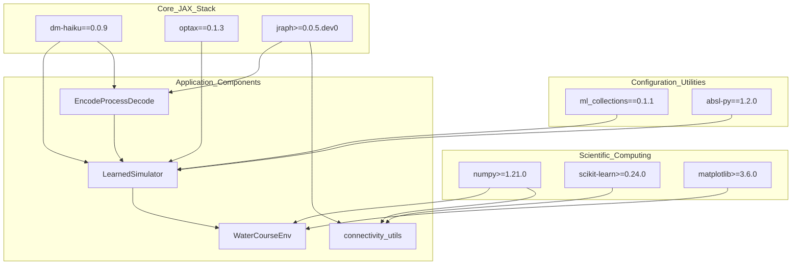
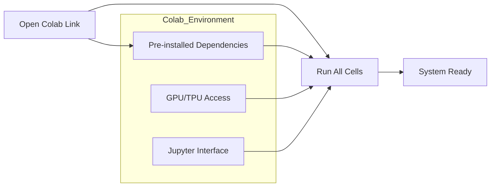
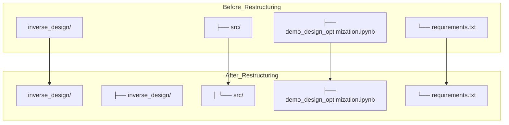
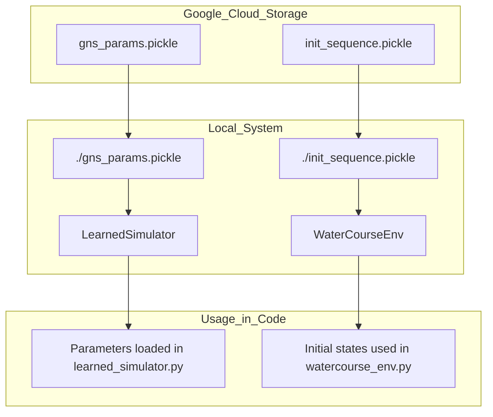
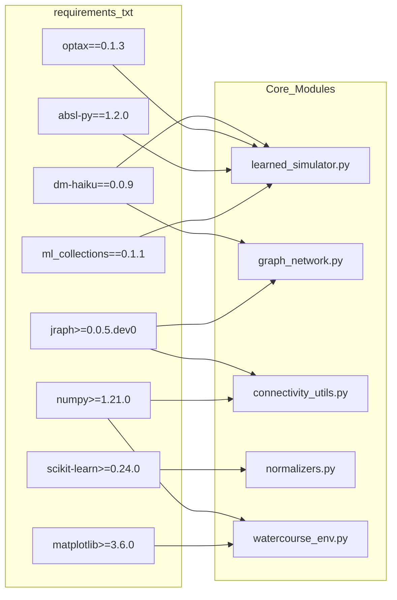

<!-- source: DeepWiki mcp.deepwiki.com · repo google-deepmind/inverse_design · page 2.1 Installation and Dependencies · fetched 2026-10-26 -->

# Installation and Dependencies

<details>
<summary>Relevant source files</summary>

The following files were used as context for generating this wiki page:

- [README.md](README.md)
- [requirements.txt](requirements.txt)

</details>


This page provides comprehensive instructions for setting up the inverse design system for fluid-structure interactions. It covers environment setup, dependency installation, and downloading required pre-trained models to get the system running locally or in Google Colab.

For information about using the system after installation, see [Demo Walkthrough](#2.2). For development setup and contributing guidelines, see [Contributing Guidelines](#5.1).

## Overview and Requirements

The inverse design system requires Python 3.7+ and several specialized machine learning libraries, particularly those from the JAX ecosystem for automatic differentiation and graph neural networks. The system depends on pre-trained model weights and initial simulation data that must be downloaded separately.

### System Dependencies Architecture



**Dependency Overview**
The system builds on JAX-based neural network libraries (`dm-haiku`, `jraph`) for graph processing, optimization libraries (`optax`) for gradient-based design optimization, and scientific computing libraries (`numpy`, `scikit-learn`) for data processing and connectivity computations.

Sources: [requirements.txt:1-9](), [README.md:20-32]()

## Installation Methods

### Method 1: Google Colab (Recommended for Quick Start)

The simplest way to run the system is through Google Colab, which provides a pre-configured environment with GPU support.



**Colab Setup Steps:**
1. Open the [Google Colab notebook](https://colab.research.google.com/github/deepmind/inverse_design/blob/master/demo_design_optimization.ipynb)
2. Run all cells to automatically install dependencies and download models
3. The environment will be ready for immediate use

Sources: [README.md:16-17]()

### Method 2: Local Installation

For local development or when you need more control over the environment, follow these steps to set up the system on your machine.

#### Environment Setup

```bash
# Clone the repository
git clone https://github.com/deepmind/inverse_design.git

# Create isolated Python environment
python3 -m venv id_venv
source id_venv/bin/activate  # On Windows: id_venv\Scripts\activate

# Upgrade pip to latest version
pip install --upgrade pip
```

#### Dependency Installation

```bash
# Install core dependencies
pip install -r ./inverse_design/requirements.txt

# Install Jupyter notebook if not present
pip install notebook
```

#### Directory Structure Configuration

The repository requires a specific directory structure for the Python modules to import correctly:

```bash
cd inverse_design
mkdir inverse_design
mv src/ inverse_design/
```



**Directory Structure Purpose**
This restructuring allows the `demo_design_optimization.ipynb` notebook to import modules from `inverse_design.src` using Python's standard import system.

Sources: [README.md:23-40]()

## Pre-trained Model Download

The system requires two pre-trained data files that must be downloaded from Google Cloud Storage:

### Required Model Files

| File | Purpose | Size | Source |
|------|---------|------|--------|
| `gns_params.pickle` | Pre-trained Graph Network Simulator weights | ~50MB | Google Cloud Storage |
| `init_sequence.pickle` | Initial simulation states and configurations | ~10MB | Google Cloud Storage |

### Download Commands

```bash
# Download pre-trained GNS model parameters
wget -O ./gns_params.pickle https://storage.googleapis.com/dm_inverse_design_watercourse/gns_params.pickle

# Download initial simulation sequence data  
wget -O ./init_sequence.pickle https://storage.googleapis.com/dm_inverse_design_watercourse/init_sequence.pickle
```



**Model File Usage**
- `gns_params.pickle` contains the trained weights for the `EncodeProcessDecode` graph neural network
- `init_sequence.pickle` provides initial particle and obstacle configurations for the `WaterCourseEnv`

Sources: [README.md:42-46]()

## Dependency Specifications

### Core JAX Ecosystem

The system heavily relies on the JAX ecosystem for automatic differentiation and neural network computation:

- **`dm-haiku==0.0.9`**: Neural network library for building the `EncodeProcessDecode` architecture
- **`jraph>=0.0.5.dev0`**: Graph neural network library used in `connectivity_utils` and graph processing
- **`optax==0.1.3`**: Optimization library for gradient-based landscape design optimization

### Scientific Computing Stack

- **`numpy>=1.21.0`**: Numerical computing foundation used throughout the codebase
- **`scikit-learn>=0.24.0`**: Machine learning utilities, particularly for normalization in `normalizers.py`
- **`matplotlib>=3.6.0`**: Visualization library for plotting simulation results

### Configuration and Utilities

- **`ml_collections==0.1.1`**: Configuration management for model parameters
- **`absl-py==1.2.0`**: Google's Python utilities library for command-line flag handling



Sources: [requirements.txt:1-9]()

## Installation Verification

After completing the installation, verify the setup by checking that all components can be imported:

### Quick Verification Steps

1. **Activate your environment** (if using local installation):
   ```bash
   source id_venv/bin/activate
   ```

2. **Start Jupyter notebook**:
   ```bash
   jupyter notebook
   ```

3. **Open `demo_design_optimization.ipynb`** and run from the third cell onwards (the first two cells are for Colab setup)

4. **Verify imports** - The notebook should successfully import:
   - `inverse_design.src.learned_simulator`
   - `inverse_design.src.watercourse_env`
   - `inverse_design.src.connectivity_utils`

### Common Installation Issues

| Issue | Cause | Solution |
|-------|-------|----------|
| Import errors for `inverse_design.src` | Incorrect directory structure | Ensure `src/` is moved inside `inverse_design/` subdirectory |
| `jraph` version conflicts | Development version requirement | Install with `pip install jraph>=0.0.5.dev0` explicitly |
| Missing model files | Files not downloaded | Re-run wget commands for pickle files |
| JAX/CUDA compatibility | GPU driver issues | Use CPU-only JAX or update CUDA drivers |

Sources: [README.md:48-49]()

## Next Steps

Once installation is complete:
- Proceed to [Demo Walkthrough](#2.2) to run your first optimization
- Review [System Architecture](#3) to understand the system components
- For development work, see [Contributing Guidelines](#5.1)

The system is now ready for inverse design optimization of fluid-structure interactions using graph neural network simulators.

---

