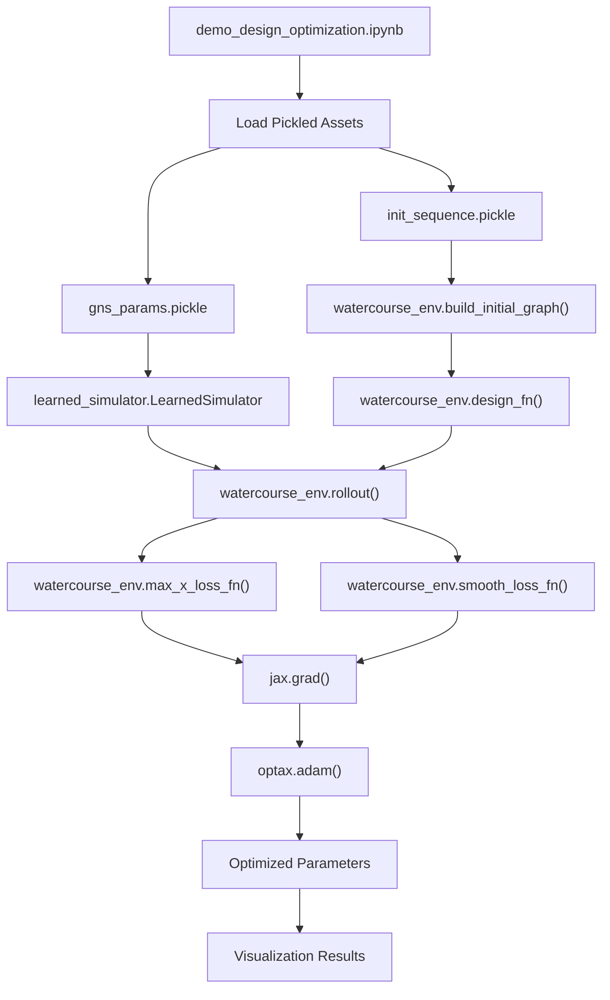
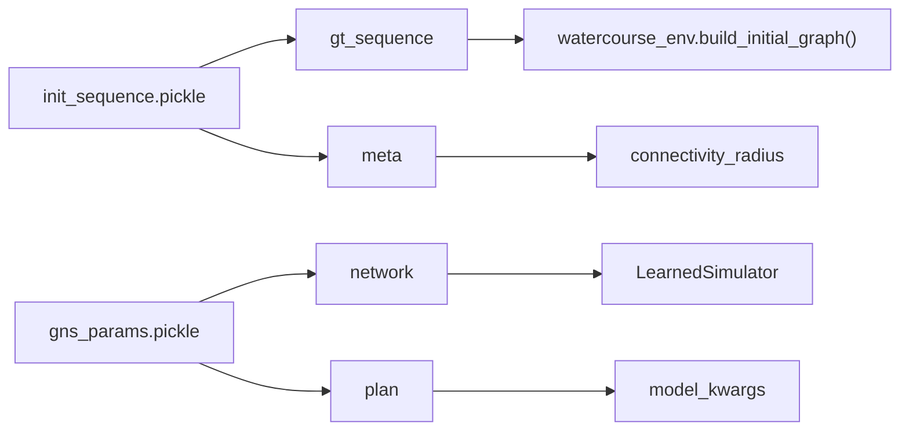
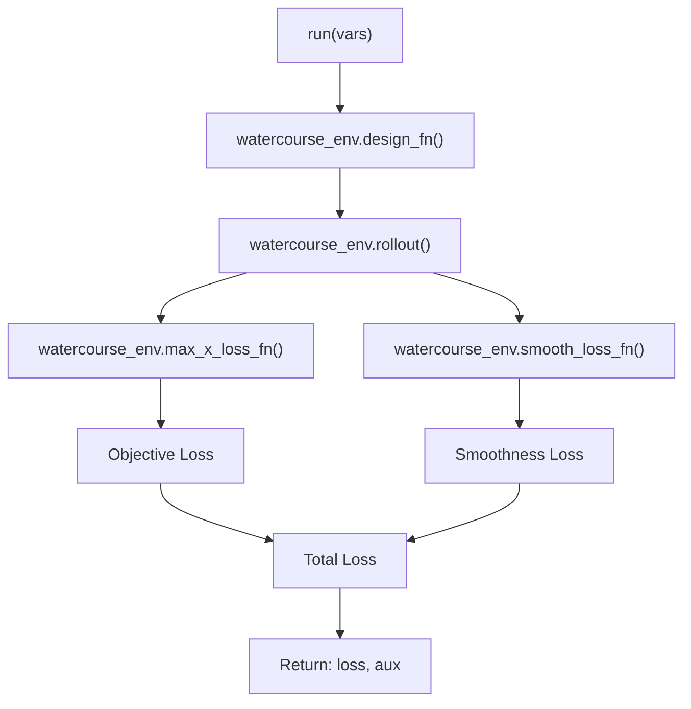
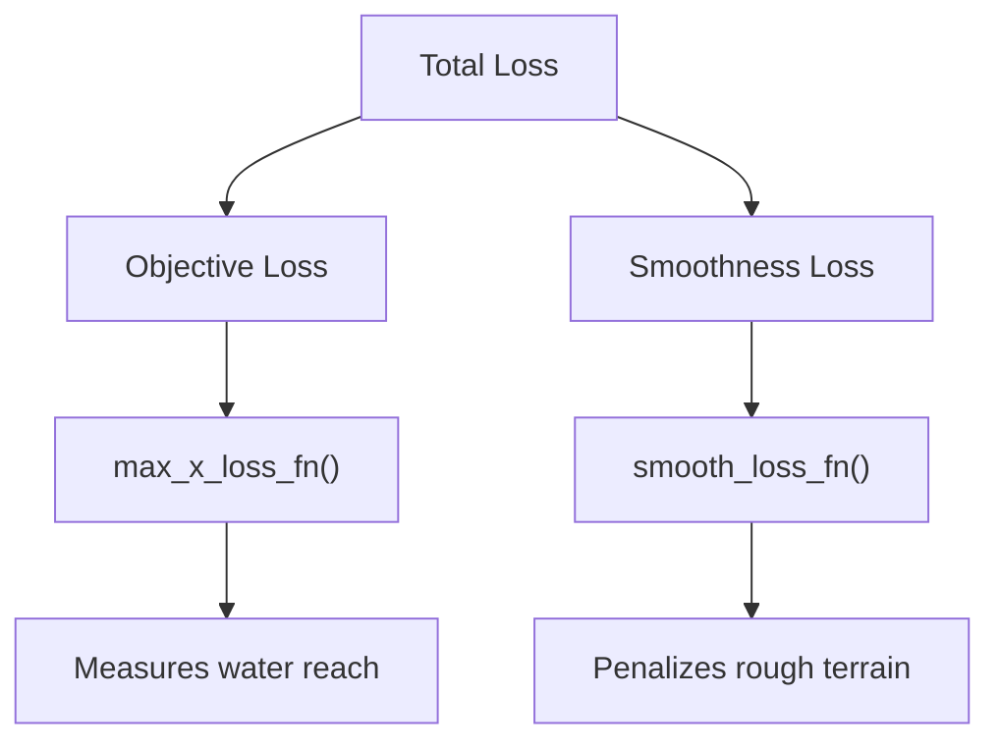

<!-- source: DeepWiki mcp.deepwiki.com · repo google-deepmind/inverse_design · page 2.2 Demo Walkthrough · fetched 2026-10-26 -->

# Demo Walkthrough

Relevant source files

The following files were used as context for generating this wiki page:

- [README.md](README.md)
- [demo_design_optimization.ipynb](demo_design_optimization.ipynb)

This document provides a step-by-step guide through the demonstration notebook (`demo_design_optimization.ipynb`) that showcases the inverse design optimization process. The demo illustrates how to optimize a 3D landscape to redirect water flow using pre-trained graph neural network simulators and gradient-based optimization.

For installation instructions and setup requirements, see [Installation and Dependencies](#2.1). For detailed technical documentation of the system components, see [System Architecture](#3).

## Demo Overview

The demonstration implements a complete inverse design pipeline that optimizes landscape parameters to achieve desired water flow behavior. The process involves loading pre-trained models, setting up the simulation environment, defining optimization objectives, and running gradient-based optimization to iteratively improve the landscape design.

### Demo Workflow Diagram

Sources: [demo_design_optimization.ipynb:98-178](), [demo_design_optimization.ipynb:188-227]()

## Step-by-Step Walkthrough

### Step 1: Environment Setup and Data Loading

The demo begins by importing the necessary modules and loading pre-trained assets. Two critical pickle files contain the simulation state and neural network parameters:

- `init_sequence.pickle`: Contains initial particle configurations and simulation metadata
- `gns_params.pickle`: Contains pre-trained graph neural network weights and model configuration

The loaded data structures provide:
- `gt_sequence`: Ground truth particle trajectories for initialization
- `meta`: Simulation metadata including connectivity radius
- `network`: Pre-trained neural network weights
- `plan`: Model configuration and hyperparameters

Sources: [demo_design_optimization.ipynb:98-110](), [demo_design_optimization.ipynb:127-141]()

### Step 2: Simulation Environment Configuration

The demo configures the `LearnedSimulator` and establishes the 3D environment using `watercourse_env` functions:

Key configuration parameters:
- `MAX_EDGES = 2**16`: Maximum edges for graph padding
- `connectivity_radius`: Distance threshold for particle connections
- `num_side = 25`: Landscape grid dimensions (25×25)
- `length = 50`: Simulation rollout steps
- `radius = 0.1`: Particle connection radius

The environment setup involves:
1. `watercourse_env.make_plain_obstacles()`: Creates initial flat landscape
2. `watercourse_env.build_initial_graph()`: Constructs particle graph from sequence data
3. `model_utils.flatten_features()`: Prepares graph features for neural network processing

Sources: [demo_design_optimization.ipynb:124-151](), [demo_design_optimization.ipynb:132-141]()

### Step 3: Optimization Function Definition

The core optimization function `run()` implements the complete forward simulation and loss computation pipeline:

The function performs:
1. **Design Generation**: `watercourse_env.design_fn()` converts optimization variables to landscape geometry
2. **Physics Simulation**: `watercourse_env.rollout()` executes multi-step fluid dynamics using the learned simulator
3. **Loss Computation**: 
   - `watercourse_env.max_x_loss_fn()`: Measures water flow distance objective
   - `watercourse_env.smooth_loss_fn()`: Penalizes rough landscape features
4. **Auxiliary Data**: Returns trajectory and design parameters for visualization

Sources: [demo_design_optimization.ipynb:156-178]()

### Step 4: Gradient-Based Optimization Loop

The optimization employs JAX automatic differentiation with the Adam optimizer:

| Parameter | Value | Purpose |
|-----------|-------|---------|
| `LEARNING_RATE` | 0.05 | Adam optimizer learning rate |
| `num_opt_steps` | 100 | Total optimization iterations |
| `smoothing_factor` | 1e2 | Smoothness penalty weight |

The optimization step function `opt_step()` implements:
1. `jax.grad(run, has_aux=True)()`: Computes gradients of total loss
2. `optimizer.update()`: Applies Adam update rule
3. `optax.apply_updates()`: Updates design parameters

The loop tracks optimization progress in `opt_traj` for analysis and visualization.

Sources: [demo_design_optimization.ipynb:188-227]()

### Step 5: Results Visualization

The demo provides two visualization modes:

#### Design Evolution Visualization
Displays landscape height fields at optimization intervals using `np.tanh()` transformation to show the actual terrain heights that influence water flow.

#### Particle Trajectory Comparison
Shows 3D animated comparisons between initial flat design and optimized landscape, visualizing:
- Blue particles: Water flow
- Black particles: Landscape obstacles  
- Green marker: Target location (1.5, 1.5, 0)

The visualization uses coordinate bounds:
- X-axis: [-0.6, 1.6]
- Y-axis: [-0.1, 1.6] 
- Z-axis: [-0.1, 1.2]

Sources: [demo_design_optimization.ipynb:238-250](), [demo_design_optimization.ipynb:260-287]()

## Understanding the Results

### Loss Function Components

The optimization minimizes a composite objective:

- **Objective Loss**: `watercourse_env.max_x_loss_fn()` encourages water particles to reach maximum distance
- **Smoothness Loss**: `watercourse_env.smooth_loss_fn()` with `smoothing_factor=1e2` prevents unrealistic terrain features

### Optimization Convergence

The live-updating loss plot during optimization shows:
- Individual loss components (objective, smooth)
- Total combined loss
- Convergence behavior over 100 iterations

Successful optimization typically shows:
1. Rapid initial decrease in total loss
2. Stabilization of smoothness penalty
3. Continued improvement in objective function

### Design Parameter Interpretation

The optimized `params` array represents a 25×25 grid of landscape height values. The `np.tanh()` transformation maps raw optimization variables to bounded height values in [-1, 1], creating realistic terrain variations that guide water flow toward the target location.

Sources: [demo_design_optimization.ipynb:167-170](), [demo_design_optimization.ipynb:221-226](), [demo_design_optimization.ipynb:244-249]()

---

