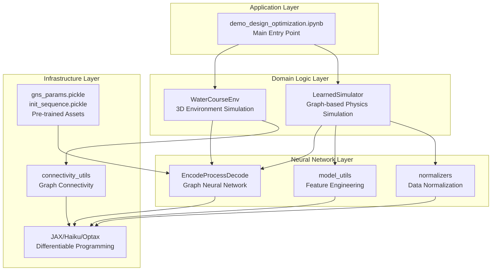
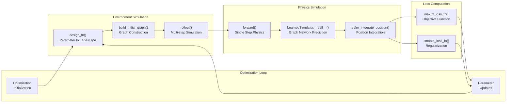
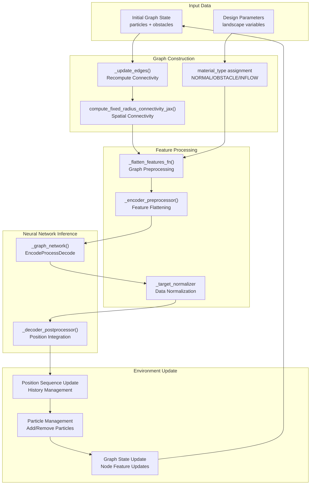
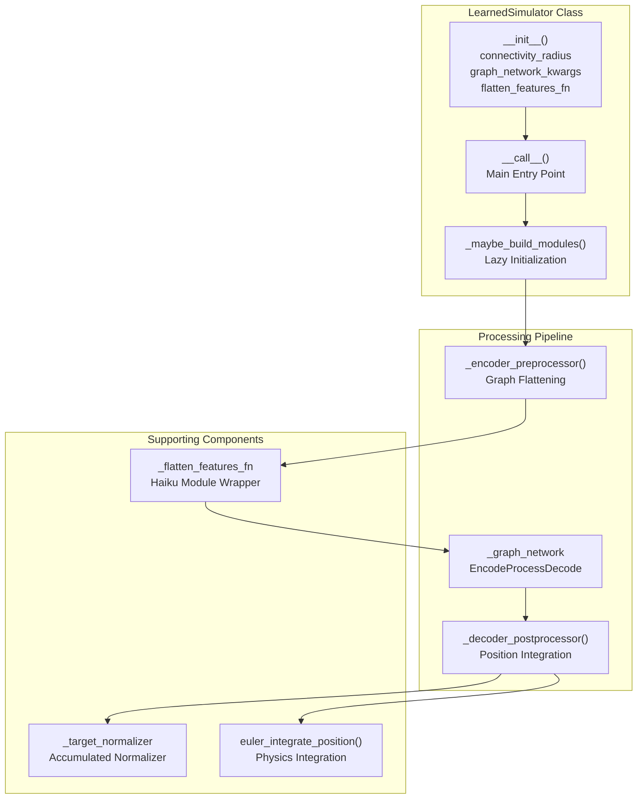

<!-- source: DeepWiki mcp.deepwiki.com · repo google-deepmind/inverse_design · page 3 System Architecture · fetched 2026-10-26 -->

# System Architecture

<details>
<summary>Relevant source files</summary>

The following files were used as context for generating this wiki page:

- [README.md](README.md)
- [src/learned_simulator.py](src/learned_simulator.py)
- [src/watercourse_env.py](src/watercourse_env.py)

</details>


## Purpose and Scope

This document provides a comprehensive overview of the inverse design system's architecture, covering how the major components interact to enable gradient-based optimization of fluid-structure interactions. The system implements an Encode-Process-Decode graph neural network architecture that can learn physics dynamics and enable inverse design through differentiable programming.

For implementation details of specific components, see [Graph Neural Network Architecture](#3.1), [Physics Simulation Engine](#3.2), and [Graph Processing Pipeline](#3.3). For hands-on usage guidance, see [Demo Walkthrough](#2.2).

## High-Level System Overview

The system consists of four primary layers that work together to enable inverse design optimization:

### System Architecture Diagram



**Sources:** [README.md:1-49](), [src/learned_simulator.py:33-75](), [src/watercourse_env.py:152-166]()

## Core Component Interactions

The system's core components form a tightly integrated pipeline where each component has specific responsibilities:

### Component Interaction Flow



**Sources:** [src/watercourse_env.py:198-219](), [src/watercourse_env.py:113-149](), [src/watercourse_env.py:152-166](), [src/watercourse_env.py:59-111](), [src/learned_simulator.py:77-91](), [src/learned_simulator.py:113-122]()

## Data Flow Architecture

The system processes graph-structured data through multiple transformation stages:

### Graph Data Processing Pipeline



**Sources:** [src/watercourse_env.py:35-57](), [src/watercourse_env.py:74-80](), [src/learned_simulator.py:93-99](), [src/learned_simulator.py:101-111](), [src/watercourse_env.py:89-110]()

## Key System Interfaces

The system exposes several critical interfaces that enable the inverse design optimization:

### Primary API Interface Points

| Interface | Location | Purpose | Key Parameters |
|-----------|----------|---------|----------------|
| `LearnedSimulator.__call__` | [src/learned_simulator.py:77-91]() | Main physics prediction interface | `input_graph`, `padded_graph` |
| `design_fn` | [src/watercourse_env.py:198-219]() | Convert parameters to landscape | `params`, `graph`, `height_scale` |
| `rollout` | [src/watercourse_env.py:152-166]() | Multi-step simulation execution | `initial_graph`, `inflow_stack`, `network` |
| `forward` | [src/watercourse_env.py:59-111]() | Single simulation step | `input_graph`, `new_particles`, `network` |
| `max_x_loss_fn` | [src/watercourse_env.py:181-187]() | Primary optimization objective | `graph` |
| `smooth_loss_fn` | [src/watercourse_env.py:190-195]() | Regularization loss function | `obs_pos`, `num_side` |

**Sources:** [src/learned_simulator.py:77-91](), [src/watercourse_env.py:198-219](), [src/watercourse_env.py:152-166](), [src/watercourse_env.py:59-111](), [src/watercourse_env.py:181-187](), [src/watercourse_env.py:190-195]()

## Graph Network Integration

The `LearnedSimulator` serves as the central component that integrates the graph neural network with the physics simulation:

### LearnedSimulator Architecture



The `LearnedSimulator` class implements a three-stage processing pipeline:

1. **Encoder Preprocessing** ([src/learned_simulator.py:93-99]()): Flattens input graph features and handles connectivity
2. **Graph Network Inference** ([src/learned_simulator.py:82]()): Applies the `EncodeProcessDecode` network to predict dynamics
3. **Decoder Postprocessing** ([src/learned_simulator.py:101-111]()): Denormalizes predictions and integrates to get new positions

**Sources:** [src/learned_simulator.py:33-75](), [src/learned_simulator.py:77-91](), [src/learned_simulator.py:93-99](), [src/learned_simulator.py:101-111](), [src/learned_simulator.py:113-122]()

## Environment Simulation Framework

The `watercourse_env.py` module provides the 3D environment simulation capabilities:

### WaterCourse Environment Components

```mermaid
graph LR
    subgraph "Environment Setup"
        PlainObs["make_plain_obstacles()<br/>Mesh Generation"]
        BuildInit["build_initial_graph()<br/>Graph Initialization"]
        InflowStack["Inflow Stack<br/>Particle Injection"]
    end
    
    subgraph "Simulation Execution"
        RolloutMain["rollout()<br/>JAX Scan Loop"]
        StepFn["_step()<br/>Checkpointed Step"]
        ForwardMain["forward()<br/>Model Application"]
    end
    
    subgraph "Graph Updates"
        UpdateEdges["_update_edges()<br/>Connectivity Updates"]
        MaterialAssign["Material Type Assignment<br/>NORMAL/OBSTACLE/INFLOW"]
        ParticleManage["Particle Management<br/>Add/Remove Logic"]
    end
    
    PlainObs --> BuildInit
    BuildInit --> InflowStack
    InflowStack --> RolloutMain
    RolloutMain --> StepFn
    StepFn --> ForwardMain
    ForwardMain --> UpdateEdges
    UpdateEdges --> MaterialAssign
    MaterialAssign --> ParticleManage
```



Key environment constants and their purposes:

| Constant | Value | Purpose |
|----------|-------|---------|
| `NORMAL` | 0 | Regular fluid particles |
| `OBSTACLE` | 1 | Static obstacle particles |
| `INFLOW` | 4 | Particle injection points |
| `OOB_AREA` | 1.5 | Out-of-bounds threshold for particle cleanup |

**Sources:** [src/watercourse_env.py:27-33](), [src/watercourse_env.py:168-178](), [src/watercourse_env.py:113-149](), [src/watercourse_env.py:152-166](), [src/watercourse_env.py:35-57](), [src/watercourse_env.py:74-80](), [src/watercourse_env.py:94-110]()

## Optimization Integration

The system integrates with JAX's automatic differentiation capabilities to enable gradient-based inverse design:

### Optimization Data Flow

```mermaid
sequenceDiagram
    participant Opt as "JAX Optimizer"
    participant DesignFn as "design_fn()"
    participant Env as "Environment"
    participant Sim as "LearnedSimulator"
    participant Loss as "Loss Functions"
    
    Opt->>DesignFn: "Design Parameters"
    DesignFn->>Env: "Updated Graph with Landscape"
    Env->>Sim: "Initial Graph State"
    
    loop "Simulation Rollout"
        Sim->>Sim: "Graph Network Prediction"
        Sim->>Env: "Next Particle Positions"
        Env->>Env: "Update Graph State"
    end
    
    Env->>Loss: "Final Particle Trajectories"
    Loss->>Opt: "Loss Values + Gradients"
    
    Note over Opt,Loss: "JAX automatic differentiation<br/>enables end-to-end gradients"
```

The `design_fn` function ([src/watercourse_env.py:198-219]()) serves as the key interface between optimization parameters and the physical landscape, using a `tanh` transformation to constrain height variations within reasonable bounds.

**Sources:** [src/watercourse_env.py:198-219](), [src/watercourse_env.py:181-187](), [src/watercourse_env.py:190-195]()

---

