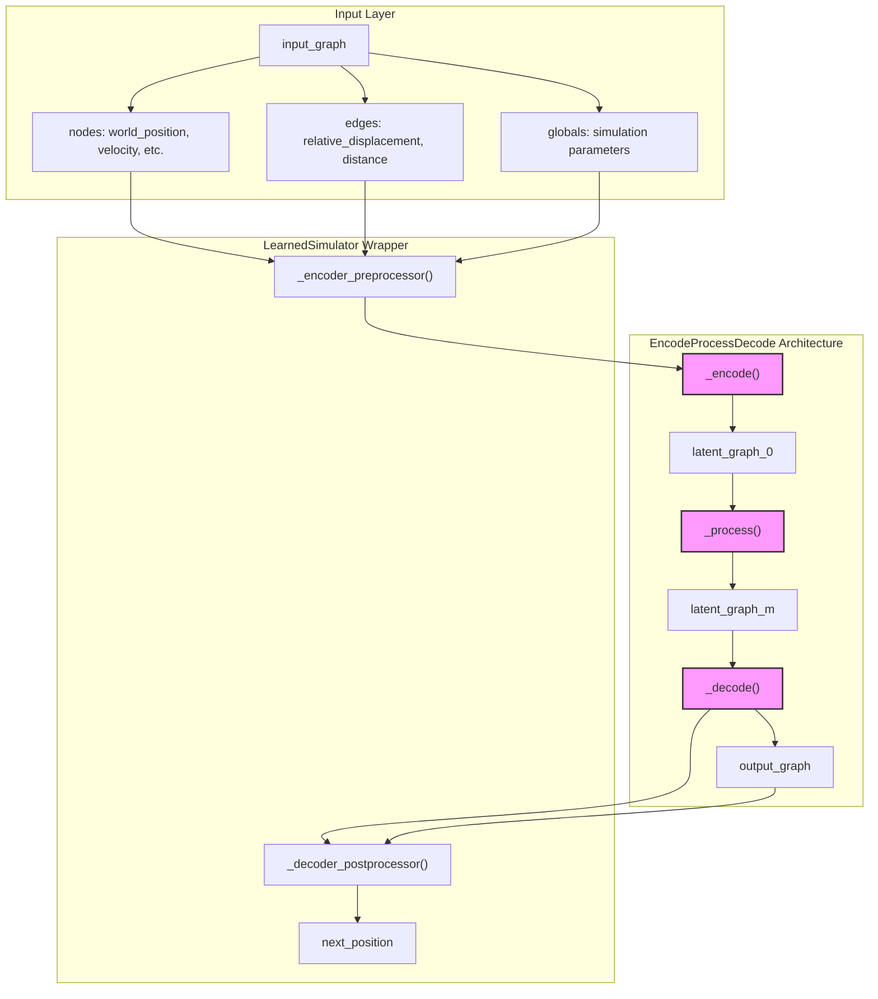
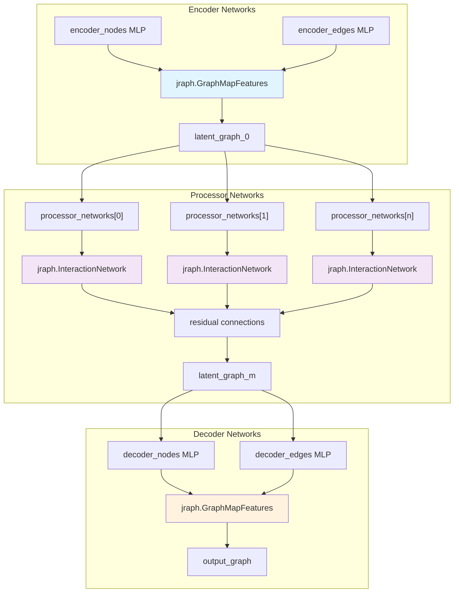
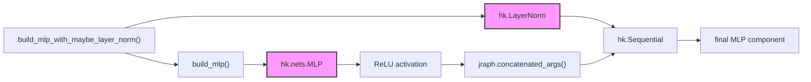
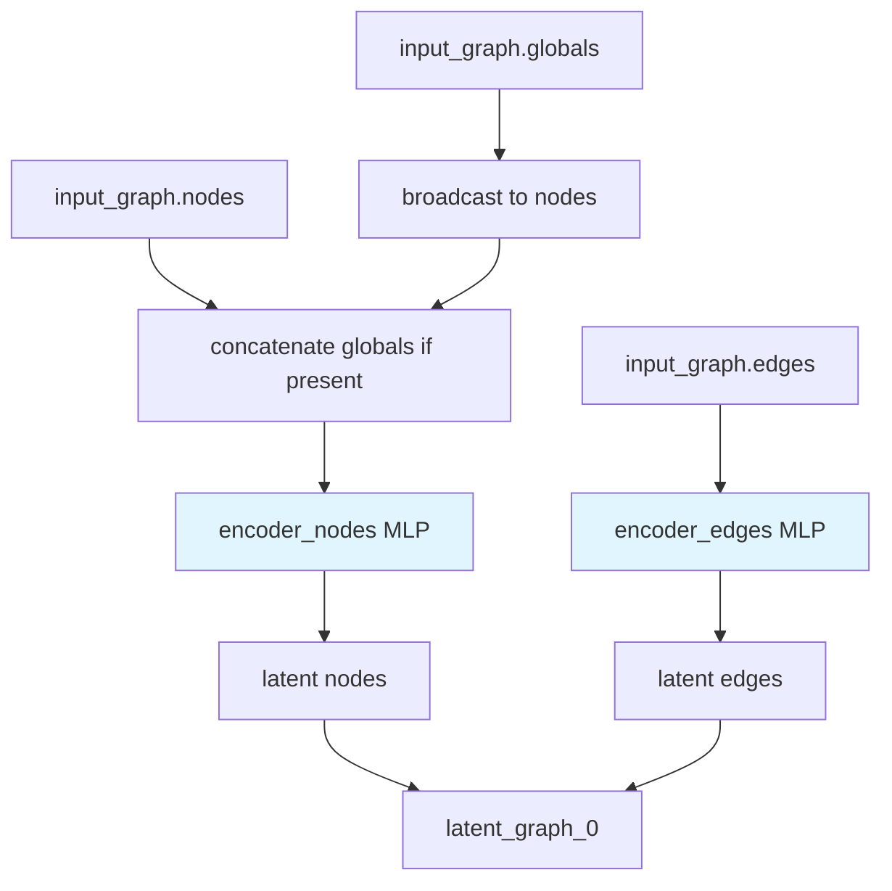
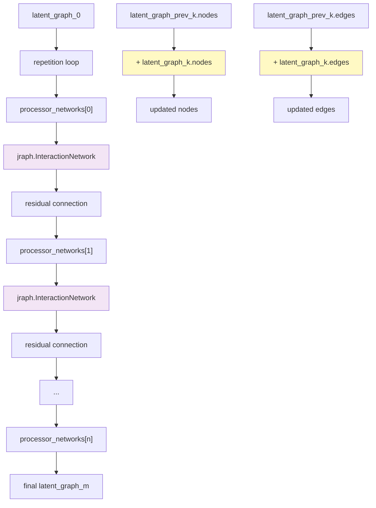
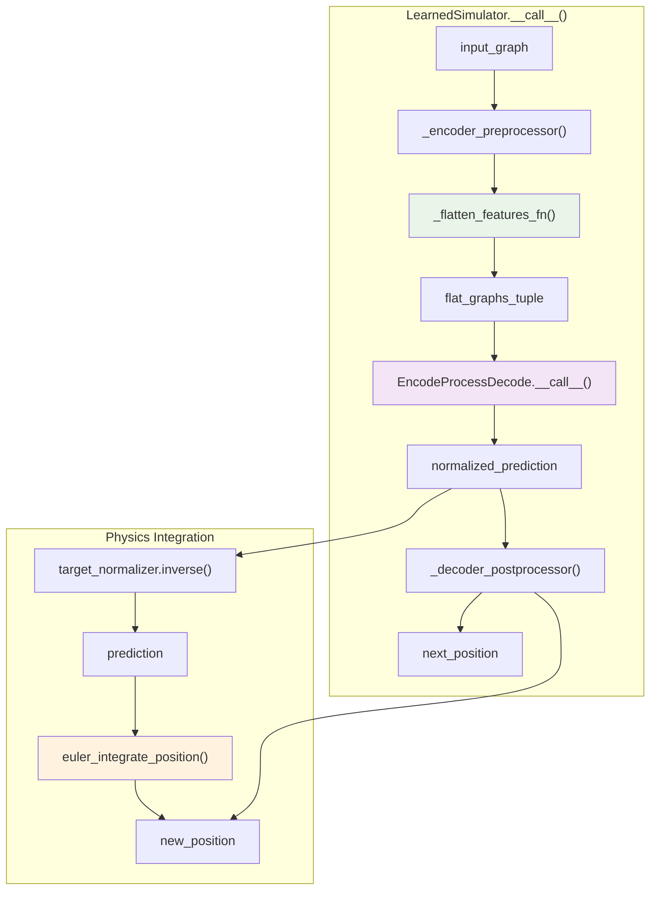
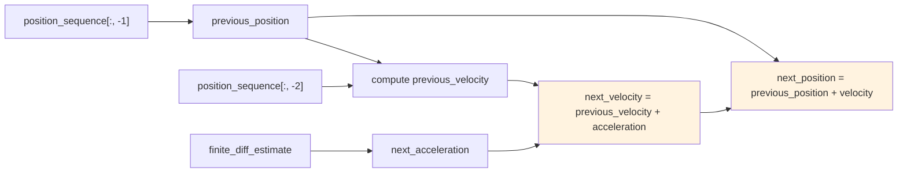

<!-- source: DeepWiki mcp.deepwiki.com · repo google-deepmind/inverse_design · page 3.1 Graph Neural Network Architecture · fetched 2026-10-26 -->

# Graph Neural Network Architecture

Relevant source files

The following files were used as context for generating this wiki page:

- [src/graph_network.py](src/graph_network.py)
- [src/learned_simulator.py](src/learned_simulator.py)

This document provides a detailed technical overview of the core graph neural network architecture used in the inverse design system. It covers the `EncodeProcessDecode` class implementation and its integration with the `LearnedSimulator` wrapper class. For information about the broader physics simulation integration, see [Physics Simulation Engine](#3.2). For details on graph data preprocessing and connectivity computation, see [Graph Processing Pipeline](#3.3).

## Overview

The system implements an Encode-Process-Decode (EPD) architecture that operates on graph-structured data representing particle systems and fluid-structure interactions. This architecture transforms input graphs through three distinct phases: encoding raw features into latent representations, processing through multiple message-passing steps, and decoding back to output predictions.

Sources: [src/graph_network.py:79-89](), [src/learned_simulator.py:77-91]()

## Core Components

### EncodeProcessDecode Class Structure

The `EncodeProcessDecode` class serves as the main neural network architecture, implementing a three-stage processing pipeline with configurable parameters for different aspects of the graph network.

| Parameter | Type | Purpose |
|-----------|------|---------|
| `latent_size` | int | Dimensionality of internal node/edge representations |
| `mlp_hidden_size` | int | Hidden layer size for all MLPs |
| `mlp_num_hidden_layers` | int | Depth of MLP networks |
| `num_message_passing_steps` | int | Number of unshared message passing iterations |
| `num_processor_repetitions` | int | Times the processor is applied sequentially |
| `encode_nodes` | bool | Whether to encode node features |
| `encode_edges` | bool | Whether to encode edge features |
| `node_output_size` | int | Output dimensionality for decoded nodes |
| `edge_output_size` | int | Output dimensionality for decoded edges |

Sources: [src/graph_network.py:28-42]()

### Network Component Architecture

Sources: [src/graph_network.py:91-141]()

### MLP Construction Pattern

The system uses a consistent pattern for building Multi-Layer Perceptrons (MLPs) with optional layer normalization:

Sources: [src/graph_network.py:93-108]()

## Processing Pipeline

### Encoding Phase

The encoding phase transforms input graph features into latent representations. It handles global feature broadcasting and applies separate MLPs to node and edge features.

The encoding step includes global feature broadcasting where globals are repeated for each node:

Sources: [src/graph_network.py:142-158]()

### Processing Phase

The processing phase applies multiple message-passing steps with residual connections. Each step uses unshared parameters and can be repeated multiple times.

Each processing step implements residual connections by adding previous node and edge states to the updated states:

Sources: [src/graph_network.py:160-190]()

### Decoding Phase

The decoding phase transforms latent representations back to the desired output space using separate MLPs for nodes and edges.

Sources: [src/graph_network.py:192-194]()

## Integration with LearnedSimulator

### Wrapper Architecture

The `LearnedSimulator` class wraps the `EncodeProcessDecode` network with physics-specific preprocessing and postprocessing logic.

Sources: [src/learned_simulator.py:77-91]()

### Euler Integration

The system uses Euler integration to convert acceleration predictions to position updates:

The integration assumes `dt=1` corresponding to the finite difference step size.

Sources: [src/learned_simulator.py:113-122]()

### Normalization Integration

The simulator integrates with the normalization system to handle statistical preprocessing and postprocessing of predictions.

Sources: [src/learned_simulator.py:74-75](), [src/learned_simulator.py:107]()

## Key Design Patterns

### Lazy Module Construction

Both classes use lazy construction patterns where neural network modules are built only when first called with actual data:

Sources: [src/learned_simulator.py:66-76]()

### Haiku Module Wrapping

External functions are wrapped using `hk.to_module()` to ensure proper variable reuse across multiple calls:

Sources: [src/learned_simulator.py:63-64]()

### Jraph Integration

The architecture leverages Jraph's graph network primitives including `GraphMapFeatures`, `InteractionNetwork`, and `concatenated_args` for efficient graph operations.

Sources: [src/graph_network.py:99](), [src/graph_network.py:116](), [src/graph_network.py:125]()

---

