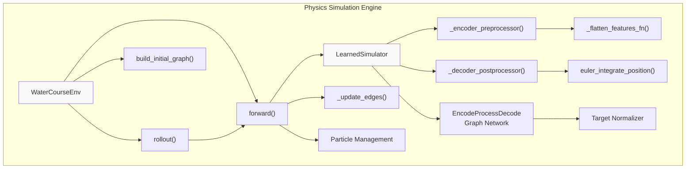
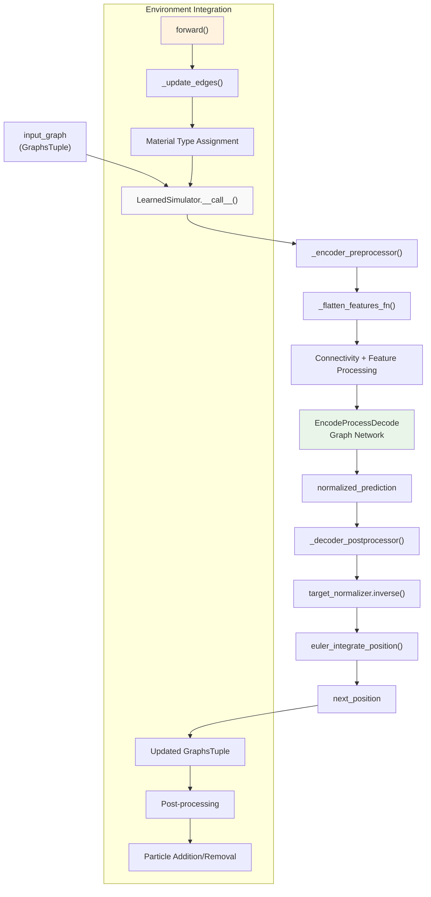
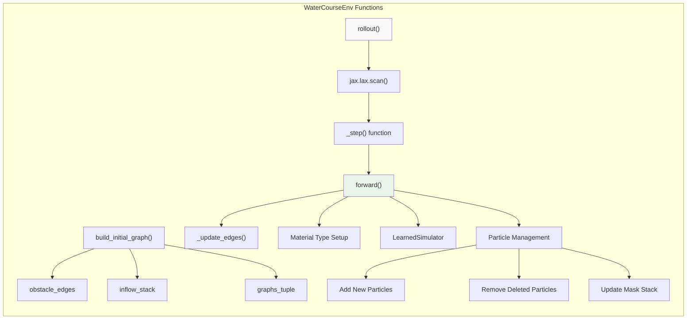
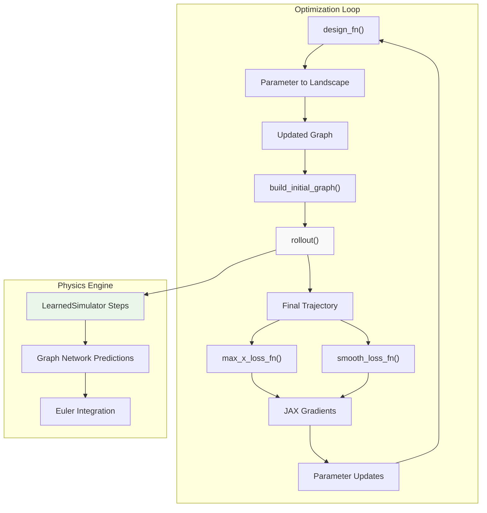

<!-- source: DeepWiki mcp.deepwiki.com · repo google-deepmind/inverse_design · page 3.2 Physics Simulation Engine · fetched 2026-10-26 -->

# Physics Simulation Engine

<details>
<summary>Relevant source files</summary>

The following files were used as context for generating this wiki page:

- [src/learned_simulator.py](src/learned_simulator.py)
- [src/watercourse_env.py](src/watercourse_env.py)

</details>


This document covers the physics simulation engine that performs learned fluid dynamics simulations using graph neural networks. The engine integrates the `LearnedSimulator` with the `WaterCourseEnv` environment to execute physics-based simulations for inverse design optimization.

For details about the underlying graph neural network architecture, see [Graph Neural Network Architecture](#3.1). For information about graph data processing, see [Graph Processing Pipeline](#3.3).

## Core Architecture

The physics simulation engine consists of two primary components that work together to execute learned physics simulations:

**Simulation Architecture Overview**


Sources: [src/learned_simulator.py:33-132](), [src/watercourse_env.py:59-111]()

## Simulation Pipeline

The physics simulation follows a structured pipeline from graph preprocessing through neural network prediction to physical integration:

**Simulation Execution Flow**


Sources: [src/learned_simulator.py:77-91](), [src/watercourse_env.py:59-111]()

## Learned Simulator Components

The `LearnedSimulator` class orchestrates the physics prediction through several key methods:

| Method | Purpose | Input | Output |
|--------|---------|-------|--------|
| `__call__()` | Main simulation step | `GraphsTuple` | Updated `GraphsTuple` with new positions |
| `_encoder_preprocessor()` | Prepares graph for neural network | Raw graph | Flattened features graph |
| `_decoder_postprocessor()` | Converts predictions to positions | Normalized predictions | Next positions |
| `_maybe_build_modules()` | Lazy initialization | Input graph | Initialized modules |

The simulation uses Euler integration for position updates:

```python
def euler_integrate_position(position_sequence, finite_diff_estimate):
  previous_position = position_sequence[:, -1]
  previous_velocity = previous_position - position_sequence[:, -2]
  next_acceleration = finite_diff_estimate
  next_velocity = previous_velocity + next_acceleration
  next_position = previous_position + next_velocity
```

Sources: [src/learned_simulator.py:77-91](), [src/learned_simulator.py:113-123]()

## Environment Integration

The `WaterCourseEnv` provides the 3D simulation environment and manages the complete simulation workflow:

**Environment Simulation Components**


The environment handles several critical aspects:

- **Edge Management**: `_update_edges()` recomputes particle connectivity and adds obstacle edges
- **Material Types**: Assigns `NORMAL`, `OBSTACLE`, and `INFLOW` particle types  
- **Particle Lifecycle**: Adds new particles from inflow and removes particles that hit the ground
- **Boundary Conditions**: Manages out-of-bounds particles and external masks

Sources: [src/watercourse_env.py:35-57](), [src/watercourse_env.py:113-149](), [src/watercourse_env.py:152-166]()

## Simulation State Management

The simulation maintains particle state through a comprehensive node feature system:

| Node Feature | Type | Purpose |
|--------------|------|---------|
| `world_position` | `(N, history, 3)` | Position trajectory over time |
| `mask_stack` | `(N, history)` | Active particle mask over time |
| `external_mask` | `(N,)` | Marks obstacle/boundary particles |
| `obstacle_mask` | `(N,)` | Identifies static obstacle particles |
| `material_type(9)` | `(N,)` | Particle type classification |
| `deleted` | `(N,)` | Tracks particles removed from simulation |

The `forward()` function manages state transitions:

1. **Edge Updates**: Recomputes connectivity based on `connectivity_radius`
2. **Model Execution**: Runs `LearnedSimulator` to predict next positions
3. **Position Integration**: Updates `world_position` with new predictions
4. **Particle Management**: Adds inflow particles and removes particles below ground
5. **Mask Updates**: Maintains `mask_stack` and `external_mask` consistency

Sources: [src/watercourse_env.py:59-111](), [src/watercourse_env.py:27-32]()

## Optimization Integration

The physics simulation engine provides differentiable simulation for inverse design through JAX compatibility:

**Optimization Integration Architecture**


The engine supports optimization through:

- **Differentiable Design**: `design_fn()` converts parameters to landscape modifications
- **Loss Functions**: `max_x_loss_fn()` and `smooth_loss_fn()` provide optimization objectives  
- **JAX Compatibility**: All operations use JAX for automatic differentiation
- **Gradient Flow**: Enables end-to-end optimization from design parameters to simulation outcomes

Sources: [src/watercourse_env.py:181-219](), [src/watercourse_env.py:152-166]()

---

