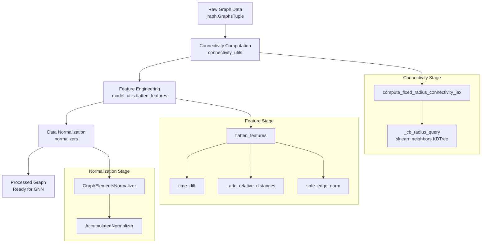
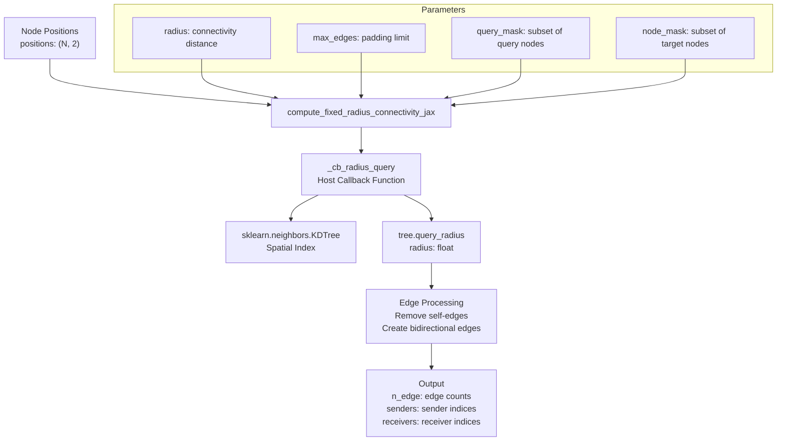
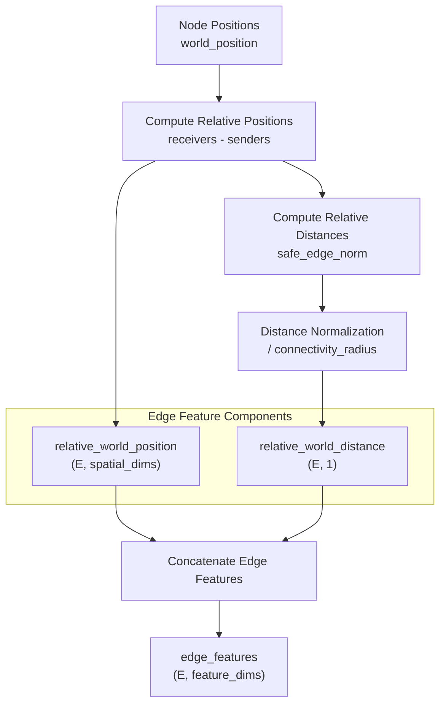
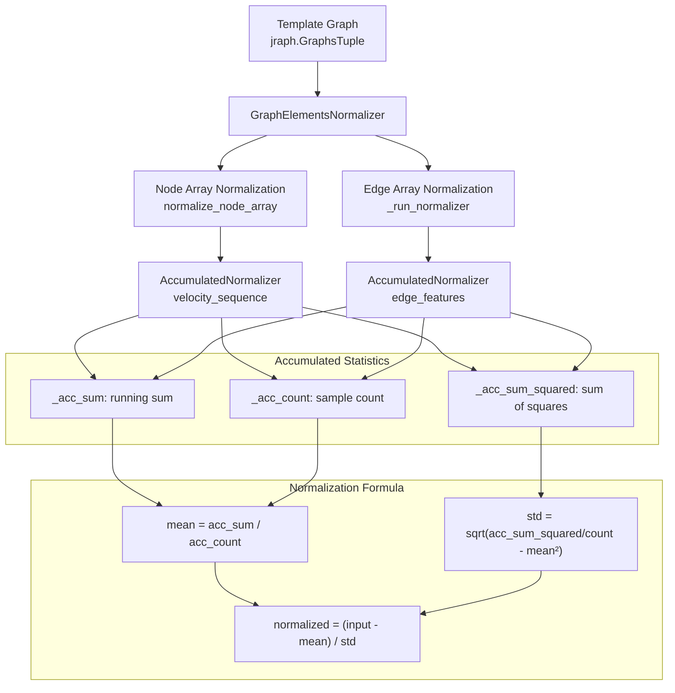

<!-- source: DeepWiki mcp.deepwiki.com · repo google-deepmind/inverse_design · page 3.3 Graph Processing Pipeline · fetched 2026-10-26 -->

# Graph Processing Pipeline

Relevant source files

The following files were used as context for generating this wiki page:

- [src/connectivity_utils.py](src/connectivity_utils.py)
- [src/model_utils.py](src/model_utils.py)
- [src/normalizers.py](src/normalizers.py)

This document covers the graph data processing workflow that transforms raw graph structures into feature-rich representations suitable for the graph neural network. The pipeline encompasses three main stages: connectivity computation, feature engineering, and data normalization. For information about the neural network architecture that processes these graphs, see [Graph Neural Network Architecture](#3.1). For details about the physics simulation that uses these processed graphs, see [Physics Simulation Engine](#3.2).

## Pipeline Overview

The graph processing pipeline converts input graph data through a series of transformations to produce normalized, feature-rich graphs ready for neural network processing. The pipeline operates on `jraph.GraphsTuple` objects and processes both node and edge information.

### Graph Processing Flow

Sources: [src/connectivity_utils.py:16-142](), [src/model_utils.py:16-126](), [src/normalizers.py:16-159]()

## Connectivity Computation

The connectivity computation stage determines which nodes in the graph are connected based on spatial proximity. This creates the edge structure that defines particle interactions in the physics simulation.

### Radius-Based Connectivity

The system uses fixed-radius connectivity where nodes are connected if they are within a specified distance threshold. The implementation leverages scikit-learn's KDTree for efficient spatial queries.

The core connectivity function `compute_fixed_radius_connectivity_jax` at [src/connectivity_utils.py:78-103]() uses a JAX host callback to interface with NumPy-based spatial indexing. The callback function `_cb_radius_query` at [src/connectivity_utils.py:26-76]() handles the actual computation using scikit-learn's KDTree.

Key features:
- **Batched Processing**: Handles multiple graphs simultaneously with proper offset management
- **Bidirectional Edges**: Creates symmetric connectivity by adding reverse edges
- **Self-Edge Removal**: Eliminates connections from nodes to themselves
- **Padding Support**: Pads edge arrays to fixed size for efficient batching

Sources: [src/connectivity_utils.py:78-103](), [src/connectivity_utils.py:26-76](), [src/connectivity_utils.py:116-142]()

## Feature Engineering

The feature engineering stage transforms raw node and edge data into meaningful representations for the neural network. This includes computing temporal derivatives, relative positions, and material encodings.

### Node Feature Processing

Node features are extracted and processed through the `flatten_features` function at [src/model_utils.py:26-91]():

| Feature Type | Processing | Output Shape | Description |
|--------------|------------|--------------|-------------|
| Velocity | `time_diff(position_sequence)` | `(N, spatial_dims * time_steps)` | Finite difference of positions |
| Material Type | `jax.nn.one_hot(material_type, 9)` | `(N, 9)` | One-hot encoded material classification |

### Edge Feature Processing

Edge features capture spatial relationships between connected particles:

The `_add_relative_distances` function at [src/model_utils.py:108-126]() computes relative positions between connected nodes, while `safe_edge_norm` at [src/model_utils.py:98-106]() handles distance computation with proper padding mask support.

Sources: [src/model_utils.py:26-91](), [src/model_utils.py:93-96](), [src/model_utils.py:108-126](), [src/model_utils.py:98-106]()

## Data Normalization

The normalization system ensures stable training by normalizing graph features using accumulated statistics. This is particularly important for handling the varying scales of physical quantities.

### Normalization Architecture

The `GraphElementsNormalizer` at [src/normalizers.py:116-159]() manages normalization for different graph components, while `AccumulatedNormalizer` at [src/normalizers.py:27-115]() maintains running statistics for online normalization.

### Padding-Aware Normalization

The system handles padded graphs by computing proper masks:
- **Node Padding Mask**: `jraph.get_node_padding_mask(template_graph)`
- **Edge Padding Mask**: `jraph.get_edge_padding_mask(template_graph)`
- **Graph Padding Mask**: `jraph.get_graph_padding_mask(template_graph)`

These masks ensure that padding elements don't affect normalization statistics.

Sources: [src/normalizers.py:116-159](), [src/normalizers.py:27-115](), [src/normalizers.py:23-25]()

## Integration with Neural Network

The processed graphs integrate seamlessly with the graph neural network architecture. The pipeline outputs `jraph.GraphsTuple` objects with:

- **Flattened Node Features**: Concatenated velocity and material type features
- **Flattened Edge Features**: Concatenated relative position and distance features  
- **Proper Connectivity**: Radius-based edge structure for particle interactions
- **Normalized Data**: Zero-mean, unit-variance features for stable training

This standardized format enables the Encode-Process-Decode network to efficiently process the graph data for physics simulation prediction.

Sources: [src/model_utils.py:83-91]()

---

