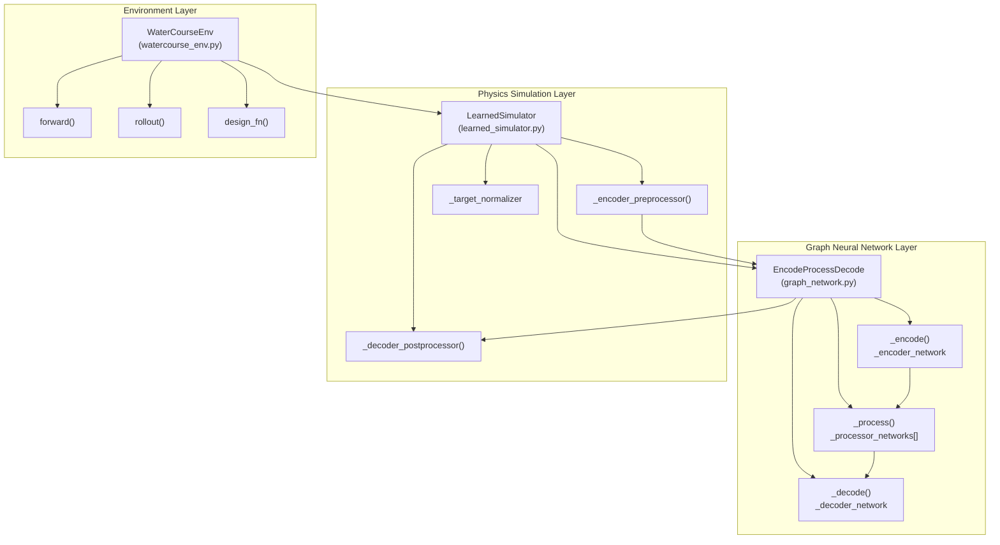
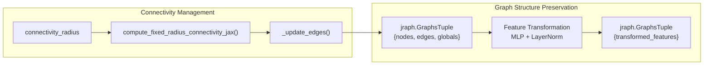

<!-- source: DeepWiki mcp.deepwiki.com · repo google-deepmind/inverse_design · page 4 Implementation Guide · fetched 2026-10-26 -->

# Implementation Guide

<details>
<summary>Relevant source files</summary>

The following files were used as context for generating this wiki page:

- [src/graph_network.py](src/graph_network.py)
- [src/learned_simulator.py](src/learned_simulator.py)
- [src/watercourse_env.py](src/watercourse_env.py)

</details>


This document provides detailed technical documentation for developers who want to understand or extend the inverse design system components. It covers the core implementation architecture, data flow patterns, and key extension points in the codebase.

For information about graph connectivity utilities and feature engineering, see [Graph Connectivity and Features](#4.1). For details on the normalization framework, see [Data Normalization System](#4.2). For environment setup and optimization implementation, see [Environment and Optimization](#4.3).

## Core Implementation Architecture

The system implements a three-layer architecture with clear separation of concerns between the graph neural network, physics simulation, and environment management.

### Primary Implementation Components



**Sources:** [src/graph_network.py:25-195](), [src/learned_simulator.py:33-132](), [src/watercourse_env.py:1-219]()

### Implementation Data Flow

The system processes graph-structured data through a series of transformations that maintain differentiability for optimization.

```mermaid
flowchart LR
    subgraph "Input Processing"
        InputGraph["jraph.GraphsTuple<br/>input_graph"]
        FlattenFn["_flatten_features_fn<br/>(hk.to_module)"]
    end
    
    subgraph "EncodeProcessDecode Pipeline"
        EncodeStep["_encode()<br/>_encoder_network"]
        ProcessStep["_process()<br/>message passing loops"]
        DecodeStep["_decode()<br/>_decoder_network"]
    end
    
    subgraph "Physics Integration"
        Prediction["normalized_prediction<br/>(network output)"]
        Inverse["_target_normalizer.inverse()"]
        Euler["euler_integrate_position()"]
    end
    
    subgraph "Environment Update"
        UpdateEdges["_update_edges()"]
        NewParticles["new_particles mask"]
        NextPosition["next_pos_seq"]
    end
    
    InputGraph --> FlattenFn
    FlattenFn --> EncodeStep
    EncodeStep --> ProcessStep
    ProcessStep --> DecodeStep
    DecodeStep --> Prediction
    Prediction --> Inverse
    Inverse --> Euler
    Euler --> UpdateEdges
    UpdateEdges --> NewParticles
    NewParticles --> NextPosition
```



**Sources:** [src/learned_simulator.py:77-111](), [src/graph_network.py:79-194](), [src/watercourse_env.py:59-111]()

## Key Implementation Patterns

### Module Initialization Pattern

The codebase follows a lazy initialization pattern where neural network modules are built only when first called:

| Component | Initialization Method | Key Parameters |
|-----------|----------------------|----------------|
| `EncodeProcessDecode` | `_networks_builder()` | `latent_size`, `mlp_hidden_size`, `num_message_passing_steps` |
| `LearnedSimulator` | `_maybe_build_modules()` | `connectivity_radius`, `graph_network_kwargs` |
| Normalizers | `get_accumulated_normalizer()` | `name` for variable scoping |

**Sources:** [src/graph_network.py:91-141](), [src/learned_simulator.py:66-76]()

### Graph Processing Pattern

All graph operations maintain the `jraph.GraphsTuple` structure while transforming node and edge features:



**Sources:** [src/graph_network.py:142-194](), [src/watercourse_env.py:35-56]()

### Residual Connection Implementation

The message passing steps implement residual connections for training stability:

```python
# From _process_step()
latent_graph_k = latent_graph_k._replace(
    nodes=latent_graph_k.nodes+latent_graph_prev_k.nodes,
    edges=latent_graph_k.edges+latent_graph_prev_k.edges)
```

**Sources:** [src/graph_network.py:175-190]()

## Extension Points

### Custom Graph Networks

To implement custom graph architectures, extend the `EncodeProcessDecode` class and override:

- `_networks_builder()` for custom MLP architectures
- `_process_step()` for custom message passing
- `_encode()` / `_decode()` for custom feature transformations

### Custom Physics Integration

The physics integration uses Euler method by default. To implement custom integrators, replace `euler_integrate_position()` with custom integration schemes in `_decoder_postprocessor()`.

### Custom Loss Functions

Loss functions follow the pattern: `loss_fn(graph) -> scalar`. Examples include:
- `max_x_loss_fn()` for particle position optimization
- `smooth_loss_fn()` for landscape smoothing

**Sources:** [src/watercourse_env.py:181-196]()

### Environment Customization

The environment can be extended by modifying:
- `design_fn()` for custom parameter transformations
- `forward()` for custom simulation steps  
- `build_initial_graph()` for custom initialization

**Sources:** [src/watercourse_env.py:113-149](), [src/watercourse_env.py:198-219]()

---

