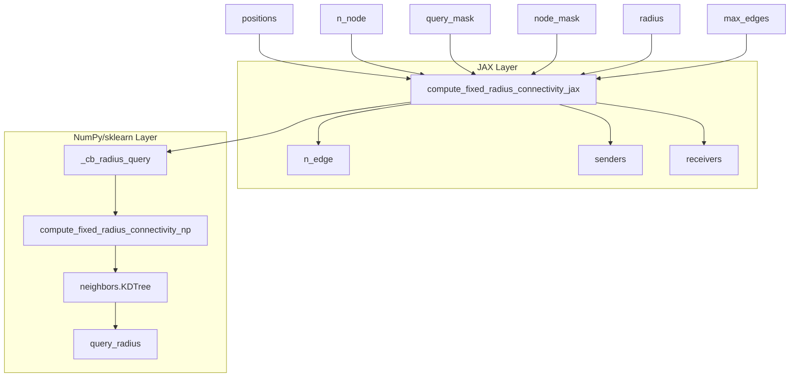
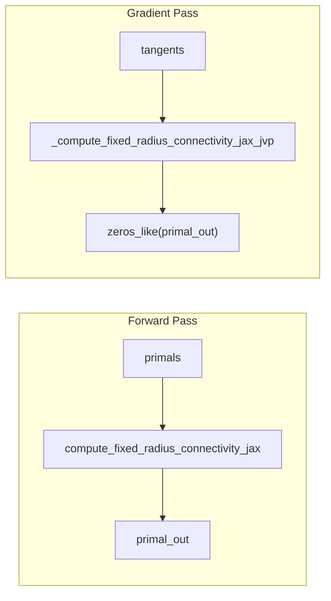
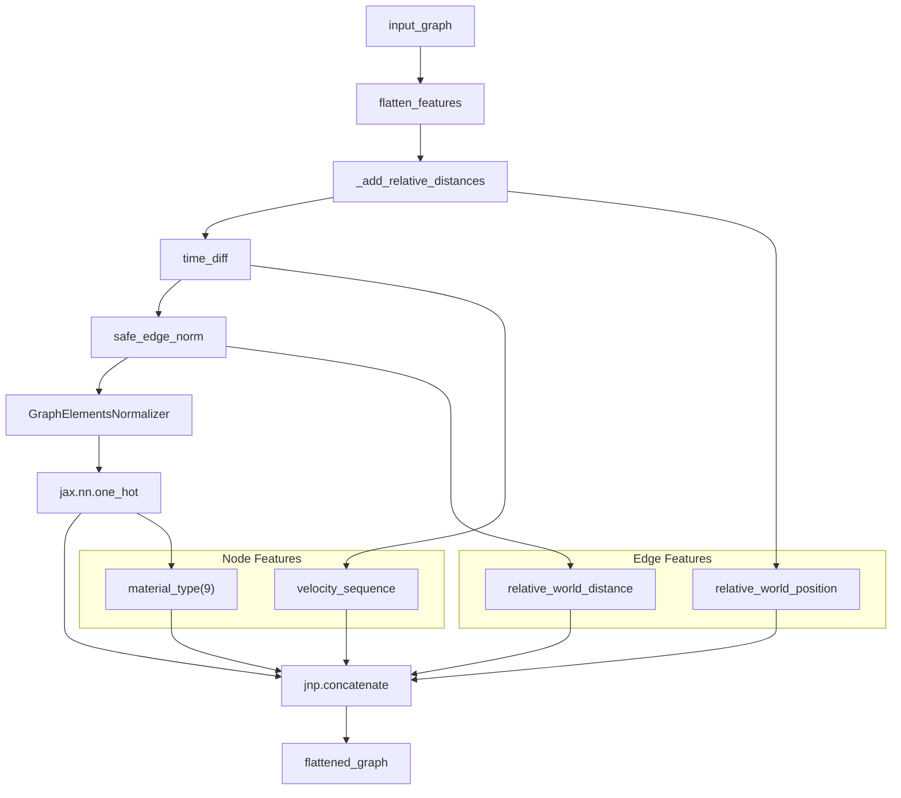
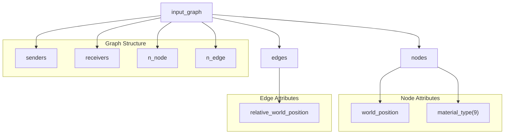

<!-- source: DeepWiki mcp.deepwiki.com · repo google-deepmind/inverse_design · page 4.1 Graph Connectivity and Features · fetched 2026-10-26 -->

# Graph Connectivity and Features

Relevant source files

The following files were used as context for generating this wiki page:

- [src/connectivity_utils.py](src/connectivity_utils.py)
- [src/model_utils.py](src/model_utils.py)

This document covers the technical implementation of graph connectivity computation and feature preprocessing in the inverse design system. It details how spatial relationships between particles are computed, how graph features are extracted and normalized, and how the data flows through the preprocessing pipeline before entering the neural network.

For information about the broader graph neural network architecture, see [Graph Neural Network Architecture](#3.1). For details about data normalization, see [Data Normalization System](#4.2).

## Purpose and Scope

The graph connectivity and features system provides two critical functions:

1. **Connectivity Computation**: Determining which particles should be connected by edges based on spatial proximity using fixed-radius connectivity
2. **Feature Engineering**: Extracting and preprocessing node and edge features from raw simulation data for consumption by the graph neural network

These components form the foundation of the graph representation used throughout the physics simulation pipeline.

## Graph Connectivity Computation

The system computes graph connectivity using a fixed-radius approach where particles within a specified distance become connected by edges. This spatial connectivity captures local particle interactions essential for physics simulation.

### Connectivity Architecture

Sources: [src/connectivity_utils.py:78-103](), [src/connectivity_utils.py:116-141]()

### Connectivity Implementation Details

The connectivity computation involves several key components:

| Component | Function | Purpose |
|-----------|----------|---------|
| `compute_fixed_radius_connectivity_jax` | Main JAX interface | Provides differentiable connectivity computation with custom JVP |
| `_cb_radius_query` | Host callback | Bridges JAX and NumPy for efficient spatial queries |
| `compute_fixed_radius_connectivity_np` | NumPy implementation | Uses sklearn KDTree for efficient radius-based neighbor search |

The system handles batched graphs by processing each graph separately while maintaining global indexing. The implementation includes several important features:

- **Bidirectional Edges**: All connections are made bidirectional for undirected graph representation [src/connectivity_utils.py:52-57]()
- **Self-Edge Removal**: Prevents particles from connecting to themselves [src/connectivity_utils.py:48-50]()
- **Padding Handling**: Manages variable-sized graphs through padding to maximum edge count [src/connectivity_utils.py:65-75]()
- **Masking Support**: Allows selective connectivity through query and node masks [src/connectivity_utils.py:35-46]()

### Custom Differentiation

The connectivity computation uses a custom JVP (Jacobian-vector product) that returns zero gradients, since connectivity structure should not change during optimization:

Sources: [src/connectivity_utils.py:105-113]()

## Feature Flattening and Preprocessing

The feature processing pipeline transforms raw simulation data into normalized, flattened feature vectors suitable for neural network consumption.

### Feature Processing Pipeline

Sources: [src/model_utils.py:26-91]()

### Node Feature Extraction

The system extracts two primary types of node features:

1. **Velocity Sequence**: Computed from position differences using finite differences
   - Calculated by `time_diff(position_sequence)` [src/model_utils.py:93-95]()
   - Flattened to 1D array per node [src/model_utils.py:51-52]()
   - Optionally normalized using `GraphElementsNormalizer` [src/model_utils.py:54-57]()

2. **Material Type**: One-hot encoded material classification
   - Applied to 9 material types [src/model_utils.py:61]()
   - No normalization required for categorical data

### Edge Feature Extraction

Edge features capture spatial relationships between connected particles:

| Feature | Computation | Purpose |
|---------|-------------|---------|
| `relative_world_position` | `particle_pos[receivers] - particle_pos[senders]` | Vector displacement between particles |
| `relative_world_distance` | `safe_edge_norm(relative_world_position)` | Scalar distance magnitude |

The `safe_edge_norm` function prevents NaN values in padded graph elements by adding small perturbations to zero-norm vectors in padding regions [src/model_utils.py:98-105]().

### Normalization Integration

When `apply_normalization=True`, the system:

1. Creates a `GraphElementsNormalizer` instance [src/model_utils.py:34-36]()
2. Normalizes velocity sequences using accumulated statistics [src/model_utils.py:55-56]()
3. Scales relative positions and distances by connectivity radius [src/model_utils.py:75-77]()

## Data Structures and Graph Representation

The system works with Jraph graph structures containing specific node and edge attributes:

### Input Graph Structure

Sources: [src/model_utils.py:44](), [src/model_utils.py:61](), [src/model_utils.py:67]()

### Output Graph Structure

After feature processing, the graph is transformed to contain flattened feature arrays:

- **Nodes**: Concatenated array of `[velocity_features, material_one_hot]`
- **Edges**: Concatenated array of `[relative_position, relative_distance]`  
- **Globals**: Set to `None` as global features are not used [src/model_utils.py:89]()

## Integration with Neural Network Pipeline

The connectivity and feature processing components integrate with the broader system through several key interfaces:

1. **Connectivity Radius**: Shared parameter used for both connectivity computation and feature normalization
2. **Padded Graph Support**: Both modules handle variable-sized batched graphs through padding
3. **Normalization Framework**: Features are preprocessed using the same normalization system used throughout the pipeline

The processed graphs are then consumed by the `EncodeProcessDecode` graph neural network architecture for physics simulation.

Sources: [src/connectivity_utils.py:1-142](), [src/model_utils.py:1-126]()

---

