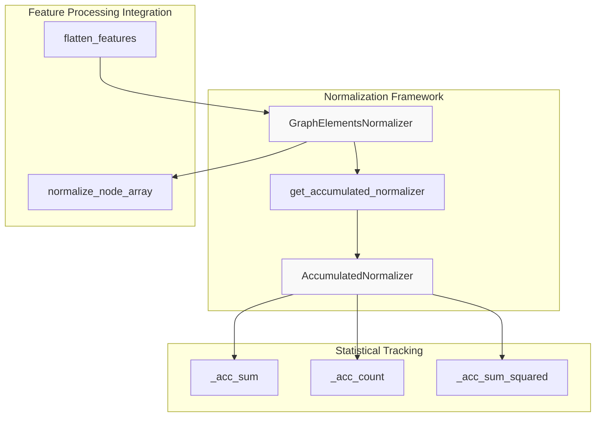
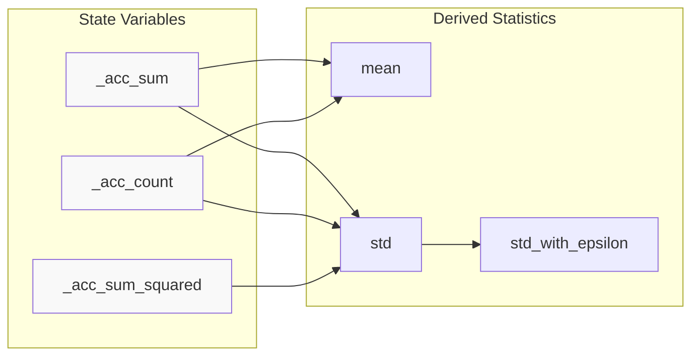
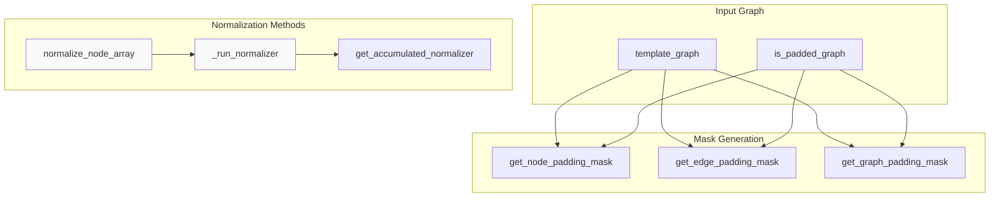
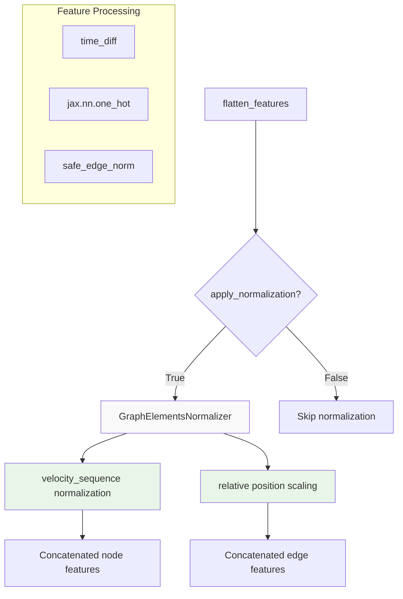

<!-- source: DeepWiki mcp.deepwiki.com · repo google-deepmind/inverse_design · page 4.2 Data Normalization System · fetched 2026-10-26 -->

# Data Normalization System

<details>
<summary>Relevant source files</summary>

The following files were used as context for generating this wiki page:

- [src/model_utils.py](src/model_utils.py)
- [src/normalizers.py](src/normalizers.py)

</details>


This document covers the data normalization framework used throughout the inverse design system to ensure stable training and inference of graph neural networks. The normalization system provides standardization of graph node and edge features through accumulated statistics and specialized handling of padded graph structures.

For information about graph connectivity and feature engineering, see [Graph Connectivity and Features](#4.1). For details on the neural network architecture that consumes these normalized features, see [Graph Neural Network Architecture](#3.1).

## Purpose and Scope

The normalization system serves three primary functions:

1. **Statistical Normalization**: Accumulates mean and standard deviation statistics for consistent feature scaling
2. **Graph-Aware Processing**: Handles padded graphs and different graph element types (nodes, edges, globals)
3. **Integration Support**: Provides seamless integration with the feature processing pipeline

## Core Components Overview

The normalization system consists of two main classes and their supporting infrastructure:



**Normalization Component Architecture**

Sources: [src/normalizers.py:23-159](), [src/model_utils.py:26-91]()

## AccumulatedNormalizer System

The `AccumulatedNormalizer` class provides the core statistical normalization functionality using Haiku's state management:

| Property | Description | Implementation |
|----------|-------------|----------------|
| `mean` | Running average of accumulated features | `_acc_sum / _safe_count` |
| `std` | Standard deviation with numerical stability | `sqrt(variance)` with non-negative clipping |
| `std_with_epsilon` | Standard deviation with minimum threshold | `max(std, std_epsilon)` |

### Statistical Accumulation

The accumulator maintains three state variables for computing statistics:



**Statistical Computation Flow**

The normalization transformation follows the standard formula:
```
normalized_data = (batched_data - mean) / std_with_epsilon
```

The inverse transformation reconstructs original values:
```
original_data = normalized_data * std_with_epsilon + mean
```

Sources: [src/normalizers.py:27-114]()

## Graph Elements Normalization

The `GraphElementsNormalizer` class extends normalization to handle graph-structured data with proper padding mask support:

### Padding Mask Integration



**Graph Padding Mask Processing**

The `GraphElementsNormalizer` automatically creates appropriate padding masks when `is_padded_graph=True`:

- **Node mask**: `jraph.get_node_padding_mask(template_graph)`
- **Edge mask**: `jraph.get_edge_padding_mask(template_graph)`  
- **Graph mask**: `jraph.get_graph_padding_mask(template_graph)`

### Name Management

The normalizer enforces unique naming to prevent statistics collision:

```python
def _run_normalizer(self, name, array, mask):
    if name in self._names_used:
        raise ValueError(f'Attempt to reuse name {name}')
    self._names_used.append(name)
```

Sources: [src/normalizers.py:116-159]()

## Integration with Feature Processing

The normalization system integrates with the feature processing pipeline through the `flatten_features` function:

### Conditional Normalization



**Feature Processing with Normalization**

### Node Feature Normalization

The system normalizes velocity sequences while preserving material type one-hot encodings:

1. **Velocity sequence**: Computed via finite differences and normalized
2. **Material types**: One-hot encoded without normalization

```python
# Velocity normalization
flat_velocity_sequence = graph_elements_normalizer.normalize_node_array(
    "velocity_sequence", flat_velocity_sequence)

# Material types (no normalization needed)
node_features.append(jax.nn.one_hot(input_graph.nodes["material_type(9)"], 9))
```

### Edge Feature Normalization

Edge features receive scaling based on the connectivity radius:

```python
if apply_normalization:
    relative_world_position = relative_world_position / connectivity_radius
    relative_world_distance = relative_world_distance / connectivity_radius
```

Sources: [src/model_utils.py:26-91]()

## Implementation Details

### Haiku State Management

The `AccumulatedNormalizer` leverages Haiku's state management for persistent statistics:

| State Variable | Shape | Initialization | Purpose |
|---------------|-------|----------------|---------|
| `acc_sum` | `(feature_dim,)` | `jnp.zeros` | Sum of all feature values |
| `acc_count` | `()` | `jnp.zeros` | Number of accumulations |
| `acc_sum_squared` | `(feature_dim,)` | `jnp.zeros` | Sum of squared values |

### Numerical Stability

The implementation includes several numerical stability measures:

1. **Safe count**: `jnp.maximum(self._acc_count, 1.)` prevents division by zero
2. **Variance clipping**: `jnp.maximum(var, 0.)` prevents negative variance
3. **Epsilon threshold**: `std_epsilon=1e-5` ensures minimum standard deviation
4. **Float32 precision**: All accumulations use `dtype=jnp.float32`

### Padding-Safe Operations

For padded graphs, the `safe_edge_norm` function prevents NaN values in padding elements:

```python
def safe_edge_norm(array, graph, is_padded_graph, keepdims=False):
    if is_padded_graph:
        padding_mask = jraph.get_edge_padding_mask(graph)
        epsilon = 1e-8
        perturb = jnp.logical_not(padding_mask) * epsilon
        array += jnp.expand_dims(perturb, range(1, len(array.shape)))
    return jnp.linalg.norm(array, axis=-1, keepdims=keepdims)
```

Sources: [src/normalizers.py:27-159](), [src/model_utils.py:98-105]()

---

