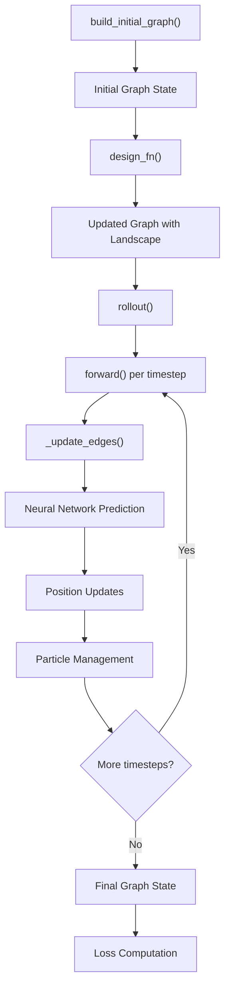
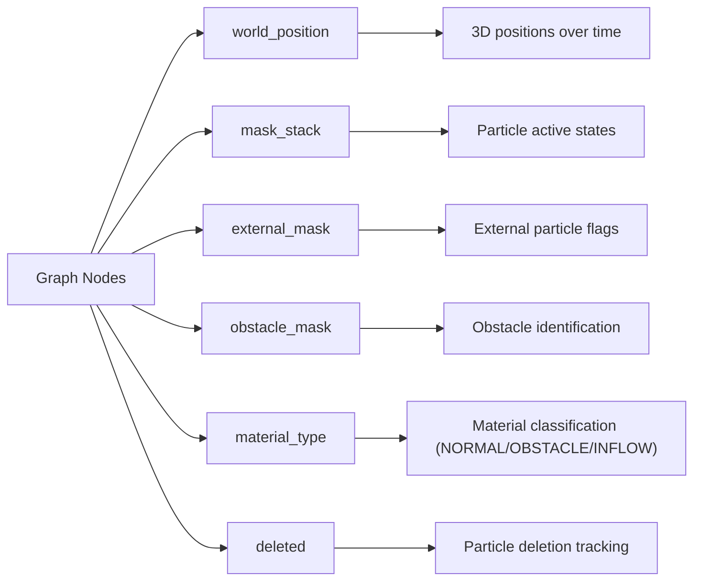
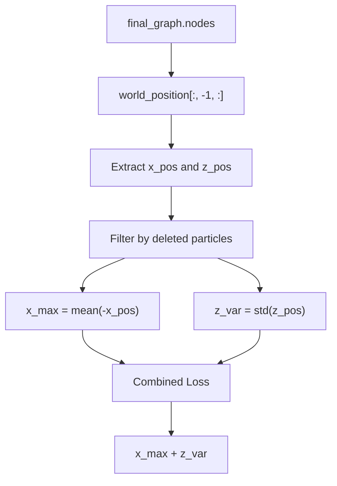
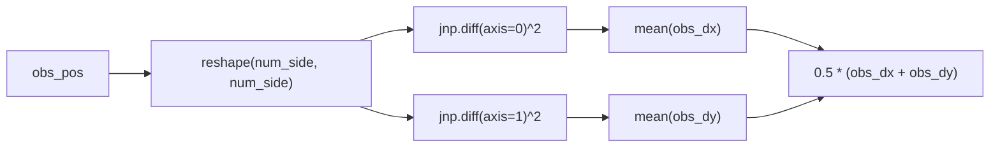
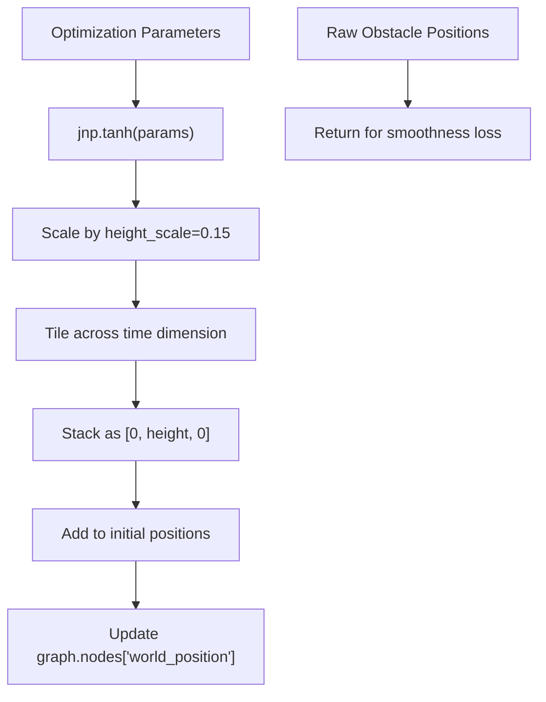
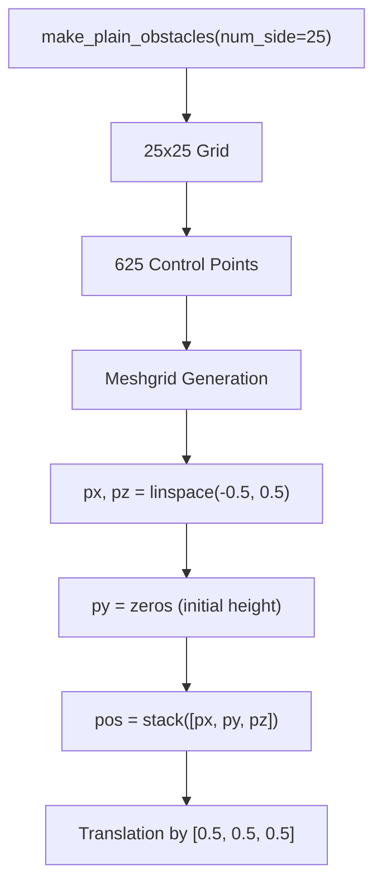
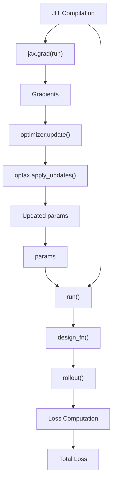
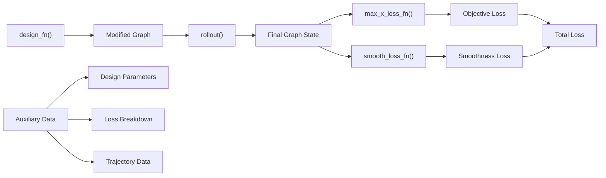
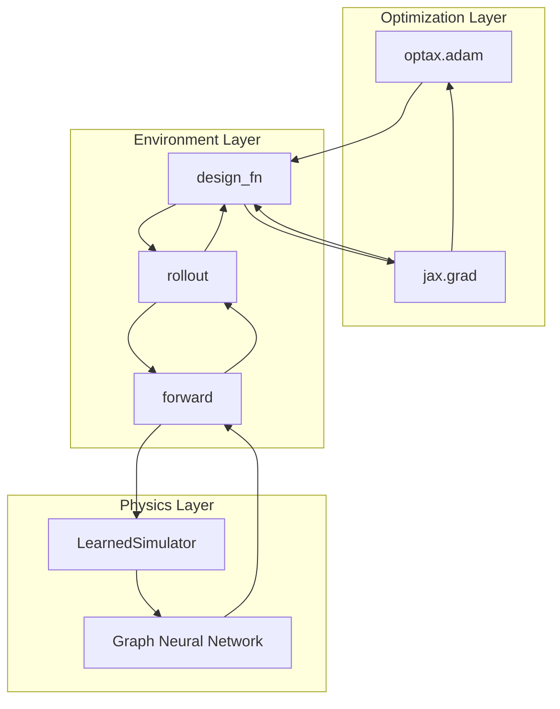

<!-- source: DeepWiki mcp.deepwiki.com · repo google-deepmind/inverse_design · page 4.3 Environment and Optimization · fetched 2026-10-26 -->

# Environment and Optimization

Relevant source files

The following files were used as context for generating this wiki page:

- [demo_design_optimization.ipynb](demo_design_optimization.ipynb)
- [src/watercourse_env.py](src/watercourse_env.py)

This page provides technical documentation for the WaterCourse environment implementation and the gradient-based optimization system used for inverse design. It covers the environment simulation mechanics, loss function design, parameter-to-landscape mapping, and the optimization loop that enables automated landscape design.

For information about the underlying physics simulation engine integration, see [3.2](#3.2). For details on the graph neural network architecture that powers the simulation, see [3.1](#3.1).

## WaterCourse Environment Implementation

The `WaterCourseEnv` system provides a 3D fluid simulation environment built around graph-based particle dynamics. The environment manages particle states, obstacle interactions, and temporal evolution of the simulation.

### Environment Simulation Flow

Sources: [src/watercourse_env.py:152-165](), [src/watercourse_env.py:59-111]()

The core simulation operates through several key functions:

| Function | Purpose | Key Operations |
|----------|---------|----------------|
| `build_initial_graph()` | Initialize simulation state | Pad graphs, create inflow stack, handle stray particles |
| `forward()` | Single timestep simulation | Update edges, run neural network, manage particles |
| `rollout()` | Multi-timestep simulation | Apply `forward()` iteratively using `jax.lax.scan` |
| `_update_edges()` | Graph connectivity | Recompute particle-particle and particle-obstacle edges |

### Graph State Management

The environment maintains several critical node features:

Sources: [src/watercourse_env.py:73-109]()

The particle management system includes automatic deletion of particles that fall below the ground surface and dynamic addition of new particles from the inflow source [src/watercourse_env.py:94-100]().

## Loss Functions and Objectives

The optimization system employs two complementary loss functions that guide landscape design toward desired fluid behavior.

### Objective Loss Function

The `max_x_loss_fn()` implements the primary objective of maximizing particle travel distance in the x-direction:

Sources: [src/watercourse_env.py:181-187]()

This loss function encourages particles to travel far in the positive x-direction while maintaining reasonable spread in the z-direction. The negative sign in `jnp.mean(-x_pos)` converts the maximization problem into a minimization suitable for gradient descent.

### Smoothness Regularization

The `smooth_loss_fn()` provides regularization to prevent overly sharp landscape features:

Sources: [src/watercourse_env.py:190-195]()

The smoothness loss computes the mean squared differences between adjacent height values in both spatial dimensions, encouraging gradual rather than abrupt terrain changes.

## Design Parameter System

The `design_fn()` function serves as the critical interface between optimization parameters and the physical landscape representation.

### Parameter-to-Landscape Mapping

Sources: [src/watercourse_env.py:198-218]()

The design function applies several transformations:

1. **Bounded Transformation**: `jnp.tanh()` constrains height values to [-1, 1] range
2. **Physical Scaling**: `height_scale=0.15` limits maximum terrain elevation
3. **Temporal Consistency**: Heights are tiled across all time steps
4. **Coordinate Mapping**: Only Y-axis (height) is modified, X and Z remain fixed

### Landscape Grid Structure

The system uses a structured grid approach for landscape representation:

Sources: [src/watercourse_env.py:168-178]()

## Optimization Loop Implementation

The optimization system integrates JAX automatic differentiation with Optax optimizers to enable gradient-based landscape design.

### Optimization Architecture

Sources: [demo_design_optimization.ipynb:156-178](), [demo_design_optimization.ipynb:209-214]()

The optimization loop implements several key patterns:

| Component | Implementation | Purpose |
|-----------|----------------|---------|
| `@jax.jit` decorator | Applied to `run()` and `opt_step()` | Compilation for performance |
| `jax.grad(has_aux=True)` | Gradient computation with auxiliaries | Enable loss decomposition tracking |
| `optax.adam()` | Adam optimizer with learning rate 0.05 | Adaptive gradient descent |
| `jax.lax.scan` | Used in `rollout()` | Efficient sequential operations |

### Loss Integration and Tracking

The `run()` function combines multiple loss terms and provides detailed auxiliary information:

Sources: [demo_design_optimization.ipynb:166-178]()

The auxiliary data structure enables comprehensive tracking of optimization progress, including individual loss components and intermediate simulation results for visualization and analysis.

## Environment-Optimizer Integration

The system achieves end-to-end differentiability through careful integration of environment simulation and optimization components.

### Differentiable Simulation Pipeline

Sources: [src/watercourse_env.py:152-165](), [demo_design_optimization.ipynb:127-130]()

The integration leverages JAX's automatic differentiation capabilities to propagate gradients through the entire simulation pipeline, from landscape parameters through graph neural network predictions to final objective values. The `jax.checkpoint` decorator on the step function [src/watercourse_env.py:155]() optimizes memory usage during gradient computation through the temporal rollout sequence.

---

