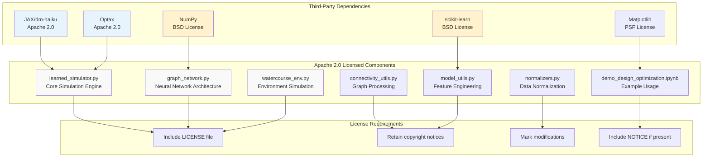
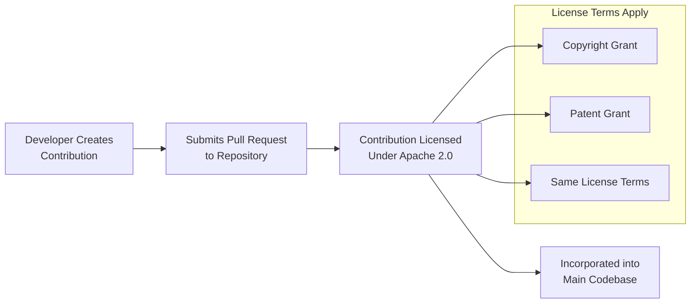
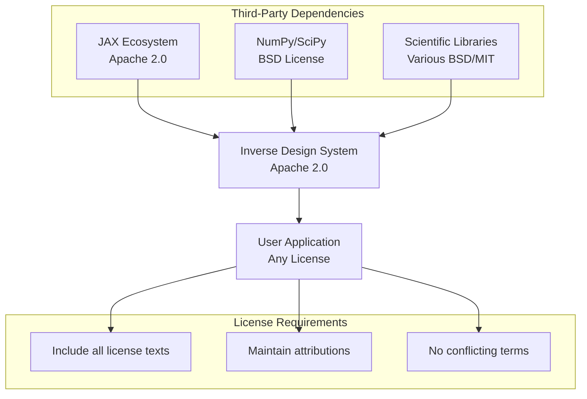

<!-- source: DeepWiki mcp.deepwiki.com · repo google-deepmind/inverse_design · page 5.2 License and Legal · fetched 2026-10-26 -->

# License and Legal

Relevant source files

The following files were used as context for generating this wiki page:

- [LICENSE](LICENSE)

This document covers the licensing terms and legal requirements for using, modifying, and distributing the inverse design system. It outlines the Apache 2.0 license terms that govern this codebase and provides guidance on compliance requirements for users and contributors.

For information about contributing code changes, see [Contributing Guidelines](#5.1).

## License Overview

The inverse design system is licensed under the Apache License, Version 2.0. This is a permissive open-source license that allows broad usage while providing patent protection and requiring proper attribution.

### License Grant Summary

| Permission | Description | Requirements |
|------------|-------------|--------------|
| **Use** | Run the software for any purpose | Include license text |
| **Modify** | Create derivative works and modifications | Mark changed files |
| **Distribute** | Share copies in source or binary form | Retain attribution notices |
| **Sublicense** | Include in larger works under different licenses | Include original license |
| **Patent Grant** | Use any patents contributed by authors | No patent litigation against project |

### Key License Terms

The Apache 2.0 license provides several important protections and requirements:

**Copyright License** ([LICENSE:67-72]()): Contributors grant a perpetual, worldwide, royalty-free license to use, reproduce, modify, and distribute the work.

**Patent License** ([LICENSE:74-88]()): Contributors grant patent licenses for their contributions, with termination if you sue over patent infringement.

**Attribution Requirements** ([LICENSE:95-106]()): When redistributing, you must:
- Include a copy of the license
- State changes made to files
- Retain copyright and attribution notices
- Include NOTICE file contents if present

Sources: [LICENSE:1-203]()

## License Architecture

The following diagram shows how licensing applies across the system components:

This diagram illustrates that all core system components are under Apache 2.0, while third-party dependencies have compatible but different licenses.

Sources: [LICENSE:1-203]()

## Compliance Requirements

### For End Users

When using the inverse design system in your projects:

1. **Include License Text**: Copy the [LICENSE]() file into your distribution
2. **Attribution**: Maintain copyright notices in source files
3. **No Warranty**: Understand the software is provided "AS IS" ([LICENSE:144-153]())

### For Redistributors

When distributing modified versions:

1. **Mark Changes**: Clearly indicate modified files ([LICENSE:98-99]())
2. **Preserve Notices**: Keep all copyright and attribution notices ([LICENSE:101-105]())
3. **License Inclusion**: Provide copy of Apache 2.0 license ([LICENSE:95-96]())

### For Commercial Use

The Apache 2.0 license allows commercial use without royalties:

- No restriction on commercial applications
- No requirement to open-source derivative works
- Patent protection from contributors
- Must comply with attribution requirements

Sources: [LICENSE:67-135]()

## Contribution Licensing

### Contributor License Agreement

All contributions are licensed under the same Apache 2.0 terms ([LICENSE:131-137]()):

### Patent Considerations

Contributors automatically grant patent licenses for their contributions ([LICENSE:74-88]()):

- **Patent Grant**: License to use patents in contributed code
- **Defensive Termination**: Patent license terminates if you sue the project
- **Scope**: Limited to patents necessarily infringed by the contribution

Sources: [LICENSE:49-137]()

## Third-Party Dependencies

### Compatible Licenses

The system relies on several third-party libraries with compatible licenses:

| Library | License | Compatibility |
|---------|---------|---------------|
| JAX | Apache 2.0 | ✅ Same license |
| dm-haiku | Apache 2.0 | ✅ Same license |
| Optax | Apache 2.0 | ✅ Same license |
| NumPy | BSD 3-Clause | ✅ Compatible |
| scikit-learn | BSD 3-Clause | ✅ Compatible |
| Matplotlib | PSF License | ✅ Compatible |

### License Compatibility Flow

Users must ensure compliance with all dependency licenses when redistributing.

Sources: [LICENSE:1-203]()

## Warranty and Liability

### Disclaimer of Warranty

The software is provided "AS IS" without warranties ([LICENSE:144-153]()):

- **No Express Warranties**: No guarantees about functionality
- **No Implied Warranties**: No warranties of merchantability or fitness
- **User Responsibility**: You assume all risks of use

### Limitation of Liability

Contributors have limited liability ([LICENSE:154-165]()):

- **No Damages**: Contributors not liable for any damages
- **Broad Coverage**: Includes direct, indirect, and consequential damages
- **Exception**: Deliberate and grossly negligent acts may still create liability

### Risk Assumption

Users are responsible for:
- Determining appropriateness of use
- Assuming risks of redistribution
- Complying with applicable laws
- Understanding system limitations

Sources: [LICENSE:144-175]()

## Legal Compliance Checklist

### Before Using the System

- [ ] Review Apache 2.0 license terms
- [ ] Understand warranty disclaimers
- [ ] Verify compatibility with your project's license
- [ ] Check third-party dependency licenses

### Before Redistributing

- [ ] Include complete LICENSE file
- [ ] Maintain all copyright notices
- [ ] Mark any modified files
- [ ] Include NOTICE file if present
- [ ] Verify third-party license compliance

### Before Contributing

- [ ] Understand contribution licensing
- [ ] Ensure you have rights to contribute
- [ ] Follow contribution guidelines (see [Contributing Guidelines](#5.1))
- [ ] Understand patent implications

Sources: [LICENSE:1-203]()