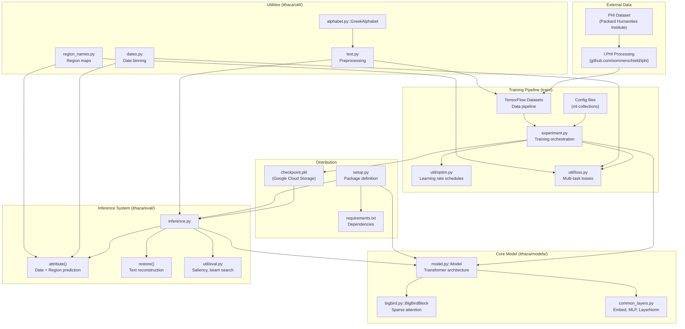
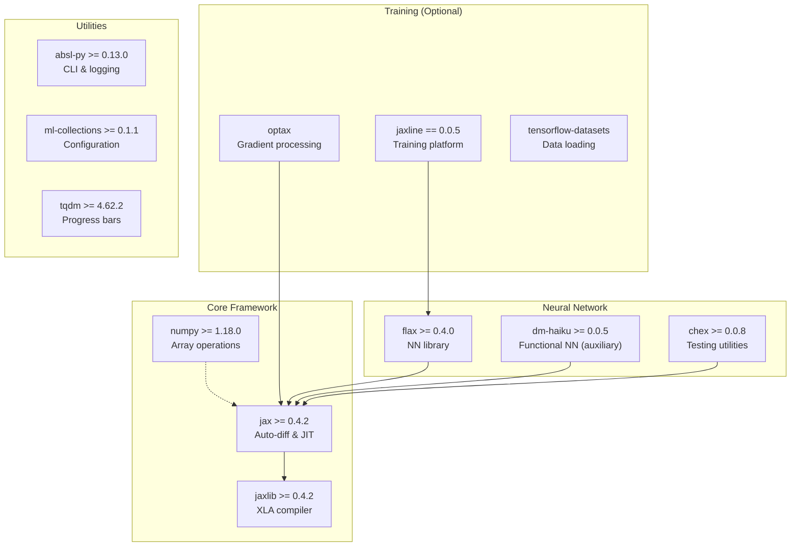
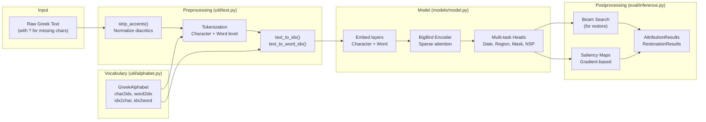

<!-- source: DeepWiki mcp.deepwiki.com · repo google-deepmind/ithaca · page 1 Overview · fetched 2026-10-26 -->

# Overview

<details>
<summary>Relevant source files</summary>

The following files were used as context for generating this wiki page:

- [README.md](README.md)
- [requirements.txt](requirements.txt)
- [setup.py](setup.py)

</details>


This document provides a high-level introduction to the Ithaca project, a deep neural network system for restoring and attributing ancient Greek inscriptions. It covers the project's purpose, core capabilities, system architecture, and technology stack. For detailed information about specific components, refer to the subsections below or the specialized pages linked throughout this document.

## Purpose and Scope

Ithaca is a machine learning system designed to assist historians and epigraphers in three tasks:

1. **Text Restoration**: Reconstructing missing or damaged characters in ancient Greek inscriptions
2. **Geographical Attribution**: Predicting the original location of inscriptions across 84 regions
3. **Chronological Attribution**: Dating inscriptions within the period 800 BCE to 800 CE

The system combines a Transformer-based neural network architecture with interpretability features to support collaborative research between AI and historians. This overview covers the high-level system design, core components, and how they integrate. For installation and usage, see [Getting Started](#2). For architectural details, see [Model Architecture](#3).

**Sources:** [README.md:1-48]()

## What is Ithaca?

Ithaca is a deep learning system built on the JAX ecosystem that processes ancient Greek inscriptions to provide three types of predictions simultaneously. The system achieves 62% accuracy in text restoration independently, and when used collaboratively with historians, their combined performance reaches 72% accuracy. For geographical attribution, Ithaca achieves 71% accuracy, and for dating, it predicts within 30 years of ground-truth ranges.

The codebase is distributed as a Python package with two installation modes:
- **Core installation** ([setup.py:35]()): Inference components only, excluding training code
- **Full installation** ([setup.py:38-44]()): Includes training infrastructure with additional dependencies

**Sources:** [README.md:20-43](), [setup.py:14-44]()

## Core Capabilities and Code Mapping

The following diagram maps Ithaca's user-facing capabilities to their corresponding code implementations:

```mermaid
graph TB
    subgraph "User Capabilities"
        RESTORE["Text Restoration<br/>(Fill missing characters)"]
        ATTRIB_GEO["Geographical Attribution<br/>(Predict region)"]
        ATTRIB_DATE["Chronological Attribution<br/>(Predict date)"]
    end
    
    subgraph "ithaca.eval Module"
        INFER_PY["inference.py"]
        RESTORE_FN["restore()"]
        ATTRIB_FN["attribute()"]
        RESTORE_RESULT["RestorationResults"]
        ATTRIB_RESULT["AttributionResults"]
        
        INFER_PY --> RESTORE_FN
        INFER_PY --> ATTRIB_FN
        RESTORE_FN --> RESTORE_RESULT
        ATTRIB_FN --> ATTRIB_RESULT
    end
    
    subgraph "User Interfaces"
        COLAB["colabs/ithaca_inference.ipynb<br/>(Interactive)"]
        CLI["inference_example.py<br/>(Command-line)"]
        API["Python API<br/>(Programmatic)"]
    end
    
    subgraph "ithaca.models Module"
        MODEL_PY["model.py"]
        MODEL_CLASS["Model class"]
        BIGBIRD_PY["bigbird.py"]
        LAYERS_PY["common_layers.py"]
        
        MODEL_PY --> MODEL_CLASS
        MODEL_CLASS --> BIGBIRD_PY
        MODEL_CLASS --> LAYERS_PY
    end
    
    subgraph "Supporting Utilities"
        ALPHABET["util/alphabet.py<br/>GreekAlphabet"]
        TEXT["util/text.py<br/>Text processing"]
        DATES["util/dates.py<br/>Date binning"]
        REGIONS["util/region_names.py<br/>Region mappings"]
    end
    
    RESTORE --> RESTORE_FN
    ATTRIB_GEO --> ATTRIB_FN
    ATTRIB_DATE --> ATTRIB_FN
    
    COLAB --> RESTORE_FN
    COLAB --> ATTRIB_FN
    CLI --> RESTORE_FN
    CLI --> ATTRIB_FN
    API --> RESTORE_FN
    API --> ATTRIB_FN
    
    RESTORE_FN --> MODEL_CLASS
    ATTRIB_FN --> MODEL_CLASS
    
    RESTORE_FN --> ALPHABET
    RESTORE_FN --> TEXT
    ATTRIB_FN --> DATES
    ATTRIB_FN --> REGIONS
```



**Capability-to-Code Mapping:**

| User Capability | Primary Function | Result Type | Key Dependencies |
|----------------|------------------|-------------|------------------|
| Text Restoration | `inference.restore()` | `RestorationResults` | `GreekAlphabet`, beam search |
| Geographical Attribution | `inference.attribute()` | `AttributionResults` | Region mappings (84 classes) |
| Chronological Attribution | `inference.attribute()` | `AttributionResults` | Date binning utilities |

**Sources:** [setup.py:35](), README.md structure

## System Architecture

Ithaca's architecture consists of three major subsystems: Training, Model Core, and Inference. The following diagram shows how these components interact:



**Key Architectural Decisions:**

1. **Separation of Training and Inference**: The [setup.py:35]() excludes the `train/` directory from the default installation, allowing lightweight deployment for inference-only use cases.

2. **JAX-based Implementation**: All model code uses JAX for automatic differentiation and JIT compilation, with Flax for neural network modules.

3. **Multi-task Learning**: The model simultaneously predicts text restoration, geographical location, and date, sharing representations across tasks ([model.py]()).

4. **Checkpoint-based Deployment**: Trained models are serialized as `checkpoint.pkl` files and distributed separately from the codebase via Google Cloud Storage.

**Sources:** [setup.py:14-44](), [README.md:118-125]()

## Technology Stack

Ithaca is built on the JAX ecosystem with the following core dependencies:



**Dependency Categories:**

| Category | Dependencies | Installation Mode |
|----------|-------------|-------------------|
| Core (Always) | JAX, JAXlib, Flax, NumPy, Haiku, Chex | `pip install ithaca` |
| Utilities (Always) | absl-py, ml-collections, tqdm | `pip install ithaca` |
| Training (Optional) | Optax, Jaxline, TensorFlow Datasets | `pip install ithaca[train]` |

The core installation is sufficient for running inference with pre-trained models. The training installation is required only for training new models or modifying the training pipeline. For detailed installation instructions, see [Installation](#2.1).

**Sources:** [requirements.txt:1-10](), [setup.py:37-44]()

## Component Overview

### Model Components

The neural network implementation is organized in `ithaca/models/`:

- **[model.py]()**: Defines the `Model` class, the main Transformer-based architecture
- **[bigbird.py]()**: Implements `BigBirdBlock` and `BigBirdSelfAttention` for sparse attention patterns
- **[common_layers.py]()**: Provides reusable components (`Embed`, `AddPositionEmbs`, `MlpBlock`, `LayerNorm`, `classifier_head`)

For detailed architecture documentation, see [Model Architecture](#3).

### Training Components

Training infrastructure resides in `train/` (excluded from default installation):

- **[train/experiment.py]()**: Orchestrates training loops using the Jaxline platform
- **Training configuration**: Uses `ml-collections` for hyperparameter management
- **Multi-task loss**: Defined in `ithaca/util/loss.py`, combining date, region, mask, and NSP losses

For training details, see [Training System](#4).

### Inference Components

Inference functionality is in `ithaca/eval/`:

- **[ithaca/eval/inference.py]()**: Core inference functions `attribute()` and `restore()`
- **Result types**: `AttributionResults` and `RestorationResults` (NamedTuples)
- **Interactive interface**: [colabs/ithaca_inference.ipynb]()
- **CLI tool**: [inference_example.py]()

For inference documentation, see [Inference System](#5).

### Utility Modules

Support utilities in `ithaca/util/`:

- **[alphabet.py]()**: `GreekAlphabet` class for character/word vocabulary management
- **[text.py]()**: Text preprocessing (accent stripping, tokenization, augmentation)
- **[dates.py]()**: Date binning and conversion utilities
- **[region_names.py]()**: Geographic region mappings (84 subregions)
- **[loss.py]()**: Loss function implementations
- **[optim.py]()**: Learning rate schedules and optimization utilities
- **[eval.py]()**: Evaluation utilities (beam search, saliency, metrics)

For utility documentation, see [Data Processing Utilities](#6).

**Sources:** [setup.py:35](), directory structure

## Data Flow

The following diagram illustrates how data flows through the system from raw inscriptions to predictions:



**Processing Steps:**

1. **Input**: Ancient Greek text with `?` characters marking damaged/missing parts
2. **Preprocessing**: Accent normalization, tokenization at character and word levels
3. **Vocabulary Mapping**: Convert text to numerical indices using `GreekAlphabet`
4. **Model Forward Pass**: Embeddings → BigBird encoder → Multi-task heads
5. **Postprocessing**: Beam search for restoration, saliency computation for interpretability
6. **Output**: Structured results with predictions and confidence scores

For detailed data processing documentation, see [Data Processing Utilities](#6).

**Sources:** System diagrams, [setup.py:35]()

## Quick Navigation

- **Installation and Usage**: [Getting Started](#2)
- **Model Details**: [Model Architecture](#3)
- **Training New Models**: [Training System](#4)
- **Running Inference**: [Inference System](#5)
- **Data Processing**: [Data Processing Utilities](#6)
- **Development**: [Development Guide](#7)
- **API Reference**: [API Reference](#8)

## Package Distribution

Ithaca is distributed as a Python package via PyPI. The [setup.py]() defines two installation modes:

**Standard Installation (inference only):**
```sh
pip install ithaca
```

This installs core dependencies from [requirements.txt:1-10]() and all modules except `train/`.

**Full Installation (with training):**
```sh
pip install ithaca[train]
```

This adds training dependencies: `optax`, `jaxline==0.0.5`, and `tensorflow-datasets` ([setup.py:38-44]()).

**Model Checkpoint:**

The trained model weights are not included in the package. Download separately:
```sh
curl --output checkpoint.pkl https://storage.googleapis.com/ithaca-resources/models/checkpoint_v1.pkl
```

For complete installation instructions, see [Installation](#2.1).

**Sources:** [setup.py:14-52](), [README.md:79-114]()

---

This overview provides the foundation for understanding Ithaca's architecture and capabilities. For detailed documentation of specific components, navigate to the relevant sections using the links above.

---

