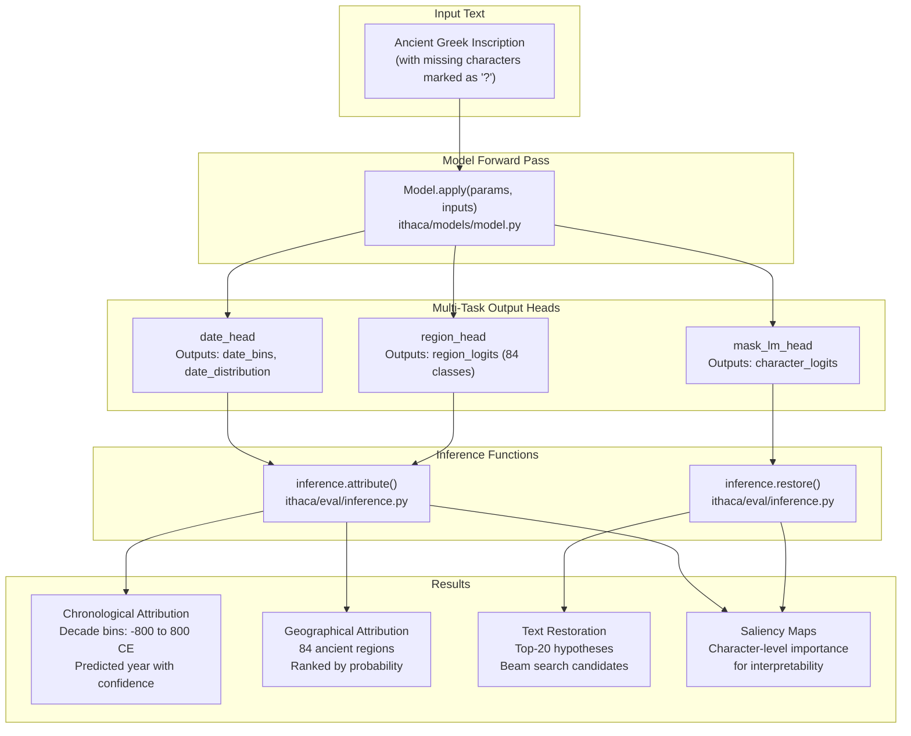
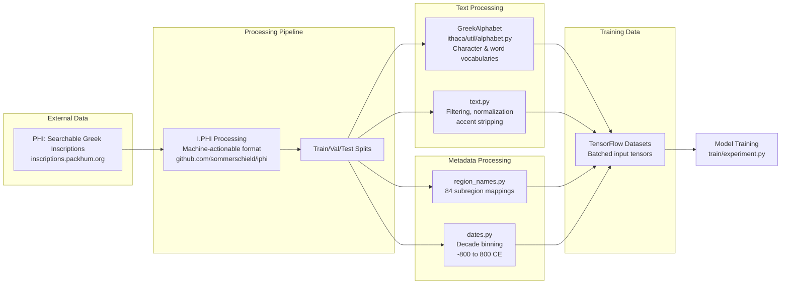
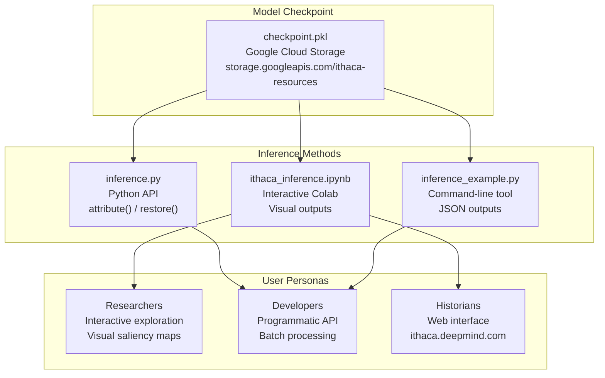

<!-- source: DeepWiki mcp.deepwiki.com · repo google-deepmind/ithaca · page 1.1 What is Ithaca? · fetched 2026-10-26 -->

# What is Ithaca?

<details>
<summary>Relevant source files</summary>

The following files were used as context for generating this wiki page:

- [README.md](README.md)
- [colabs/ithaca_inference.ipynb](colabs/ithaca_inference.ipynb)

</details>


This page introduces the Ithaca project: a deep neural network system for assisting historians and epigraphists with the restoration, geographical attribution, and chronological dating of ancient Greek inscriptions. It covers the project's purpose, core capabilities, historical context, and research applications.

For information about the model architecture and technical implementation, see [Model Architecture](#3). For training procedures, see [Training System](#4). For performing inference with pre-trained models, see [Inference System](#5).

---

## Purpose and Scope

Ithaca is a deep learning system designed to assist historians and epigraphists with three fundamental tasks in the study of ancient Greek inscriptions:

| Task | Description | Performance |
|------|-------------|-------------|
| **Text Restoration** | Reconstruct missing or damaged characters in inscriptions | 62% character accuracy (model alone), 72% (with historian collaboration) |
| **Geographical Attribution** | Identify the original location of an inscription | 71% accuracy across 84 ancient regions |
| **Chronological Dating** | Estimate when an inscription was written | Within 30 years of ground-truth date ranges |

The system is explicitly designed for **collaborative decision support** rather than autonomous operation. Historians using Ithaca see their restoration accuracy improve from 25% to 72%, demonstrating the synergistic potential of human-AI cooperation in historical research.

**Sources:** [README.md:1-43](), [colabs/ithaca_inference.ipynb:20-48]()

---

## The Problem: Ancient Text Analysis

Ancient Greek inscriptions are primary sources for understanding the thought, language, society, and history of Classical civilization. However, these texts face three critical challenges:

### 1. Physical Damage
Over centuries, inscriptions carved in stone or written on other materials have deteriorated. Characters become illegible, entire sections are lost, and text fragments may be the only surviving evidence of important historical events.

### 2. Unknown Provenance
Many inscriptions have been moved from their original locations through trade, looting, or archaeological excavation. Without knowing where a text originated, historians lose crucial geographical context for interpretation.

### 3. Dating Uncertainty
The chronological placement of inscriptions often relies on stylistic analysis, historical references within the text, or archaeological context—all subject to interpretation and uncertainty.

These challenges limit our ability to study key periods of human history. Ithaca addresses all three simultaneously through multi-task learning.

**Sources:** [README.md:20-28](), [colabs/ithaca_inference.ipynb:26-48]()

---

## Core Capabilities and Model Outputs

The following diagram shows how Ithaca's three capabilities map to specific model components and prediction tasks:



### Restoration Task
The **masked language modeling head** (`mask_lm_head` in [ithaca/models/model.py]()) predicts missing characters marked with `?` in the input text. The `inference.restore()` function uses non-sequential beam search to generate Top-20 restoration hypotheses ranked by probability.

### Geographical Attribution Task
The **region classification head** (`region_head` in [ithaca/models/model.py]()) predicts one of 84 ancient Greek subregions. Region mappings are maintained in [ithaca/util/region_names.py]() and derived from the PHI dataset's geographical metadata.

### Chronological Dating Task
The **date prediction head** (`date_head` in [ithaca/models/model.py]()) produces both:
- A **date distribution** over decade bins from 800 BCE to 800 CE (defined in [ithaca/util/dates.py]())
- An **L1 regression target** for precise year prediction

The combination of distribution and point estimate provides both uncertainty quantification and fine-grained dating.

**Sources:** [ithaca/models/model.py](), [ithaca/eval/inference.py](), [colabs/ithaca_inference.ipynb:121-195]()

---

## Data Source: PHI and I.PHI

Ithaca is trained on the **Packard Humanities Institute (PHI)** dataset, the largest digital corpus of ancient Greek inscriptions:



### PHI Dataset Characteristics
- **Content**: Inscribed texts from ancient Greece, including decrees, laws, dedications, and public records
- **Metadata**: Each inscription has geographical origin (region/subregion) and estimated date ranges
- **Processing**: The I.PHI workflow converts raw PHI data into machine-actionable format with train/validation/test splits

### Text Representation
The `GreekAlphabet` class ([ithaca/util/alphabet.py]()) handles:
- **Character-level vocabulary**: ~50 tokens including Greek letters, punctuation, and special tokens (`<pad>`, `<sos>`, `<unk>`, `<mask>`)
- **Word-level vocabulary**: ~100k word tokens for semantic understanding
- **Text normalization**: Diacritic conversion (tonos/oxia), sigma handling, and accent stripping via [ithaca/util/text.py]()

**Sources:** [README.md:118-122](), [ithaca/util/alphabet.py](), [ithaca/util/text.py](), [ithaca/util/dates.py](), [ithaca/util/region_names.py]()

---

## Research Applications

Ithaca enables several impactful research workflows:

### 1. Text Restoration for Damaged Inscriptions
When physical damage makes inscriptions illegible, historians traditionally rely on expertise in ancient language, historical context, and comparison with similar texts. Ithaca provides:
- **Top-20 restoration candidates** ranked by probability
- **Saliency maps** showing which input characters most influenced each prediction
- **Interactive exploration** via the Colab notebook interface

Example from [colabs/ithaca_inference.ipynb:381-383]():
```
Input: "αναγραψαι δε τοδε ?????????α την βουλην"
Top hypothesis (66.1%): "αναγραψαι δε τοδε το ψηφισμα την βουλην"
```

### 2. Geographical Attribution for Provenance Research
When inscriptions are found out of context, determining their origin helps:
- **Reconstruct historical trade networks**
- **Identify cultural influences** between regions
- **Verify authenticity** of artifacts

Ithaca predicts among **84 subregions** (defined in [ithaca/util/region_names.py]()) of the ancient Greek world, with probability rankings and geographical visualizations.

### 3. Chronological Dating for Historical Analysis
Accurate dating allows historians to:
- **Place texts in historical context** (wars, political changes, cultural movements)
- **Resolve dating disputes** in scholarly literature
- **Redate key texts** with improved evidence

Ithaca's date predictions use **decade bins** from 800 BCE to 800 CE ([ithaca/util/dates.py:25-34]()), providing both a distribution (uncertainty) and a point estimate.

### 4. Human-AI Collaboration
The system's architecture emphasizes **decision support** rather than automation:
- Historians see performance improve from **25% to 72%** when using Ithaca
- Multiple restoration hypotheses enable expert judgment
- Saliency maps provide interpretability for predictions
- Interactive Colab notebook supports iterative exploration

**Sources:** [README.md:35-43](), [colabs/ithaca_inference.ipynb:124-135](), [colabs/ithaca_inference.ipynb:424-433]()

---

## Inference Interfaces

Ithaca provides three interfaces for using pre-trained models:



### 1. Python API: `inference.py`
The core inference module ([ithaca/eval/inference.py]()) provides two main functions:
- **`attribute(text, ...)`**: Returns `AttributionResults` with date/region predictions and saliency maps
- **`restore(text, ...)`**: Returns `RestorationResults` with Top-20 restoration hypotheses and saliency maps

Both functions take Ancient Greek text with missing characters marked as `?` (to predict) or `-` (to skip).

### 2. Interactive Colab Notebook
The notebook ([colabs/ithaca_inference.ipynb]()) provides:
- Step-by-step guided workflow
- Visual outputs (bar charts, maps, HTML tables)
- Saliency visualizations with purple gradient highlighting
- No installation required (runs in browser)

### 3. Command-Line Tool
The CLI script ([inference_example.py]()) enables:
- Batch processing of texts
- JSON output for integration with other tools
- Input from files or command-line arguments

Example usage from [README.md:89-101]():
```bash
python inference_example.py --input_file=example_input.txt
python inference_example.py --attribute_json=attribute.json --restore_json=restore.json
```

**Sources:** [README.md:67-114](), [colabs/ithaca_inference.ipynb:105-137](), [inference_example.py]()

---

## Key Research Contributions

Ithaca represents several advances in the application of deep learning to humanities research:

### Multi-Task Architecture
Unlike prior work focusing on single tasks, Ithaca jointly learns:
- **Text restoration** (masked language modeling)
- **Geographical attribution** (84-class classification)
- **Chronological dating** (distribution + regression)

This multi-task approach enables the model to leverage correlations between tasks (e.g., certain phrases are more common in specific regions/time periods).

### Collaborative Design
The system is explicitly designed for **human-in-the-loop** workflows:
- Provides multiple hypotheses rather than single predictions
- Includes saliency maps for interpretability
- Achieves significant accuracy gains when combined with expert knowledge (25% → 72%)

### Sparse Attention for Long Texts
Ancient inscriptions can be lengthy. Ithaca uses **BigBird sparse attention** ([ithaca/models/bigbird.py]()) to efficiently process sequences up to 768 characters, reducing computational complexity from O(n²) to O(n).

### Dual-Level Text Representation
The model processes text at both:
- **Character level**: For fine-grained restoration and handling of rare forms
- **Word level**: For semantic understanding and contextual reasoning

This dual representation is implemented via separate embedding layers in [ithaca/models/common_layers.py]().

**Sources:** [README.md:5-48](), [ithaca/models/model.py](), [ithaca/models/bigbird.py](), [ithaca/models/common_layers.py]()

---

## Summary

Ithaca is a deep neural network for ancient Greek inscription analysis that:

1. **Restores damaged text** with 62% accuracy (model alone) or 72% (with historians)
2. **Attributes inscriptions geographically** to 84 ancient regions with 71% accuracy
3. **Dates inscriptions chronologically** within 30 years of ground-truth ranges
4. **Supports collaborative research** through interpretable, multi-hypothesis outputs
5. **Processes long texts efficiently** using sparse BigBird attention
6. **Provides multiple interfaces** (Python API, Colab notebook, CLI tool)

The system demonstrates how AI can serve as a research aid in humanities scholarship, enhancing rather than replacing human expertise.

**Sources:** [README.md:1-65](), [colabs/ithaca_inference.ipynb:20-67]()

---

