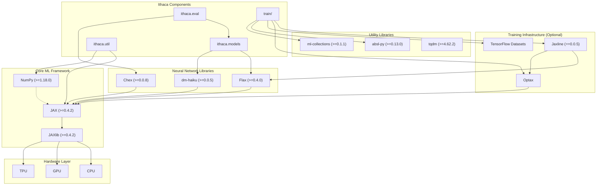
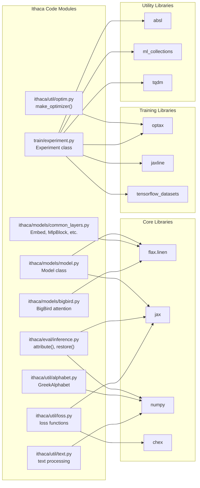

<!-- source: DeepWiki mcp.deepwiki.com · repo google-deepmind/ithaca · page 1.3 Technology Stack · fetched 2026-10-26 -->

# Technology Stack

<details>
<summary>Relevant source files</summary>

The following files were used as context for generating this wiki page:

- [requirements.txt](requirements.txt)
- [setup.py](setup.py)

</details>


This page documents the technology stack and dependencies that form the foundation of the Ithaca project. It covers the JAX ecosystem libraries, neural network frameworks, optimization tools, and supporting utilities. For information about how these components fit into the overall system architecture, see [System Architecture](#1.2). For details about the model implementation using these libraries, see [Model Architecture](#3).

## Overview

Ithaca is built on the JAX ecosystem, a modern machine learning framework designed for high-performance numerical computing. The technology stack is organized into two tiers:

1. **Core dependencies**: Required for inference and model loading
2. **Training dependencies**: Additional libraries required only for model training

This separation enables lightweight deployment for inference-only use cases while providing comprehensive tools for researchers and developers.

## Dependency Hierarchy



**Sources:** [requirements.txt:1-10](), [setup.py:37-44]()

## Core Framework

### JAX and JAXlib

**JAX** (version >=0.4.2) is the foundational framework for Ithaca, providing:

- **Automatic differentiation**: Gradient computation for training neural networks
- **Just-in-time compilation**: XLA compilation for high-performance execution
- **Vectorization**: `vmap` for efficient batch processing
- **Parallelization**: `pmap` for multi-device training
- **Functional programming paradigm**: Pure functions enable reliable transformations

**JAXlib** (version >=0.4.2) provides the XLA backend that compiles JAX programs for CPU, GPU, and TPU execution. The version constraint ensures compatibility with the JAX transformations used throughout Ithaca.

**Version requirement:** `>=0.4.2` ensures access to modern JAX APIs, including improved `pmap` semantics and better error messages.

**Sources:** [requirements.txt:5-6]()

### NumPy Compatibility

**NumPy** (version >=1.18.0) provides the array interface. JAX implements a NumPy-compatible API, allowing Ithaca code to use familiar array operations while benefiting from JAX's performance optimizations. The code uses `jax.numpy` (typically imported as `jnp`) rather than standard NumPy for operations within compiled functions.

**Sources:** [requirements.txt:8]()

## Neural Network Libraries

### Flax

**Flax** (version >=0.4.0) is the primary neural network library used in Ithaca. It provides:

- **Module system**: Object-oriented neural network components
- **Parameter management**: Structured parameter dictionaries with frozen dataclasses
- **Training utilities**: Checkpointing, serialization, and model inspection

Ithaca's model architecture is implemented entirely in Flax. Key Flax constructs used include:

- `flax.linen.Module`: Base class for all model components
- `flax.linen.Embed`: Embedding layers for character and word tokens
- `flax.linen.Dense`: Linear transformation layers
- `flax.linen.LayerNorm`: Layer normalization
- `flax.linen.Dropout`: Dropout regularization

The choice of Flax over other JAX neural network libraries reflects its mature API, strong documentation, and object-oriented design that facilitates complex model architectures.

**Sources:** [requirements.txt:3](), [setup.py:35]()

### dm-haiku

**dm-haiku** (version >=0.0.5) is included as a dependency but plays a secondary role. Haiku provides an alternative functional approach to neural network construction. While Ithaca's core model uses Flax, Haiku may be used in utility functions or experiments. The library is maintained to ensure compatibility with the broader JAX ecosystem.

**Sources:** [requirements.txt:4]()

### Chex

**Chex** (version >=0.0.8) provides testing and validation utilities for JAX code:

- **Array assertions**: Verify shape, dtype, and numerical properties
- **Dataclass utilities**: Frozen dataclasses for parameter structures
- **Fake JAX functions**: Testing without actual hardware acceleration

Chex is used throughout Ithaca for type checking and runtime validation, improving code reliability.

**Sources:** [requirements.txt:2]()

## Optimization and Training Infrastructure

These dependencies are installed only with `pip install ithaca[train]` (see [setup.py:38-44]()):

### Optax

**Optax** provides gradient transformation and optimization algorithms. Ithaca uses Optax to construct sophisticated optimizer chains:

- Learning rate schedules (linear warmup + square root decay)
- Gradient clipping (global norm clipping)
- Weight decay
- AdamW optimizer

The optimizer configuration in `train/experiment.py` chains multiple Optax transformations to create the final optimizer. For details on the specific optimization strategy, see [Optimization and Schedulers](#4.3).

**Sources:** [setup.py:40]()

### Jaxline

**Jaxline** (version ==0.0.5) is the experiment management framework that orchestrates training:

- **Experiment class**: Base class for defining training loops
- **Checkpointing**: Automatic model and optimizer state persistence
- **Distributed training**: Integration with JAX's `pmap` for multi-device training
- **Periodic evaluation**: Scheduling validation runs during training
- **Configuration management**: Integration with `ml-collections` for hyperparameter specification

The `train/experiment.py` module implements a Jaxline experiment that handles the complete training lifecycle. Note the pinned version (`==0.0.5`), which ensures API stability.

**Sources:** [setup.py:41]()

### TensorFlow Datasets

**TensorFlow Datasets** (TFDS) provides the data loading pipeline:

- Efficient I/O with prefetching and parallelization
- Standardized dataset interface
- Support for large datasets that don't fit in memory

While Ithaca uses JAX/Flax for modeling, TFDS is retained for its robust data loading capabilities. The data pipeline converts TensorFlow tensors to NumPy arrays for consumption by JAX models.

**Sources:** [setup.py:42]()

## Utility Libraries

### absl-py

**absl-py** (version >=0.13.0) provides:

- **Flags**: Command-line argument parsing via `absl.flags`
- **Logging**: Structured logging via `absl.logging`
- **App framework**: Main application entry points via `absl.app`

Used extensively in `train/experiment.py` for configuring training runs and in example scripts for user-facing interfaces.

**Sources:** [requirements.txt:1]()

### ml-collections

**ml-collections** (version >=0.1.1) provides `ConfigDict`, a dictionary-like structure for configuration management:

- Attribute-style access to configuration values
- Type checking and validation
- Immutable configurations for reproducibility

Training experiments use `ml-collections` to specify model hyperparameters, training settings, and data pipeline configurations.

**Sources:** [requirements.txt:7]()

### tqdm

**tqdm** (version >=4.62.2) provides progress bars for long-running operations:

- Training loop progress visualization
- Data loading progress tracking
- Inference progress for batch processing

**Sources:** [requirements.txt:9]()

## Dependency Organization

The [setup.py:26-52]() file organizes dependencies into two installation modes:

### Core Installation

```python
# Core dependencies (required)
install_requires=(here / 'requirements.txt').read_text().splitlines()
```

Includes all libraries in [requirements.txt:1-10]():
- `absl-py>=0.13.0`
- `chex>=0.0.8`
- `flax>=0.4.0`
- `dm-haiku>=0.0.5`
- `jax>=0.4.2`
- `jaxlib>=0.4.2`
- `ml-collections>=0.1.1`
- `numpy>=1.18.0`
- `tqdm>=4.62.2`

**Installation command**: `pip install ithaca`

**Use case**: Inference-only applications where users load pre-trained models for text attribution and restoration.

### Training Installation

```python
extras_require={
    'train': [
        'optax',
        'jaxline==0.0.5',
        'tensorflow-datasets',
    ]
}
```

Adds three additional dependencies (see [setup.py:39-43]()):
- `optax`: Gradient processing and optimization
- `jaxline==0.0.5`: Experiment management framework
- `tensorflow-datasets`: Data loading infrastructure

**Installation command**: `pip install ithaca[train]`

**Use case**: Researchers and developers who need to train custom models or reproduce experiments.

### Package Exclusion

The [setup.py:35]() line explicitly excludes the `train/` directory from the distributed package:

```python
packages=setuptools.find_packages(exclude=('train',))
```

This ensures that:
1. Training code is not installed with the core package
2. Users performing inference don't download unnecessary code
3. The package remains lightweight for production deployments

**Sources:** [setup.py:26-52]()

## Version Constraints

The following table summarizes version requirements and their rationale:

| Library | Constraint | Type | Rationale |
|---------|-----------|------|-----------|
| `jax` | `>=0.4.2` | Lower bound | Modern API features, improved `pmap` semantics |
| `jaxlib` | `>=0.4.2` | Lower bound | Must match JAX version for XLA backend compatibility |
| `flax` | `>=0.4.0` | Lower bound | Stable `linen` module API |
| `jaxline` | `==0.0.5` | Exact pin | API stability for experiment framework |
| `absl-py` | `>=0.13.0` | Lower bound | Flags and logging API compatibility |
| `chex` | `>=0.0.8` | Lower bound | Dataclass and testing utilities |
| `dm-haiku` | `>=0.0.5` | Lower bound | Ecosystem compatibility |
| `ml-collections` | `>=0.1.1` | Lower bound | ConfigDict API stability |
| `numpy` | `>=1.18.0` | Lower bound | Array interface compatibility |
| `tqdm` | `>=4.62.2` | Lower bound | Progress bar features |

**Note**: Optax, TensorFlow Datasets have no version constraints in [setup.py:40-42](), allowing flexibility for training environments.

**Sources:** [requirements.txt:1-10](), [setup.py:38-44]()

## Component-Library Mapping



This diagram shows which Ithaca code modules depend on which external libraries:

**Core modules** (`ithaca/models/`, `ithaca/eval/`, `ithaca/util/`):
- Use only core dependencies from [requirements.txt:1-10]()
- Can be imported and used without training dependencies

**Training module** (`train/`):
- Requires all core dependencies plus training extras from [setup.py:39-43]()
- Not included in default installation

**Sources:** [requirements.txt:1-10](), [setup.py:26-52]()

## Installation Verification

After installation, verify the technology stack is correctly configured:

```bash
# Verify core installation
python -c "import jax; import flax; print(f'JAX: {jax.__version__}, Flax: {flax.__version__}')"

# Verify training installation (if installed with [train] extra)
python -c "import optax; import jaxline; print('Training dependencies available')"

# Check hardware acceleration
python -c "import jax; print(f'Devices: {jax.devices()}')"
```

The last command should list available accelerators (CPU, GPU, or TPU).

**Sources:** [requirements.txt:1-10](), [setup.py:37-44]()

---

