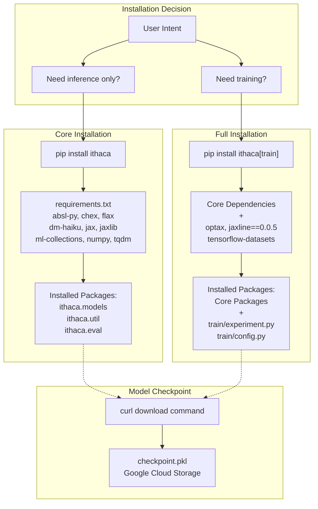
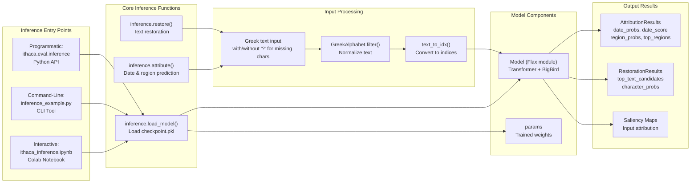

<!-- source: DeepWiki mcp.deepwiki.com · repo google-deepmind/ithaca · page 2 Getting Started · fetched 2026-10-26 -->

# Getting Started

<details>
<summary>Relevant source files</summary>

The following files were used as context for generating this wiki page:

- [README.md](README.md)
- [requirements.txt](requirements.txt)
- [setup.py](setup.py)

</details>


This document provides installation instructions and quick start guides for using Ithaca. It covers both inference-only usage (for end users performing text restoration and attribution) and full installation (for researchers and developers who want to train models or extend the codebase).

**Scope of this document:**
- Installing the `ithaca` package in core or full mode
- Downloading pre-trained model checkpoints
- Running inference via Colab notebook, CLI, or Python API
- Verifying your installation

For detailed information about the model architecture, see [Model Architecture](#3). For training custom models, see [Training System](#4). For the complete API reference, see [API Reference](#8).

---

## Installation Modes

Ithaca offers two installation modes to accommodate different use cases:

| Installation Mode | Use Case | Includes Training Code | Dependencies |
|-------------------|----------|------------------------|--------------|
| **Core** | Inference only | No | Minimal (JAX, Flax, NumPy, etc.) |
| **Full** | Training & Development | Yes | Core + Optax, JAXline, TFDS |

The installation mode determines which packages are installed via [setup.py:35-44](), which excludes the `train/` directory in core mode and includes additional training dependencies in full mode.



**Installation Mode Selection Diagram**

**Sources:** [setup.py:26-44](), [requirements.txt:1-9](), [README.md:79-82]()

---

## Prerequisites

Before installing Ithaca, ensure you have:

- **Python 3.7+** (recommended: Python 3.8 or 3.9)
- **pip** package manager
- **Git** (if installing from source)

For GPU/TPU acceleration (recommended for training):
- CUDA-compatible GPU with appropriate drivers
- Or access to Google Cloud TPU

---

## Core Installation (Inference Only)

For users who only need to perform text restoration and attribution using pre-trained models:

### Step 1: Install the Package

```sh
pip install ithaca
```

Or if installing from source:

```sh
git clone https://github.com/google-deepmind/ithaca.git
cd ithaca
pip install .
```

This installs the core dependencies listed in [requirements.txt:1-9]() and all packages except `train/`, as specified by [setup.py:35]().

### Step 2: Download the Pre-trained Model

```sh
curl --output checkpoint.pkl https://storage.googleapis.com/ithaca-resources/models/checkpoint_v1.pkl
```

The checkpoint file (`checkpoint.pkl`) contains:
- Model architecture configuration
- Trained parameter weights
- Vocabulary mappings (`GreekAlphabet`)
- Region metadata (84 subregions)

**Important:** The checkpoint file is approximately 500MB and is not included in the repository due to its size. It must be downloaded separately from Google Cloud Storage.

### Step 3: Verify Installation

Test that the installation works:

```python
import jax
import flax
from ithaca.eval import inference

print("Ithaca core installation successful!")
print(f"JAX version: {jax.__version__}")
print(f"Flax version: {flax.__version__}")
```

**Sources:** [README.md:79-87](), [setup.py:26-37]()

---

## Full Installation (Training and Development)

For researchers and developers who need to train models or modify the codebase:

### Step 1: Install with Training Dependencies

```sh
pip install ithaca[train]
```

Or from source:

```sh
git clone https://github.com/google-deepmind/ithaca.git
cd ithaca
pip install .[train]
```

This installs additional dependencies defined in [setup.py:38-44]():
- `optax` - Gradient transformation library
- `jaxline==0.0.5` - Training experiment framework
- `tensorflow-datasets` - Data loading pipeline

### Step 2: Verify Training Installation

```python
import optax
import jaxline
import tensorflow_datasets as tfds
from train import experiment

print("Ithaca full installation successful!")
print(f"Optax version: {optax.__version__}")
print(f"TensorFlow Datasets available: {tfds.__version__}")
```

### Step 3: (Optional) Download Pre-trained Model

Even when training from scratch, you may want to download the checkpoint for fine-tuning or comparison:

```sh
curl --output checkpoint.pkl https://storage.googleapis.com/ithaca-resources/models/checkpoint_v1.pkl
```

**Sources:** [setup.py:38-44](), [README.md:125]()

---

## Quick Start: Inference

Once installed, you can perform inference in three ways:



**Inference Workflow Diagram**

**Sources:** [README.md:67-114](), [colabs/ithaca_inference.ipynb:6.14]()

---

## Interactive Colab Notebook

The fastest way to start using Ithaca is through the interactive Colab notebook.

### Access the Notebook

Click this badge to open the notebook:

[](https://colab.research.google.com/github/deepmind/ithaca/blob/master/colabs/ithaca_inference.ipynb)

Or navigate to: [https://github.com/google-deepmind/ithaca/blob/master/colabs/ithaca_inference.ipynb](https://github.com/google-deepmind/ithaca/blob/master/colabs/ithaca_inference.ipynb)

### Notebook Features

The Colab notebook provides:

1. **Automatic Setup** - Installs dependencies and downloads the checkpoint
2. **Text Attribution** - Predict date and geographical origin
3. **Text Restoration** - Fill in missing characters marked with `?`
4. **Visualizations** - Saliency maps showing which characters influenced predictions
5. **Interactive Widgets** - Easy-to-use interface for non-programmers

### Example Usage in Notebook

```python
# After running setup cells in the notebook:

# Attribution example
text = "δήμο το αθηναίων"  # "the people of Athens"
attribution_results = inference.attribute(model, params, text)
print(f"Predicted date: {attribution_results.date_score}")
print(f"Top region: {attribution_results.top_regions[0]}")

# Restoration example
damaged_text = "???μο το αθηναίων"  # First 3 characters missing
restoration_results = inference.restore(model, params, damaged_text)
print(f"Restored text: {restoration_results.top_text_candidates[0]}")
```

The notebook includes detailed examples and explanations for each function. For more details on the `attribute()` and `restore()` functions, see [Attribution](#5.2) and [Restoration](#5.3).

**Sources:** [README.md:67-72](), [colabs/ithaca_inference.ipynb:6.14]()

---

## Command-Line Interface

For batch processing or integration into scripts, use the `inference_example.py` CLI tool.

### Basic Usage

```sh
python inference_example.py --input_file=example_input.txt
```

This command:
1. Loads the model from `checkpoint.pkl`
2. Reads Greek text from `example_input.txt`
3. Performs both attribution and restoration
4. Prints results to console

### Input Methods

**From file:**
```sh
python inference_example.py --input_file=my_inscription.txt
```

**From command-line argument:**
```sh
python inference_example.py --input="δήμο το αθηναίων"
```

**With missing characters (for restoration):**
```sh
python inference_example.py --input="???μο το αθηναίων"
```

### Output Options

**Save results to JSON:**
```sh
python inference_example.py \
  --input_file=example_input.txt \
  --attribute_json=attribution_output.json \
  --restore_json=restoration_output.json
```

**JSON output structure:**

Attribution JSON:
```json
{
  "date_score": 425.5,
  "date_probs": [0.01, 0.05, 0.12, ...],
  "region_probs": [0.15, 0.08, ...],
  "top_regions": ["Attica", "Boeotia", ...]
}
```

Restoration JSON:
```json
{
  "top_text_candidates": ["δήμο το αθηναίων", "δῆμο το αθηναίων", ...],
  "character_probs": [[0.8, 0.1, ...], ...]
}
```

### CLI Reference

| Flag | Description | Default |
|------|-------------|---------|
| `--input` | Greek text string | None |
| `--input_file` | Path to text file (UTF-8) | None |
| `--checkpoint` | Path to checkpoint.pkl | `checkpoint.pkl` |
| `--attribute_json` | Save attribution results | None |
| `--restore_json` | Save restoration results | None |

**View all options:**
```sh
python inference_example.py --help
```

**Sources:** [README.md:89-114](), [inference_example.py (referenced)]()

---

## Programmatic Python API

For integration into Python applications, use the `ithaca.eval.inference` module directly.

### Basic Workflow

```python
from ithaca.eval import inference

# Step 1: Load model and checkpoint
model, params, config = inference.load_model('checkpoint.pkl')

# Step 2: Perform attribution
text = "δήμο το αθηναίων"
attribution_results = inference.attribute(
    model=model,
    params=params,
    text=text,
    vocab=config['vocab'],
    region_map=config['region_map']
)

print(f"Predicted date: {attribution_results.date_score} CE")
print(f"Top 3 regions: {attribution_results.top_regions[:3]}")

# Step 3: Perform restoration (for damaged text)
damaged_text = "???μο το αθηναίων"
restoration_results = inference.restore(
    model=model,
    params=params,
    text=damaged_text,
    vocab=config['vocab'],
    beam_size=10
)

print(f"Best restoration: {restoration_results.top_text_candidates[0]}")
```

### Key Functions

| Function | Purpose | Returns |
|----------|---------|---------|
| `inference.load_model(path)` | Load checkpoint | `(model, params, config)` |
| `inference.attribute(...)` | Predict date & region | `AttributionResults` |
| `inference.restore(...)` | Fill missing characters | `RestorationResults` |

For detailed API documentation, see [ithaca.eval](#8.2).

**Sources:** [ithaca/eval/inference.py:0.14](), [README.md:74-114]()

---

## Verifying Your Installation

After installation, run these verification checks:

### Test 1: Import Core Modules

```python
import jax
import flax
from ithaca.models import model
from ithaca.util import alphabet, text
from ithaca.eval import inference

print("✓ All core modules imported successfully")
```

### Test 2: Check JAX Device

```python
import jax
devices = jax.devices()
print(f"JAX devices: {devices}")
print(f"Default backend: {jax.default_backend()}")
```

Expected output:
- CPU: `[CpuDevice(id=0)]`
- GPU: `[GpuDevice(id=0)]`
- TPU: `[TpuDevice(id=0)]`

### Test 3: Test Greek Alphabet Processing

```python
from ithaca.util.alphabet import GreekAlphabet

vocab = GreekAlphabet()
test_text = "δήμο"
filtered = vocab.filter(test_text)
print(f"Original: {test_text}")
print(f"Filtered: {filtered}")
print("✓ Greek text processing works")
```

### Test 4: Load Checkpoint (if downloaded)

```python
from ithaca.eval import inference

try:
    model, params, config = inference.load_model('checkpoint.pkl')
    print(f"✓ Checkpoint loaded successfully")
    print(f"Model config: {config.keys()}")
except FileNotFoundError:
    print("⚠ checkpoint.pkl not found - download it first")
```

### Test 5: Full Inference Test

```python
from ithaca.eval import inference

# Load model
model, params, config = inference.load_model('checkpoint.pkl')

# Test attribution
text = "δήμο το αθηναίων"
results = inference.attribute(model, params, text, 
                               vocab=config['vocab'],
                               region_map=config['region_map'])

print(f"✓ Attribution successful")
print(f"  Predicted date: {results.date_score}")
print(f"  Top region: {results.top_regions[0]}")
```

If all tests pass, your installation is ready for use.

**Sources:** [requirements.txt:1-9](), [setup.py:26-44](), [README.md:79-87]()

---

## Troubleshooting

### Common Issues

**Issue: `ModuleNotFoundError: No module named 'jax'`**
- **Solution:** Reinstall with `pip install --upgrade ithaca`

**Issue: `FileNotFoundError: checkpoint.pkl not found`**
- **Solution:** Download the checkpoint:
  ```sh
  curl --output checkpoint.pkl https://storage.googleapis.com/ithaca-resources/models/checkpoint_v1.pkl
  ```

**Issue: JAX not detecting GPU**
- **Solution:** Install GPU-specific JAX version:
  ```sh
  pip install --upgrade "jax[cuda]" -f https://storage.googleapis.com/jax-releases/jax_cuda_releases.html
  ```

**Issue: `ImportError: cannot import name 'experiment'`**
- **Cause:** Training code not installed
- **Solution:** Install full version: `pip install ithaca[train]`

**Issue: Out of memory during inference**
- **Solution:** Reduce beam size in restoration:
  ```python
  inference.restore(model, params, text, beam_size=5)  # Default is 10
  ```

### Getting Help

- **GitHub Issues:** [https://github.com/google-deepmind/ithaca/issues](https://github.com/google-deepmind/ithaca/issues)
- **Paper:** [Nature article](https://www.nature.com/articles/s41586-022-04448-z)
- **Blog:** [DeepMind blog post](https://www.deepmind.com/blog/predicting-the-past-with-ithaca)

---

## Next Steps

After completing installation and running your first inference:

- **Explore the Model:** Learn about the architecture in [Model Architecture](#3)
- **Advanced Inference:** See [Inference System](#5) for beam search, saliency maps, and interpretability
- **Train Custom Models:** Follow [Training System](#4) to train on your own data
- **API Reference:** Browse [API Reference](#8) for detailed function documentation
- **Data Processing:** Understand text processing in [Data Processing Utilities](#6)

**Sources:** [README.md:1-130](), [setup.py:1-53](), [requirements.txt:1-9]()

---

