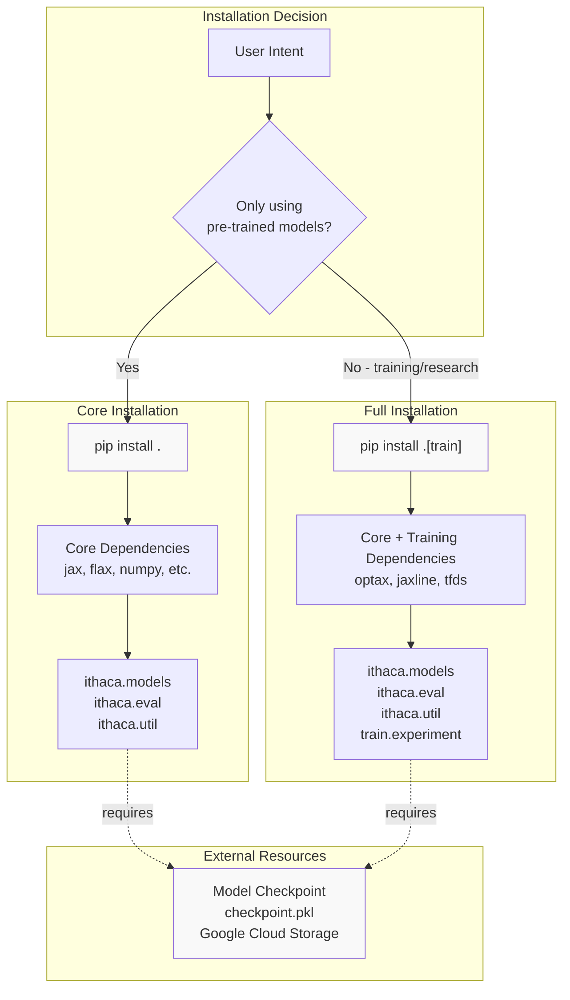
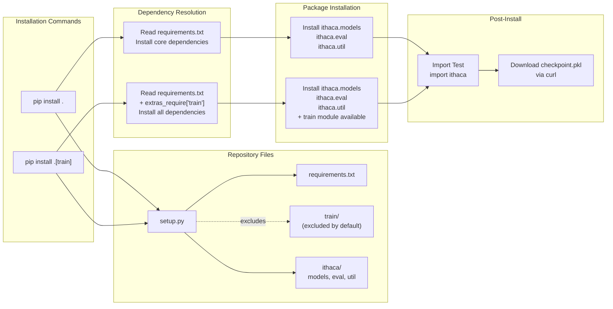
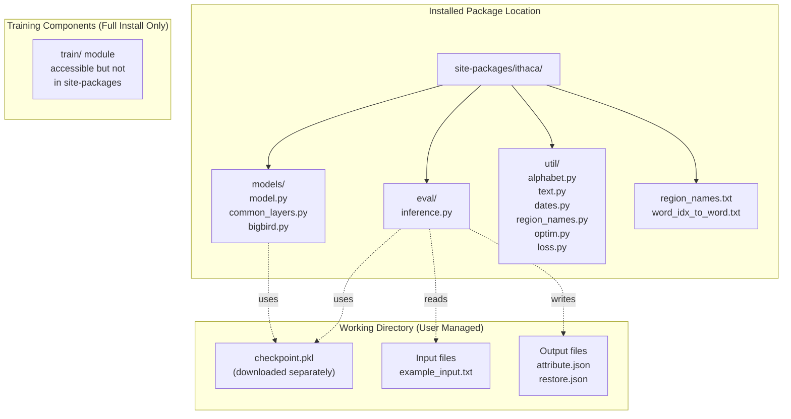

<!-- source: DeepWiki mcp.deepwiki.com · repo google-deepmind/ithaca · page 2.1 Installation · fetched 2026-10-26 -->

# Installation

<details>
<summary>Relevant source files</summary>

The following files were used as context for generating this wiki page:

- [README.md](README.md)
- [requirements.txt](requirements.txt)
- [setup.py](setup.py)

</details>


This page provides detailed instructions for installing the Ithaca package and its dependencies. Installation supports two modes: **core installation** for inference-only usage, and **full installation** for training and development. For guidance on using the installed package, see [Quick Start: Inference](#2.2) and [Command Line Interface](#2.4).

## Prerequisites

Before installing Ithaca, ensure your system meets the following requirements:

| Requirement | Specification |
|------------|--------------|
| Python Version | ≥ 3.7 |
| Operating System | Linux, macOS, or Windows with WSL |
| Hardware | CPU (minimum), GPU/TPU (recommended for training) |
| Disk Space | ~500 MB for package + 2.5 GB for model checkpoint |

**Note:** While inference can run on CPU, GPU/TPU acceleration significantly improves performance, especially for large texts or batch processing.

**Sources:** [setup.py:1-53](), [requirements.txt:1-10]()

## Installation Modes Overview



**Installation Mode Selection**

**Sources:** [setup.py:26-44](), [README.md:79-82]()

## Core Installation (Inference Only)

The core installation includes all components necessary for inference: model architecture, evaluation utilities, and text processing. Training code is excluded to minimize dependencies.

### Step 1: Install Package

From the repository root directory:

```sh
pip install .
```

This command reads [setup.py:26-52]() which:
- Installs packages found by `setuptools.find_packages(exclude=('train',))` [setup.py:35]()
- Reads dependencies from [requirements.txt:1-10]()
- Excludes the `train/` directory

### Step 2: Download Model Checkpoint

Download the pre-trained model from Google Cloud Storage:

```sh
curl --output checkpoint.pkl https://storage.googleapis.com/ithaca-resources/models/checkpoint_v1.pkl
```

The checkpoint file (`checkpoint.pkl`) contains:
- Trained model parameters
- Model architecture configuration
- Vocabulary mappings (`GreekAlphabet`)
- Region ID-to-name mappings

**File size:** ~2.5 GB

**Sources:** [setup.py:14-19](), [setup.py:35-37](), [README.md:79-87]()

## Full Installation (Training and Development)

Researchers and developers who need to train models or modify training code should use the full installation with optional training dependencies.

### Step 1: Install Package with Training Dependencies

```sh
pip install .[train]
```

This installs core dependencies plus training-specific packages defined in [setup.py:38-44]():
- `optax` - Gradient transformations and optimization
- `jaxline==0.0.5` - Training platform and experiment management
- `tensorflow-datasets` - Data loading infrastructure

### Step 2: Download Model Checkpoint

Same as core installation:

```sh
curl --output checkpoint.pkl https://storage.googleapis.com/ithaca-resources/models/checkpoint_v1.pkl
```

**Sources:** [setup.py:38-44](), [README.md:124-125]()

## Dependency Breakdown

The following table lists all dependencies and their purposes:

| Package | Version | Installation Mode | Purpose |
|---------|---------|------------------|---------|
| `jax` | ≥0.4.2 | Core, Full | Auto-differentiation and JIT compilation |
| `jaxlib` | ≥0.4.2 | Core, Full | XLA backend for JAX |
| `flax` | ≥0.4.0 | Core, Full | Neural network library (model definitions) |
| `numpy` | ≥1.18.0 | Core, Full | Array operations |
| `chex` | ≥0.0.8 | Core, Full | Testing and validation utilities |
| `dm-haiku` | ≥0.0.5 | Core, Full | Alternative NN library (available but not primary) |
| `ml-collections` | ≥0.1.1 | Core, Full | Configuration management |
| `absl-py` | ≥0.13.0 | Core, Full | Command-line interface and logging |
| `tqdm` | ≥4.62.2 | Core, Full | Progress bars |
| `optax` | (latest) | Full only | Gradient transformations and optimizers |
| `jaxline` | ==0.0.5 | Full only | Training platform and checkpointing |
| `tensorflow-datasets` | (latest) | Full only | Data loading pipeline |

**Sources:** [requirements.txt:1-10](), [setup.py:38-44]()

## Installation Flow Diagram



**Package Installation Flow**

**Sources:** [setup.py:21-52](), [requirements.txt:1-10]()

## Installation Verification

After installation, verify that the package is correctly installed:

### Test Python Import

```python
# Test core functionality
import ithaca
from ithaca.models import model
from ithaca.eval import inference
from ithaca.util import alphabet

print("Ithaca core installation successful!")
```

### Test Training Components (Full Installation Only)

```python
# Test training dependencies
import optax
import jaxline
import tensorflow_datasets as tfds

print("Ithaca full installation successful!")
```

### Test with Inference Example

Run the provided inference example script [README.md:89-94]():

```sh
python inference_example.py --input_file=example_input.txt
```

Expected output includes:
- Attribution results (date and region predictions)
- Restoration results (filled missing characters)
- Saliency visualization information

**Sources:** [README.md:89-114]()

## Hardware Acceleration Setup

### GPU Support

JAX automatically detects CUDA-capable GPUs. Verify GPU availability:

```python
import jax
print(f"Available devices: {jax.devices()}")
print(f"Default backend: {jax.default_backend()}")
```

Expected output for GPU system:
```
Available devices: [GpuDevice(id=0), ...]
Default backend: gpu
```

### TPU Support

For Google Colab or Cloud TPU:
```python
import jax
print(f"TPU devices: {jax.devices('tpu')}")
```

**Note:** TPU support requires additional configuration. See the [Interactive Colab Notebook](#2.3) for TPU-enabled inference examples.

**Sources:** [requirements.txt:5-6]()

## File Structure After Installation



**Post-Installation File Organization**

**Sources:** [setup.py:35-36]()

## Troubleshooting

### Common Installation Issues

| Issue | Symptoms | Solution |
|-------|----------|----------|
| **JAX/JAXlib version mismatch** | Import errors: `AttributeError` in JAX | Ensure `jax` and `jaxlib` versions match: `pip install --upgrade jax jaxlib` |
| **CUDA not found** | JAX defaults to CPU despite GPU available | Install CUDA-compatible jaxlib: `pip install --upgrade "jax[cuda]" -f https://storage.googleapis.com/jax-releases/jax_cuda_releases.html` |
| **Training dependencies missing** | `ImportError: No module named 'optax'` | Use full installation: `pip install .[train]` |
| **Checkpoint download fails** | `curl: (22) HTTP error` | Check network connection; try alternative: `wget https://storage.googleapis.com/ithaca-resources/models/checkpoint_v1.pkl` |
| **Out of memory errors** | JAX raises OOM during inference | Reduce batch size or use CPU: `export JAX_PLATFORM_NAME=cpu` |

### Verifying JAX Backend

```python
import jax
import jaxlib

print(f"JAX version: {jax.__version__}")
print(f"JAXlib version: {jaxlib.__version__}")
print(f"Available backends: {[d.platform for d in jax.devices()]}")
```

### Dependency Conflicts

If you encounter dependency conflicts with existing packages:

```sh
# Create isolated environment
python -m venv ithaca_env
source ithaca_env/bin/activate  # On Windows: ithaca_env\Scripts\activate

# Install in clean environment
pip install .
```

**Sources:** [requirements.txt:5-6]()

## Alternative Installation Methods

### Development Installation

For contributors who plan to modify source code:

```sh
pip install -e .
```

The `-e` (editable) flag creates a symbolic link, allowing code changes to take effect without reinstallation.

### Installing from Source Distribution

If installing from a source tarball:

```sh
tar -xzf ithaca-0.1.0.tar.gz
cd ithaca-0.1.0
pip install .
```

### Installing Specific Version

```sh
pip install ithaca==0.1.0
```

**Sources:** [setup.py:30]()

## Next Steps

After successful installation:

1. **Inference Users:** Proceed to [Quick Start: Inference](#2.2) for using pre-trained models
2. **Interactive Users:** Try the [Interactive Colab Notebook](#2.3) for browser-based inference
3. **CLI Users:** Explore [Command Line Interface](#2.4) for batch processing
4. **Researchers:** See [Training System](#4) for training custom models
5. **Developers:** Consult [Development Guide](#7) for contribution guidelines

**Sources:** [README.md:67-125]()

---

