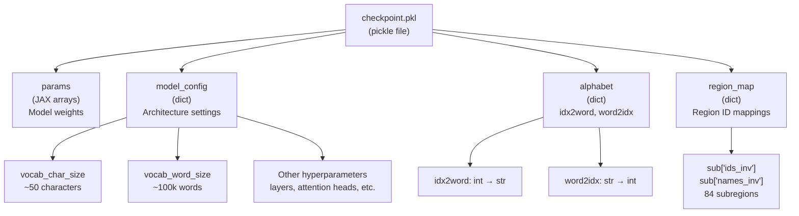
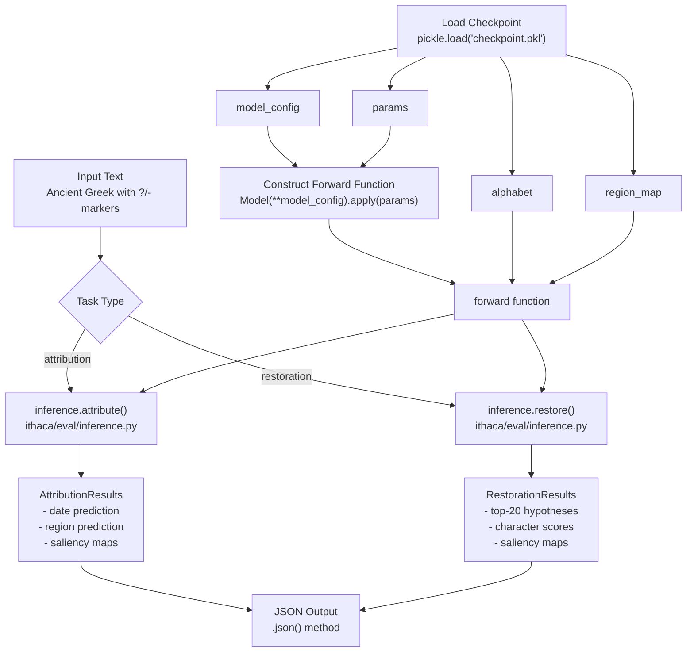

<!-- source: DeepWiki mcp.deepwiki.com · repo google-deepmind/ithaca · page 2.2 Quick Start: Inference · fetched 2026-10-26 -->

# Quick Start: Inference

<details>
<summary>Relevant source files</summary>

The following files were used as context for generating this wiki page:

- [README.md](README.md)
- [colabs/ithaca_inference.ipynb](colabs/ithaca_inference.ipynb)
- [inference_example.py](inference_example.py)

</details>


This page provides a step-by-step guide to performing inference with pre-trained Ithaca models. You will learn how to download model checkpoints, load them programmatically, and run both attribution (predicting date and region) and restoration (filling in missing characters) tasks on ancient Greek inscriptions.

**Scope**: This page covers the core inference API and programmatic usage. For interactive notebook usage, see [Interactive Colab Notebook](#2.3). For command-line usage, see [Command Line Interface](#2.4). For detailed API documentation, see [ithaca.eval](#8.2).

## Prerequisites

Before performing inference, ensure you have installed the `ithaca` package as described in [Installation](#2.1):

```bash
pip install git+https://github.com/deepmind/ithaca
```

The inference functionality requires only the core dependencies (JAX, Flax, NumPy) without the training infrastructure.

**Sources**: [README.md:74-82]()

## Downloading the Model Checkpoint

Ithaca's pre-trained model is distributed as a pickle file hosted on Google Cloud Storage. Download it using:

```bash
curl --output checkpoint.pkl https://storage.googleapis.com/ithaca-resources/models/checkpoint_v1.pkl
```

The checkpoint file (`checkpoint.pkl`) contains:
- Trained model parameters
- Model architecture configuration
- Vocabulary mappings (character and word indices)
- Region mapping metadata (84 subregions)

**File size**: Approximately 500MB

**Sources**: [README.md:84-87](), [colabs/ithaca_inference.ipynb:222-224]()

## Checkpoint Structure

Understanding the checkpoint structure is essential for programmatic usage. The pickle file contains a dictionary with the following keys:



**Sources**: [inference_example.py:40-73](), [colabs/ithaca_inference.ipynb:352-367]()

## Loading the Checkpoint

The following code demonstrates how to load the checkpoint and prepare it for inference:

```python
import functools
import pickle
import jax
from ithaca.models.model import Model
from ithaca.util.alphabet import GreekAlphabet

# Load checkpoint pickle
with open('checkpoint.pkl', 'rb') as f:
    checkpoint = pickle.load(f)

# Extract model configuration
model_config = checkpoint['model_config']
params = jax.device_put(checkpoint['params'])

# Reconstruct the model
model = Model(**model_config)
forward = functools.partial(model.apply, params)

# Load vocabulary
alphabet = GreekAlphabet()
alphabet.idx2word = checkpoint['alphabet']['idx2word']
alphabet.word2idx = checkpoint['alphabet']['word2idx']

# Extract region mappings
region_map = checkpoint['region_map']

# Get vocabulary sizes
vocab_char_size = model_config['vocab_char_size']
vocab_word_size = model_config['vocab_word_size']
```

**Key components**:

| Component | Type | Purpose |
|-----------|------|---------|
| `params` | JAX arrays | Learned model weights |
| `forward` | Callable | Inference function: `forward(input_data)` |
| `alphabet` | `GreekAlphabet` | Text-to-index conversions |
| `region_map` | dict | Region ID ↔ name mappings |
| `vocab_char_size` | int | Character vocabulary size |
| `vocab_word_size` | int | Word vocabulary size |

**Sources**: [inference_example.py:40-73](), [colabs/ithaca_inference.ipynb:345-367]()

## Input Text Format

Ithaca accepts ancient Greek text with specific conventions for marking missing or uncertain characters:

### Text Requirements

- **Length**: Between 50 and 750 characters
- **Character set**: Ancient Greek alphabet (Unicode)
- **Encoding**: UTF-8

### Missing Character Conventions

| Symbol | Meaning | Usage |
|--------|---------|-------|
| `?` | Missing character to be **predicted** | Ithaca will propose restoration candidates |
| `-` | Missing character to be **skipped** | Ithaca ignores these positions |
| Regular text | Known characters | Used as context for predictions |

### Example Input

```python
text = '''ἔδοξεν τῆι βουλῆι και τῶι δήμωι λυσίστρατος εἶπε- 
επειδὴ διοφάνης ἀνὴρ ἀγαθὸς ὢν διατελεῖ περὶ δηλίους δεδόχθαι 
τῶι ----- διοφάνην καλλι-------- --ηναῖον πρόξενον εἶναι δ---------
αὐτὸγ καὶ ἐκγόνους κ-- ειναι αυτοις ατελειαν εν δηλωι παντων...
αναγραψαι δε τοδε ?????????α την βουλην εις...'''
```

**Validation**:
```python
assert 50 <= len(text) <= 750, "Text must be 50-750 characters"
```

**Sources**: [colabs/ithaca_inference.ipynb:377-396](), [inference_example.py:88-91]()

## Inference Workflow

The following diagram illustrates the complete inference workflow from text input to results:



**Sources**: [inference_example.py:76-126](), [colabs/ithaca_inference.ipynb:345-557]()

## Attribution: Predicting Date and Region

Attribution predicts when and where an inscription was written. Use the `inference.attribute()` function:

```python
from ithaca.eval import inference

attribution_results = inference.attribute(
    text=input_text,
    forward=forward,
    params=params,
    alphabet=alphabet,
    region_map=region_map,
    vocab_char_size=vocab_char_size,
    vocab_word_size=vocab_word_size
)
```

### Attribution Results Structure

The function returns an `AttributionResults` NamedTuple containing:

| Field | Type | Description |
|-------|------|-------------|
| `date_pred` | int | Predicted year (e.g., -340 for 340 BCE) |
| `date_probs` | array | Probability distribution over decades (800 BCE - 800 CE) |
| `region_probs` | array | Probabilities for 84 subregions |
| `top_regions` | list | Top-10 region predictions with names and probabilities |
| `date_saliency` | array | Character importance for date prediction |
| `region_saliency` | array | Character importance for region prediction |

### Date Prediction

Ithaca predicts dates as probability distributions over decade intervals:

```python
# Get predicted year
predicted_year = attribution_results.date_pred  # e.g., -340

# Access full distribution
date_distribution = attribution_results.date_probs  # Shape: (160,)
# Covers 800 BCE to 800 CE in 10-year intervals
```

### Region Prediction

Regions are predicted among 84 subregions of the ancient Greek world:

```python
# Top-10 regions with probabilities
for region in attribution_results.top_regions[:10]:
    print(f"{region['name']}: {region['probability']:.2%}")
    
# Example output:
# Attica: 45.3%
# Aegean Islands: 23.1%
# Peloponnese: 12.7%
# ...
```

### Accessing Region Names

Use the `region_map` to convert region IDs to human-readable names:

```python
def get_subregion_name(region_id, region_map):
    """Convert region ID to name."""
    return region_map['sub']['names_inv'][
        region_map['sub']['ids_inv'][region_id]
    ]
```

**Sources**: [inference_example.py:100-112](), [colabs/ithaca_inference.ipynb:286-299]()

## Restoration: Filling Missing Characters

Restoration predicts missing characters marked with `?`. Use the `inference.restore()` function:

```python
from ithaca.eval import inference

restoration_results = inference.restore(
    text=input_text,
    forward=forward,
    params=params,
    alphabet=alphabet,
    vocab_char_size=vocab_char_size,
    vocab_word_size=vocab_word_size
)
```

### Restoration Results Structure

The function returns a `RestorationResults` NamedTuple containing:

| Field | Type | Description |
|-------|------|-------------|
| `input_text` | str | Original input with `?` markers |
| `predictions` | list | Top-20 restoration hypotheses |
| `prediction_saliency` | list | Saliency for each restoration step |

### Restoration Hypotheses

Each prediction in the `predictions` list contains:

```python
for i, prediction in enumerate(restoration_results.predictions[:5]):
    print(f"Hypothesis {i+1} ({prediction.score:.1%}): {prediction.text}")

# Example output:
# Hypothesis 1 (66.1%): ἔδοξεν...το ψήφισμα την βουλην...
# Hypothesis 2 (0.1%): ἔδοξεν...το ψημισμα την βουλην...
# Hypothesis 3 (0.1%): ἔδοξεν...το ψήφιζμα την βουλην...
```

**Hypothesis structure**:
- `text`: Restored text with `?` replaced by predicted characters
- `score`: Cumulative probability (0.0 to 1.0)

### Beam Search Process

Ithaca uses **non-sequential beam search** to generate restoration hypotheses:

1. **Initial pass**: Model predicts confidence scores for all `?` positions
2. **Iterative restoration**: Fill positions starting with highest confidence
3. **Beam expansion**: Maintain top-k candidates at each step
4. **Ranking**: Final hypotheses ranked by cumulative probability

**Sources**: [inference_example.py:114-125](), [colabs/ithaca_inference.ipynb:413-557]()

## Output Formats

Both `AttributionResults` and `RestorationResults` provide a `.json()` method for serialization:

```python
# Save attribution to JSON
with open('attribution.json', 'w') as f:
    f.write(attribution_results.json(indent=2))

# Save restoration to JSON
with open('restoration.json', 'w') as f:
    f.write(restoration_results.json(indent=2))
```

### JSON Structure Examples

**Attribution JSON**:
```json
{
  "date_pred": -340,
  "date_probs": [0.001, 0.002, ...],
  "region_probs": [0.453, 0.231, ...],
  "top_regions": [
    {"id": 12, "name": "Attica", "probability": 0.453},
    {"id": 5, "name": "Aegean Islands", "probability": 0.231}
  ]
}
```

**Restoration JSON**:
```json
{
  "input_text": "ἔδοξεν...?????????α...",
  "predictions": [
    {"text": "ἔδοξεν...το ψήφισμα...", "score": 0.661},
    {"text": "ἔδοξεν...το ψημισμα...", "score": 0.001}
  ]
}
```

**Sources**: [inference_example.py:103-125]()

## Complete Example

Here is a complete minimal example combining all the steps:

```python
import functools
import pickle
import jax
from ithaca.eval import inference
from ithaca.models.model import Model
from ithaca.util.alphabet import GreekAlphabet

# 1. Load checkpoint
with open('checkpoint.pkl', 'rb') as f:
    checkpoint = pickle.load(f)

# 2. Prepare model
model_config = checkpoint['model_config']
params = jax.device_put(checkpoint['params'])
model = Model(**model_config)
forward = functools.partial(model.apply, params)

# 3. Prepare alphabet and region map
alphabet = GreekAlphabet()
alphabet.idx2word = checkpoint['alphabet']['idx2word']
alphabet.word2idx = checkpoint['alphabet']['word2idx']
region_map = checkpoint['region_map']

vocab_char_size = model_config['vocab_char_size']
vocab_word_size = model_config['vocab_word_size']

# 4. Define input text (50-750 characters)
text = '''ἔδοξεν τῆι βουλῆι και τῶι δήμωι λυσίστρατος εἶπε- 
επειδὴ διοφάνης ἀνὴρ ἀγαθὸς ὢν διατελεῖ περὶ δηλίους δεδόχθαι 
τῶι δήμωι διοφάνην καλλι?????????ον πρόξενον εἶναι...'''

# 5. Run attribution
attribution = inference.attribute(
    text=text,
    forward=forward,
    params=params,
    alphabet=alphabet,
    region_map=region_map,
    vocab_char_size=vocab_char_size,
    vocab_word_size=vocab_word_size
)

print(f"Predicted date: {attribution.date_pred}")
print(f"Top region: {attribution.top_regions[0]['name']}")

# 6. Run restoration
restoration = inference.restore(
    text=text,
    forward=forward,
    params=params,
    alphabet=alphabet,
    vocab_char_size=vocab_char_size,
    vocab_word_size=vocab_word_size
)

print(f"Top restoration: {restoration.predictions[0].text}")
print(f"Confidence: {restoration.predictions[0].score:.1%}")
```

**Sources**: [inference_example.py:76-126](), [colabs/ithaca_inference.ipynb:345-557]()

## Next Steps

- For interactive inference with visualizations, see [Interactive Colab Notebook](#2.3)
- For command-line batch processing, see [Command Line Interface](#2.4)
- For detailed API documentation, see [ithaca.eval](#8.2)
- For understanding model predictions, see [Saliency Maps and Interpretability](#5.4)

**Sources**: [README.md:67-114](), [colabs/ithaca_inference.ipynb:1-276](), [inference_example.py:1-130]()

---

