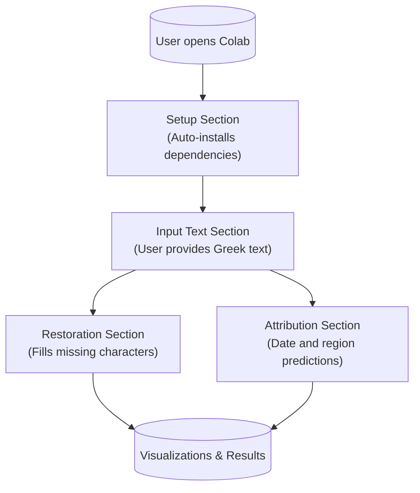
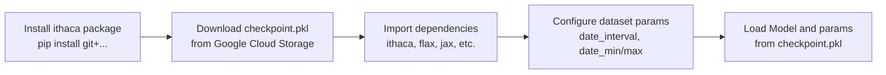
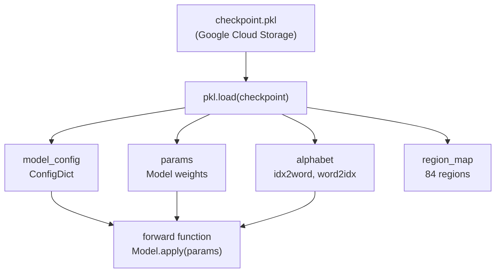
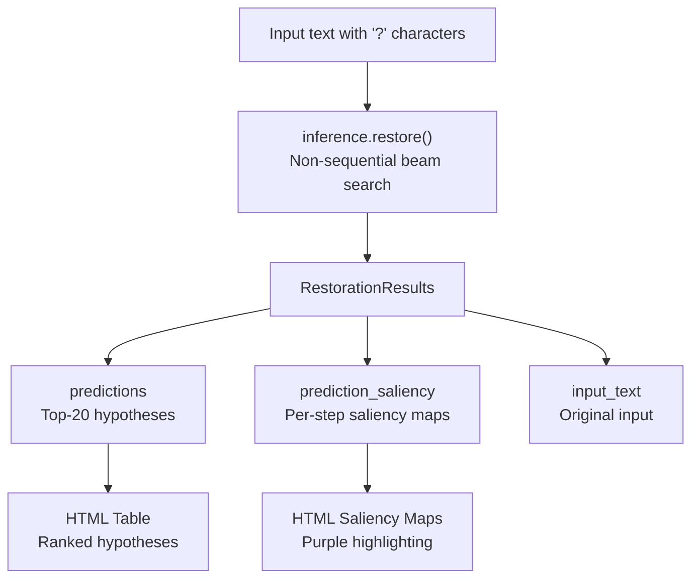
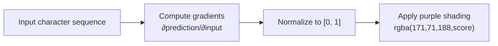
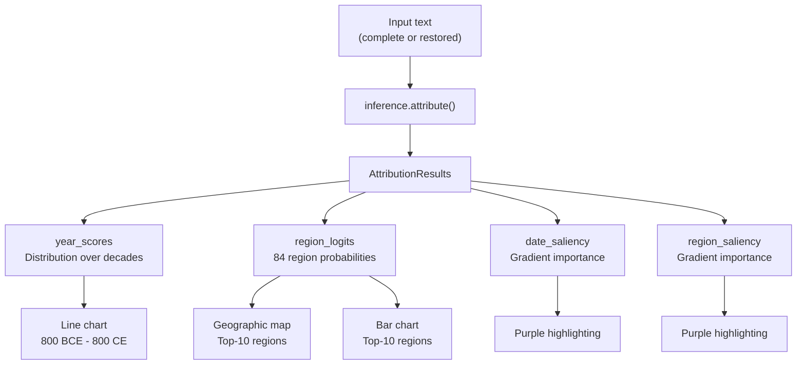
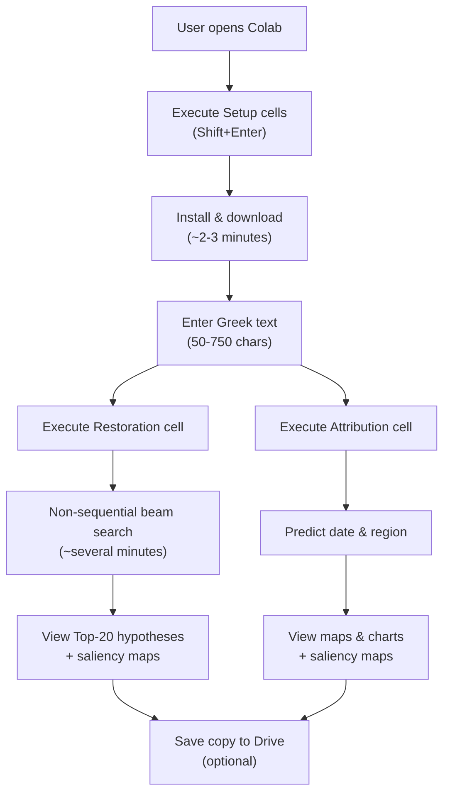

<!-- source: DeepWiki mcp.deepwiki.com · repo google-deepmind/ithaca · page 2.3 Interactive Colab Notebook · fetched 2026-10-26 -->

# Interactive Colab Notebook

<details>
<summary>Relevant source files</summary>

The following files were used as context for generating this wiki page:

- [README.md](README.md)
- [colabs/ithaca_inference.ipynb](colabs/ithaca_inference.ipynb)

</details>


This document provides a comprehensive guide to using the Ithaca interactive Colab notebook for text restoration and attribution of ancient Greek inscriptions. The notebook provides a user-friendly interface for researchers without requiring local installation or command-line expertise.

For programmatic inference usage, see [Command Line Interface](#2.4). For details on the underlying inference functions, see [Inference System](#5).

---

## Overview

The interactive Colab notebook (`colabs/ithaca_inference.ipynb`) provides a browser-based interface for performing text restoration and geographical/chronological attribution on ancient Greek inscriptions. It handles all dependencies, model loading, and result visualization automatically.

**Notebook Structure:**



**Sources:** [colabs/ithaca_inference.ipynb:1-137]()

---

## Accessing the Notebook

The notebook is hosted on Google Colab and can be accessed via:
- Direct link: `https://colab.research.google.com/github/deepmind/ithaca/blob/master/colabs/ithaca_inference.ipynb`
- Colab badge in repository README

**Requirements:**
- Google account (for Colab access)
- GPU runtime recommended (Colab provides free GPU access)
- No local installation required

**Sources:** [README.md:67-72](), [colabs/ithaca_inference.ipynb:1-18]()

---

## Setup Process

The notebook automates all setup steps through hidden cells that users execute but can skip reading.

### Setup Workflow



### Installation Cell

The first setup cell installs the Ithaca package and downloads the pre-trained model checkpoint:

```python
!pip install -q git+https://github.com/deepmind/ithaca
!curl --output checkpoint.pkl https://storage.googleapis.com/ithaca-resources/models/checkpoint_v1.pkl
```

**Key actions:**
- Installs `ithaca` package from GitHub repository
- Downloads `checkpoint.pkl` (pre-trained model weights) to Colab runtime
- Additional install: `geopandas` for geographical map visualization

**Sources:** [colabs/ithaca_inference.ipynb:216-240]()

### Import and Configuration

The imports cell loads all required dependencies:

| Module | Purpose |
|--------|---------|
| `ithaca.eval.inference` | Core inference functions: `attribute()`, `restore()` |
| `ithaca.models.model.Model` | Transformer model architecture |
| `ithaca.util.alphabet.GreekAlphabet` | Greek character vocabulary handling |
| `jax` | JAX framework for model execution |
| `flax.linen` | Neural network layers |
| `folium` | Interactive map generation |
| `matplotlib.pyplot` | Plotting utilities |

**Dataset configuration:**
```python
class dataset_config:
  date_interval = 10      # Date bins in 10-year intervals
  date_max = 800          # Maximum date: 800 CE
  date_min = -800         # Minimum date: 800 BCE
```

**Sources:** [colabs/ithaca_inference.ipynb:243-342]()

### Model Loading



The model loading cell reconstructs the trained model from the checkpoint:

```python
with open("checkpoint.pkl", "rb") as f:
  checkpoint = pkl.load(f)

model_config = config_dict.ConfigDict(checkpoint['model_config'])
params = jax.device_put(checkpoint['params'])

alphabet = GreekAlphabet()
alphabet.idx2word = checkpoint['alphabet']['idx2word']
alphabet.word2idx = checkpoint['alphabet']['word2idx']

vocab_char_size = checkpoint['model_config']['vocab_char_size']
vocab_word_size = checkpoint['model_config']['vocab_word_size']

region_map = checkpoint['region_map']

forward = functools.partial(Model(**model_config).apply, params)
```

**Key objects loaded:**
- `model_config`: Model hyperparameters (layers, dimensions, etc.)
- `params`: Trained neural network weights
- `alphabet`: Character and word vocabularies
- `region_map`: Mapping of region IDs to names (84 subregions)
- `forward`: Callable function for model inference

**Sources:** [colabs/ithaca_inference.ipynb:345-370]()

---

## Input Text Requirements

### Text Input Format

Users provide ancient Greek text in a designated input cell. The text must meet specific formatting requirements:

**Length constraints:**
- Minimum: 50 characters
- Maximum: 750 characters

**Missing character notation:**
| Symbol | Meaning | Usage |
|--------|---------|-------|
| `-` (dash) | Missing character to skip | Character is illegible, do not predict |
| `?` (question mark) | Missing character to predict | Character should be restored by model |

**Example input:**
```python
text = 'ἔδοξεν τῆι βουλῆι και τῶι δήμωι λυσίστρατος εἶπε- επειδη διοφανης ανηρ αγαθος ων διατελει περι δηλιους δεδοχθαι τωι ----- διοφανην καλλι-------- --ηναιον προξενον ειναι δ--------- αυτογ και εκγονους κ-- ειναι αυτοις ατελειαν εν δηλωι παντων'
```

**Text preprocessing:**
- Notebook automatically handles Greek character normalization
- Diacritics and accents are processed by `GreekAlphabet.filter()`
- Text is converted to lowercase and normalized forms (e.g., tonos/oxia unification)

**Sources:** [colabs/ithaca_inference.ipynb:373-400]()

---

## Restoration Workflow

The restoration section generates multiple hypotheses for missing characters and visualizes model confidence through saliency maps.

### Restoration Process



### Calling the Restore Function

```python
restoration_results = inference.restore(
    text=text,
    forward=forward,
    params=params,
    alphabet=alphabet,
    vocab_char_size=vocab_char_size,
    vocab_word_size=vocab_word_size,
)
```

**Arguments:**
- `text`: Input Greek text with `?` markers
- `forward`: Model inference function
- `params`: Model weights
- `alphabet`: Greek vocabulary
- `vocab_char_size`, `vocab_word_size`: Vocabulary dimensions

**Returns:** `RestorationResults` NamedTuple containing:
- `predictions`: List of restoration hypotheses with scores
- `prediction_saliency`: Saliency maps for each restoration step
- `input_text`: Original input for reference

**Sources:** [colabs/ithaca_inference.ipynb:414-442]()

### Top-20 Hypothesis Visualization

The notebook renders an interactive HTML table showing:

| Column | Content |
|--------|---------|
| Hypothesis N | Rank (1-20) |
| Score | Probability percentage (e.g., 66.1%) |
| Text | Full text with predicted characters highlighted |

**Features:**
- Horizontal scrolling for long texts
- "Jump to restoration area" button
- Sticky header columns for context while scrolling
- Predicted characters highlighted with grey background

**HTML rendering approach:**
```python
template = jinja2.Template("""...""")
display(HTML(template.render(
    restoration_results=restoration_results,
    prediction_idx=prediction_idx
)))
```

The template uses:
- Jinja2 templating for dynamic content
- Custom CSS for styling and sticky headers
- JavaScript for navigation features

**Sources:** [colabs/ithaca_inference.ipynb:414-829]()

### Restoration Saliency Maps

Saliency maps show which input characters most influenced each prediction:



**Visualization details:**
- Each restoration step shown as a separate row
- Restored character highlighted in center column
- Surrounding characters shaded by importance (0.00 to 1.00)
- Purple color intensity: `background: rgba(171,71,188,{score})`
- Hover effects highlight currently viewed restoration

**Key insight:** Saliency maps reveal which context the model used to make predictions, enabling historians to evaluate prediction reliability.

**Sources:** [colabs/ithaca_inference.ipynb:831-971]()

---

## Attribution Workflow

The attribution section predicts geographical origin and chronological date of the inscription. (Note: The provided file is truncated, so attribution details are inferred from the system architecture and README.)

### Attribution Process



### Calling the Attribute Function

Expected usage pattern (inferred from system design):

```python
attribution_results = inference.attribute(
    text=text,
    forward=forward,
    params=params,
    alphabet=alphabet,
    vocab_char_size=vocab_char_size,
    vocab_word_size=vocab_word_size,
    region_map=region_map,
)
```

### Expected Visualizations

Based on the notebook instructions, the attribution section provides:

1. **Geographical Attribution:**
   - Bar chart: Top-10 regions ranked by probability
   - Interactive map: Geographic visualization using `folium`
   - Coverage: 84 ancient world regions

2. **Chronological Attribution:**
   - Categorical distribution: Probability over decades (800 BCE to 800 CE)
   - Line chart: Temporal probability distribution
   - Date interval: 10-year bins

3. **Attribution Saliency Maps:**
   - Separate saliency for geographical and chronological predictions
   - Same purple highlighting scheme as restoration saliency
   - Shows which text features influenced each prediction type

**Sources:** [colabs/ithaca_inference.ipynb:104-136](), [README.md:35-43]()

---

## Helper Functions and Templates

The notebook includes several utility functions for visualization:

### Region Name Resolution

```python
def get_subregion_name(id, region_map):
  return region_map['sub']['names_inv'][region_map['sub']['ids_inv'][id]]
```

Converts region ID to human-readable name using the region map.

### Date Formatting

```python
def bce_ad(d):
  if d < 0:
    return f'{abs(d)} BCE'
  elif d > 0:
    return f'{abs(d)} AD'
  return 0
```

Formats dates with BCE/AD notation.

### Saliency HTML Generation

```python
SALIENCY_SNIPPET_TEMPLATE = jinja2.Template("""
<div class="saliency">
  
    <span
      style="background-color: rgba(171,71,188,{{'%.2f'|format(score)}});"
      title="Saliency score {{'%.2f'|format(score)}}">{{ char }}</span>
  
</div>
""")

def generate_saliency(text, saliency, snippet=False):
  """Generates saliency visualisation."""
  snippet_html = SALIENCY_SNIPPET_TEMPLATE.render(
      pairs=list(zip(text, saliency)))
  if snippet:
    return snippet_html
  return SALIENCY_TEMPLATE.render(body_html=snippet_html)
```

Creates HTML with purple-shaded characters based on saliency scores.

**Sources:** [colabs/ithaca_inference.ipynb:284-339]()

---

## Saving Work

The notebook provides guidance on preserving results:

**Important:** The Colab notebook is read-only by default. Changes and outputs are not automatically saved.

**To save work:**
1. Click `File` → `Save a copy in Drive`
2. Creates a personal copy in Google Drive
3. All outputs and modifications are preserved in the copy

**Alternative: Downloading outputs**
- Right-click on visualizations to save images
- Copy text from restoration tables
- Take screenshots of results

**Sources:** [colabs/ithaca_inference.ipynb:136]()

---

## Execution Flow Summary



**Performance notes:**
- Setup: 2-3 minutes for installation and checkpoint download
- Restoration: Several minutes depending on number of missing characters
- Attribution: Faster, typically under 1 minute
- GPU runtime strongly recommended for acceptable performance

**Sources:** [colabs/ithaca_inference.ipynb:104-136]()

---

## Code Entity Reference

This section maps natural language concepts to code entities for developers examining the notebook implementation:

| Concept | Code Entity | Location |
|---------|-------------|----------|
| Restoration inference | `inference.restore()` | ithaca/eval/inference.py |
| Attribution inference | `inference.attribute()` | ithaca/eval/inference.py |
| Model architecture | `Model` class | ithaca/models/model.py |
| Greek vocabulary | `GreekAlphabet` class | ithaca/util/alphabet.py |
| Model forward pass | `forward` function (partial) | Created from Model.apply |
| Restoration results | `RestorationResults` NamedTuple | ithaca/eval/inference.py |
| Attribution results | `AttributionResults` NamedTuple | ithaca/eval/inference.py |
| Model checkpoint | `checkpoint.pkl` | Google Cloud Storage |
| Region mappings | `region_map` dict | Loaded from checkpoint |
| Saliency template | `SALIENCY_SNIPPET_TEMPLATE` | Jinja2 template in notebook |
| Date configuration | `dataset_config` class | Defined in notebook |

**Sources:** [colabs/ithaca_inference.ipynb:243-370]()

---

