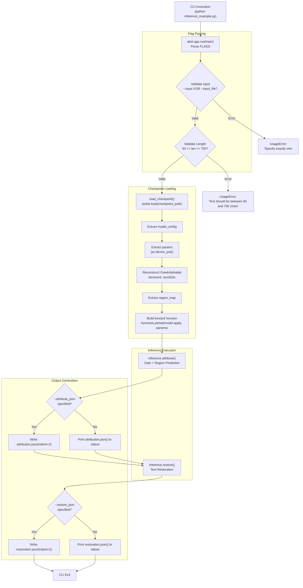
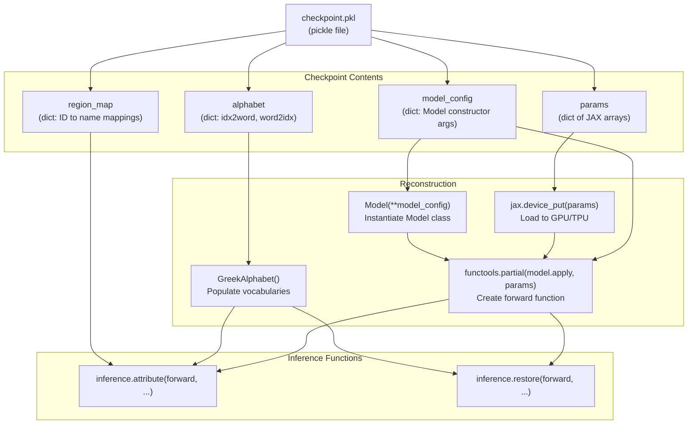
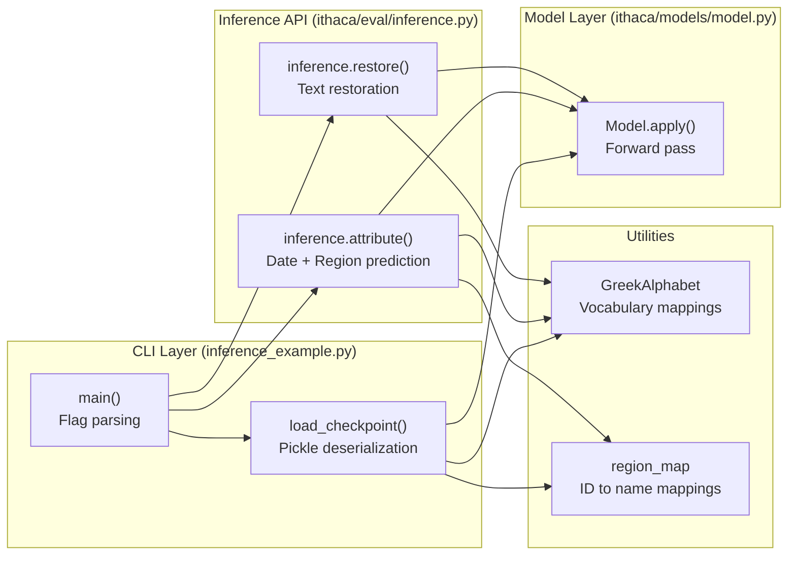

<!-- source: DeepWiki mcp.deepwiki.com · repo google-deepmind/ithaca · page 2.4 Command Line Interface · fetched 2026-10-26 -->

# Command Line Interface

<details>
<summary>Relevant source files</summary>

The following files were used as context for generating this wiki page:

- [README.md](README.md)
- [example_input.txt](example_input.txt)
- [inference_example.py](inference_example.py)

</details>


This page documents the `inference_example.py` command-line interface for performing text restoration and attribution on ancient Greek inscriptions. The CLI provides a scriptable, non-interactive interface for batch processing or programmatic usage.

For interactive inference with visualizations, see [Interactive Colab Notebook](#2.3). For programmatic API usage within Python code, see [Inference Overview](#5.1).

---

## Purpose and Scope

The `inference_example.py` script is a command-line wrapper around the core inference functions ([ithaca/eval/inference.py:0-0]()). It enables:

- **Batch processing**: Process multiple inscriptions via shell scripts
- **Automation**: Integrate Ithaca inference into data pipelines
- **Reproducibility**: Script-based workflows for research reproducibility
- **JSON output**: Machine-readable results for downstream processing

The CLI performs both attribution (date and region prediction) and restoration (missing character reconstruction) on a single input text per invocation.

**Sources:** [README.md:74-114](), [inference_example.py:1-130]()

---

## Installation and Setup

### Prerequisites

Install the `ithaca` package (core dependencies only):

```sh
pip install .
```

### Download Model Checkpoint

The trained model checkpoint must be downloaded separately (approximately 1.8 GB):

```sh
curl --output checkpoint.pkl https://storage.googleapis.com/ithaca-resources/models/checkpoint_v1.pkl
```

The checkpoint pickle contains:
- Model parameters (`params`)
- Model architecture configuration (`model_config`)
- Greek alphabet vocabulary mappings (`alphabet`)
- Region ID-to-name mappings (`region_map`)

**Sources:** [README.md:79-87](), [inference_example.py:40-74]()

---

## Command-Line Arguments

### Flag Reference

| Flag | Type | Required | Default | Description |
|------|------|----------|---------|-------------|
| `--input` | string | Either this or `--input_file` | `""` | Direct text input as command-line argument |
| `--input_file` | string | Either this or `--input` | `""` | Path to UTF-8 text file containing input |
| `--checkpoint_path` | string | No | `checkpoint.pkl` | Path to model checkpoint pickle file |
| `--attribute_json` | string | No | `""` | Path to save attribution results as JSON |
| `--restore_json` | string | No | `""` | Path to save restoration results as JSON |

### Mutual Exclusivity

Exactly one of `--input` or `--input_file` must be specified. The script enforces this constraint at [inference_example.py:80-86]():

```python
if FLAGS.input and not FLAGS.input_file:
    input_text = FLAGS.input
elif not FLAGS.input and FLAGS.input_file:
    with open(FLAGS.input_file, 'r', encoding='utf8') as f:
      input_text = f.read()
else:
    raise app.UsageError('Specify exactly one of --input and --input_file.')
```

**Sources:** [inference_example.py:28-37]()

---

## Input Requirements

### Text Length Validation

Input text must be between **50 and 750 characters** (inclusive). This constraint is enforced at [inference_example.py:88-91]():

```python
if not 50 <= len(input_text) <= 750:
    raise app.UsageError(
        f'Text should be between 50 and 750 chars long, but the input was '
        f'{len(input_text)} characters')
```

### Input Format

Input text should be:
- **Ancient Greek**: Written in Greek characters (Unicode)
- **UTF-8 encoded**: When using `--input_file`
- **Accents optional**: The model handles both accented and unaccented text via [GreekAlphabet.filter]() normalization
- **Missing characters**: Mark with `?` for restoration (e.g., `τὴ? βου?ὴγ`)

**Example input** from [example_input.txt:1-2]():
```
ἔδοξεν τῆι βουλῆι καὶ τῶι δήμωι λυσίστρατος εἶπε- ἐπειδὴ διοφάνης ἀνὴρ 
ἀγαθὸς ὢν διατελεῖ περὶ δηλίους δεδόχθαι τῶι ----- διοφάνην καλλι-------- 
--ηναῖον πρόξενον εἶναι δ--------- αὐτὸγ καὶ ἐκγόνους...
```

**Sources:** [inference_example.py:80-91](), [example_input.txt:1-2]()

---

## CLI Execution Flow



**Execution Flow:**

1. **Flag Parsing** ([inference_example.py:76-91]()): `absl.app` parses command-line flags and validates inputs
2. **Checkpoint Loading** ([inference_example.py:40-73]()): Deserializes model checkpoint and reconstructs components
3. **Inference Execution** ([inference_example.py:100-120]()): Calls core inference functions
4. **Output Generation** ([inference_example.py:108-125]()): Writes results to JSON files or prints to stdout

**Sources:** [inference_example.py:76-129]()

---

## Checkpoint Loading Process



The `load_checkpoint()` function ([inference_example.py:40-73]()) performs the following steps:

1. **Deserialize pickle**: Loads checkpoint dictionary from disk
2. **Transfer to device**: `jax.device_put(checkpoint['params'])` moves parameters to accelerator (GPU/TPU)
3. **Reconstruct model**: `Model(**checkpoint['model_config'])` instantiates model with saved configuration
4. **Create forward function**: `functools.partial(model.apply, params)` binds parameters to the model's apply method
5. **Restore vocabularies**: Populates `GreekAlphabet` instance with saved word and character mappings

The forward function signature expected by `inference.attribute()` and `inference.restore()` is:
```python
forward(text_char, text_word, ...) -> model_output
```

**Sources:** [inference_example.py:40-73]()

---

## Usage Examples

### Basic Usage: Print to stdout

```sh
python inference_example.py --input_file=example_input.txt
```

Output format (truncated for brevity):
```
Attribution: {
  "date_predictions": [...],
  "region_predictions": [...],
  "attribution_saliency": {...}
}
Restoration: {
  "restorations": [...],
  "restoration_saliency": {...}
}
```

### Direct Text Input

```sh
python inference_example.py --input="ἔδοξεν τῆι βουλῆι καὶ τῶι δήμωι..."
```

### Save Results to JSON Files

```sh
python inference_example.py \
  --input_file=example_input.txt \
  --attribute_json=attribute.json \
  --restore_json=restore.json
```

This creates two files:
- `attribute.json`: Contains date predictions, region predictions, and attribution saliency maps
- `restore.json`: Contains character restorations and restoration saliency maps

### Custom Checkpoint Path

```sh
python inference_example.py \
  --input_file=example_input.txt \
  --checkpoint_path=/path/to/custom_checkpoint.pkl
```

### Display Help

```sh
python inference_example.py --help
```

**Sources:** [README.md:89-114]()

---

## Output Format

### Attribution Output Structure

The `attribution` object is an `AttributionResults` namedtuple containing:

| Field | Type | Description |
|-------|------|-------------|
| `date_predictions` | List of tuples | Year scores: `[(year, score), ...]` sorted by score |
| `region_predictions` | List of tuples | Region predictions: `[(region_name, score), ...]` |
| `attribution_saliency` | Dict | Saliency maps for date and region predictions |

The `.json()` method serializes to JSON format ([inference_example.py:110-112]()).

### Restoration Output Structure

The `restoration` object is a `RestorationResults` namedtuple containing:

| Field | Type | Description |
|-------|------|-------------|
| `restorations` | List of dicts | Beam search candidates with restored text and scores |
| `restoration_saliency` | Dict | Saliency maps for each restoration |

**Sources:** [inference_example.py:100-125]()

---

## Integration with Core Inference Functions



The CLI serves as a thin wrapper that:
1. **Parses command-line arguments** using `absl.flags`
2. **Loads checkpoint** and reconstructs model components
3. **Invokes core functions**: `inference.attribute()` and `inference.restore()`
4. **Formats output**: Converts namedtuples to JSON or prints to stdout

The separation of concerns allows:
- **CLI independence**: Core inference functions can be used without CLI
- **Testing**: Core logic testable without command-line parsing
- **Multiple interfaces**: Same core functions used by CLI, Colab, and programmatic API

**Sources:** [inference_example.py:1-130]()

---

## Error Handling

### Common Errors

| Error | Cause | Solution |
|-------|-------|----------|
| `UsageError: Specify exactly one of --input and --input_file` | Both or neither flag specified | Use exactly one input method |
| `UsageError: Text should be between 50 and 750 chars long` | Input text length invalid | Adjust input text length |
| `FileNotFoundError: checkpoint.pkl` | Checkpoint not downloaded | Run `curl --output checkpoint.pkl https://...` |
| `FileNotFoundError: [input_file]` | Input file doesn't exist | Check file path |
| `UnicodeDecodeError` | Input file not UTF-8 encoded | Convert file to UTF-8 |

### Validation Flow

The script performs validation in this order:
1. Flag validation ([inference_example.py:80-86]()): Mutual exclusivity of input flags
2. Length validation ([inference_example.py:88-91]()): 50-750 character constraint
3. Checkpoint loading ([inference_example.py:54-55]()): File existence and pickle format
4. Model reconstruction ([inference_example.py:61-62]()): Valid model configuration

**Sources:** [inference_example.py:76-96]()

---

## Comparison: CLI vs Colab vs Programmatic API

| Feature | CLI (`inference_example.py`) | Colab Notebook | Programmatic API |
|---------|------------------------------|----------------|------------------|
| **Installation** | `pip install .` | Browser-based, no install | `pip install .` |
| **Interface** | Command-line flags | Interactive widgets | Python functions |
| **Batch processing** | Yes (via shell scripts) | Manual per text | Yes (via loops) |
| **Visualization** | No | Yes (attention, saliency) | Requires custom code |
| **Output format** | JSON | Interactive display | Python objects |
| **Use case** | Automation, pipelines | Exploration, demos | Integration, research |
| **Dependencies** | Minimal (core only) | Minimal (core only) | Minimal (core only) |

For interactive exploration with visualizations, see [Interactive Colab Notebook](#2.3).  
For programmatic integration within Python applications, see [Inference Overview](#5.1).

**Sources:** [README.md:67-114](), [inference_example.py:1-130]()

---

