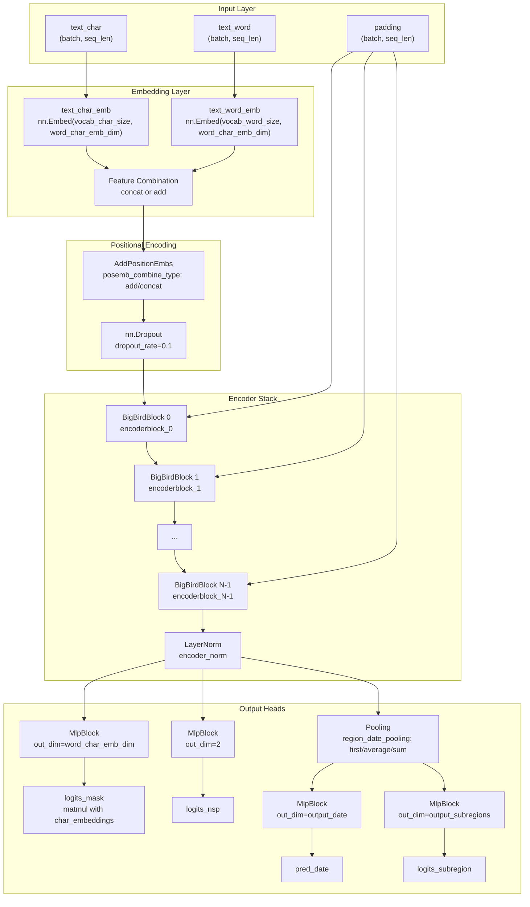
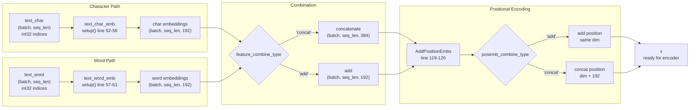
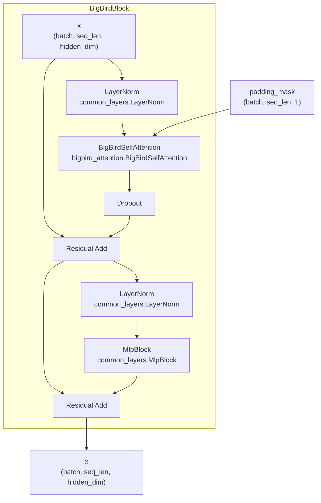
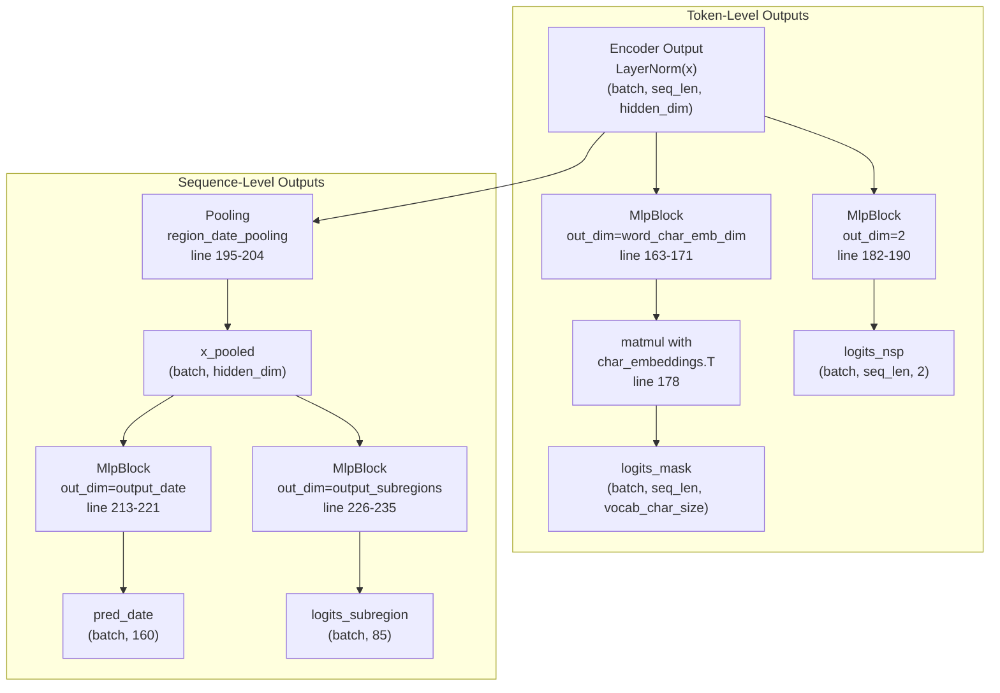

<!-- source: DeepWiki mcp.deepwiki.com · repo google-deepmind/ithaca · page 3 Model Architecture · fetched 2026-10-26 -->

# Model Architecture

<details>
<summary>Relevant source files</summary>

The following files were used as context for generating this wiki page:

- [ithaca/models/bigbird.py](ithaca/models/bigbird.py)
- [ithaca/models/common_layers.py](ithaca/models/common_layers.py)
- [ithaca/models/model.py](ithaca/models/model.py)

</details>


This document provides a comprehensive technical reference for the Ithaca neural network architecture. It covers the `Model` class structure, input processing pipeline, encoder components, and multi-task output heads. For information about training this model, see [Training System](#4). For guidance on using the model for inference, see [Inference System](#5).

## Architecture Overview

The Ithaca model is a Transformer-based architecture built on Flax that processes ancient Greek text through dual character and word embeddings, applies sparse attention via BigBird blocks, and produces four simultaneous outputs: date prediction, geographical region classification, masked character prediction, and next sentence prediction.



**Sources:** [ithaca/models/model.py:24-243]()

## Model Class Structure

The `Model` class in [ithaca/models/model.py:24-243]() is a Flax `nn.Module` that encapsulates the entire architecture. Key configuration parameters control model dimensions, attention patterns, and output behavior.

### Core Configuration Parameters

| Parameter | Default Value | Description |
|-----------|--------------|-------------|
| `vocab_char_size` | 164 | Character vocabulary size |
| `vocab_word_size` | 100004 | Word vocabulary size |
| `output_subregions` | 85 | Number of geographical regions |
| `output_date` | 160 | Number of date bins for distribution |
| `num_heads` | 8 | Number of attention heads per layer |
| `num_layers` | 6 | Number of encoder blocks |
| `word_char_emb_dim` | 192 | Dimension of character/word embeddings |
| `emb_dim` | 512 | Hidden dimension for MLPs |
| `qkv_dim` | 512 | Query/key/value dimension for attention |
| `mlp_dim` | 2048 | Feed-forward network dimension |
| `max_len` | 1024 | Maximum sequence length |

### Additional Configuration

| Parameter | Default Value | Description |
|-----------|--------------|-------------|
| `output_date_dist` | True | Output date as distribution vs single value |
| `output_return_emb` | False | Return encoder embeddings with outputs |
| `use_output_mlp` | True | Use MLP blocks for output heads |
| `feature_combine_type` | 'concat' | How to combine char/word embeddings: 'concat' or 'add' |
| `posemb_combine_type` | 'add' | How to add positional embeddings: 'add' or 'concat' |
| `region_date_pooling` | 'first' | Pooling strategy: 'first', 'average', or 'sum' |
| `learn_pos_emb` | True | Learn positional embeddings vs fixed sinusoidal |
| `use_bfloat16` | False | Use bfloat16 precision for computation |
| `dropout_rate` | 0.1 | Dropout rate for regularization |
| `attention_dropout_rate` | 0.1 | Dropout rate for attention weights |
| `activation_fn` | 'gelu' | Activation function: 'gelu' or 'relu' |
| `model_type` | 'bigbird' | Encoder type (currently only 'bigbird' supported) |

**Sources:** [ithaca/models/model.py:24-49]()

## Input Processing Pipeline

The model processes text through parallel character-level and word-level embedding pathways. This dual representation captures both fine-grained character patterns and broader semantic word meanings.



### Embedding Initialization

The embeddings are initialized in the `setup()` method [ithaca/models/model.py:51-61]():

- **Character embeddings** (`text_char_emb`): Maps character vocabulary (164 tokens) to 192-dimensional vectors
- **Word embeddings** (`text_word_emb`): Maps word vocabulary (100,004 tokens) to 192-dimensional vectors
- Both use `nn.initializers.normal(stddev=1.0)` initialization

### Feature Combination

The model supports two methods for combining character and word embeddings [ithaca/models/model.py:109-114]():

1. **Concatenation** (`feature_combine_type='concat'`): Concatenates along the feature dimension, resulting in 384-dimensional vectors
2. **Addition** (`feature_combine_type='add'`): Element-wise addition, maintaining 192-dimensional vectors

### Positional Encoding

Positional information is added via the `AddPositionEmbs` layer from `common_layers.py` [ithaca/models/model.py:117-126](). The layer supports:

- **Learned embeddings**: When `learn_pos_emb=True`, trainable positional embeddings are initialized with sinusoidal patterns
- **Fixed sinusoidal embeddings**: When `learn_pos_emb=False`, uses standard sinusoidal position encoding
- **Combination modes**: 
  - `'add'`: Adds positional encoding to input (preserves dimension)
  - `'concat'`: Concatenates positional encoding (increases dimension)

### Padding Mask

The model automatically generates padding masks from input tensors [ithaca/models/model.py:75-80]():

```python
padding = jnp.where(text_char > 0, 1, 0)  # Binary mask: 1 for valid tokens, 0 for padding
padding_mask = padding[..., jnp.newaxis]   # Shape: (batch, seq_len, 1)
text_len = jnp.sum(padding, 1)             # Actual sequence lengths
```

**Sources:** [ithaca/models/model.py:51-127](), [ithaca/models/common_layers.py:74-107](), [ithaca/models/common_layers.py:143-219]()

## Encoder Stack

The encoder consists of a stack of `BigBirdBlock` layers that apply sparse self-attention followed by feed-forward transformations. Each block uses the same configuration but with different random seeds for sparse attention patterns.

### BigBirdBlock Structure



Each `BigBirdBlock` [ithaca/models/bigbird.py:32-110]() implements the standard Transformer architecture with pre-normalization:

1. **Layer Normalization** [ithaca/models/bigbird.py:79]() applied before attention
2. **BigBird Self-Attention** [ithaca/models/bigbird.py:80-96]() with sparse attention patterns
3. **Dropout** [ithaca/models/bigbird.py:97]() for regularization
4. **Residual Connection** [ithaca/models/bigbird.py:98]() with input
5. **Layer Normalization** [ithaca/models/bigbird.py:101]() applied before MLP
6. **MLP Block** [ithaca/models/bigbird.py:102-108]() for feed-forward transformation
7. **Residual Connection** [ithaca/models/bigbird.py:110]() with attention output

### Encoder Loop

The model constructs `num_layers` encoder blocks in a loop [ithaca/models/model.py:141-157]():

```python
for lyr in range(self.num_layers):
  x = model_block(
      qkv_dim=self.qkv_dim,           # 512
      mlp_dim=self.mlp_dim,           # 2048
      num_heads=self.num_heads,       # 8
      dtype=dtype,                     # float32 or bfloat16
      dropout_rate=self.dropout_rate,
      attention_dropout_rate=self.attention_dropout_rate,
      deterministic=not is_training,
      activation_fn=self.activation_fn,
      connectivity_seed=lyr,           # Different seed per layer
      name=f'encoderblock_{lyr}',
  )(x, padding_mask=padding_mask)
```

Key features:
- Each layer uses a unique `connectivity_seed` based on layer index for different sparse attention patterns
- `deterministic` flag controls dropout behavior (disabled during inference)
- Padding mask propagates through all layers to ignore padded positions
- Final layer normalization [ithaca/models/model.py:158]() applied after all blocks

**Sources:** [ithaca/models/model.py:136-159](), [ithaca/models/bigbird.py:32-110]()

## Multi-Task Output Heads

The model produces four distinct outputs from the encoder representations, enabling multi-task learning. Two heads operate on sequence-level representations (after pooling), while two operate on token-level representations.



### 1. Masked Language Modeling (logits_mask)

Predicts the original character at each position for masked tokens [ithaca/models/model.py:162-178]():

- **MLP transformation**: Projects encoder output to embedding dimension (`word_char_emb_dim=192`)
- **Weight tying**: Multiplies by transposed character embedding matrix for output logits
- **Output shape**: `(batch, seq_len, vocab_char_size)` where `vocab_char_size=164`
- **Purpose**: Character restoration and reconstruction

### 2. Next Sentence Prediction (logits_nsp)

Predicts whether consecutive sentences follow each other [ithaca/models/model.py:180-192]():

- **MLP transformation**: Projects to 2-dimensional binary classification
- **Output shape**: `(batch, seq_len, 2)` with logits for [not_consecutive, consecutive]
- **Purpose**: Discourse coherence understanding

### 3. Date Prediction (pred_date)

Predicts the date as a distribution over time bins [ithaca/models/model.py:206-223]():

- **Pooling**: Reduces sequence to single representation using `region_date_pooling` strategy
- **Distribution mode**: When `output_date_dist=True`, outputs `output_date=160` bins
- **Single value mode**: When `output_date_dist=False`, outputs single regression value
- **Output shape**: `(batch, 160)` for distribution or `(batch, 1)` for regression
- **Purpose**: Temporal attribution

### 4. Region Classification (logits_subregion)

Classifies the geographical origin into subregions [ithaca/models/model.py:225-237]():

- **Pooling**: Uses same pooled representation as date prediction
- **Output shape**: `(batch, output_subregions)` where `output_subregions=85`
- **Purpose**: Geographical attribution across 84 ancient Greek regions plus unknown class

### Pooling Strategies

The `region_date_pooling` parameter controls how sequence-level representations are computed [ithaca/models/model.py:195-204]():

| Strategy | Implementation | Use Case |
|----------|---------------|----------|
| `'first'` | `x[:, 0, :]` | Use first token (CLS-style) |
| `'average'` | `sum(x * padding_mask) / text_len` | Mean pooling over valid tokens |
| `'sum'` | `sum(x * padding_mask)` | Sum pooling over valid tokens |

### MLP Output Heads

When `use_output_mlp=True` (default), each output head uses an `MlpBlock` from `common_layers.py` [ithaca/models/common_layers.py:221-256]():

- **Two-layer MLP**: Dense(`emb_dim`) → Activation → Dropout → Dense(`out_dim`)
- **Activation**: Configurable via `activation_fn` (default: 'gelu')
- **No output dropout**: `out_dropout=False` for final predictions

When `use_output_mlp=False`, heads use simple `nn.Dense` layers without intermediate transformations.

**Sources:** [ithaca/models/model.py:161-243](), [ithaca/models/common_layers.py:221-256]()

## Data Type Handling

The model supports mixed-precision training through the `use_bfloat16` parameter [ithaca/models/model.py:129-134]():

```python
if self.use_bfloat16:
  x = x.astype(jnp.bfloat16)
  dtype = jnp.bfloat16
else:
  dtype = jnp.float32
```

All encoder blocks and output heads receive the same `dtype` parameter, ensuring consistent computation precision throughout the forward pass.

**Sources:** [ithaca/models/model.py:129-134]()

## Common Layer Components

The model relies heavily on reusable components from `common_layers.py`. These components provide standard neural network operations with consistent interfaces.

### Embed Layer

The `Embed` class [ithaca/models/common_layers.py:74-107]() provides bidirectional embedding operations:

- **Input mode** (`mode='input'`): Maps integer indices to vectors via lookup
- **Output mode** (`mode='output'`): Projects vectors to vocabulary space via matrix multiplication
- **Initialization**: Configurable via `emb_init` parameter (default: normal distribution)

### AddPositionEmbs Layer

The `AddPositionEmbs` class [ithaca/models/common_layers.py:143-219]() adds positional information:

- **Sinusoidal encoding**: Generates fixed position embeddings using sine/cosine functions [ithaca/models/common_layers.py:109-140]()
- **Learned encoding**: Optional trainable position embeddings
- **Combination modes**: Add or concatenate positional information
- **Cache support**: Handles autoregressive decoding with position tracking

### MlpBlock Layer

The `MlpBlock` class [ithaca/models/common_layers.py:221-256]() implements feed-forward blocks:

- **Architecture**: Dense → Activation → Dropout → Dense → (optional) Dropout
- **Activation functions**: 'relu' or 'gelu' via `ACTIVATION_FN_DICT` [ithaca/models/common_layers.py:34-37]()
- **Dimension control**: Configurable intermediate (`mlp_dim`) and output (`out_dim`) dimensions
- **Dropout control**: Separate control for intermediate and output dropout

### LayerNorm

The `LayerNorm` class [ithaca/models/common_layers.py:289-318]() provides layer normalization:

- **Computation**: Normalizes over feature dimension with learned scale and bias
- **Precision**: Always computes in float32 for numerical stability, then casts to target dtype
- **Epsilon**: Adaptive based on dtype (1e-12 for float32, 1e-3 for float16)

**Sources:** [ithaca/models/common_layers.py:74-107](), [ithaca/models/common_layers.py:143-219](), [ithaca/models/common_layers.py:221-256](), [ithaca/models/common_layers.py:289-318]()

## Model Invocation

The model's `__call__` method [ithaca/models/model.py:63-243]() supports flexible input formats:

### Input Options

The model accepts inputs in three formats:

1. **Integer indices**: `text_char` and `text_word` as integer arrays
2. **One-hot encodings**: `text_char_onehot` and `text_word_onehot` for smooth gradients
3. **Pre-computed embeddings**: `text_char_emb` and `text_word_emb` for custom embeddings

### Training Mode

The `is_training` parameter controls:
- Dropout behavior (`deterministic=not is_training`)
- Batch normalization statistics (if used)
- Gradient flow for regularization

### Return Values

Standard mode returns a 4-tuple [ithaca/models/model.py:239]():
```python
outputs = (pred_date, logits_subregion, logits_mask, logits_nsp)
```

Extended mode (when `output_return_emb=True`) returns outputs plus encoder embeddings [ithaca/models/model.py:240-243]():
```python
return outputs, torso_output  # torso_output: (batch, seq_len, hidden_dim)
```

**Sources:** [ithaca/models/model.py:63-243]()

## Architecture Summary

The Ithaca model architecture can be summarized as follows:

| Component | Implementation | Parameters |
|-----------|---------------|------------|
| **Input Processing** | Dual char/word embeddings + positional encoding | 164 char vocab, 100k word vocab, 192-dim embeddings |
| **Encoder** | Stack of BigBirdBlock layers | 6 layers, 8 heads, 512 qkv_dim, 2048 mlp_dim |
| **Attention** | Sparse BigBird self-attention | Block size 64, 3 random blocks per query |
| **Date Head** | MLP + distribution output | 160 bins (decade intervals, 800 BCE - 800 CE) |
| **Region Head** | MLP + softmax classification | 85 classes (84 regions + unknown) |
| **Mask Head** | MLP + character projection | 164 character vocabulary |
| **NSP Head** | MLP + binary classification | 2 classes (consecutive / not) |
| **Total Parameters** | ~100M (approximate) | Dominated by embeddings and attention weights |

This architecture enables the model to simultaneously perform text restoration (via masked language modeling), temporal attribution (via date prediction), and geographical attribution (via region classification), while understanding discourse structure (via next sentence prediction).

**Sources:** [ithaca/models/model.py:24-243](), [ithaca/models/bigbird.py:32-110](), [ithaca/models/common_layers.py:1-319]()

---

