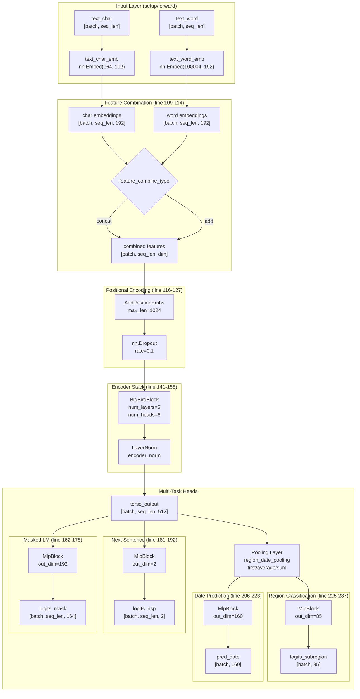
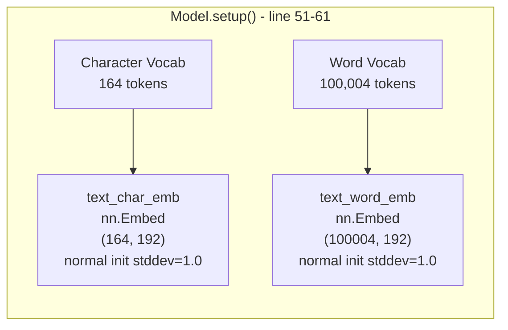
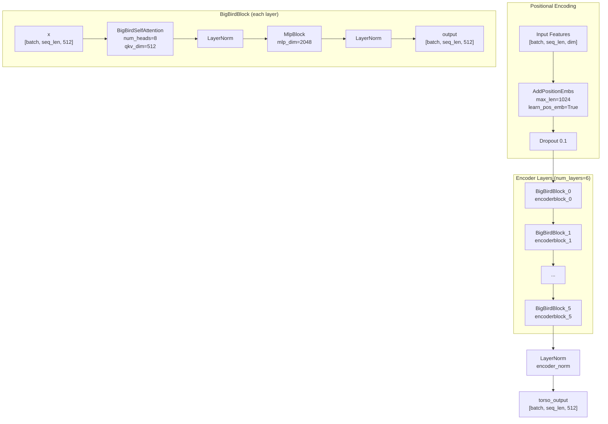
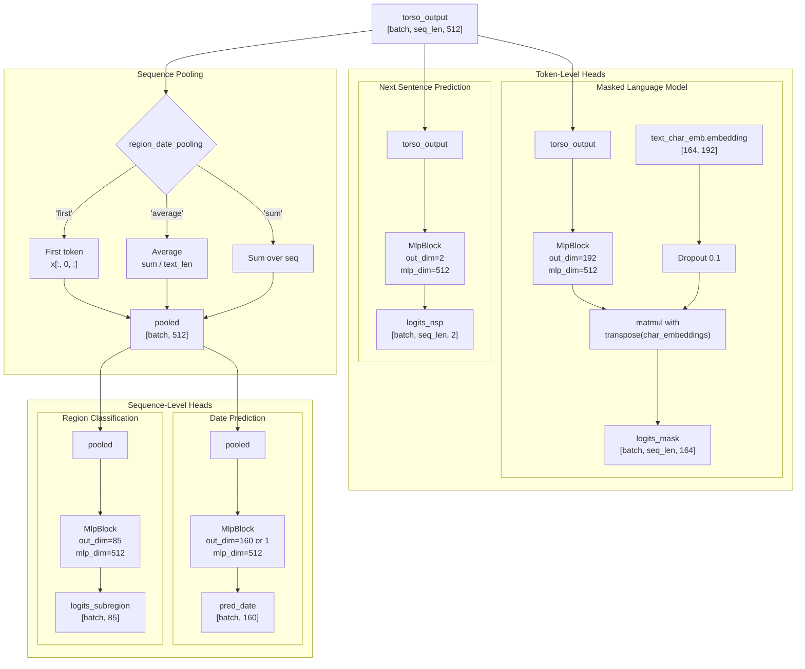
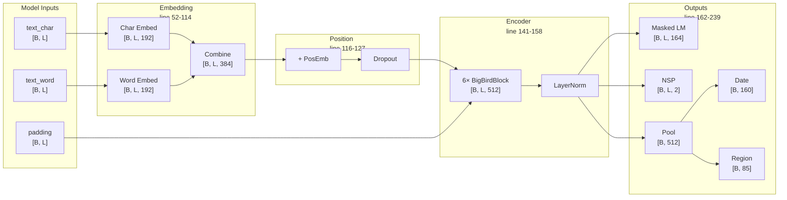

<!-- source: DeepWiki mcp.deepwiki.com · repo google-deepmind/ithaca · page 3.1 Model Overview · fetched 2026-10-26 -->

# Model Overview

<details>
<summary>Relevant source files</summary>

The following files were used as context for generating this wiki page:

- [README.md](README.md)
- [ithaca/models/model.py](ithaca/models/model.py)

</details>


## Purpose and Scope

This page provides a high-level overview of the Ithaca neural network architecture, describing how the model processes ancient Greek inscriptions to perform multi-task predictions. The page covers the overall architecture flow from input embeddings through the encoder stack to the multi-task output heads.

For detailed information about specific components, see:
- **Reusable layer implementations**: [Common Layers](#3.2)
- **Sparse attention mechanism**: [BigBird Attention](#3.3)
- **Text embedding and preprocessing**: [Input Processing](#3.4)
- **Task-specific output heads**: [Multi-Task Output Heads](#3.5)

## Architecture Overview

The Ithaca model is implemented in the `Model` class [ithaca/models/model.py:24-243](), a Flax neural network module based on the Transformer architecture with BigBird sparse attention. The model performs four simultaneous tasks: masked language modeling (text restoration), geographical attribution, chronological dating, and next sentence prediction.

### Model Architecture Diagram



**Sources:** [ithaca/models/model.py:24-243]()

## Model Class Configuration

The `Model` class is configured through a comprehensive set of hyperparameters that control architecture, capacity, and behavior.

### Core Architecture Parameters

| Parameter | Default | Description | Line Reference |
|-----------|---------|-------------|----------------|
| `vocab_char_size` | 164 | Character vocabulary size | [ithaca/models/model.py:26]() |
| `vocab_word_size` | 100004 | Word vocabulary size (100k words + special tokens) | [ithaca/models/model.py:27]() |
| `output_subregions` | 85 | Number of geographical regions | [ithaca/models/model.py:28]() |
| `output_date` | 160 | Number of date bins for distribution | [ithaca/models/model.py:29]() |
| `num_heads` | 8 | Number of attention heads | [ithaca/models/model.py:33]() |
| `num_layers` | 6 | Number of encoder blocks | [ithaca/models/model.py:34]() |
| `word_char_emb_dim` | 192 | Embedding dimension for chars/words | [ithaca/models/model.py:35]() |
| `emb_dim` | 512 | Hidden dimension for encoder | [ithaca/models/model.py:36]() |
| `qkv_dim` | 512 | Dimension for query/key/value projections | [ithaca/models/model.py:37]() |
| `mlp_dim` | 2048 | Feed-forward network dimension | [ithaca/models/model.py:38]() |
| `max_len` | 1024 | Maximum sequence length | [ithaca/models/model.py:39]() |

### Architectural Choices

| Parameter | Default | Options | Description | Line Reference |
|-----------|---------|---------|-------------|----------------|
| `feature_combine_type` | `'concat'` | `'concat'`, `'add'` | How to combine char and word embeddings | [ithaca/models/model.py:41]() |
| `posemb_combine_type` | `'add'` | `'add'`, `'concat'` | How to add positional embeddings | [ithaca/models/model.py:42]() |
| `region_date_pooling` | `'first'` | `'first'`, `'average'`, `'sum'` | Pooling strategy for sequence-level tasks | [ithaca/models/model.py:43]() |
| `model_type` | `'bigbird'` | `'bigbird'` | Attention mechanism type | [ithaca/models/model.py:49]() |
| `activation_fn` | `'gelu'` | `'gelu'`, etc. | Activation function for MLPs | [ithaca/models/model.py:48]() |

### Training Configuration

| Parameter | Default | Description | Line Reference |
|-----------|---------|-------------|----------------|
| `dropout_rate` | 0.1 | Dropout rate for regularization | [ithaca/models/model.py:46]() |
| `attention_dropout_rate` | 0.1 | Dropout rate in attention layers | [ithaca/models/model.py:47]() |
| `use_bfloat16` | False | Use bfloat16 precision for memory efficiency | [ithaca/models/model.py:45]() |

**Sources:** [ithaca/models/model.py:24-49]()

## Input Processing Layer

The input layer processes two parallel streams of information: character-level and word-level representations. Both are embedded using separate embedding tables initialized in the `setup()` method.

### Embedding Initialization



The embeddings are created with normal initialization [ithaca/models/model.py:52-61]():
- **Character embeddings**: Map 164 character tokens to 192-dimensional vectors
- **Word embeddings**: Map 100,004 word tokens to 192-dimensional vectors

### Input Processing Flow

The `__call__` method [ithaca/models/model.py:64-72]() accepts multiple input formats:

1. **Token indices**: `text_char` and `text_word` (most common)
2. **One-hot vectors**: `text_char_onehot` and `text_word_onehot` (for gradient computation)
3. **Pre-computed embeddings**: `text_char_emb` and `text_word_emb` (for saliency analysis)

The padding mask is automatically computed from the input [ithaca/models/model.py:75-80]():
```
padding = jnp.where(text_char > 0, 1, 0)
```

### Feature Combination

After embedding, the character and word representations are combined using one of two strategies [ithaca/models/model.py:109-114]():

| Strategy | Operation | Output Dimension |
|----------|-----------|------------------|
| `'add'` | Element-wise addition | 192 |
| `'concat'` | Concatenation along feature axis | 384 |

The `'concat'` mode is the default, producing richer representations by preserving both character and word information separately.

**Sources:** [ithaca/models/model.py:51-114](), [README.md:46-48]()

## Encoder Stack

The encoder consists of a stack of BigBird transformer blocks followed by layer normalization. Each block applies self-attention and feed-forward transformations with residual connections.

### Encoder Architecture



### Encoder Loop Implementation

The encoder stack is built dynamically in a loop [ithaca/models/model.py:141-158]():

```python
for lyr in range(self.num_layers):
    x = model_block(
        qkv_dim=self.qkv_dim,
        mlp_dim=self.mlp_dim,
        num_heads=self.num_heads,
        dtype=dtype,
        causal_mask=self.causal_mask,
        dropout_rate=self.dropout_rate,
        attention_dropout_rate=self.attention_dropout_rate,
        deterministic=not is_training,
        activation_fn=self.activation_fn,
        connectivity_seed=lyr,
        name=f'encoderblock_{lyr}',
    )(x, padding_mask=padding_mask)
```

Key implementation details:
- **`connectivity_seed=lyr`**: Each layer uses a different seed for BigBird's random attention patterns
- **`padding_mask`**: Passed to prevent attention to padding tokens
- **`deterministic=not is_training`**: Controls dropout behavior during inference

The final encoder output (`torso_output`) is layer-normalized [ithaca/models/model.py:158]() and serves as input to all downstream task heads.

**Sources:** [ithaca/models/model.py:116-158](), [ithaca/models/bigbird.py]()

## Multi-Task Output Heads

The model produces four different outputs from the encoder representations, enabling joint training on complementary tasks. Two heads operate on sequence-level pooled representations (date and region), while two operate on token-level representations (masked LM and NSP).

### Output Head Architecture



### Pooling Strategy

For sequence-level tasks (date and region), the model applies pooling to convert from `[batch, seq_len, 512]` to `[batch, 512]` [ithaca/models/model.py:195-204]():

| Strategy | Implementation | Use Case |
|----------|----------------|----------|
| `'first'` | `x[:, 0, :]` | BERT-style [CLS] token representation |
| `'average'` | `sum(x * mask) / seq_len` | Bag-of-words style averaging |
| `'sum'` | `sum(x * mask)` | Accumulative representation |

The default `'first'` strategy follows BERT's approach of using the first token's representation for sequence classification.

### Output Dimensions

Each head produces outputs with specific dimensions:

| Head | Output Name | Shape | Description |
|------|-------------|-------|-------------|
| Masked LM | `logits_mask` | `[batch, seq_len, 164]` | Character prediction logits per position |
| NSP | `logits_nsp` | `[batch, seq_len, 2]` | Binary classification per position |
| Date | `pred_date` | `[batch, 160]` | Date distribution (160 bins) or `[batch, 1]` for L1 only |
| Region | `logits_subregion` | `[batch, 85]` | Softmax logits over 84 regions + unknown |

The final output tuple [ithaca/models/model.py:239-243]():
```python
outputs = (pred_date, logits_subregion, logits_mask, logits_nsp)
```

### Masked Language Model Implementation

The masked LM head uses a weight-sharing technique [ithaca/models/model.py:162-178](): the output projection reuses the input character embedding matrix. This reduces parameters and ensures consistency between input and output representations:

1. Project encoder output to embedding dimension: `MlpBlock(out_dim=192)`
2. Multiply by transposed character embeddings: `matmul(x_mask, transpose(char_embeddings))`
3. Result: logits over 164 character vocabulary

**Sources:** [ithaca/models/model.py:162-243]()

## Data Flow Summary

### Complete Forward Pass



Where `B` = batch size, `L` = sequence length (max 1024).

### Key Design Principles

1. **Dual-Level Input**: Character and word embeddings capture different granularities of linguistic information
2. **Sparse Attention**: BigBird reduces attention complexity from O(n²) to O(n) for long sequences
3. **Multi-Task Learning**: Joint training on four tasks improves representations and enables zero-shot transfer
4. **Shared Encoder**: All tasks benefit from a single powerful encoder, promoting parameter efficiency
5. **Flexible Pooling**: Different pooling strategies can be selected based on task requirements

**Sources:** [ithaca/models/model.py:24-243](), [README.md:46-48]()

---

