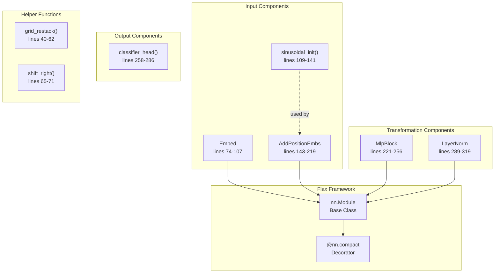
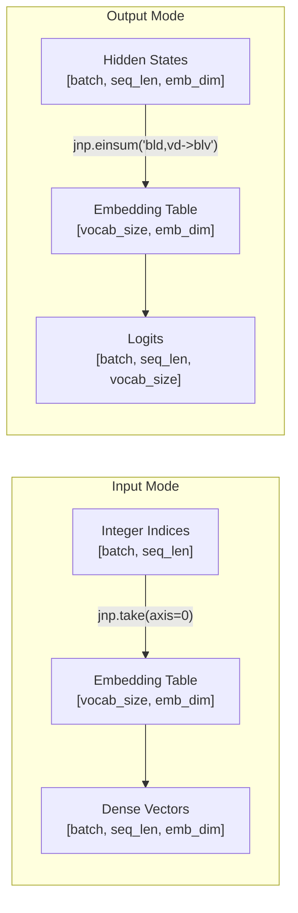
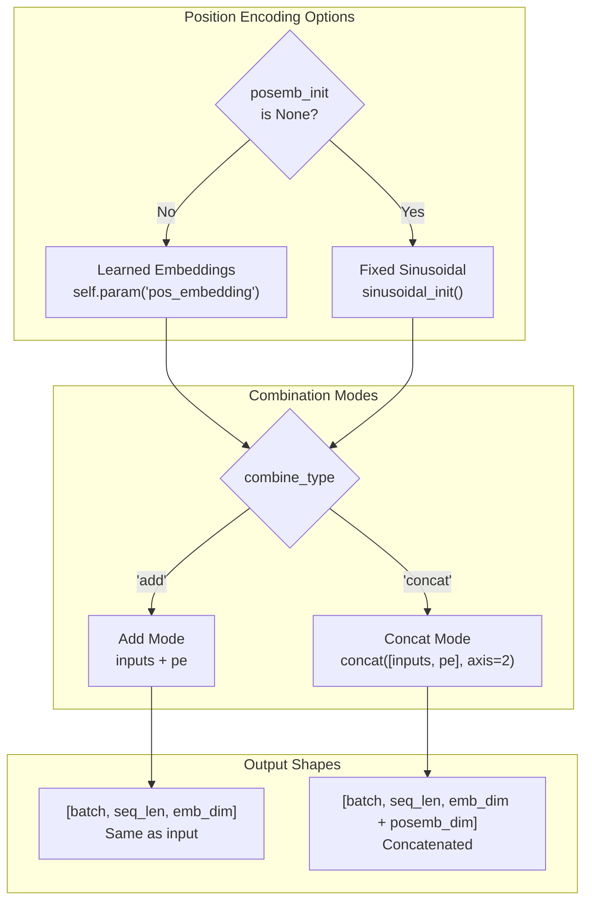
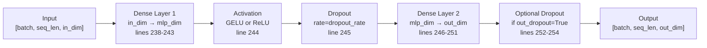
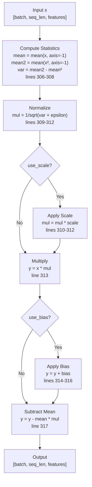
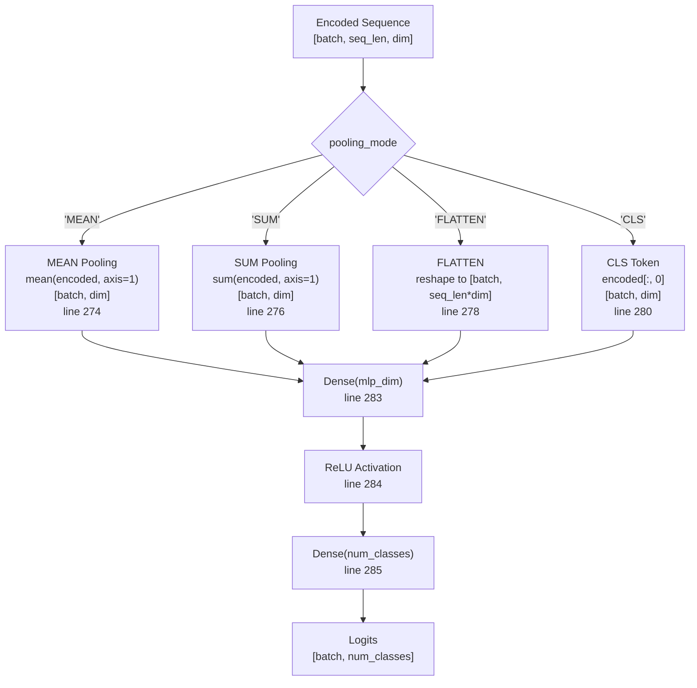
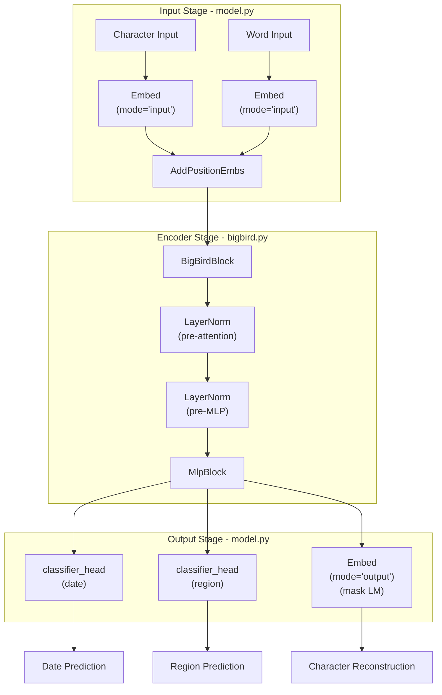

<!-- source: DeepWiki mcp.deepwiki.com · repo google-deepmind/ithaca · page 3.2 Common Layers · fetched 2026-10-26 -->

# Common Layers

<details>
<summary>Relevant source files</summary>

The following files were used as context for generating this wiki page:

- [ithaca/models/common_layers.py](ithaca/models/common_layers.py)

</details>


This page documents the reusable neural network components defined in [ithaca/models/common_layers.py](). These layers form the building blocks of the Ithaca model architecture, providing embedding, positional encoding, feed-forward transformations, normalization, and classification functionality. For the overall model architecture that uses these layers, see [Model Overview](#3.1). For specialized attention mechanisms, see [BigBird Attention](#3.3).

**Sources:** [ithaca/models/common_layers.py:1-319]()

---

## Component Overview

The `common_layers.py` module provides five primary components and several helper functions:

| Component | Class/Function | Purpose |
|-----------|---------------|---------|
| Embedding | `Embed` | Converts integer token indices to dense vectors |
| Positional Encoding | `AddPositionEmbs` | Adds position information to embeddings |
| Feed-Forward | `MlpBlock` | Two-layer feed-forward network with activation |
| Normalization | `LayerNorm` | Layer normalization for stable training |
| Classification | `classifier_head` | Sequence-to-class projection with pooling |

These components are implemented using Flax's `linen` module system and are designed to be composable and reusable throughout the model architecture.

**Sources:** [ithaca/models/common_layers.py:14-18]()

---

### Component Architecture



**Sources:** [ithaca/models/common_layers.py:1-319]()

---

## Embed Layer

The `Embed` class provides a parameterized function from integer indices to dense vectors, supporting both input embeddings and output projections.

### Implementation Details

**Location:** [ithaca/models/common_layers.py:74-107]()

**Attributes:**
- `mode`: Either `'input'` or `'output'` to support weight sharing between input and output layers
- `emb_init`: Embedding initialization function (default: `nn.initializers.normal(stddev=1.0)`)

**Parameters:**
- `num_embeddings`: Vocabulary size
- `features`: Embedding dimension

### Usage Modes



**Key Implementation:**
- **Input mode** [ithaca/models/common_layers.py:101-104](): Uses `jnp.take()` to look up embeddings by index
- **Output mode** [ithaca/models/common_layers.py:105-106](): Projects hidden states back to vocabulary space using `jnp.einsum()`
- **Type validation** [ithaca/models/common_layers.py:102-103](): Ensures input indices are integer types

**Sources:** [ithaca/models/common_layers.py:74-107]()

---

## Positional Encoding

The `AddPositionEmbs` class adds positional information to input embeddings, either through learned parameters or fixed sinusoidal patterns.

### Implementation Details

**Location:** [ithaca/models/common_layers.py:143-219]()

**Attributes:**
- `posemb_init`: Optional learned position embedding initializer (if `None`, uses fixed sinusoidal)
- `posemb_dim`: Dimension of position embeddings (defaults to input dimension)
- `max_len`: Maximum sequence length (default: 512)
- `combine_type`: How to combine with inputs: `'add'` or `'concat'` (default: `'concat'`)
- `replicate_tf`: Whether to replicate TensorFlow's exact periodic encoding

### Sinusoidal Position Encoding

The `sinusoidal_init` function [ithaca/models/common_layers.py:109-141]() generates fixed position embeddings using sine and cosine functions:

**Formula:**
- Even dimensions: `PE[pos, 2i] = sin(pos / 10000^(2i/d_model))`
- Odd dimensions: `PE[pos, 2i+1] = cos(pos / 10000^(2i/d_model))`



**Cache Support:** [ithaca/models/common_layers.py:197-206]() implements fast autoregressive decoding by tracking position indices in Flax's attention cache mechanism.

**Sources:** [ithaca/models/common_layers.py:109-141](), [ithaca/models/common_layers.py:143-219]()

---

## MLP Block

The `MlpBlock` class implements the feed-forward network used in Transformer layers, consisting of two linear transformations with an activation function and dropout.

### Implementation Details

**Location:** [ithaca/models/common_layers.py:221-256]()

**Attributes:**
- `mlp_dim`: Hidden dimension of the feed-forward network
- `out_dim`: Output dimension (defaults to input dimension if `None`)
- `dropout_rate`: Dropout probability (default: 0.1)
- `deterministic`: Whether to disable dropout (for inference)
- `activation_fn`: Activation function name from `ACTIVATION_FN_DICT` (default: `'gelu'`)
- `kernel_init`: Weight initialization (default: `nn.initializers.xavier_uniform()`)
- `bias_init`: Bias initialization (default: `nn.initializers.normal(stddev=1e-6)`)

### Architecture



**Supported Activations:** [ithaca/models/common_layers.py:34-37]()
- `'relu'`: `nn.relu`
- `'gelu'`: `nn.gelu`

**Usage Pattern:** The MLP block is typically applied after self-attention in Transformer layers, with `mlp_dim` often set to 4× the model dimension.

**Sources:** [ithaca/models/common_layers.py:221-256](), [ithaca/models/common_layers.py:34-37]()

---

## Layer Normalization

The `LayerNorm` class implements layer normalization, which normalizes inputs across the feature dimension to stabilize training.

### Implementation Details

**Location:** [ithaca/models/common_layers.py:289-319]()

**Attributes:**
- `epsilon`: Small constant for numerical stability (default: 1e-12 for float32, 1e-3 for float16)
- `dtype`: Data type for parameters (default: `jnp.float32`)
- `use_bias`: Whether to apply learned bias (default: `True`)
- `use_scale`: Whether to apply learned scale (default: `True`)
- `bias_init`: Bias initialization (default: `initializers.zeros`)
- `scale_init`: Scale initialization (default: `initializers.ones`)

### Normalization Formula

The implementation [ithaca/models/common_layers.py:304-318]() computes:

1. **Mean:** `mean = E[x]` across feature dimension
2. **Variance:** `var = E[x²] - E[x]²`
3. **Normalization:** `y = (x - mean) / sqrt(var + epsilon)`
4. **Affine transformation:** `output = scale * y + bias`



**Note:** [ithaca/models/common_layers.py:290]() mentions this implementation replicates `tf.contrib` behavior for compatibility with TensorFlow models.

**Sources:** [ithaca/models/common_layers.py:289-319]()

---

## Classification Head

The `classifier_head` function provides a sequence-to-class projection layer with configurable pooling strategies.

### Implementation Details

**Location:** [ithaca/models/common_layers.py:258-286]()

**Parameters:**
- `encoded`: Input tensor of shape `[batch, seq_len, dim]`
- `num_classes`: Number of output classes
- `mlp_dim`: Hidden dimension for intermediate MLP
- `pooling_mode`: Pooling strategy (default: `'MEAN'`)

### Pooling Strategies



### Pooling Mode Details

| Mode | Operation | Output Shape | Use Case |
|------|-----------|--------------|----------|
| `'MEAN'` | Average over sequence | `[batch, dim]` | Default sequence classification |
| `'SUM'` | Sum over sequence | `[batch, dim]` | Aggregation without averaging |
| `'FLATTEN'` | Flatten all dimensions | `[batch, seq_len*dim]` | Full sequence information |
| `'CLS'` | First token only | `[batch, dim]` | BERT-style classification |

**Architecture:** [ithaca/models/common_layers.py:283-285]()
1. Pool sequence to fixed-size representation
2. Apply intermediate dense layer with ReLU
3. Project to class logits

**Sources:** [ithaca/models/common_layers.py:258-286]()

---

## Helper Functions

### grid_restack

**Location:** [ithaca/models/common_layers.py:40-62]()

**Purpose:** Reshapes multiple sequences by interleaving positions, used in meta-performer architectures.

**Example:**
- Input: `[[1,2,3,4], [5,6,7,8], [9,10,11,12]]`
- Output: `[1,5,9,2,6,10,3,7,11,4,8,12]`

**Implementation:** Concatenates corresponding positions from all input sequences.

### shift_right

**Location:** [ithaca/models/common_layers.py:65-71]()

**Purpose:** Shifts input right by padding with zeros on the left, removing the last element. Used for autoregressive decoding.

**Implementation:**
```python
# Pad (1, 0) on axis=1, then slice off last element
padded = jnp.pad(x, pad_widths, mode='constant', constant_values=0)
return padded[:, :-1]
```

**Sources:** [ithaca/models/common_layers.py:40-71]()

---

## Integration with Model Architecture

These common layers are composed throughout the Ithaca model:



**Usage Notes:**
- `Embed` is used for both character and word embeddings at the input [ithaca/models/model.py]()
- `AddPositionEmbs` provides position information after embedding
- `LayerNorm` and `MlpBlock` are used repeatedly in each Transformer block [ithaca/models/bigbird.py]()
- `classifier_head` pools encoder output for sequence-level predictions
- `Embed` in output mode projects back to vocabulary for masked language modeling

**Sources:** [ithaca/models/common_layers.py:14-18]()

---

## Design Principles

The common layers module follows several design principles:

1. **Composability:** Each layer is a self-contained Flax module that can be composed into larger architectures
2. **Configurability:** Extensive attributes allow customization without modifying code
3. **Mode flexibility:** Components like `Embed` support multiple operational modes
4. **Compatibility:** Implementation replicates TensorFlow behavior for model portability
5. **Type safety:** Input validation ensures correct tensor types and shapes

**Attribution:** [ithaca/models/common_layers.py:16-17]() notes this implementation is adapted from the Long Range Arena benchmark suite.

**Sources:** [ithaca/models/common_layers.py:1-19]()

---

