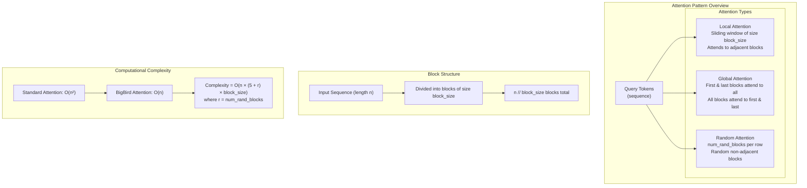
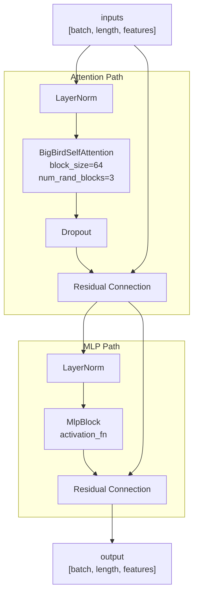
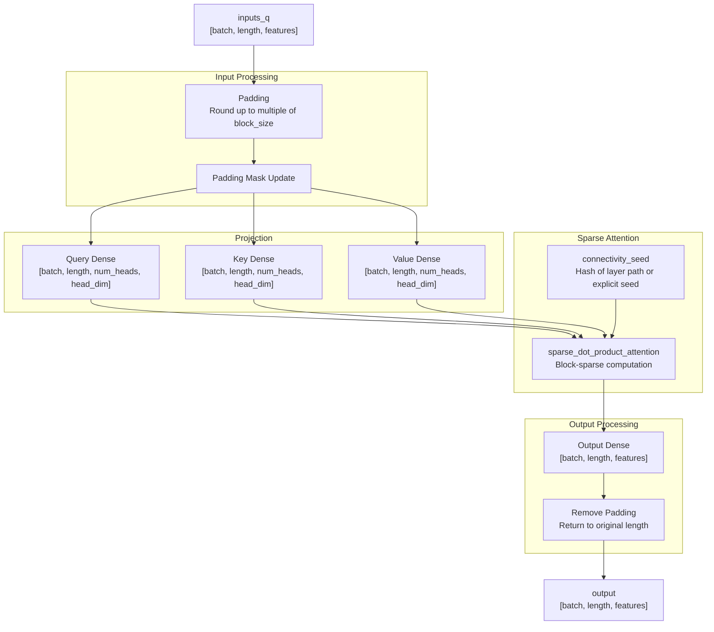
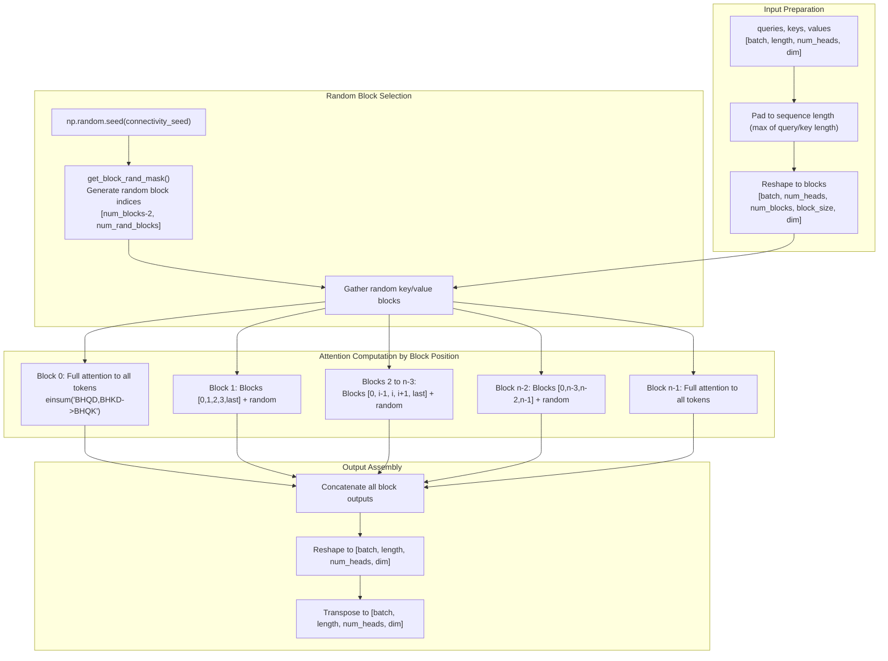

<!-- source: DeepWiki mcp.deepwiki.com · repo google-deepmind/ithaca · page 3.3 BigBird Attention · fetched 2026-10-26 -->

# BigBird Attention

<details>
<summary>Relevant source files</summary>

The following files were used as context for generating this wiki page:

- [ithaca/models/bigbird.py](ithaca/models/bigbird.py)
- [ithaca/models/bigbird_attention.py](ithaca/models/bigbird_attention.py)

</details>


This page documents the BigBird sparse attention mechanism used in Ithaca's Transformer architecture. BigBird reduces the computational complexity of standard self-attention from O(n²) to O(n) by using a block-sparse attention pattern that combines local, global, and random connections.

For information about the overall model architecture, see [Model Overview](#3.1). For details about how BigBird blocks are integrated into the encoder stack, see [Model Overview](#3.1). For documentation of other neural network layers, see [Common Layers](#3.2).

## Overview and Motivation

Standard Transformer self-attention computes attention between every pair of tokens in a sequence, resulting in O(n²) time and memory complexity. For ancient Greek inscriptions that can contain hundreds of tokens (up to 768 in Ithaca), this becomes computationally expensive.

BigBird attention addresses this by implementing a sparse attention pattern where each token only attends to a subset of other tokens. Despite being sparse, BigBird maintains the ability to model long-range dependencies through a combination of three attention patterns:

| Pattern Type | Description | Purpose |
|--------------|-------------|---------|
| **Local (Sliding Window)** | Each token attends to neighboring tokens within a fixed window | Captures local context and linguistic patterns |
| **Global** | First and last blocks attend to all tokens | Provides sequence-level information flow |
| **Random** | Each block attends to random blocks elsewhere in the sequence | Enables long-range connections with controlled sparsity |

The implementation in Ithaca is adapted from the [Long Range Arena](https://github.com/google-research/long-range-arena) BigBird implementation, which follows the paper [Big Bird: Transformers for Longer Sequences (Zaheer et al., 2020)](https://arxiv.org/abs/2007.14062).

**Sources:** [ithaca/models/bigbird.py:14-18](), [ithaca/models/bigbird_attention.py:14-20]()

## BigBird Attention Pattern

The following diagram illustrates the sparse attention pattern used by BigBird. Each query token (row) attends to a subset of key tokens (columns), shown by the connections:



**Sources:** [ithaca/models/bigbird_attention.py:325-413](), [ithaca/models/bigbird.py:28-29]()

### Attention Pattern Details

For a sequence of length `n` divided into blocks of size `block_size`:

**Block Positions:**
- Block 0 (first): Attends to all tokens in the sequence
- Block 1 (second): Attends to blocks 0, 1, 2, 3, last, plus `num_rand_blocks` random blocks
- Blocks 2 to n-3 (middle): Attends to blocks 0, last, three adjacent blocks (i-1, i, i+1), plus `num_rand_blocks` random blocks
- Block n-2 (second-last): Attends to blocks 0, n-3, n-2, n-1, plus `num_rand_blocks` random blocks
- Block n-1 (last): Attends to all tokens in the sequence

**Sources:** [ithaca/models/bigbird_attention.py:138-323]()

## Architecture Components

### BigBirdBlock: Transformer Layer

The `BigBirdBlock` class implements a complete Transformer layer with sparse attention. It follows the standard pre-norm architecture: LayerNorm → Attention → Residual, followed by LayerNorm → MLP → Residual.



**Key Parameters:**

| Parameter | Type | Default | Description |
|-----------|------|---------|-------------|
| `qkv_dim` | int | - | Dimension of query/key/value projections |
| `mlp_dim` | int | - | Hidden dimension of feed-forward network |
| `num_heads` | int | - | Number of attention heads |
| `block_size` | int | 64 | Size of attention blocks for local attention |
| `num_rand_blocks` | int | 3 | Number of random blocks each token attends to |
| `connectivity_seed` | Optional[int] | None | Seed for random block selection (if None, derived from layer path) |
| `dropout_rate` | float | 0.1 | Dropout rate for residual connections |
| `attention_dropout_rate` | float | 0.1 | Dropout rate for attention weights |

**Sources:** [ithaca/models/bigbird.py:32-111]()

### BigBirdSelfAttention: Sparse Attention Mechanism

The `BigBirdSelfAttention` class implements the sparse multi-head dot-product attention. It inherits from `BigBirdAttention` and sets `inputs_kv=None` to enforce self-attention.



**Sources:** [ithaca/models/bigbird_attention.py:550-603](), [ithaca/models/bigbird_attention.py:415-548]()

### Connectivity Seed and Random Block Selection

The `connectivity_seed` parameter controls the random block selection for sparse attention. This is important for reproducibility:

- **If `connectivity_seed` is None**: The seed is derived from the layer's construction path using `hash(path) % 2**32` [ithaca/models/bigbird_attention.py:515-517]()
- **If `connectivity_seed` is provided**: Uses the explicit seed value [ithaca/models/bigbird_attention.py:518-519]()

The seed is used in `get_block_rand_mask()` to generate the random attention pattern [ithaca/models/bigbird_attention.py:32-74](), which determines which random blocks each query block attends to.

**Sources:** [ithaca/models/bigbird_attention.py:515-519](), [ithaca/models/bigbird_attention.py:32-74]()

## Sparse Attention Implementation

### Block-Sparse Computation Flow

The core sparse attention is implemented in `sparse_dot_product_attention()` and `band_start_block_rand_multi_attention_pad()`. The computation is structured to handle different block positions efficiently:



**Sources:** [ithaca/models/bigbird_attention.py:325-413](), [ithaca/models/bigbird_attention.py:138-323]()

### Key Implementation Functions

| Function | Purpose | Location |
|----------|---------|----------|
| `get_block_rand_mask` | Generate random block indices for sparse attention pattern | [ithaca/models/bigbird_attention.py:32-74]() |
| `create_band_mask_from_inputs` | Create 3D attention mask for local band (sliding window) | [ithaca/models/bigbird_attention.py:77-98]() |
| `create_rand_mask_from_inputs` | Create 3D attention mask for random blocks | [ithaca/models/bigbird_attention.py:100-126]() |
| `gather_1`, `gather_2` | JAX vmap-based gathering for random block selection | [ithaca/models/bigbird_attention.py:128-136]() |
| `band_start_block_rand_multi_attention_pad` | Core sparse attention computation for all block positions | [ithaca/models/bigbird_attention.py:138-323]() |
| `sparse_dot_product_attention` | Top-level sparse attention interface | [ithaca/models/bigbird_attention.py:325-413]() |

**Sources:** [ithaca/models/bigbird_attention.py:32-413]()

### Padding and Masking

BigBird requires the sequence length to be a multiple of `block_size`. The implementation handles this through:

1. **Input Padding**: If `orig_seqlen % block_size != 0`, pad the sequence to the next multiple [ithaca/models/bigbird_attention.py:481-489]()
   ```python
   extra_len = self.block_size - (orig_seqlen % self.block_size)
   inputs_q = jnp.pad(inputs_q, pad_width)
   ```

2. **Mask Padding**: Extend the padding mask with `-1e9` values to ensure padded tokens don't contribute to attention [ithaca/models/bigbird_attention.py:485]()

3. **Output Unpadding**: Remove the padding from the output to return to the original sequence length [ithaca/models/bigbird_attention.py:545]()
   ```python
   out = out[:, :orig_seqlen, :]
   ```

The `padding_mask` is used throughout the attention computation to mask out padding tokens. The mask is combined with attention scores using:
```python
score += (1.0 - mask) * -10000.0
```
This ensures that padded positions receive near-zero attention weights after softmax.

**Sources:** [ithaca/models/bigbird_attention.py:481-545](), [ithaca/models/bigbird_attention.py:183-321]()

## Configuration in Ithaca

In Ithaca's model, BigBird attention is configured with the following default parameters:

```python
_DEFAULT_BLOCK_SIZE = 64
_DEFAULT_NUM_RAND_BLOCKS = 3
```

These defaults from [ithaca/models/bigbird.py:28-29]() provide a good balance between computational efficiency and modeling capacity:

- **Block size 64**: Each local attention window covers 64 tokens, sufficient for typical Greek word and phrase patterns
- **3 random blocks**: Each block attends to 3 randomly selected non-adjacent blocks, enabling long-range connections without excessive computation

For a typical inscription of 768 tokens (Ithaca's maximum sequence length), this results in:
- **12 blocks** total (768 / 64)
- **Middle blocks** (10 of them) each attend to approximately (5 + 3) × 64 = 512 tokens
- **Computational complexity**: O(768 × 8 × 64) = O(393,216) vs. O(768²) = O(589,824) for full attention

**Sources:** [ithaca/models/bigbird.py:28-29]()

## Integration with Model Architecture

BigBird blocks are stacked to form the encoder in Ithaca's model. The typical configuration involves multiple `BigBirdBlock` layers, each applying sparse attention followed by a feed-forward network. The blocks are configured in the model initialization and called sequentially during the forward pass.

For details on how BigBird blocks fit into the complete model architecture, including input embeddings and output heads, see [Model Overview](#3.1).

**Sources:** [ithaca/models/bigbird.py:32-111]()

---

