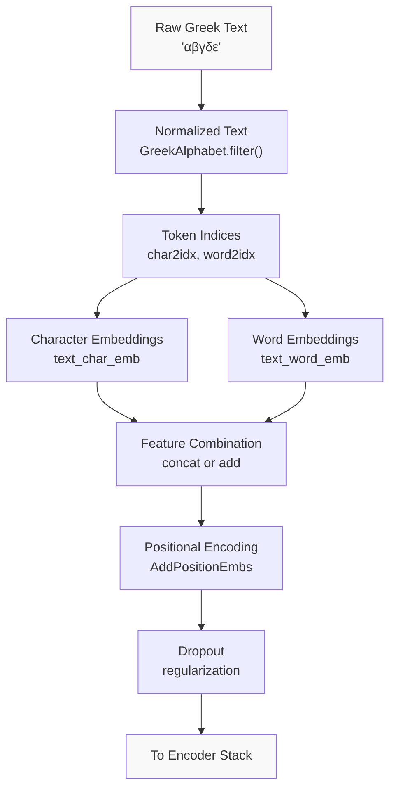
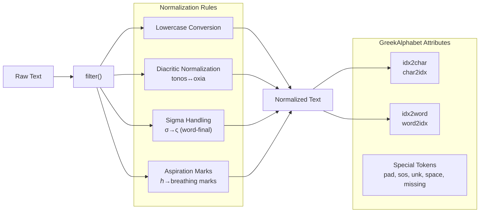
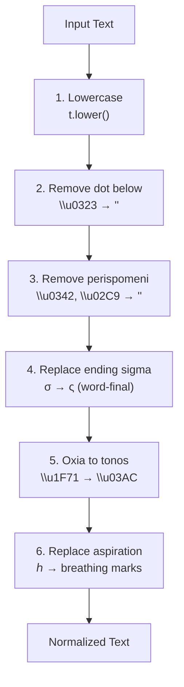
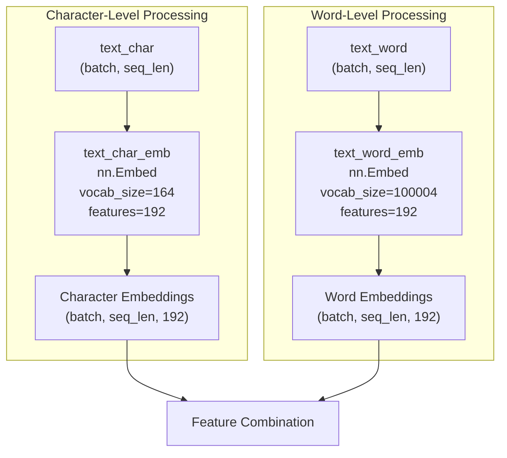
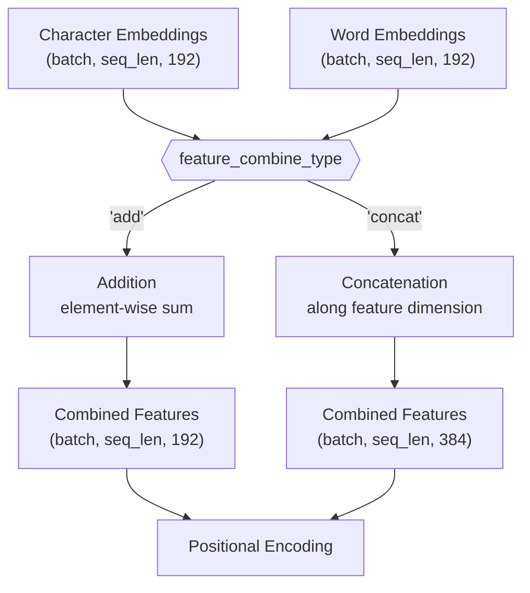
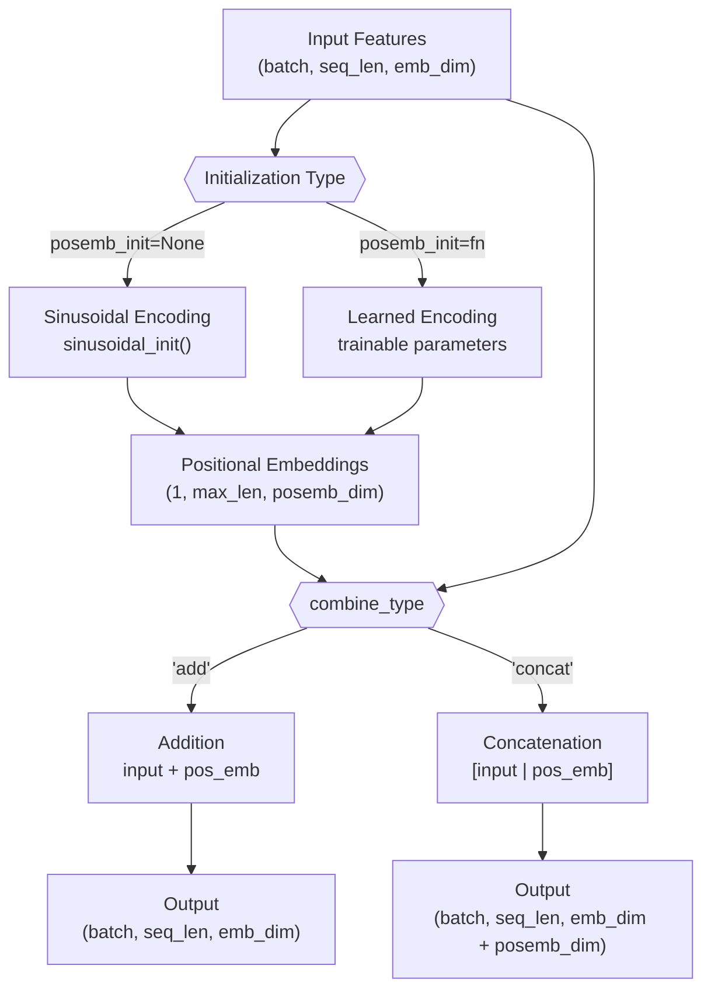
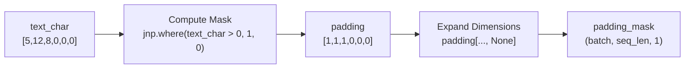
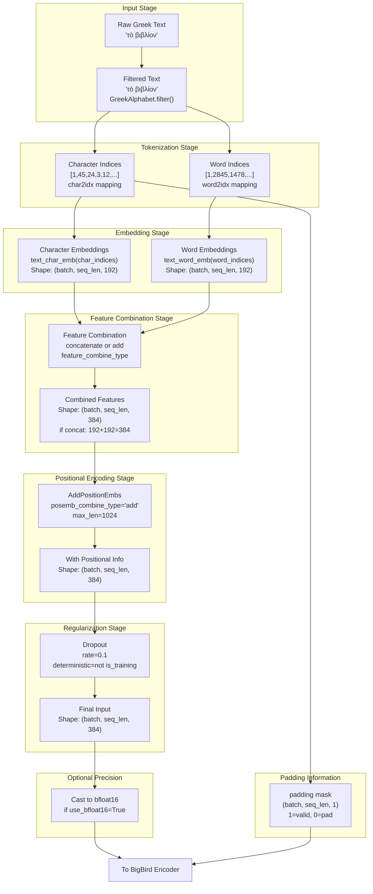

<!-- source: DeepWiki mcp.deepwiki.com · repo google-deepmind/ithaca · page 3.4 Input Processing · fetched 2026-10-26 -->

# Input Processing

<details>
<summary>Relevant source files</summary>

The following files were used as context for generating this wiki page:

- [ithaca/models/common_layers.py](ithaca/models/common_layers.py)
- [ithaca/models/model.py](ithaca/models/model.py)
- [ithaca/util/alphabet.py](ithaca/util/alphabet.py)

</details>


## Purpose and Scope

This document describes how text inputs are transformed into numerical representations suitable for the Ithaca Transformer model. Input processing encompasses text normalization, vocabulary mapping, embedding lookups, feature combination, and positional encoding. This pipeline converts ancient Greek inscriptions into dense vector representations that preserve both character-level and word-level semantic information.

For information about the model architecture that consumes these processed inputs, see [Model Overview](#3.1). For details on the embedding layers themselves, see [Common Layers](#3.2). For the full data pipeline including augmentation and batching, see [Data Loading and Augmentation](#4.5).

---

## Input Pipeline Overview

The input processing pipeline consists of six major stages that transform raw Greek text into model-ready tensors:



**Sources:** [ithaca/models/model.py:64-127](), [ithaca/util/alphabet.py:81-172]()

---

## Input Format Variations

The model accepts multiple input formats to support different use cases:

| Input Type | Description | Use Case | Shape |
|-----------|-------------|----------|-------|
| `text_char` | Character token indices | Standard training/inference | `(batch, seq_len)` |
| `text_char_onehot` | One-hot encoded characters | Gradient-based saliency | `(batch, seq_len, vocab_char_size)` |
| `text_char_emb` | Pre-computed embeddings | Advanced manipulation | `(batch, seq_len, emb_dim)` |
| `text_word` | Word token indices | Standard training/inference | `(batch, seq_len)` |
| `text_word_onehot` | One-hot encoded words | Gradient-based saliency | `(batch, seq_len, vocab_word_size)` |
| `text_word_emb` | Pre-computed embeddings | Advanced manipulation | `(batch, seq_len, emb_dim)` |
| `padding` | Binary mask (1=valid, 0=pad) | Masking padded positions | `(batch, seq_len)` |

The model requires exactly one format per modality (character and word) and automatically generates padding masks if not provided:

```python
# Automatic padding mask generation
if text_char is not None and padding is None:
    padding = jnp.where(text_char > 0, 1, 0)
elif text_char_onehot is not None and padding is None:
    padding = jnp.where(text_char_onehot.argmax(-1) > 0, 1, 0)
```

**Sources:** [ithaca/models/model.py:64-79]()

---

## Text Normalization and Vocabulary

### GreekAlphabet Class

The `GreekAlphabet` class handles vocabulary mappings and text normalization for ancient Greek inscriptions:



**Character Vocabulary Structure:**

The character vocabulary (`idx2char`) contains 164 tokens organized as:

| Index Range | Content | Example |
|------------|---------|---------|
| 0 | Padding token | `#` |
| 1 | Start-of-sentence | `<` |
| 2 | Unknown character | `^` |
| 3 | Space | ` ` |
| 4 | Missing character | `-` |
| 5-31 | Greek alphabet | `αβγδε...ψωϙϛ` |
| 32 | Numerals | `0` |
| 33 | Punctuation | `.` |

**Word Vocabulary Structure:**

The word vocabulary (`idx2word`) contains up to 100,004 tokens:

| Index Range | Content |
|------------|---------|
| 0 | Padding token (`#`) |
| 1 | Start-of-sentence (`<`) |
| 2 | Unknown word (`^`) |
| 3-100003 | Most frequent words from training corpus |

**Sources:** [ithaca/util/alphabet.py:21-78](), [ithaca/util/alphabet.py:81-172]()

### Text Filtering Process

The `GreekAlphabet.filter()` method applies a series of normalization operations:



**Key Normalization Rules:**

1. **Tonos-Oxia Conversion**: Ancient texts use oxia accents (U+1F71), while modern encoding uses tonos (U+03AC). The filter maintains a bidirectional mapping with 10 accent pairs for seamless conversion.

2. **Ending Sigma**: The regular sigma `σ` becomes final sigma `ς` when at word boundaries: `regex: ([\w\[\]])σ(?![\[\]])(\b) → \1ς\2`

3. **Aspiration Handling**: Converts `ℎ` to appropriate breathing marks based on following vowel using 19 pattern rules.

**Sources:** [ithaca/util/alphabet.py:113-171]()

---

## Dual-Level Embeddings

### Embedding Layer Architecture

The model uses two parallel embedding layers to capture different linguistic granularities:



**Embedding Configuration:**

Both embedding layers are configured in `model.py` with identical dimensions:

```python
# Character embeddings
self.text_char_emb = nn.Embed(
    num_embeddings=self.vocab_char_size,  # default: 164
    features=self.word_char_emb_dim,      # default: 192
    embedding_init=nn.initializers.normal(stddev=1.0),
    name='char_embeddings')

# Word embeddings  
self.text_word_emb = nn.Embed(
    num_embeddings=self.vocab_word_size,  # default: 100004
    features=self.word_char_emb_dim,      # default: 192
    embedding_init=nn.initializers.normal(stddev=1.0),
    name='word_embeddings')
```

**Sources:** [ithaca/models/model.py:51-61]()

### Embed Layer Implementation

The `Embed` class from `common_layers.py` provides a bidirectional mapping between tokens and vectors:

**Mode: 'input' (default)**
- Maps integer indices to dense vectors
- Forward pass: `output = embedding_table[input_indices]`
- Implementation: `jnp.take(embedding, inputs, axis=0)`
- Used for: Training and inference

**Mode: 'output'**
- Maps vectors back to logit scores over vocabulary
- Forward pass: `output = input @ embedding_table.T`
- Implementation: `jnp.einsum('bld,vd->blv', inputs, embedding)`
- Used for: Masked language modeling head

**Sources:** [ithaca/models/common_layers.py:74-107]()

---

## Feature Combination Strategies

After obtaining character and word embeddings, they must be combined into a single representation. The model supports two combination strategies controlled by `feature_combine_type`:



### Addition Strategy (`feature_combine_type='add'`)

**Computation:**
```python
x = char_embeddings + word_embeddings  # Element-wise addition
# Output shape: (batch, seq_len, 192)
```

**Characteristics:**
- Preserves embedding dimension (192)
- Assumes character and word information occupy same semantic space
- More parameter-efficient
- Lower memory footprint during training

### Concatenation Strategy (`feature_combine_type='concat'`)

**Computation:**
```python
x = jax.lax.concatenate([char_embeddings, word_embeddings], 2)
# Output shape: (batch, seq_len, 384)
```

**Characteristics:**
- Doubles embedding dimension (192 → 384)
- Allows model to learn separate character and word features
- Higher model capacity
- Default configuration for Ithaca

**Sources:** [ithaca/models/model.py:109-114]()

---

## Positional Encoding

### AddPositionEmbs Layer

Since Transformer architectures are permutation-invariant, positional information must be explicitly added. The `AddPositionEmbs` layer provides this functionality:



### Sinusoidal Positional Encoding

When `posemb_init=None` (or using `sinusoidal_init()`), the layer uses fixed sinusoidal embeddings:

**Formula:**
```
PE(pos, 2i)   = sin(pos / 10000^(2i/d_model))
PE(pos, 2i+1) = cos(pos / 10000^(2i/d_model))
```

Where:
- `pos`: position in sequence (0 to max_len-1)
- `i`: dimension index (0 to d_model/2-1)
- `d_model`: embedding dimension

**Implementation Details:**

The `sinusoidal_init()` function generates the encoding table:

| Parameter | Default | Description |
|-----------|---------|-------------|
| `max_len` | 2048 | Maximum sequence length |
| `replicate_tf` | False | Match TensorFlow implementation exactly |
| Output shape | `(1, max_len, d_feature)` | Broadcasted across batch |

**Sources:** [ithaca/models/common_layers.py:109-141]()

### Learned Positional Encoding

When `learn_pos_emb=True`, the model initializes with sinusoidal encoding but allows gradients to update the values during training:

```python
# In model.py
pe_init = common_layers.sinusoidal_init(max_len=self.max_len) if self.learn_pos_emb else None
```

This provides a warm-start with structured positional information while allowing adaptation to the specific task.

**Sources:** [ithaca/models/model.py:117-126]()

### Positional Encoding Combination

Similar to feature combination, positional embeddings support two combination modes:

**Addition (`posemb_combine_type='add'`)**:
```python
output = input + positional_embeddings[:, :length, :]
# Requires posemb_dim == input_dim
# Output shape: (batch, seq_len, emb_dim)
```

**Concatenation (`posemb_combine_type='concat'`)**:
```python
output = concatenate([input, positional_embeddings[:, :length, :]], axis=2)
# posemb_dim can differ from input_dim
# Output shape: (batch, seq_len, input_dim + posemb_dim)
```

Ithaca uses **addition** (`posemb_combine_type='add'`) by default, which maintains the embedding dimension and follows standard Transformer practice.

**Sources:** [ithaca/models/common_layers.py:143-219]()

---

## Padding and Masking

### Padding Mask Generation

Variable-length sequences are padded to a fixed length (`max_len=1024` by default). The model generates binary masks to distinguish valid tokens from padding:



**Mask Application:**

The padding mask is used in three contexts:

1. **Attention Masking**: Prevents attention to padded positions in `BigBirdBlock`
2. **Pooling Operations**: Excludes padding from average/sum pooling
3. **Loss Computation**: Masks padded positions from loss calculation

**Example:**

```python
# Generate mask
padding = jnp.where(text_char > 0, 1, 0)  # Shape: (batch, seq_len)
padding_mask = padding[..., jnp.newaxis]  # Shape: (batch, seq_len, 1)

# Compute text length (for average pooling)
text_len = jnp.sum(padding, 1)  # Shape: (batch,)

# Apply mask to pooling
x = jnp.multiply(padding_mask.astype(jnp.float32), x)
x = jnp.sum(x, 1) / text_len.astype(jnp.float32)[..., None]
```

**Sources:** [ithaca/models/model.py:75-80](), [ithaca/models/model.py:195-204]()

---

## Complete Input Processing Pipeline

The following diagram shows the complete data flow from raw text to encoder-ready representations:



### Pipeline Summary Table

| Stage | Input Shape | Output Shape | Key Parameters |
|-------|-------------|--------------|----------------|
| Text Normalization | String | String | `GreekAlphabet.filter()` |
| Tokenization | String | `(batch, seq_len)` | `char2idx`, `word2idx` |
| Character Embedding | `(batch, seq_len)` | `(batch, seq_len, 192)` | `vocab_char_size=164` |
| Word Embedding | `(batch, seq_len)` | `(batch, seq_len, 192)` | `vocab_word_size=100004` |
| Feature Combination | 2×`(batch, seq_len, 192)` | `(batch, seq_len, 384)` | `feature_combine_type='concat'` |
| Positional Encoding | `(batch, seq_len, 384)` | `(batch, seq_len, 384)` | `posemb_combine_type='add'`, `max_len=1024` |
| Dropout | `(batch, seq_len, 384)` | `(batch, seq_len, 384)` | `dropout_rate=0.1` |
| Precision Cast (optional) | `(batch, seq_len, 384)` | `(batch, seq_len, 384)` | `use_bfloat16=False` |

**Sources:** [ithaca/models/model.py:64-135]()

---

## Configuration Parameters

The input processing pipeline is controlled by these model configuration parameters:

| Parameter | Type | Default | Description |
|-----------|------|---------|-------------|
| `vocab_char_size` | int | 164 | Character vocabulary size (includes special tokens) |
| `vocab_word_size` | int | 100004 | Word vocabulary size (includes special tokens) |
| `word_char_emb_dim` | int | 192 | Dimension of character and word embeddings |
| `emb_dim` | int | 512 | Hidden dimension after combination (unused if concat) |
| `max_len` | int | 1024 | Maximum sequence length for positional encoding |
| `feature_combine_type` | str | 'concat' | How to combine char/word embeddings: 'add' or 'concat' |
| `posemb_combine_type` | str | 'add' | How to add positional encoding: 'add' or 'concat' |
| `learn_pos_emb` | bool | True | Whether positional embeddings are trainable |
| `dropout_rate` | float | 0.1 | Dropout rate applied after positional encoding |
| `use_bfloat16` | bool | False | Whether to cast to bfloat16 precision |

**Typical Configuration:**

```python
model = Model(
    vocab_char_size=164,           # Full Greek alphabet + special tokens
    vocab_word_size=100004,        # Top 100k words from corpus
    word_char_emb_dim=192,         # Embedding dimension for both levels
    feature_combine_type='concat', # Results in 384-dim features
    posemb_combine_type='add',     # Standard transformer approach
    learn_pos_emb=True,            # Start from sinusoidal, allow learning
    max_len=1024,                  # Support sequences up to 1024 tokens
    dropout_rate=0.1,              # 10% dropout for regularization
)
```

**Sources:** [ithaca/models/model.py:24-50]()

---

## Input Processing Code Example

Here is a simplified trace through the input processing code:

```python
# Step 1: Initialize embeddings (in setup())
self.text_char_emb = nn.Embed(
    num_embeddings=self.vocab_char_size,
    features=self.word_char_emb_dim,
    embedding_init=nn.initializers.normal(stddev=1.0))

self.text_word_emb = nn.Embed(
    num_embeddings=self.vocab_word_size, 
    features=self.word_char_emb_dim,
    embedding_init=nn.initializers.normal(stddev=1.0))

# Step 2: Generate padding mask
if text_char is not None and padding is None:
    padding = jnp.where(text_char > 0, 1, 0)
padding_mask = padding[..., jnp.newaxis]

# Step 3: Character embeddings
if text_char is not None:
    x = self.text_char_emb(text_char)

# Step 4: Word embeddings  
if text_word is not None:
    text_word_emb_x = self.text_word_emb(text_word)

# Step 5: Combine features
if self.feature_combine_type == 'concat':
    x = jax.lax.concatenate([x, text_word_emb_x], 2)

# Step 6: Add positional encoding
pe_init = common_layers.sinusoidal_init(max_len=self.max_len) 
x = common_layers.AddPositionEmbs(
    posemb_init=pe_init,
    max_len=self.max_len,
    combine_type=self.posemb_combine_type)(x)

# Step 7: Apply dropout
x = nn.Dropout(rate=self.dropout_rate)(x, deterministic=not is_training)

# x is now ready for the encoder stack
```

**Sources:** [ithaca/models/model.py:51-127]()

---

