<!-- source: DeepWiki mcp.deepwiki.com · repo google-deepmind/ithaca · page 3.5 Multi-Task Output Heads · fetched 2026-10-26 -->

# Multi-Task Output Heads

<details>
<summary>Relevant source files</summary>

The following files were used as context for generating this wiki page:

- [ithaca/models/model.py](ithaca/models/model.py)
- [train/experiment.py](train/experiment.py)

</details>


This document describes the four prediction tasks performed by the Ithaca model: date prediction, region classification, masked language modeling, and next sentence prediction. Each task has its own output head connected to the encoder, enabling the model to learn complementary representations for ancient text analysis.

For information about the encoder architecture that feeds these heads, see [BigBird Attention](#3.3). For details on how these heads are used during inference, see [Attribution](#5.2) and [Restoration](#5.3).

## Overview

The Ithaca model employs multi-task learning to jointly optimize four prediction objectives. This approach allows the model to learn richer representations by sharing knowledge across related tasks while specializing output projections for each specific prediction.

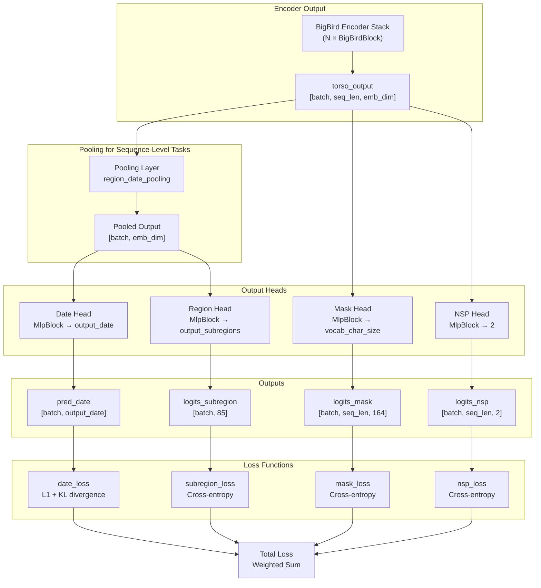

**Sources:** [ithaca/models/model.py:24-243](), [train/experiment.py:198-333]()

## Architecture Details

### Pooling Strategy

Sequence-level tasks (date prediction and region classification) require aggregating the encoder output from `[batch, seq_len, emb_dim]` to `[batch, emb_dim]`. The model supports three pooling strategies configured via `region_date_pooling`:

| Pooling Type | Implementation | Use Case |
|--------------|----------------|----------|
| `first` | `x[:, 0, :]` | Uses first token (CLS-style) |
| `average` | `sum(x * mask) / text_len` | Weighted average over valid tokens |
| `sum` | `sum(x * mask)` | Sum over valid tokens |

Token-level tasks (masked language modeling and next sentence prediction) operate directly on the full encoder output without pooling.

**Sources:** [ithaca/models/model.py:194-204]()

### MLP Output Heads

All four heads use the same architecture pattern controlled by `use_output_mlp`:

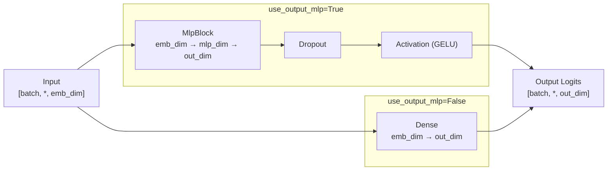

When `use_output_mlp=True` (default), each head applies:
1. Dense projection: `emb_dim` → `mlp_dim` (typically 2048)
2. Dropout (rate: `dropout_rate`, typically 0.1)
3. Activation function (default: GELU)
4. Dense projection: `mlp_dim` → `out_dim`

**Sources:** [ithaca/models/model.py:162-237]()

## Date Prediction Head

The date prediction head estimates when an inscription was created, outputting a probability distribution over time bins.

### Architecture

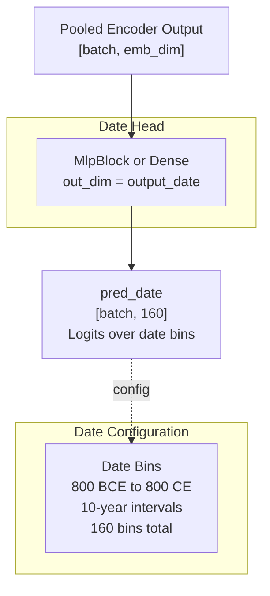

The head outputs logits over `output_date` bins (default: 160, covering 800 BCE to 800 CE in 10-year intervals). The configuration `output_date_dist=True` enables distribution-based prediction.

**Sources:** [ithaca/models/model.py:206-223]()

### Loss Function

Date prediction uses a composite loss combining L1 regression and distribution matching:

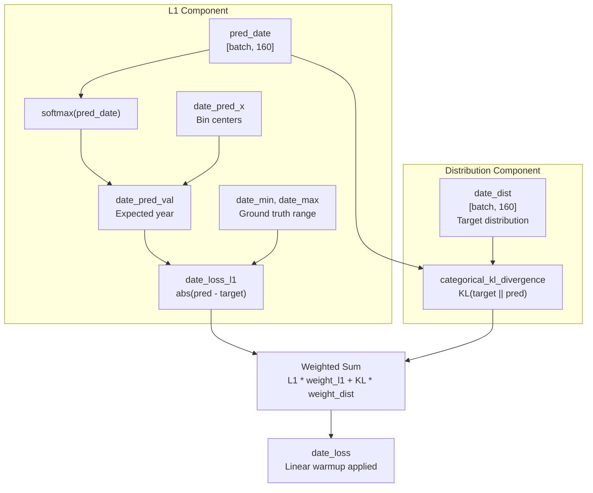

The loss computation occurs in two stages:

1. **L1 Loss** (if `'l1'` in `loss.date.type`):
   - Convert logits to probabilities via softmax
   - Compute expected value: `pred_val = dot(softmax(pred_date), date_pred_x)`
   - Calculate L1 distance to ground truth range
   - Weight by `loss.date.weight_l1`

2. **Distribution Loss** (if `'dist'` in `loss.date.type`):
   - Compute KL divergence between target and predicted distributions
   - Weight by `loss.date.weight_dist`

The combined loss is scaled by `linear_weight()` for curriculum learning, starting at step `loss.date.step_start` and reaching full weight at `loss.date.step_end`.

**Sources:** [train/experiment.py:229-269](), [train/experiment.py:494-515]()

## Region Classification Head

The region classification head predicts the geographical origin of an inscription across 84 subregions.

### Architecture

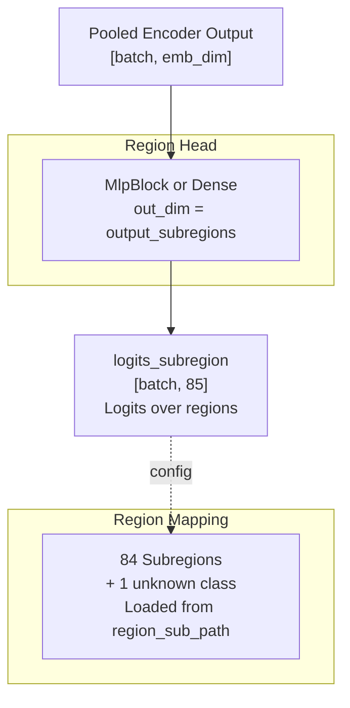

The head outputs logits over `output_subregions` classes (default: 85, including 84 known subregions plus one unknown class).

**Sources:** [ithaca/models/model.py:225-237]()

### Loss Function

Region classification uses cross-entropy with label smoothing:

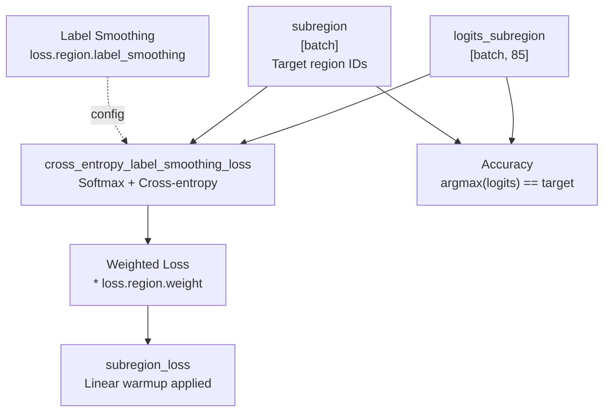

**Training:** Cross-entropy with label smoothing (typical value: 0.1) to prevent overconfidence.

**Evaluation:** Standard cross-entropy without label smoothing.

The loss is weighted by `loss.region.weight` and undergoes linear warmup from `loss.region.step_start` to `loss.region.step_end`.

**Sources:** [train/experiment.py:272-285](), [train/experiment.py:518-523]()

## Masked Language Modeling Head

The masked LM head performs character-level restoration by predicting masked characters in the input sequence.

### Architecture

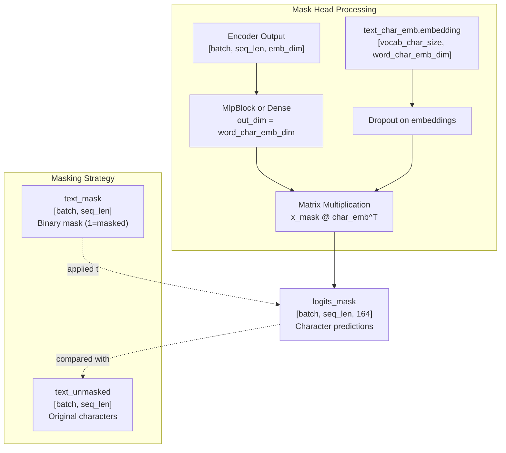

The mask head uses a tied embedding approach:
1. Project encoder output to character embedding dimension (`word_char_emb_dim`, typically 192)
2. Multiply by transposed character embeddings to get logits over vocabulary
3. Apply dropout to embeddings for regularization

**Sources:** [ithaca/models/model.py:162-178]()

### Loss Function

The mask loss only computes loss on masked positions:

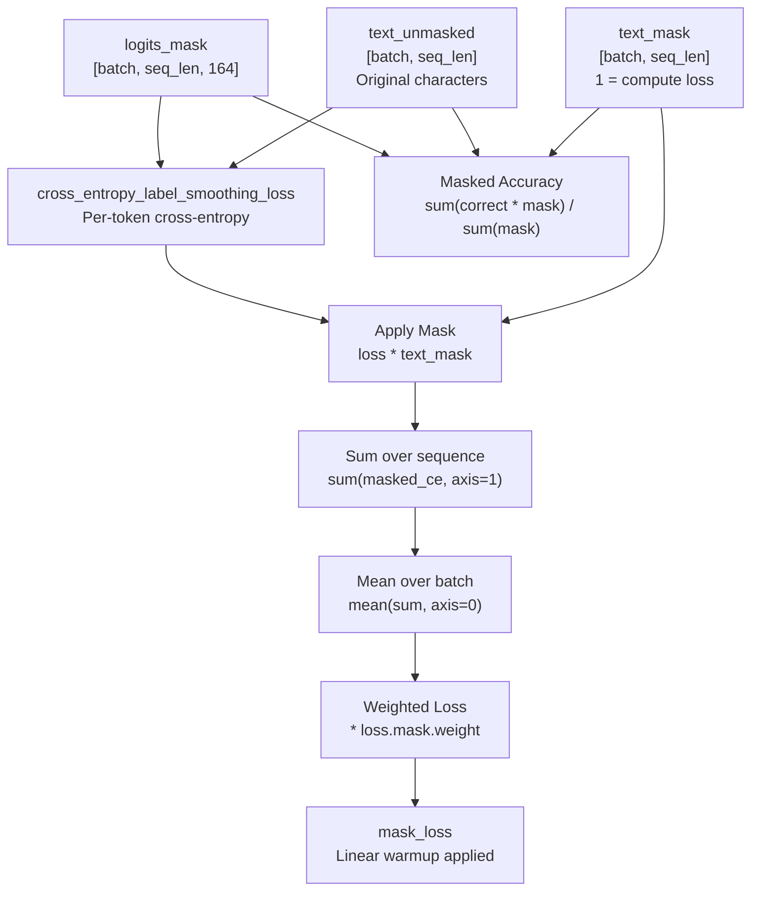

The loss computation:
1. Calculate cross-entropy at every position
2. Apply binary mask to zero out unmasked positions
3. Sum over sequence, mean over batch
4. Weight by `loss.mask.weight`
5. Apply linear warmup schedule

Accuracy is computed only on masked positions: `sum(correct & masked) / sum(masked)`.

**Sources:** [train/experiment.py:288-307](), [train/experiment.py:526-539]()

## Next Sentence Prediction Head

The NSP head predicts whether consecutive sentences in the input are in the correct order, training the model to understand discourse structure.

### Architecture

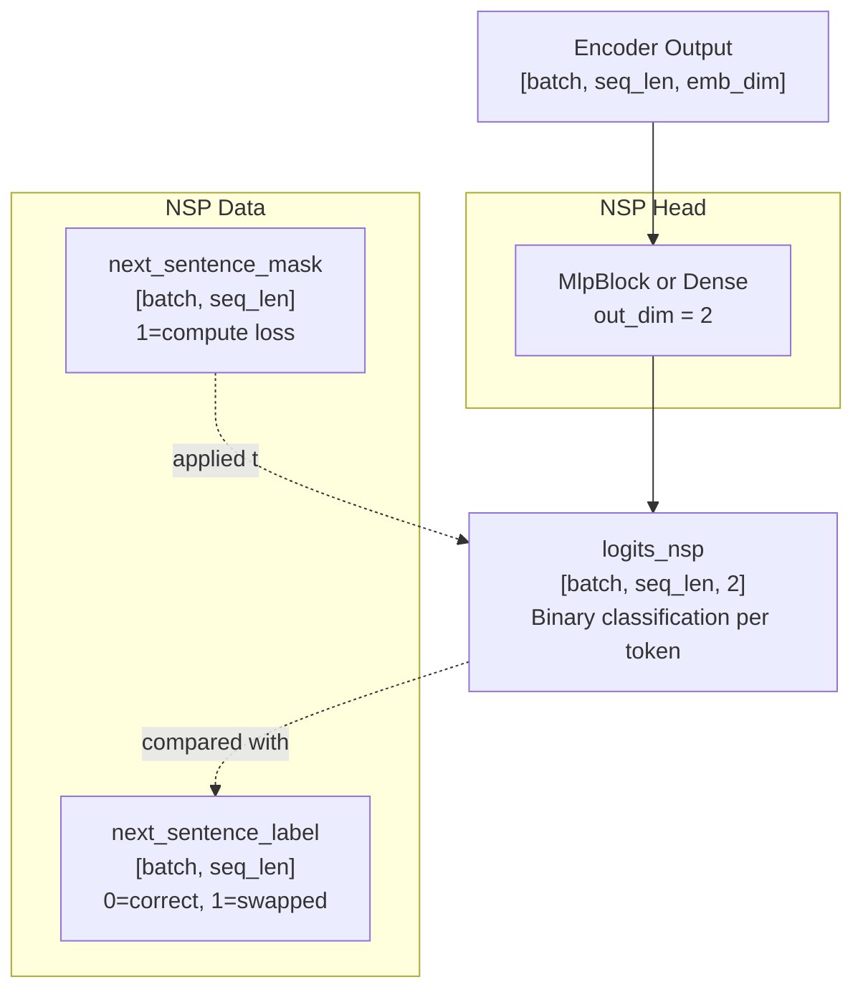

Unlike BERT's sequence-level NSP, Ithaca uses token-level NSP where each token position has a binary label indicating if surrounding sentences are correctly ordered.

**Sources:** [ithaca/models/model.py:180-192]()

### Loss Function

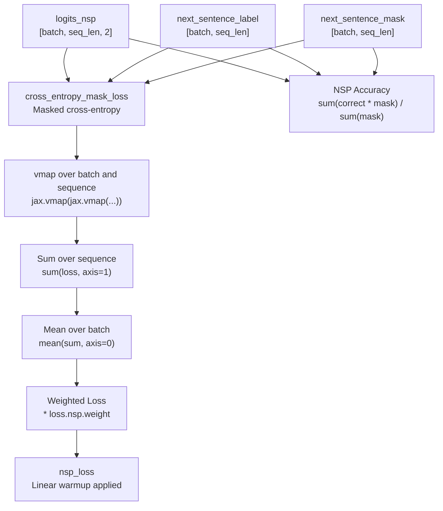

The NSP loss computation is similar to mask loss but with double `vmap` to handle the 3D structure:
1. Apply `cross_entropy_mask_loss` per token (vectorized)
2. Sum over sequence dimension
3. Mean over batch
4. Weight by `loss.nsp.weight`
5. Apply linear warmup schedule

**Sources:** [train/experiment.py:310-327](), [train/experiment.py:542-555]()

## Loss Composition

The total training loss is a weighted sum of all four task losses:

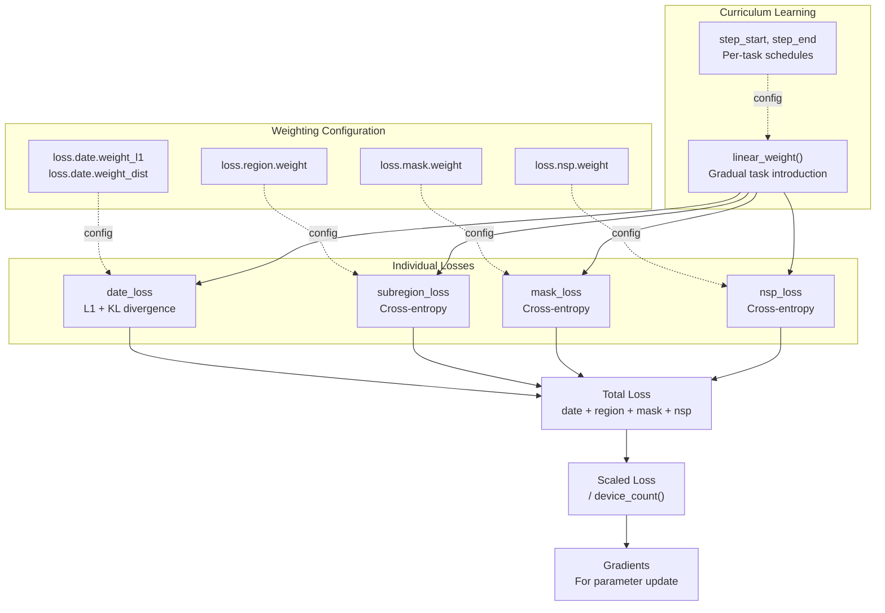

Each task loss undergoes:
1. **Task-specific weighting**: Configured per task to balance importance
2. **Linear warmup**: Controlled introduction of tasks during training
3. **Device scaling**: Division by device count for distributed training

The composite loss enables balanced multi-task learning while allowing flexible task scheduling through curriculum learning.

**Sources:** [train/experiment.py:329-333]()

## Configuration

Multi-task output heads are configured through the model and loss configuration:

### Model Configuration

```python
# Model architecture parameters
vocab_char_size: int = 164              # Character vocabulary size
output_subregions: int = 85             # Number of region classes
output_date: int = 160                  # Number of date bins
output_date_dist: bool = True           # Enable distribution prediction
use_output_mlp: bool = True             # Use MLP heads vs. Dense only
emb_dim: int = 512                      # Encoder dimension
mlp_dim: int = 2048                     # MLP hidden dimension
region_date_pooling: str = 'first'      # Pooling strategy
dropout_rate: float = 0.1               # Dropout rate
```

### Loss Configuration

| Task | Enabled Flag | Weight Parameters | Warmup Schedule |
|------|-------------|-------------------|-----------------|
| Date | `loss.date.enabled` | `weight_l1`, `weight_dist` | `step_start`, `step_end` |
| Region | `loss.region.enabled` | `weight` | `step_start`, `step_end` |
| Mask | `loss.mask.enabled` | `weight` | `step_start`, `step_end` |
| NSP | `loss.nsp.enabled` | `weight` | `step_start`, `step_end` |

Additional per-task parameters:
- **Date**: `type` (e.g., `"l1+dist"`), `label_smoothing`
- **Region**: `label_smoothing`
- **Mask**: `label_smoothing`

**Sources:** [ithaca/models/model.py:24-49](), [train/experiment.py:230-327]()

## Evaluation Metrics

During evaluation, the model computes per-task metrics and a composite score:

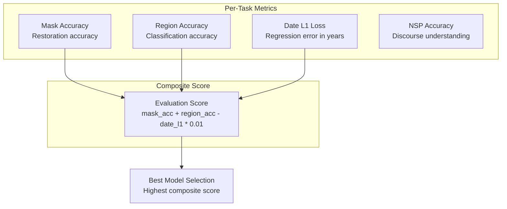

The composite score balances:
- **Restoration quality**: `mask_accuracy` (higher is better)
- **Attribution quality**: `region_accuracy` (higher is better)
- **Date prediction**: `-date_l1 * 0.01` (lower L1 is better)

NSP accuracy is tracked but not included in the composite score for model selection.

**Sources:** [train/experiment.py:558-573](), [train/experiment.py:665-667]()

## Output Shapes Summary

| Output Head | Shape | Description |
|------------|-------|-------------|
| `pred_date` | `[batch, 160]` | Date prediction logits over bins |
| `logits_subregion` | `[batch, 85]` | Region classification logits |
| `logits_mask` | `[batch, seq_len, 164]` | Character prediction per position |
| `logits_nsp` | `[batch, seq_len, 2]` | Next sentence prediction per position |

All outputs are returned as a tuple in the order: `(pred_date, logits_subregion, logits_mask, logits_nsp)`.

**Sources:** [ithaca/models/model.py:239]()

---

