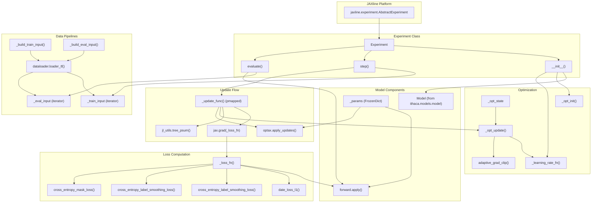
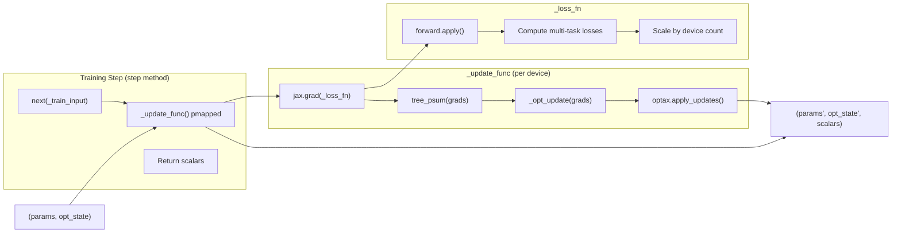
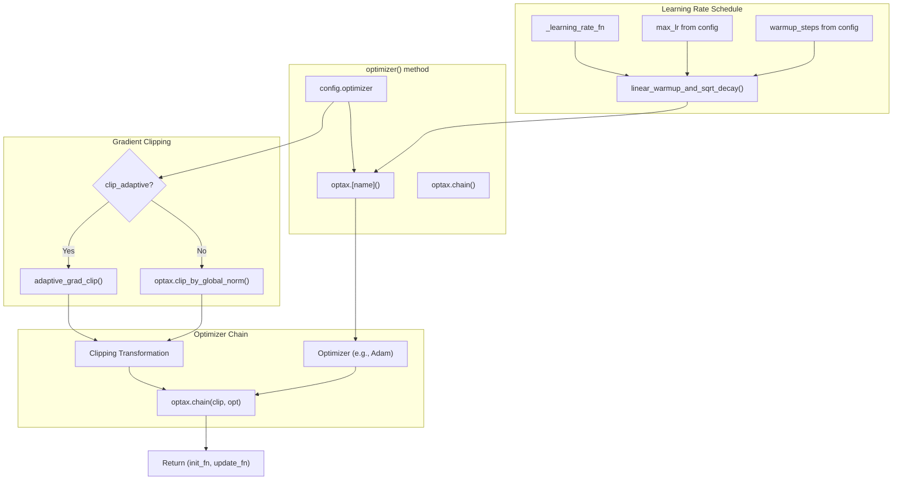
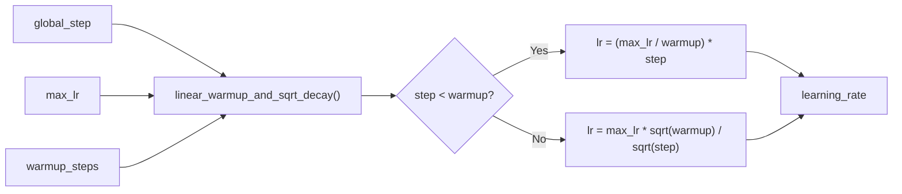
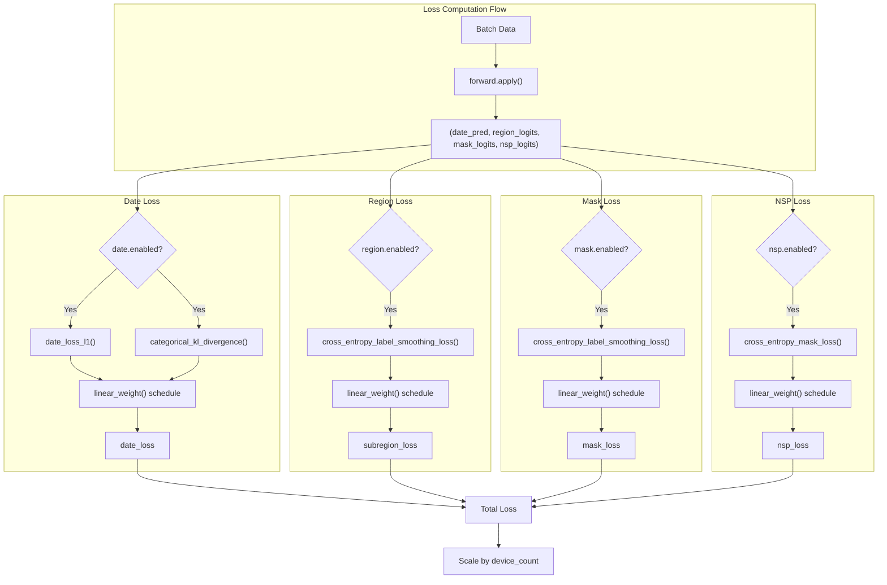
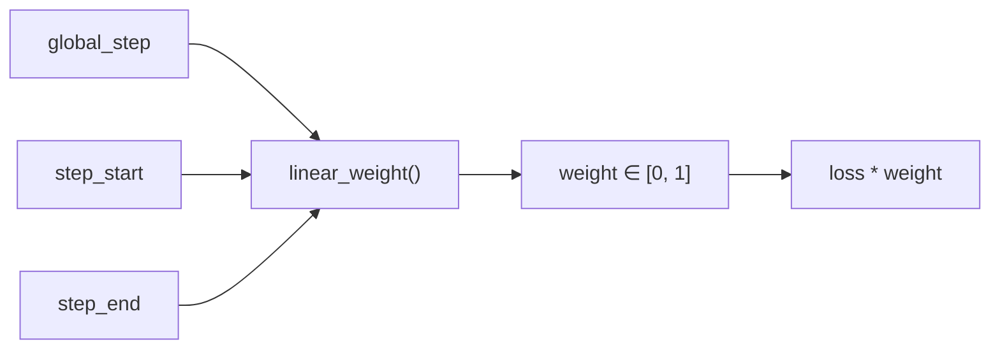
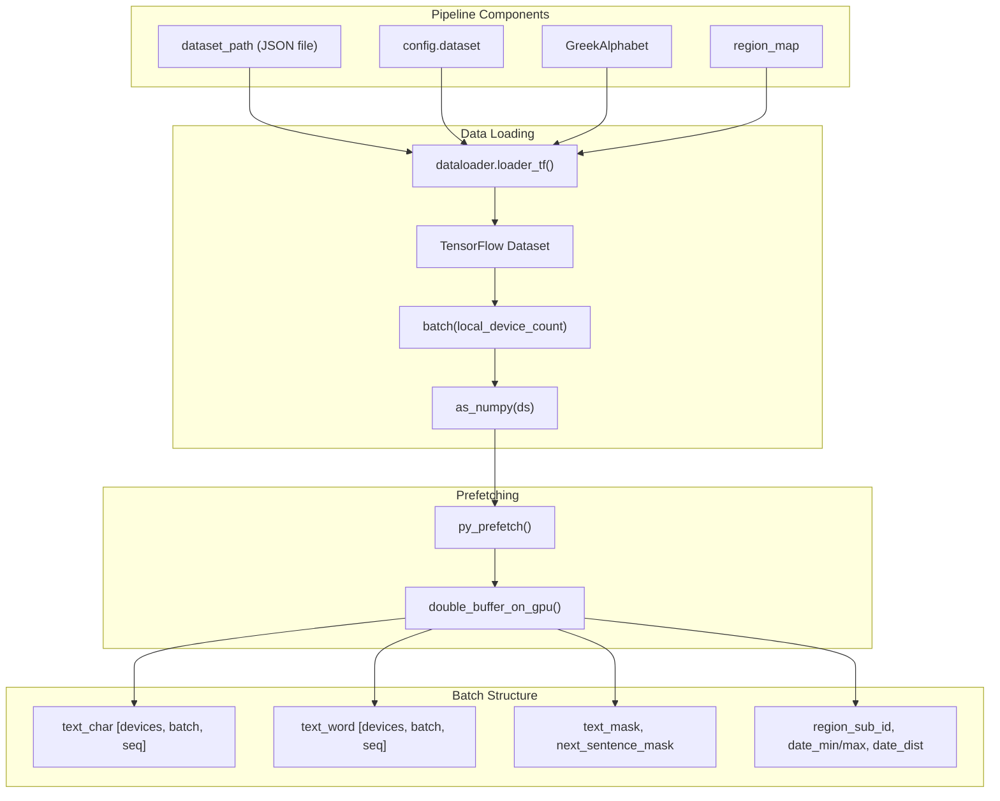
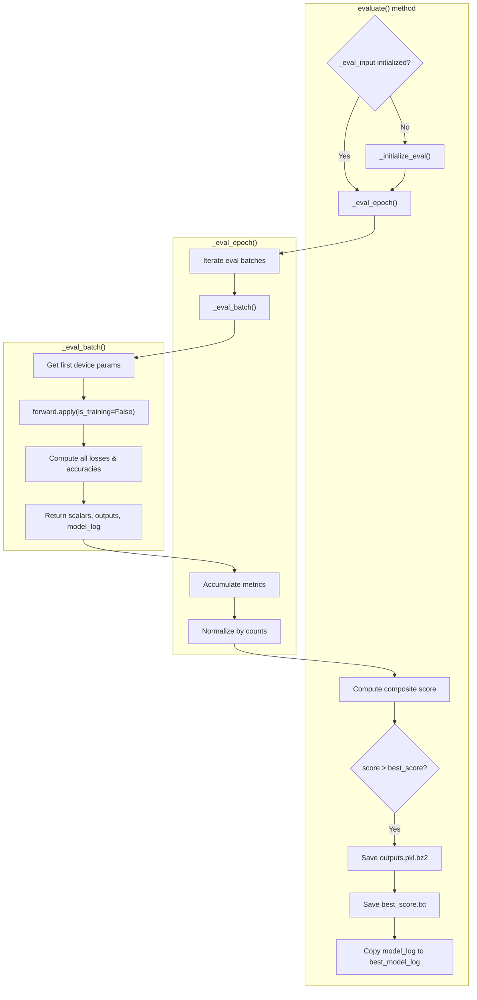
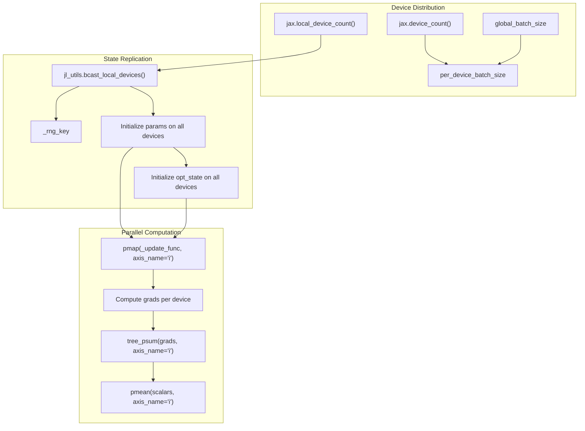
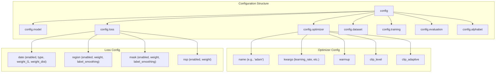

<!-- source: DeepWiki mcp.deepwiki.com · repo google-deepmind/ithaca · page 4 Training System · fetched 2026-10-26 -->

# Training System

<details>
<summary>Relevant source files</summary>

The following files were used as context for generating this wiki page:

- [ithaca/util/loss.py](ithaca/util/loss.py)
- [ithaca/util/optim.py](ithaca/util/optim.py)
- [train/experiment.py](train/experiment.py)

</details>


## Purpose and Scope

This document describes the training system for Ithaca models, including experiment orchestration, optimization strategies, loss functions, and data pipelines. The training system is built on the JAXline platform and implements distributed training with multi-task learning objectives.

For information about the model architecture being trained, see [Model Architecture](#3). For information about using trained models for inference, see [Inference System](#5). For details about data processing utilities, see [Data Processing Utilities](#6).

## System Architecture

The training system orchestrates the complete training workflow from data loading through model updates and evaluation. The system is centered around the `Experiment` class in [train/experiment.py](), which coordinates all training components.



**Sources:** [train/experiment.py:50-679]()

## Training Loop Architecture

The training loop follows JAX's functional programming paradigm with explicit state management and distributed execution via `pmap`.



**Sources:** [train/experiment.py:131-143](), [train/experiment.py:335-368]()

### Training Step Execution

The `step()` method implements a single training iteration:

| Component | File:Lines | Description |
|-----------|-----------|-------------|
| `step()` | [train/experiment.py:131-143]() | Main training step, gets batch and calls update |
| `_initialize_train()` | [train/experiment.py:145-170]() | One-time initialization of params and optimizer state |
| `_update_func()` | [train/experiment.py:335-368]() | Pmapped function computing gradients and updating params |
| `_loss_fn()` | [train/experiment.py:198-333]() | Computes multi-task loss with all enabled objectives |

**Sources:** [train/experiment.py:131-368]()

## Optimizer Configuration

The optimization system uses Optax to compose gradient transformations including learning rate scheduling and gradient clipping.



**Sources:** [train/experiment.py:110-122](), [train/experiment.py:85-89]()

### Learning Rate Scheduling

The system uses a composite learning rate schedule with linear warmup followed by square root decay:



The `linear_warmup_and_sqrt_decay()` function in [ithaca/util/optim.py:31-36]() implements this schedule:

$$\text{lr}(t) = \min\left(\frac{\text{max\_lr}}{\text{warmup\_steps}} \cdot t, \text{max\_lr} \cdot \sqrt{\frac{\text{warmup\_steps}}{t}}\right)$$

**Sources:** [ithaca/util/optim.py:31-36](), [train/experiment.py:85-89]()

### Gradient Clipping

Two gradient clipping strategies are available:

| Strategy | Function | Description |
|----------|----------|-------------|
| Global Norm | `optax.clip_by_global_norm()` | Clips gradients by global L2 norm |
| Adaptive | `adaptive_grad_clip()` | Clips unit-wise by ratio to parameter norm |

The adaptive gradient clipping from [ithaca/util/optim.py:140-167]() implements the method from Brock et al. (2021), clipping gradients to be at most `clipping * parameter_norm` on a per-unit basis.

**Sources:** [train/experiment.py:117-121](), [ithaca/util/optim.py:140-167]()

## Multi-Task Loss Functions

The training system optimizes four objectives simultaneously, with configurable weights and scheduling.



**Sources:** [train/experiment.py:198-333]()

### Loss Function Details

#### Date Loss

Date prediction uses two complementary losses:

| Loss Type | Function | Purpose |
|-----------|----------|---------|
| L1 Loss | `date_loss_l1()` | Penalizes predictions outside [date_min, date_max] range |
| Distribution Loss | `categorical_kl_divergence()` | Matches predicted distribution to ground truth |

The date loss in [train/experiment.py:230-269]() combines both components:
- **L1 component**: Computes mean predicted date from softmax distribution, penalizes deviation from valid range
- **Distribution component**: KL divergence between ground truth date distribution and predicted logits
- **Optional label smoothing**: Randomly perturbs ground truth distribution probabilities

**Sources:** [train/experiment.py:230-269](), [ithaca/util/loss.py:102-117](), [ithaca/util/loss.py:32-52]()

#### Region Loss

Region classification uses cross-entropy with label smoothing:

```python
# Implemented in train/experiment.py:272-285
subregion_loss = cross_entropy_label_smoothing_loss(
    subregion_logits,  # [batch, 84]
    subregion,         # [batch]
    label_smoothing=config.loss.region.label_smoothing
)
```

Label smoothing from [ithaca/util/loss.py:21-29]() converts one-hot labels to:
$$\text{label}_i = (1 - \epsilon) \cdot \mathbb{1}_{i=y} + \frac{\epsilon}{K}$$

where $\epsilon$ is the smoothing factor and $K$ is the number of classes (84 subregions).

**Sources:** [train/experiment.py:272-285](), [ithaca/util/loss.py:55-69]()

#### Masked Language Model Loss

The MLM loss computes cross-entropy only on masked positions:

```python
# Implemented in train/experiment.py:288-307
mask_loss = cross_entropy_label_smoothing_loss(
    mask_logits,      # [batch, seq_len, vocab_size]
    text_unmasked,    # [batch, seq_len]
    text_mask,        # [batch, seq_len] - binary mask
    label_smoothing=config.loss.mask.label_smoothing
)
```

The loss is masked to only consider positions marked for prediction, enabling efficient training on masked spans.

**Sources:** [train/experiment.py:288-307](), [ithaca/util/loss.py:55-69]()

#### Next Sentence Prediction Loss

NSP uses cross-entropy with masking to predict if sentence pairs are consecutive:

```python
# Implemented in train/experiment.py:310-327
nsp_loss = cross_entropy_mask_loss(
    nsp_logits,           # [batch, num_sentences, 2]
    next_sentence_label,  # [batch, num_sentences]
    next_sentence_mask    # [batch, num_sentences]
)
```

**Sources:** [train/experiment.py:310-327](), [ithaca/util/loss.py:78-81]()

### Loss Scheduling

Each loss component can be gradually introduced during training using `linear_weight()` from [ithaca/util/optim.py:21-28]():



This allows curriculum learning where simpler tasks are learned before more complex ones.

**Sources:** [train/experiment.py:268-269](), [train/experiment.py:283-285](), [train/experiment.py:306-307](), [train/experiment.py:326-327](), [ithaca/util/optim.py:21-28]()

## Data Pipeline

The data pipeline loads PHI inscriptions and prepares batches for training and evaluation.



**Sources:** [train/experiment.py:171-196]()

### Batch Construction

The `_build_train_input()` method in [train/experiment.py:171-196]() creates the training data pipeline:

1. **Compute batch sizes**: Global batch size is divided across devices
2. **Load dataset**: Opens JSON dataset file and creates TensorFlow dataset
3. **Apply dataloader**: Calls `dataloader.loader_tf()` with per-device batch size
4. **Batch across devices**: Groups batches by local device count (for pmap)
5. **Convert to numpy**: Converts TensorFlow tensors to JAX-compatible numpy arrays
6. **Prefetch**: Applies Python-side prefetching and GPU double-buffering

The resulting iterator yields batches with shape `[num_local_devices, per_device_batch_size, ...]`.

**Sources:** [train/experiment.py:171-196]()

### Data Augmentation

Data augmentation is handled by the `dataloader` module (not shown in provided files). Based on the high-level diagrams, augmentation includes:
- Random mask span selection for MLM
- Random sentence swap for NSP
- Random word deletion and swapping for robustness

See [Data Loading and Augmentation](#4.5) for implementation details.

## Evaluation System

Evaluation runs periodically during training to assess model performance and select the best checkpoint.



**Sources:** [train/experiment.py:377-434](), [train/experiment.py:588-674]()

### Composite Scoring

The evaluation metric combines multiple objectives:

```python
# From train/experiment.py:559-560
score = mask_accuracy + subregion_accuracy - date_l1_loss * 0.01
```

This composite score balances:
- **Mask accuracy**: Character restoration performance
- **Subregion accuracy**: Geographical attribution performance  
- **Date L1 loss**: Temporal attribution error (scaled down by 0.01)

The best model is selected based on this composite score, ensuring good performance across all tasks.

**Sources:** [train/experiment.py:559-560](), [train/experiment.py:665-667]()

### Checkpoint Management

The system maintains two types of checkpoints:

| Checkpoint Type | Location | Purpose |
|----------------|----------|---------|
| Regular | `checkpoint.pkl` | Periodic saves for resumption |
| Best Model | `best_model_log/` | Model with highest eval score |

The JAXline framework handles regular checkpointing automatically via the `CHECKPOINT_ATTRS` specification in [train/experiment.py:56-59](). Best model selection is handled by [train/experiment.py:409-429]().

**Sources:** [train/experiment.py:56-59](), [train/experiment.py:409-429]()

## Distributed Training

The system uses JAX's `pmap` for data parallelism across multiple devices (GPUs/TPUs).



**Sources:** [train/experiment.py:70](), [train/experiment.py:82-83](), [train/experiment.py:152-166](), [train/experiment.py:345-346](), [train/experiment.py:366]()

### Gradient Synchronization

Gradients are computed independently on each device, then synchronized using `tree_psum()`:

1. **Loss computation**: Each device computes `scaled_loss = loss / device_count` in [train/experiment.py:330]()
2. **Gradient computation**: `jax.grad()` computes gradients of scaled loss
3. **All-reduce**: `jl_utils.tree_psum(scaled_grads, axis_name='i')` sums gradients across devices
4. **Result**: Each device has the average gradient across all devices

This ensures gradient updates are equivalent to single-device training with a larger batch size.

**Sources:** [train/experiment.py:335-345]()

## Configuration Management

The training system uses `ml_collections.ConfigDict` for hierarchical configuration:



Key configuration sections accessed in the code:

| Config Path | Usage | File:Lines |
|------------|-------|-----------|
| `config.model` | Model architecture params | [train/experiment.py:81]() |
| `config.optimizer` | Optimizer and LR schedule | [train/experiment.py:111-122]() |
| `config.loss.date` | Date loss settings | [train/experiment.py:230-269]() |
| `config.loss.region` | Region loss settings | [train/experiment.py:272-285]() |
| `config.loss.mask` | MLM loss settings | [train/experiment.py:288-307]() |
| `config.loss.nsp` | NSP loss settings | [train/experiment.py:310-327]() |
| `config.dataset` | Data paths and settings | [train/experiment.py:185-193]() |
| `config.training.batch_size` | Global batch size | [train/experiment.py:174]() |
| `config.evaluation` | Eval settings | [train/experiment.py:92-93]() |
| `config.alphabet` | Vocabulary settings | [train/experiment.py:96-99]() |

**Sources:** [train/experiment.py:61-109]()

## Initialization and Warmup

Model initialization follows these steps:

1. **Create sample batch**: Get first batch from training data in [train/experiment.py:150]()
2. **Split RNG**: Create separate RNGs for params and dropout in [train/experiment.py:153]()
3. **Initialize parameters**: Call `forward.init()` with sample batch in [train/experiment.py:156-163]()
4. **Initialize optimizer**: Call `_opt_init()` with parameters in [train/experiment.py:165-166]()
5. **Setup data pipeline**: Create prefetched, GPU-buffered iterator in [train/experiment.py:168-169]()

The initialization is pmapped to create replicated state across all devices.

**Sources:** [train/experiment.py:145-169]()

## Training Metrics and Logging

The system logs comprehensive metrics during training:

| Metric | Type | Description |
|--------|------|-------------|
| `loss/train` | scalar | Total training loss |
| `loss/date` | scalar | Date prediction loss |
| `loss/subregion` | scalar | Region classification loss |
| `loss/mask` | scalar | Masked LM loss |
| `loss/nsp` | scalar | Next sentence prediction loss |
| `accuracy/subregion` | scalar | Region classification accuracy |
| `accuracy/mask` | scalar | Character restoration accuracy |
| `accuracy/nsp` | scalar | Next sentence prediction accuracy |
| `opt/learning_rate` | scalar | Current learning rate |
| `opt/grad_norm` | scalar | Global norm of gradients |
| `opt/param_norm` | scalar | Global norm of parameters |

Metrics are computed per-device, then averaged across devices using `jax.lax.pmean()` in [train/experiment.py:366]().

**Sources:** [train/experiment.py:353-366]()

## Summary

The training system implements a sophisticated distributed training pipeline with:

- **Multi-task learning**: Four complementary objectives (date, region, mask, NSP)
- **Flexible optimization**: Configurable LR schedules and gradient clipping
- **Efficient data loading**: Prefetched, GPU-buffered TensorFlow datasets
- **Distributed execution**: Data parallelism via JAX pmap
- **Automatic checkpointing**: JAXline-managed state persistence
- **Best model selection**: Composite scoring across tasks

For detailed information about specific subsystems, see:
- [Training Overview](#4.1) for the high-level workflow
- [Experiment Configuration](#4.2) for config management
- [Optimization and Schedulers](#4.3) for LR schedules and gradient clipping
- [Loss Functions](#4.4) for detailed loss computation
- [Data Loading and Augmentation](#4.5) for the data pipeline
- [Evaluation and Checkpointing](#4.6) for evaluation and model selection

**Sources:** [train/experiment.py:1-679](), [ithaca/util/optim.py:1-168](), [ithaca/util/loss.py:1-118]()

---

