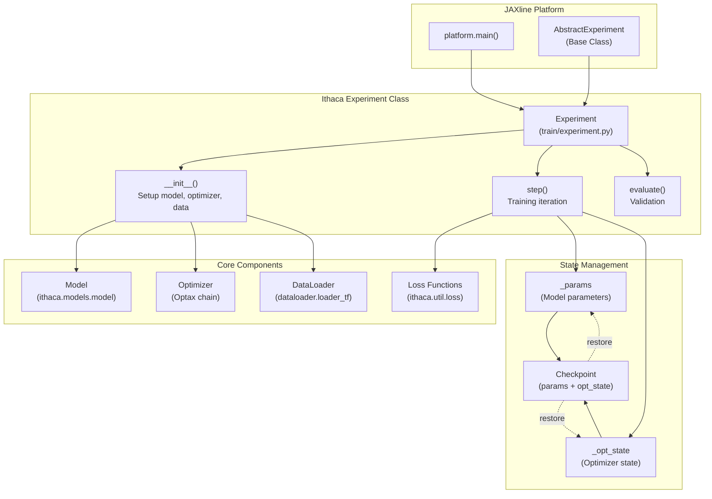
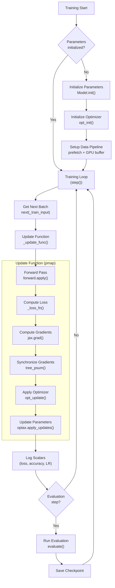
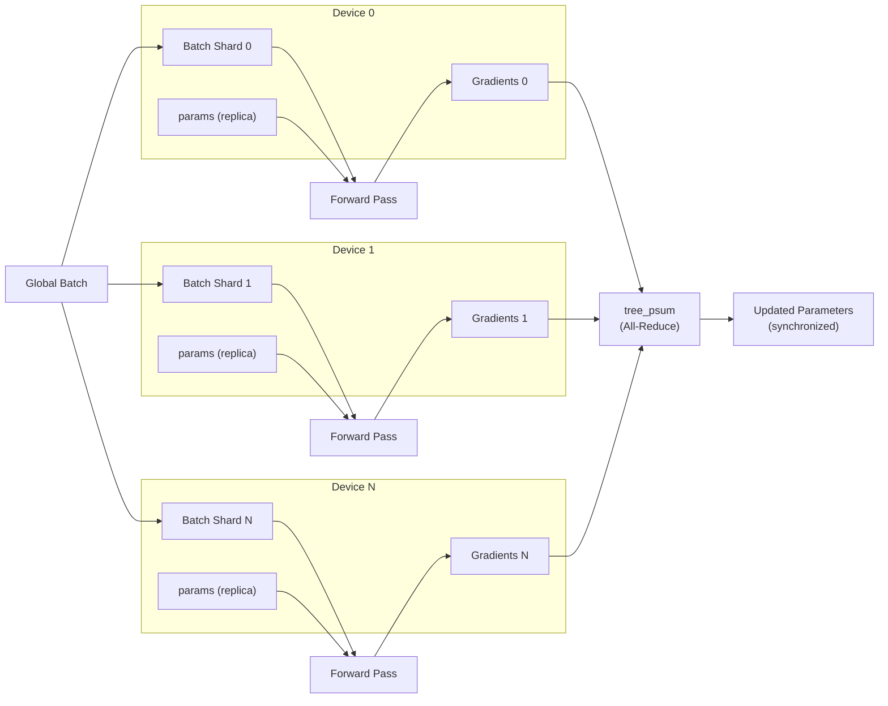
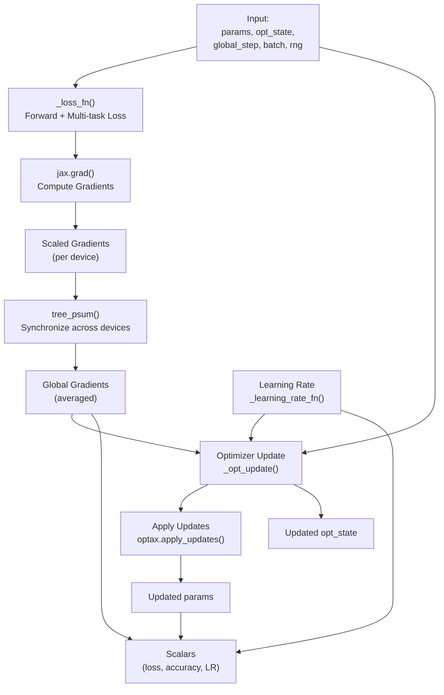
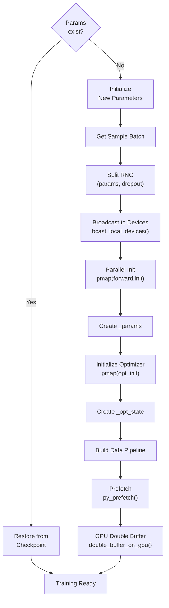

<!-- source: DeepWiki mcp.deepwiki.com · repo google-deepmind/ithaca · page 4.1 Training Overview · fetched 2026-10-26 -->

# Training Overview

<details>
<summary>Relevant source files</summary>

The following files were used as context for generating this wiki page:

- [README.md](README.md)
- [train/experiment.py](train/experiment.py)

</details>


This page provides a high-level overview of the Ithaca training system, which orchestrates model training using the JAXline platform. It covers the main training workflow, distributed training with `pmap`, and how different components interact during training.

For detailed information about specific training components:
- Experiment configuration and hyperparameters: see [Experiment Configuration](#4.2)
- Optimization and learning rate schedules: see [Optimization and Schedulers](#4.3)
- Multi-task loss functions: see [Loss Functions](#4.4)
- Data pipeline and augmentation: see [Data Loading and Augmentation](#4.5)
- Evaluation and checkpoint management: see [Evaluation and Checkpointing](#4.6)

## Training Platform Architecture

The Ithaca training system is built on the JAXline platform, which provides experiment management, checkpointing, and distributed training infrastructure. The core training logic is implemented in the `Experiment` class in [train/experiment.py]().



**Sources:** [train/experiment.py:50-122]()

## Experiment Class Structure

The `Experiment` class in [train/experiment.py]() is the main entry point for training. It inherits from JAXline's `AbstractExperiment` and implements the required training and evaluation interfaces.

### Key Attributes

| Attribute | Type | Purpose |
|-----------|------|---------|
| `_params` | PyTree | Model parameters (checkpointed) |
| `_opt_state` | PyTree | Optimizer state (checkpointed) |
| `_rng_key` | PRNGKey | Random number generator key |
| `_train_input` | Iterator | Training data pipeline |
| `_eval_input` | Iterator | Evaluation data pipeline |
| `forward` | `Model` | Model instance |
| `_update_func` | Function | Parallelized update function |
| `_alphabet` | `GreekAlphabet` | Text vocabulary |
| `_region_map` | Dict | Region ID mappings |

**Sources:** [train/experiment.py:50-109]()

### Checkpointing

The `CHECKPOINT_ATTRS` dictionary defines which attributes are persisted to checkpoints:

```python
CHECKPOINT_ATTRS = {
    '_params': 'params',
    '_opt_state': 'opt_state',
}
```

This enables training to resume from saved checkpoints, preserving both model parameters and optimizer state (including momentum buffers for Adam).

**Sources:** [train/experiment.py:56-59]()

## Training Workflow



**Sources:** [train/experiment.py:131-368]()

## Training Step Implementation

The `step()` method is called for each training iteration and orchestrates the forward pass, loss computation, gradient calculation, and parameter updates.

### Step Method

```python
def step(self, global_step, rng, **unused_args):
    """Main training step."""
    if self._train_input is None:
        self._initialize_train(rng)
    
    batch = next(self._train_input)
    (self._params, self._opt_state, scalars) = (
        self._update_func(self._params, self._opt_state, global_step, batch, rng))
    
    scalars = jl_utils.get_first(scalars)
    return scalars
```

The step method:
1. Initializes training on first call (lazy initialization)
2. Fetches the next batch from the data pipeline
3. Calls the parallelized `_update_func` to update parameters
4. Returns scalar metrics for logging

**Sources:** [train/experiment.py:131-143]()

## Distributed Training with pmap

Ithaca uses JAX's `pmap` (parallel map) to distribute training across multiple devices (GPUs/TPUs). The `_update_func` is wrapped with `pmap` to execute in parallel across all available devices.



### pmap Configuration

The `_update_func` is parallelized in the constructor:

```python
self._update_func = jax.pmap(
    self._update_func, 
    axis_name='i', 
    donate_argnums=(0, 1)
)
```

Key parameters:
- `axis_name='i'`: Names the parallel axis for collective operations
- `donate_argnums=(0, 1)`: Donates buffers for `params` and `opt_state` to reduce memory usage

**Sources:** [train/experiment.py:82-83]()

## Update Function Implementation

The `_update_func` performs the core training update, computing gradients and applying optimizer updates.



### Gradient Computation

The `_update_func` uses `jax.grad` with `has_aux=True` to compute gradients of the loss while preserving auxiliary outputs (individual loss components):

```python
def _update_func(self, params, opt_state, global_step, batch, rng):
    grad_loss_fn = jax.grad(self._loss_fn, has_aux=True)
    scaled_grads, (loss, date_loss, subregion_loss, subregion_accuracy,
                   mask_loss, mask_accuracy, nsp_loss,
                   nsp_accuracy) = grad_loss_fn(params, batch, global_step, rng)
    
    scaled_grads = jax.tree_map(jnp.nan_to_num, scaled_grads)
    grads = jl_utils.tree_psum(scaled_grads, axis_name='i')
    
    learning_rate = self._learning_rate_fn(global_step)
    updates, opt_state = self._opt_update(grads, opt_state, params=params)
    params = optax.apply_updates(params, updates)
    
    return params, opt_state, scalars
```

**Sources:** [train/experiment.py:335-368]()

## Loss Function

The `_loss_fn` computes a multi-task loss combining four objectives. See [Loss Functions](#4.4) for detailed documentation.

### Loss Components

| Task | Loss Type | Weight Configuration |
|------|-----------|---------------------|
| Date Prediction | L1 + KL Divergence | `config.loss.date.weight_l1`, `config.loss.date.weight_dist` |
| Region Classification | Cross-Entropy (label smoothing) | `config.loss.region.weight` |
| Masked Language Model | Cross-Entropy (label smoothing) | `config.loss.mask.weight` |
| Next Sentence Prediction | Cross-Entropy | `config.loss.nsp.weight` |

The total loss is:
```
loss = date_loss + subregion_loss + mask_loss + nsp_loss
```

Each loss component can be progressively ramped up using `linear_weight()` based on the training step.

**Sources:** [train/experiment.py:198-333]()

## Training Initialization

The `_initialize_train()` method sets up the training pipeline on the first training step.



### Parameter Initialization

Parameters are initialized using a sample batch:

```python
def _initialize_train(self, rng):
    if self._params is None:
        batch = next(self._build_train_input())
        
        rng = jl_utils.get_first(rng)
        params_rng, dropout_rng = jax.random.split(rng)
        params_rng = jl_utils.bcast_local_devices(params_rng)
        dropout_rng = jl_utils.bcast_local_devices(dropout_rng)
        
        init_net = jax.pmap(
            functools.partial(self.forward.init, is_training=True))
        self._params = init_net(
            {'params': params_rng, 'dropout': dropout_rng},
            text_char=batch['text_char'],
            text_word=batch['text_word'])
        
        init_opt = jax.pmap(self._opt_init)
        self._opt_state = init_opt(self._params)
```

The initialization:
1. Creates a sample batch to determine input shapes
2. Splits RNG keys for parameters and dropout
3. Broadcasts RNG keys to all devices
4. Uses `pmap(forward.init)` to initialize parameters on all devices in parallel
5. Initializes optimizer state using `pmap(opt_init)`

**Sources:** [train/experiment.py:145-169]()

## Data Pipeline Setup

The training data pipeline is built using TensorFlow Datasets with prefetching and GPU buffering for efficiency.

```mermaid
graph LR
    DATASET["TensorFlow Dataset<br/>(I.PHI data)"]
    LOADER["dataloader.loader_tf()<br/>Batch + Augment"]
    BATCH["Batch per Device<br/>shape: [per_device_batch_size, ...]"]
    STACK["Stack Devices<br/>.batch(local_device_count())"]
    NUMPY["Convert to NumPy<br/>tfds.as_numpy()"]
    PREFETCH["Python Prefetch<br/>py_prefetch()"]
    GPU_BUFFER["GPU Double Buffer<br/>double_buffer_on_gpu()"]
    ITERATOR["_train_input<br/>(Iterator)"]
    
    DATASET --> LOADER
    LOADER --> BATCH
    BATCH --> STACK
    STACK --> NUMPY
    NUMPY --> PREFETCH
    PREFETCH --> GPU_BUFFER
    GPU_BUFFER --> ITERATOR
```



### Batch Size Configuration

The global batch size is divided across devices:

```python
num_devices = jax.device_count()
global_batch_size = self.config.training.batch_size
per_device_batch_size, ragged = divmod(global_batch_size, num_devices)

if ragged:
    raise ValueError(
        f'Global batch size {global_batch_size} must be divisible by '
        f'num devices {num_devices}')
```

For example:
- Global batch size: 256
- Number of devices: 8
- Per-device batch size: 32

Each device processes its shard independently during the forward pass, then gradients are synchronized via `tree_psum`.

**Sources:** [train/experiment.py:171-196]()

## Optimizer Setup

The optimizer is configured via `config.optimizer` and constructed using Optax. See [Optimization and Schedulers](#4.3) for details.

```python
def optimizer(self):
    config_opt = self.config.optimizer
    
    kwargs = config_opt.kwargs.to_dict()
    kwargs['learning_rate'] = self._learning_rate_fn
    opt = getattr(optax, config_opt.name)(**kwargs)
    
    if hasattr(config_opt, 'clip_adaptive') and config_opt.clip_adaptive:
        if config_opt.clip_level > 0.:
            opt = optax.chain(adaptive_grad_clip(config_opt.clip_level), opt)
    elif config_opt.clip_level > 0.:
        opt = optax.chain(optax.clip_by_global_norm(config_opt.clip_level), opt)
    
    return opt
```

The optimizer chain typically includes:
1. Gradient clipping (adaptive or global norm)
2. Base optimizer (Adam with learning rate schedule)

**Sources:** [train/experiment.py:110-122]()

## Logged Metrics

The `_update_func` returns a dictionary of scalar metrics logged at each step:

| Metric | Description |
|--------|-------------|
| `loss/train` | Total training loss |
| `loss/date` | Date prediction loss |
| `loss/subregion` | Region classification loss |
| `loss/mask` | Masked language modeling loss |
| `loss/nsp` | Next sentence prediction loss |
| `accuracy/subregion` | Region classification accuracy |
| `accuracy/mask` | Masked token accuracy |
| `accuracy/nsp` | Next sentence prediction accuracy |
| `opt/learning_rate` | Current learning rate |
| `opt/grad_norm` | Global gradient norm |
| `opt/param_norm` | Global parameter norm |

These metrics are averaged across devices using `jax.lax.pmean` before logging.

**Sources:** [train/experiment.py:353-366]()

## Evaluation

Periodic evaluation is performed via the `evaluate()` method. See [Evaluation and Checkpointing](#4.6) for detailed documentation.

The evaluation workflow:
1. Run inference on validation set using `_eval_epoch()`
2. Compute composite score: `mask_accuracy + region_accuracy - date_l1 * 0.01`
3. Save outputs and model checkpoint if score improves
4. Return evaluation metrics for logging

**Sources:** [train/experiment.py:377-434]()

## Running Training

Training is initiated via the JAXline platform:

```bash
python train/experiment.py --config=path/to/config.py
```

The platform:
1. Parses configuration from `config.py`
2. Instantiates the `Experiment` class
3. Restores from checkpoint if available
4. Calls `step()` repeatedly for training iterations
5. Calls `evaluate()` at specified intervals
6. Manages checkpoint saving and logging

**Sources:** [train/experiment.py:677-679]()

---

