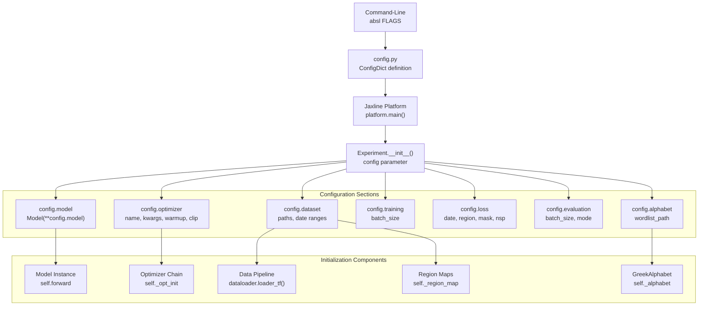
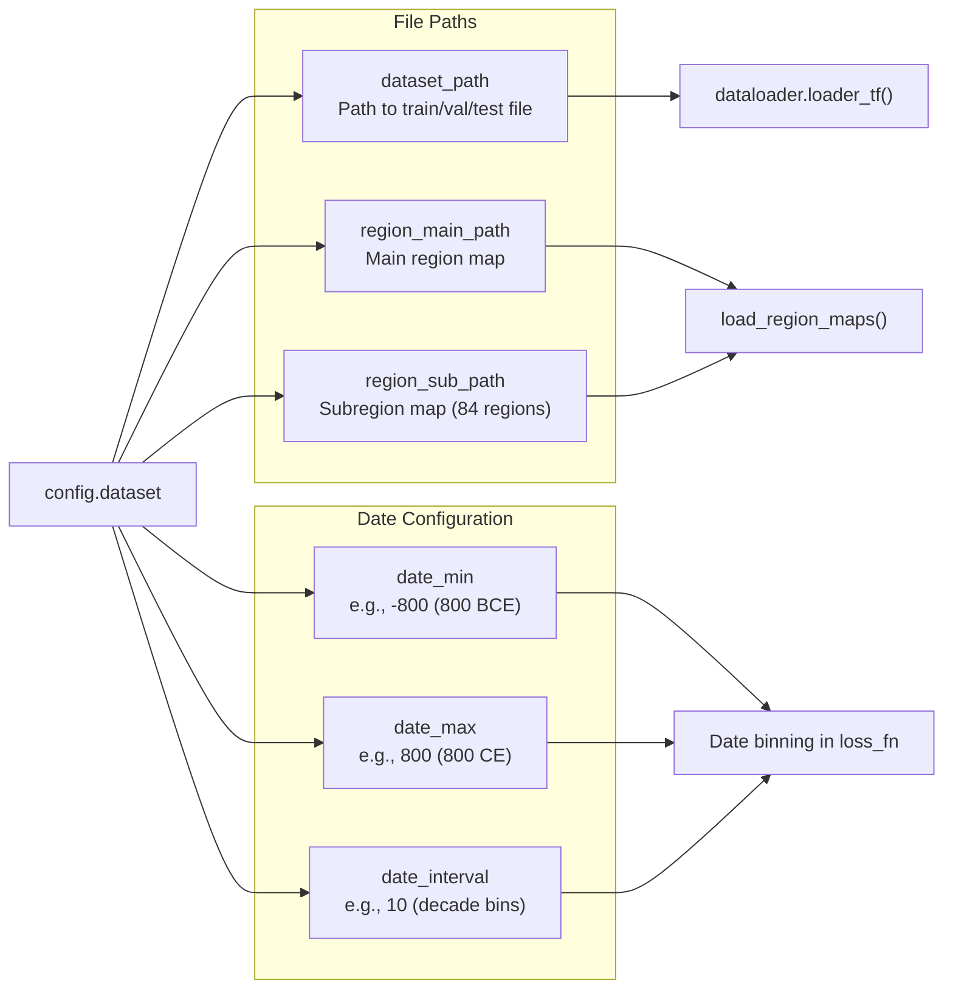
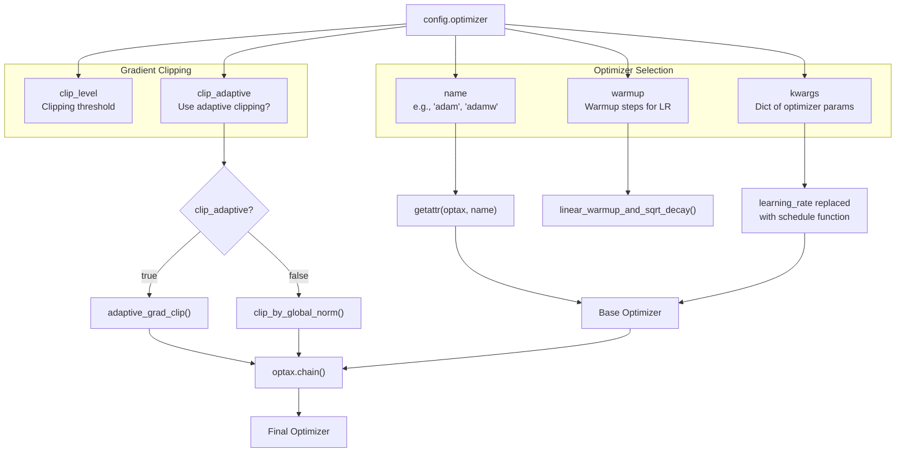

<!-- source: DeepWiki mcp.deepwiki.com · repo google-deepmind/ithaca · page 4.2 Experiment Configuration · fetched 2026-10-26 -->

# Experiment Configuration

<details>
<summary>Relevant source files</summary>

The following files were used as context for generating this wiki page:

- [requirements.txt](requirements.txt)
- [train/experiment.py](train/experiment.py)

</details>


This page documents how to configure training experiments for Ithaca models using ml-collections and command-line flags. It covers the hierarchical configuration structure, all configuration parameters, and how they are used during training initialization and execution.

For information about the training loop itself and optimization algorithms, see [Optimization and Schedulers](#4.3). For details on loss computation, see [Loss Functions](#4.4). For data pipeline configuration, see [Data Loading and Augmentation](#4.5).

---

## Configuration Architecture

Ithaca uses **ml-collections** (`ConfigDict`) for hierarchical, type-safe experiment configuration. The configuration object is passed to the `Experiment` class constructor and accessed throughout training via `self.config`.

**Configuration Flow Diagram**



**Sources:** [train/experiment.py:61-109](), [requirements.txt:7]()

---

## Configuration Hierarchy

The configuration object has seven top-level sections, each controlling a specific aspect of the training system:

| Section | Purpose | Used By |
|---------|---------|---------|
| `config.model` | Model architecture parameters | `Model.__init__()` |
| `config.optimizer` | Optimizer settings and gradient clipping | `Experiment.optimizer()` |
| `config.dataset` | Data paths and date/region mappings | `dataloader.loader_tf()` |
| `config.training` | Training loop settings | `Experiment.step()` |
| `config.loss` | Multi-task loss weights and schedules | `Experiment._loss_fn()` |
| `config.evaluation` | Evaluation settings | `Experiment.evaluate()` |
| `config.alphabet` | Greek text vocabulary configuration | `GreekAlphabet.__init__()` |

**Sources:** [train/experiment.py:61-109]()

---

## Model Configuration

The `config.model` section contains all hyperparameters for the neural network architecture. These parameters are unpacked directly into the `Model` constructor.

```python
# In Experiment.__init__()
self.forward = Model(**self.config.model)
```

**Common Model Parameters** (passed to Model class):

| Parameter | Type | Description |
|-----------|------|-------------|
| `num_layers` | int | Number of BigBird encoder layers |
| `num_heads` | int | Number of attention heads per layer |
| `qkv_dim` | int | Dimension of query/key/value projections |
| `emb_dim` | int | Embedding dimension |
| `mlp_dim` | int | MLP hidden layer dimension |
| `vocab_size_char` | int | Character vocabulary size |
| `vocab_size_word` | int | Word vocabulary size |
| `max_len` | int | Maximum sequence length (e.g., 768) |
| `dropout_rate` | float | Dropout probability |
| `attention_dropout_rate` | float | Attention dropout probability |
| `block_size` | int | BigBird block size for sparse attention |
| `num_rand_blocks` | int | Number of random attention blocks |

**Sources:** [train/experiment.py:81]()

---

## Dataset Configuration

The `config.dataset` section specifies data paths, date ranges, and region mappings. This configuration is passed to the data loader and used for date binning and region filtering.

**Dataset Configuration Structure**



**Dataset Parameters:**

| Parameter | Type | Description | Usage |
|-----------|------|-------------|-------|
| `dataset_path` | str | Path to dataset file | Opened and passed to `dataloader.loader_tf()` |
| `region_main_path` | str | Path to main region map file | Loaded via `load_region_maps()` |
| `region_sub_path` | str | Path to subregion map file | Loaded via `load_region_maps()` |
| `date_min` | int | Minimum date (e.g., -800 for 800 BCE) | Used to create date bins for prediction |
| `date_max` | int | Maximum date (e.g., 800 for 800 CE) | Used to create date bins for prediction |
| `date_interval` | int | Bin width (e.g., 10 for decades) | Determines granularity of date prediction |

**Sources:** [train/experiment.py:103-108](), [train/experiment.py:185-196](), [train/experiment.py:247-252]()

---

## Training Configuration

The `config.training` section controls training loop behavior, primarily batch size.

```python
# In Experiment._build_train_input()
global_batch_size = self.config.training.batch_size
per_device_batch_size, ragged = divmod(global_batch_size, num_devices)
```

**Training Parameters:**

| Parameter | Type | Description |
|-----------|------|-------------|
| `batch_size` | int | Global batch size across all devices |

The global batch size is automatically divided across available devices using `jax.device_count()`. If the batch size is not evenly divisible, an error is raised.

**Sources:** [train/experiment.py:174-183]()

---

## Loss Configuration

The `config.loss` section configures the multi-task loss function with four sub-sections: date, region, mask, and NSP (next sentence prediction). Each task can be independently enabled/disabled and has its own weight and scheduling parameters.

**Loss Configuration Structure**

```mermaid
graph TB
    LOSS["config.loss"]
    
    subgraph "Date Loss Config"
        DATE_EN["loss.date.enabled<br/>bool"]
        DATE_TYPE["loss.date.type<br/>'l1', 'dist', or 'l1+dist'"]
        DATE_W_L1["loss.date.weight_l1<br/>float"]
        DATE_W_DIST["loss.date.weight_dist<br/>float"]
        DATE_LS["loss.date.label_smoothing<br/>float"]
        DATE_START["loss.date.step_start<br/>int"]
        DATE_END["loss.date.step_end<br/>int"]
    end
    
    subgraph "Region Loss Config"
        REGION_EN["loss.region.enabled<br/>bool"]
        REGION_W["loss.region.weight<br/>float"]
        REGION_LS["loss.region.label_smoothing<br/>float"]
        REGION_START["loss.region.step_start<br/>int"]
        REGION_END["loss.region.step_end<br/>int"]
    end
    
    subgraph "Mask Loss Config"
        MASK_EN["loss.mask.enabled<br/>bool"]
        MASK_W["loss.mask.weight<br/>float"]
        MASK_LS["loss.mask.label_smoothing<br/>float"]
        MASK_START["loss.mask.step_start<br/>int"]
        MASK_END["loss.mask.step_end<br/>int"]
    end
    
    subgraph "NSP Loss Config"
        NSP_EN["loss.nsp.enabled<br/>bool"]
        NSP_W["loss.nsp.weight<br/>float"]
        NSP_START["loss.nsp.step_start<br/>int"]
        NSP_END["loss.nsp.step_end<br/>int"]
    end
    
    LOSS --> DATE_EN
    LOSS --> REGION_EN
    LOSS --> MASK_EN
    LOSS --> NSP_EN
    
    DATE_EN --> DATE_CALC["date_loss calculation"]
    REGION_EN --> REGION_CALC["subregion_loss calculation"]
    MASK_EN --> MASK_CALC["mask_loss calculation"]
    NSP_EN --> NSP_CALC["nsp_loss calculation"]
    
    DATE_CALC --> TOTAL["total_loss = sum of weighted losses"]
    REGION_CALC --> TOTAL
    MASK_CALC --> TOTAL
    NSP_CALC --> TOTAL
```



### Date Loss Configuration

| Parameter | Type | Description |
|-----------|------|-------------|
| `enabled` | bool | Whether to compute date loss |
| `type` | str | Loss components: `'l1'`, `'dist'`, or `'l1+dist'` |
| `weight_l1` | float | Weight for L1 loss component |
| `weight_dist` | float | Weight for KL divergence component |
| `label_smoothing` | float | Label smoothing for date distribution (0 = none) |
| `step_start` | int | Step when loss weight begins ramping up |
| `step_end` | int | Step when loss weight reaches full value |

**Date Loss Types:**
- `'l1'`: L1 distance between predicted date and ground truth midpoint
- `'dist'`: KL divergence between predicted and ground truth date distributions
- `'l1+dist'`: Both components combined

**Sources:** [train/experiment.py:230-269](), [train/experiment.py:494-516]()

### Region Loss Configuration

| Parameter | Type | Description |
|-----------|------|-------------|
| `enabled` | bool | Whether to compute region classification loss |
| `weight` | float | Loss weight multiplier |
| `label_smoothing` | float | Label smoothing factor (0 = none) |
| `step_start` | int | Step when loss weight begins ramping up |
| `step_end` | int | Step when loss weight reaches full value |

Region loss is cross-entropy over 84 subregions with optional label smoothing.

**Sources:** [train/experiment.py:272-285](), [train/experiment.py:518-524]()

### Mask Loss Configuration

| Parameter | Type | Description |
|-----------|------|-------------|
| `enabled` | bool | Whether to compute masked language modeling loss |
| `weight` | float | Loss weight multiplier |
| `label_smoothing` | float | Label smoothing factor (0 = none) |
| `step_start` | int | Step when loss weight begins ramping up |
| `step_end` | int | Step when loss weight reaches full value |

Mask loss is computed only over masked character positions using cross-entropy.

**Sources:** [train/experiment.py:288-307](), [train/experiment.py:526-540]()

### NSP Loss Configuration

| Parameter | Type | Description |
|-----------|------|-------------|
| `enabled` | bool | Whether to compute next sentence prediction loss |
| `weight` | float | Loss weight multiplier |
| `step_start` | int | Step when loss weight begins ramping up |
| `step_end` | int | Step when loss weight reaches full value |

NSP loss is cross-entropy over binary labels for sentence continuity.

**Sources:** [train/experiment.py:310-327](), [train/experiment.py:542-556]()

### Loss Weight Scheduling

All loss components support **linear weight scheduling** using `step_start` and `step_end`:

```python
# Weight ramps from 0 at step_start to 1 at step_end
weight = linear_weight(global_step, config.loss.{task}.step_start, 
                                   config.loss.{task}.step_end)
final_loss = base_loss * weight
```

This allows curriculum learning where simpler tasks (e.g., masking) are learned before complex tasks (e.g., date prediction).

**Sources:** [train/experiment.py:268-269](), [train/experiment.py:283-285](), [train/experiment.py:306-307](), [train/experiment.py:326-327]()

---

## Optimizer Configuration

The `config.optimizer` section specifies the optimizer algorithm, learning rate schedule, and gradient clipping strategy.

**Optimizer Configuration Flow**



**Optimizer Parameters:**

| Parameter | Type | Description |
|-----------|------|-------------|
| `name` | str | Optax optimizer name (e.g., `'adam'`, `'adamw'`) |
| `kwargs` | ConfigDict | Optimizer-specific parameters (e.g., `learning_rate`, `weight_decay`) |
| `kwargs.learning_rate` | float | Maximum learning rate (replaced by schedule) |
| `warmup` | int | Number of warmup steps for learning rate |
| `clip_level` | float | Gradient clipping threshold (0 = no clipping) |
| `clip_adaptive` | bool | Whether to use adaptive gradient clipping |

**Optimizer Construction:**

```python
# In Experiment.optimizer()
config_opt = self.config.optimizer
kwargs = config_opt.kwargs.to_dict()

# Replace learning_rate with schedule function
kwargs['learning_rate'] = linear_warmup_and_sqrt_decay(
    max_lr=config_opt.kwargs.learning_rate,
    warmup_steps=config_opt.warmup)

# Create base optimizer
opt = getattr(optax, config_opt.name)(**kwargs)

# Add gradient clipping
if config_opt.clip_adaptive and config_opt.clip_level > 0:
    opt = optax.chain(adaptive_grad_clip(config_opt.clip_level), opt)
elif config_opt.clip_level > 0:
    opt = optax.chain(optax.clip_by_global_norm(config_opt.clip_level), opt)
```

**Learning Rate Schedule:**

The learning rate follows a **linear warmup + square root decay** schedule:
- Warmup: Linear increase from 0 to `max_lr` over `warmup` steps
- Decay: Square root decay after warmup: `max_lr / sqrt(step - warmup + 1)`

**Sources:** [train/experiment.py:85-90](), [train/experiment.py:110-122]()

---

## Evaluation Configuration

The `config.evaluation` section controls evaluation behavior during training.

**Evaluation Parameters:**

| Parameter | Type | Description |
|-----------|------|-------------|
| `batch_size` | int | Batch size for evaluation (typically 1 for sequential processing) |
| `mode` | str | Dataset split to evaluate: `'val'` or `'test'` |
| `use_jit` | bool | Whether to JIT-compile `_eval_batch()` for speed |
| `store_model_log` | bool | Whether to save detailed model outputs per batch |
| `store_model_log_steps` | int | How often to flush model log buffer to disk |

**Evaluation Workflow:**

```python
# In Experiment._build_eval_input()
ds = dataloader.loader_tf(
    self.config.evaluation.batch_size,
    config_dataset,
    self._region_map,
    alphabet=self._alphabet,
    dataset_file=dataset_file,
    mode=self.config.evaluation.mode)  # 'val' or 'test'

# Optional JIT compilation
if self.config.evaluation.use_jit:
    self._eval_batch = jax.jit(self._eval_batch)
```

**Model Logging:**

When `store_model_log` is enabled, detailed outputs (predictions, logits) are saved per batch as compressed pickle files in `checkpoint_dir/model_log/` and `checkpoint_dir/best_model_log/`.

**Sources:** [train/experiment.py:92-94](), [train/experiment.py:444-450](), [train/experiment.py:598-650]()

---

## Alphabet Configuration

The `config.alphabet` section configures the Greek text vocabulary used for tokenization.

**Alphabet Parameters:**

| Parameter | Type | Description |
|-----------|------|-------------|
| `wordlist_path` | str | Path to file containing word vocabulary (one word per line) |
| Additional params | - | Passed to `GreekAlphabet` constructor (e.g., special token settings) |

**Initialization:**

```python
# In Experiment.__init__()
alphabet_kwargs = dict(self.config.alphabet)
wordlist_path = alphabet_kwargs.pop('wordlist_path')

with open(wordlist_path, 'r') as f:
    self._alphabet = GreekAlphabet(wordlist_file=f, **alphabet_kwargs)
```

The `GreekAlphabet` object provides:
- Character vocabulary: `idx2char`, `char2idx`
- Word vocabulary: `idx2word`, `word2idx`
- Text processing: filtering, tokenization, index conversion

**Sources:** [train/experiment.py:96-99]()

---

## Command-Line Flags

Ithaca uses **absl-py** flags for command-line configuration. The primary flag is `--config`, which specifies the path to the configuration file or module.

**Primary Flag:**

| Flag | Type | Required | Description |
|------|------|----------|-------------|
| `--config` | str | Yes | Path to config file or module defining `get_config()` |

**Usage:**

```bash
# Run training with config file
python -m train.experiment --config=path/to/config.py
```

The config file should define a `get_config()` function that returns a `ConfigDict`:

```python
import ml_collections

def get_config():
    config = ml_collections.ConfigDict()
    
    config.model = ml_collections.ConfigDict()
    config.model.num_layers = 12
    config.model.num_heads = 8
    # ... more model params
    
    config.optimizer = ml_collections.ConfigDict()
    config.optimizer.name = 'adamw'
    config.optimizer.kwargs = ml_collections.ConfigDict()
    config.optimizer.kwargs.learning_rate = 1e-4
    # ... more optimizer params
    
    # ... other config sections
    
    return config
```

**Sources:** [train/experiment.py:47](), [train/experiment.py:678]()

---

## Complete Configuration Template

Below is a comprehensive template showing all configuration sections and their typical parameters:

```python
import ml_collections

def get_config():
    config = ml_collections.ConfigDict()
    
    # Model architecture
    config.model = ml_collections.ConfigDict()
    config.model.num_layers = 12
    config.model.num_heads = 8
    config.model.qkv_dim = 512
    config.model.emb_dim = 512
    config.model.mlp_dim = 2048
    config.model.vocab_size_char = 50
    config.model.vocab_size_word = 100000
    config.model.max_len = 768
    config.model.dropout_rate = 0.1
    config.model.attention_dropout_rate = 0.1
    config.model.block_size = 64
    config.model.num_rand_blocks = 3
    
    # Optimizer
    config.optimizer = ml_collections.ConfigDict()
    config.optimizer.name = 'adamw'
    config.optimizer.warmup = 10000
    config.optimizer.clip_level = 1.0
    config.optimizer.clip_adaptive = False
    config.optimizer.kwargs = ml_collections.ConfigDict()
    config.optimizer.kwargs.learning_rate = 1e-4
    config.optimizer.kwargs.weight_decay = 0.01
    
    # Dataset
    config.dataset = ml_collections.ConfigDict()
    config.dataset.dataset_path = '/path/to/dataset.txt'
    config.dataset.region_main_path = '/path/to/region_main.txt'
    config.dataset.region_sub_path = '/path/to/region_sub.txt'
    config.dataset.date_min = -800
    config.dataset.date_max = 800
    config.dataset.date_interval = 10
    
    # Training
    config.training = ml_collections.ConfigDict()
    config.training.batch_size = 64
    
    # Loss configuration
    config.loss = ml_collections.ConfigDict()
    
    config.loss.date = ml_collections.ConfigDict()
    config.loss.date.enabled = True
    config.loss.date.type = 'l1+dist'
    config.loss.date.weight_l1 = 1.0
    config.loss.date.weight_dist = 0.1
    config.loss.date.label_smoothing = 0.0
    config.loss.date.step_start = 0
    config.loss.date.step_end = 100000
    
    config.loss.region = ml_collections.ConfigDict()
    config.loss.region.enabled = True
    config.loss.region.weight = 1.0
    config.loss.region.label_smoothing = 0.1
    config.loss.region.step_start = 0
    config.loss.region.step_end = 50000
    
    config.loss.mask = ml_collections.ConfigDict()
    config.loss.mask.enabled = True
    config.loss.mask.weight = 1.0
    config.loss.mask.label_smoothing = 0.0
    config.loss.mask.step_start = 0
    config.loss.mask.step_end = 10000
    
    config.loss.nsp = ml_collections.ConfigDict()
    config.loss.nsp.enabled = True
    config.loss.nsp.weight = 0.5
    config.loss.nsp.step_start = 0
    config.loss.nsp.step_end = 20000
    
    # Evaluation
    config.evaluation = ml_collections.ConfigDict()
    config.evaluation.batch_size = 1
    config.evaluation.mode = 'val'
    config.evaluation.use_jit = True
    config.evaluation.store_model_log = False
    config.evaluation.store_model_log_steps = 100
    
    # Alphabet
    config.alphabet = ml_collections.ConfigDict()
    config.alphabet.wordlist_path = '/path/to/wordlist.txt'
    
    return config
```

**Sources:** [train/experiment.py:61-109]()

---

## Configuration Best Practices

**Loss Weight Scheduling:**
- Start with mask loss (simplest task): `step_start=0, step_end=10000`
- Add NSP next: `step_start=0, step_end=20000`
- Add region classification: `step_start=0, step_end=50000`
- Add date prediction last (hardest task): `step_start=0, step_end=100000`

**Batch Size:**
- Must be divisible by number of devices (`jax.device_count()`)
- Typical values: 32, 64, 128
- Adjust based on GPU memory and sequence length

**Learning Rate:**
- Start with `1e-4` for AdamW
- Increase warmup steps for larger models (e.g., 10000-20000)
- Monitor gradient norms and adjust `clip_level` if gradients explode

**Gradient Clipping:**
- `clip_level=1.0` is a reasonable default
- Use `clip_adaptive=True` for more stable training with large batches
- Set `clip_level=0` to disable clipping

**Sources:** [train/experiment.py:268-327]()

---

