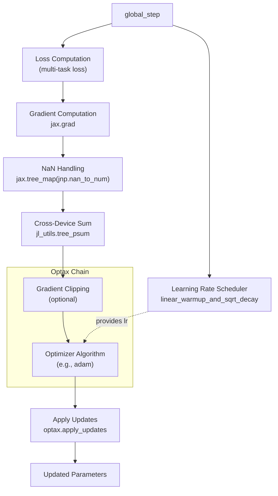
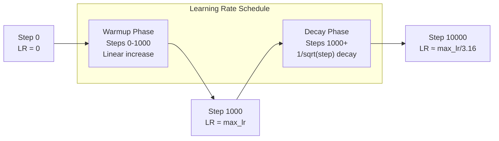
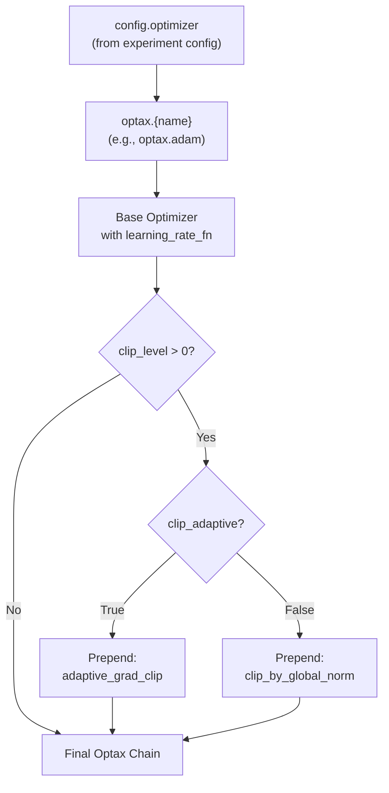
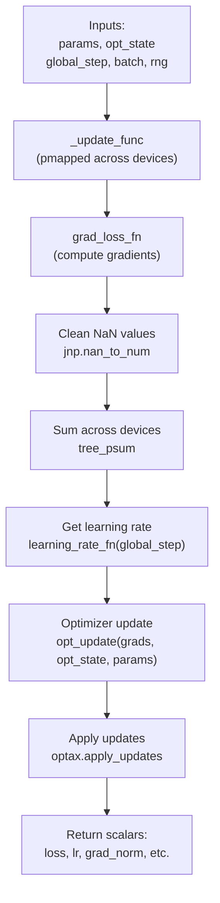

<!-- source: DeepWiki mcp.deepwiki.com · repo google-deepmind/ithaca · page 4.3 Optimization and Schedulers · fetched 2026-10-26 -->

# Optimization and Schedulers

<details>
<summary>Relevant source files</summary>

The following files were used as context for generating this wiki page:

- [ithaca/util/optim.py](ithaca/util/optim.py)
- [train/experiment.py](train/experiment.py)

</details>


This page documents the optimization strategies used during Ithaca model training, including learning rate schedules, gradient clipping mechanisms, and the Optax transformation chain. For information about loss functions applied during training, see [Loss Functions](#4.4). For the broader training workflow and experiment configuration, see [Training Overview](#4.1).

## Overview

The Ithaca training system uses a sophisticated optimization pipeline built on [Optax](https://github.com/deepmind/optax), JAX's gradient processing library. The optimization strategy combines:

1. **Learning rate scheduling**: Warmup followed by decay to stabilize training
2. **Gradient clipping**: Prevents exploding gradients using either global norm or adaptive clipping
3. **Optimizer algorithm**: Typically Adam or AdamW with configurable hyperparameters
4. **Parallelization**: `pmap` distributes gradient computation across devices

The complete optimization pipeline is defined in two locations:
- Core utilities: [ithaca/util/optim.py:1-168]()
- Training integration: [train/experiment.py:110-122]()

**Sources:** [ithaca/util/optim.py:1-168](), [train/experiment.py:61-91]()

## Optimization Pipeline

The following diagram illustrates how gradients flow through the optimization pipeline during a single training step:



The pipeline processes gradients in the following stages:

| Stage | Function | Purpose |
|-------|----------|---------|
| Loss Computation | `_loss_fn()` | Computes multi-task loss from model predictions |
| Gradient Computation | `jax.grad()` | Backpropagation to compute parameter gradients |
| NaN Handling | `jnp.nan_to_num()` | Replaces NaN/Inf values with zeros |
| Cross-Device Sum | `tree_psum()` | Aggregates gradients across distributed devices |
| Gradient Clipping | `adaptive_grad_clip()` or `clip_by_global_norm()` | Prevents exploding gradients |
| Optimizer Algorithm | `optax.adam()` or similar | Computes parameter updates (e.g., momentum, adaptive learning rates) |
| Update Application | `optax.apply_updates()` | Applies computed updates to parameters |

**Sources:** [train/experiment.py:335-368](), [train/experiment.py:198-333]()

## Learning Rate Scheduling

### Linear Warmup and Square Root Decay

The primary learning rate schedule used in Ithaca is `linear_warmup_and_sqrt_decay`, which combines two phases:

1. **Warmup Phase** (steps 0 to `warmup_steps`): Learning rate increases linearly from 0 to `max_lr`
2. **Decay Phase** (steps > `warmup_steps`): Learning rate decreases as the inverse square root of the step number

The mathematical formulation is:

```
lr(step) = min(max_lr * step / warmup_steps, 
               max_lr * sqrt(warmup_steps) / sqrt(step))
```

Implementation: [ithaca/util/optim.py:31-36]()

```python
def linear_warmup_and_sqrt_decay(global_step, max_lr, warmup_steps):
  """Linear warmup and then an inverse square root decay of learning rate."""
  linear_ratio = max_lr / warmup_steps
  decay_ratio = jnp.power(warmup_steps * 1.0, 0.5) * max_lr
  return jnp.minimum(linear_ratio * global_step,
                     decay_ratio * jnp.power(global_step, -0.5))
```

The experiment initializes this scheduler with configuration parameters: [train/experiment.py:85-88]()

```python
self._learning_rate_fn = functools.partial(
    linear_warmup_and_sqrt_decay,
    max_lr=self.config.optimizer.kwargs.learning_rate,
    warmup_steps=self.config.optimizer.warmup)
```

**Sources:** [ithaca/util/optim.py:31-36](), [train/experiment.py:85-88]()

### Learning Rate Schedule Visualization

The following diagram shows how learning rate evolves over training steps for typical hyperparameters (`max_lr=0.001`, `warmup_steps=1000`):



| Step | Learning Rate (if max_lr=0.001) | Phase |
|------|--------------------------------|-------|
| 0 | 0.0 | Warmup |
| 500 | 0.0005 | Warmup |
| 1000 | 0.001 (peak) | Transition |
| 4000 | 0.0005 | Decay |
| 10000 | ~0.000316 | Decay |
| 100000 | ~0.0001 | Decay |

**Sources:** [ithaca/util/optim.py:31-36]()

### Advanced Learning Rate Scheduler

For more complex scheduling needs, the `create_learning_rate_scheduler` function supports composable schedule factors: [ithaca/util/optim.py:39-94]()

Supported factors (combined with `*` separator):
- `constant`: Base learning rate multiplier
- `linear_warmup`: Linear increase to step `warmup_steps`
- `rsqrt_decay`: Inverse square root decay
- `rsqrt_normalized_decay`: Normalized version of rsqrt_decay
- `decay_every`: Exponential decay every N steps
- `cosine_decay`: Cyclic cosine decay

Example usage:
```python
# Default: constant * linear_warmup * rsqrt_decay
scheduler = create_learning_rate_scheduler(
    factors='constant * linear_warmup * rsqrt_decay',
    base_learning_rate=0.5,
    warmup_steps=1000
)
```

**Sources:** [ithaca/util/optim.py:39-94]()

## Gradient Clipping

Gradient clipping prevents training instabilities by limiting gradient magnitudes. Ithaca supports two clipping strategies.

### Global Norm Clipping

Clips the global norm of the gradient tree to a maximum value:

```
if ||grads|| > max_norm:
    grads = grads * (max_norm / ||grads||)
```

Implementation using Optax: [train/experiment.py:121]()

```python
opt = optax.chain(optax.clip_by_global_norm(config_opt.clip_level), opt)
```

This is the standard clipping method used when `clip_adaptive=False`.

**Sources:** [train/experiment.py:120-121]()

### Adaptive Gradient Clipping (AGC)

Adaptive gradient clipping scales gradients based on parameter magnitudes, providing better stability for different parameter groups. Introduced in [Brock et al. 2021](https://arxiv.org/abs/2102.06171), AGC clips each parameter group independently:

```
for each parameter p with gradient g:
    if ||g|| > clipping * ||p||:
        g = g * (clipping * ||p|| / ||g||)
```

Implementation: [ithaca/util/optim.py:140-167]()

```python
def adaptive_grad_clip(clipping, eps=1e-3) -> GradientTransformation:
  """Clip updates to be at most clipping * parameter_norm, unit-wise."""
  
  def init_fn(_):
    return ClipByGlobalNormState()

  def update_fn(updates, state, params):
    g_norm = jax.tree_map(unitwise_norm, updates)
    p_norm = jax.tree_map(unitwise_norm, params)
    # Maximum allowable norm
    max_norm = jax.tree_map(lambda x: clipping * jnp.maximum(x, eps), p_norm)
    # If grad norm > clipping * param_norm, rescale
    updates = jax.tree_map(unitwise_clip, g_norm, max_norm, updates)
    return updates, state

  return GradientTransformation(init_fn, update_fn)
```

The `unitwise_norm` function computes norms differently based on tensor shape: [ithaca/util/optim.py:115-128]()

| Tensor Type | Shape | Axis for Norm | Use Case |
|-------------|-------|---------------|----------|
| Scalars/Vectors | ≤1D | None | Biases |
| Linear layers | 2D or 3D | 0 | Weight matrices |
| Convolutions | 4D (HWIO) | [0,1,2] | Conv kernels |

AGC is enabled in the experiment when configured: [train/experiment.py:117-119]()

```python
if hasattr(config_opt, 'clip_adaptive') and config_opt.clip_adaptive:
  if config_opt.clip_level > 0.:
    opt = optax.chain(adaptive_grad_clip(config_opt.clip_level), opt)
```

**Sources:** [ithaca/util/optim.py:115-167](), [train/experiment.py:117-119]()

## Optax Chain Configuration

The optimizer is constructed as a chain of Optax transformations, allowing modular composition of gradient processing steps.

### Optimizer Construction

The `optimizer()` method builds the Optax chain: [train/experiment.py:110-122]()



Code implementation:

```python
def optimizer(self):
  config_opt = self.config.optimizer

  kwargs = config_opt.kwargs.to_dict()
  kwargs['learning_rate'] = self._learning_rate_fn
  opt = getattr(optax, config_opt.name)(**kwargs)

  if hasattr(config_opt, 'clip_adaptive') and config_opt.clip_adaptive:
    if config_opt.clip_level > 0.:
      opt = optax.chain(adaptive_grad_clip(config_opt.clip_level), opt)
  elif config_opt.clip_level > 0.:
    opt = optax.chain(optax.clip_by_global_norm(config_opt.clip_level), opt)
  return opt
```

### Common Optimizer Configurations

| Configuration | Optax Components | Use Case |
|--------------|------------------|----------|
| Adam + Global Clip | `[clip_by_global_norm(1.0), adam(lr=schedule)]` | Standard training |
| AdamW + AGC | `[adaptive_grad_clip(0.01), adamw(lr=schedule)]` | Weight decay with adaptive clipping |
| SGD + Momentum | `[clip_by_global_norm(1.0), sgd(lr=schedule, momentum=0.9)]` | Simple baseline |

**Sources:** [train/experiment.py:110-122]()

## Integration in Training Loop

The optimizer state and update function are used within the training step: [train/experiment.py:335-368]()

### Update Function



Key steps in the update function:

1. **Compute gradients**: `grad_loss_fn` computes gradients of the loss function
2. **Handle NaN values**: Replace any NaN/Inf values in gradients
3. **Aggregate gradients**: Sum gradients across all devices using `pmap`
4. **Get learning rate**: Query the learning rate schedule with current step
5. **Update optimizer state**: Pass gradients through Optax chain to get updates
6. **Apply updates**: Add computed updates to parameters

Implementation: [train/experiment.py:335-368]()

```python
def _update_func(self, params, opt_state, global_step, batch, rng):
  """Applies an update to parameters and returns new state."""
  # This function computes the gradient of the first output of loss_fn and
  # passes through the other arguments unchanged.
  grad_loss_fn = jax.grad(self._loss_fn, has_aux=True)
  scaled_grads, (loss, date_loss, subregion_loss, subregion_accuracy,
                 mask_loss, mask_accuracy, nsp_loss,
                 nsp_accuracy) = grad_loss_fn(params, batch, global_step, rng)

  scaled_grads = jax.tree_map(jnp.nan_to_num, scaled_grads)
  grads = jl_utils.tree_psum(scaled_grads, axis_name='i')

  # Compute and apply updates via our optimizer.
  learning_rate = self._learning_rate_fn(global_step)
  updates, opt_state = self._opt_update(grads, opt_state, params=params)
  params = optax.apply_updates(params, updates)

  # Scalars to log (note: we log the mean across all hosts/devices).
  scalars = {
      'loss/train': loss,
      'loss/date': date_loss,
      'loss/subregion': subregion_loss,
      'loss/mask': mask_loss,
      'loss/nsp': nsp_loss,
      'accuracy/subregion': subregion_accuracy,
      'accuracy/mask': mask_accuracy,
      'accuracy/nsp': nsp_accuracy,
      'opt/learning_rate': learning_rate,
      'opt/grad_norm': optax.global_norm(grads),
      'opt/param_norm': optax.global_norm(params),
  }
  scalars = jax.lax.pmean(scalars, axis_name='i')

  return params, opt_state, scalars
```

### Logged Metrics

The training loop logs the following optimization-related metrics:

| Metric | Description | Use |
|--------|-------------|-----|
| `opt/learning_rate` | Current learning rate | Monitor schedule behavior |
| `opt/grad_norm` | Global norm of gradients | Detect exploding gradients |
| `opt/param_norm` | Global norm of parameters | Monitor parameter scale |

**Sources:** [train/experiment.py:335-368]()

## Linear Weight Ramping

In addition to learning rate scheduling, Ithaca uses linear weight ramping for loss terms to gradually introduce auxiliary tasks during training: [ithaca/util/optim.py:21-28]()

```python
def linear_weight(global_step, start, end):
  """Linear weight increase."""
  if end <= 0:
    return 1.
  t = jnp.maximum(0., global_step - start)
  w = t / (end - start)
  w = jnp.minimum(w, 1.)
  return w
```

This function is applied to individual loss terms (date, region, mask, NSP) to control when they start contributing to the total loss: [train/experiment.py:268-269](), [train/experiment.py:283-285]()

Example usage:
```python
date_loss *= linear_weight(global_step, 
                          self.config.loss.date.step_start,
                          self.config.loss.date.step_end)
```

| Loss Term | Start Step | End Step | Purpose |
|-----------|------------|----------|---------|
| Date | Configurable | Configurable | Delay date prediction until model learns basic patterns |
| Region | Configurable | Configurable | Allow mask task to stabilize first |
| Mask | Configurable | Configurable | Primary task, typically enabled from start |
| NSP | Configurable | Configurable | Higher-level task, introduced later |

**Sources:** [ithaca/util/optim.py:21-28](), [train/experiment.py:268-269](), [train/experiment.py:283-285](), [train/experiment.py:306-307](), [train/experiment.py:326-327]()

## Configuration Example

A typical optimizer configuration in the experiment config:

```python
config.optimizer.name = 'adam'
config.optimizer.warmup = 10000  # Warmup steps
config.optimizer.clip_level = 1.0  # Gradient clipping threshold
config.optimizer.clip_adaptive = False  # Use global norm clipping

# Optimizer kwargs passed to optax.adam
config.optimizer.kwargs.learning_rate = 0.001  # Max learning rate
config.optimizer.kwargs.b1 = 0.9  # Adam beta1
config.optimizer.kwargs.b2 = 0.98  # Adam beta2
config.optimizer.kwargs.eps = 1e-9  # Adam epsilon
```

This configuration creates an optimizer that:
1. Uses Adam with specified hyperparameters
2. Warms up learning rate linearly for 10,000 steps
3. Decays learning rate as 1/√step afterward
4. Clips gradients to global norm of 1.0

**Sources:** [train/experiment.py:110-122]()

---

