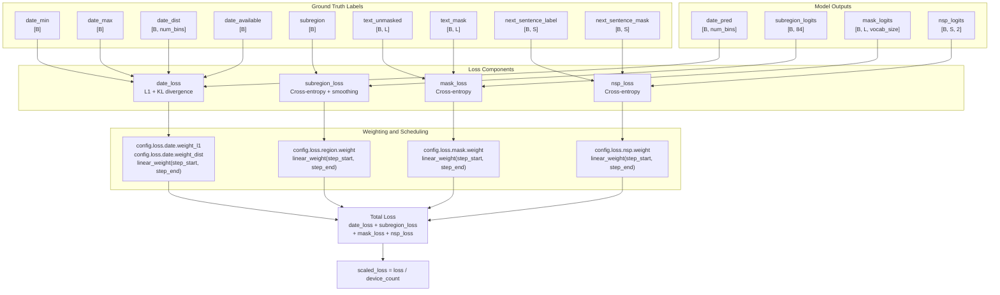
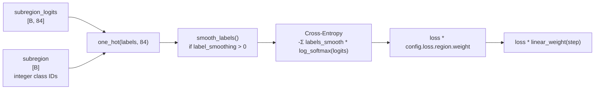
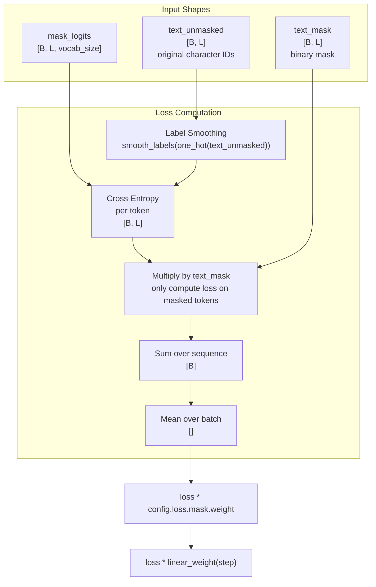
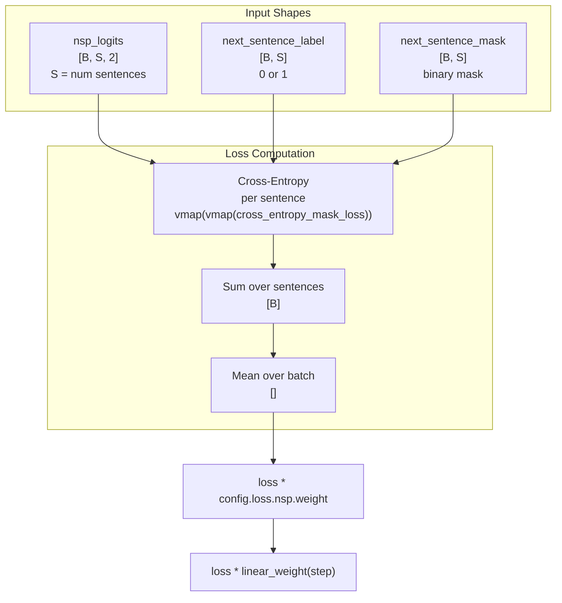

<!-- source: DeepWiki mcp.deepwiki.com · repo google-deepmind/ithaca · page 4.4 Loss Functions · fetched 2026-10-26 -->

# Loss Functions

<details>
<summary>Relevant source files</summary>

The following files were used as context for generating this wiki page:

- [ithaca/util/loss.py](ithaca/util/loss.py)
- [train/experiment.py](train/experiment.py)

</details>


This page documents the multi-task loss functions used to train the Ithaca model. The training objective combines four distinct tasks: date prediction, geographical attribution, masked language modeling, and next sentence prediction. Each task has its own loss function with configurable weights and scheduling.

For information about the optimization process and learning rate schedules, see [Optimization and Schedulers](#4.3). For details on model architecture and output heads, see [Multi-Task Output Heads](#3.5).

---

## Multi-Task Loss Architecture

The Ithaca model is trained using a composite loss function that combines four separate objectives. Each loss component can be independently enabled, weighted, and scheduled through configuration parameters.



**Sources:** [train/experiment.py:198-333](), [ithaca/util/loss.py:1-118]()

---

## Date Loss

The date loss combines two complementary objectives: an L1 loss that measures absolute error in predicted dates, and a KL divergence loss that measures the difference between predicted and target date distributions.

### L1 Component

The L1 loss penalizes predictions that fall outside the known date range `[date_min, date_max]`. The predicted date is computed as the expected value of the softmax distribution over date bins:

```
date_pred_val = softmax(date_pred) @ date_pred_x
```

The L1 loss is applied only when the prediction falls outside the valid range:

```
loss_l1 = |pred - date_min| if pred < date_min
        = |pred - date_max| if pred > date_max  
        = 0                 otherwise
```

This is implemented in [ithaca/util/loss.py:102-117]() as `date_loss_l1`:

| Component | Description |
|-----------|-------------|
| Input | `pred`: predicted date value<br/>`target_min`, `target_max`: valid date range<br/>`mask`: availability mask |
| Computation | Absolute distance to nearest range boundary |
| Masking | Multiplied by `mask` to exclude unavailable dates |
| Output | Scalar loss value per sample |

### Distribution Component

The distribution loss measures the KL divergence between the target date distribution `date_dist` and the predicted distribution `date_pred`. This encourages the model to match the full probability distribution, not just the point estimate:

```
KL(P || Q) = Σ P(i) * (log P(i) - log Q(i))
```

This is implemented using `categorical_kl_divergence` from [ithaca/util/loss.py:32-52]():

| Parameter | Description |
|-----------|-------------|
| `p_logits` | Target date distribution (ground truth) |
| `q_logits` | Predicted date distribution from model |
| `temperature` | Softmax temperature (default: 1.0) |
| Return | KL divergence, clamped to non-negative values |

### Label Smoothing

The date distribution can optionally be smoothed during training to prevent overconfidence. When `config.loss.date.label_smoothing > 0`, the target distribution is randomly perturbed:

```python
date_dist_prob_smooth = date_dist_prob * uniform(1 - ε, 1 + ε)
date_dist_prob_smooth /= sum(date_dist_prob_smooth)  # renormalize
```

This is implemented in [train/experiment.py:230-243]().

### Combined Date Loss

The final date loss combines both components with configurable weights:

```
date_loss = weight_l1 * L1_loss + weight_dist * KL_loss
```

The loss is masked to exclude samples without date information (`date_available == 0`) and scheduled using `linear_weight` from [ithaca/util/optim.py:18-29]().

**Sources:** [train/experiment.py:229-269](), [ithaca/util/loss.py:32-52](), [ithaca/util/loss.py:102-117]()

---

## Region Loss

The region loss predicts the geographical origin of inscriptions among 84 subregions using cross-entropy with label smoothing.



### Label Smoothing Implementation

Label smoothing prevents the model from becoming overconfident by replacing hard one-hot labels with soft distributions:

```
y_smooth = (1 - ε) * y_onehot + ε / num_classes
```

Where:
- `ε` is the smoothing factor from `config.loss.region.label_smoothing`
- `num_classes` is 84 (number of subregions)

This is implemented by `smooth_labels` in [ithaca/util/loss.py:21-29]() and applied through `cross_entropy_label_smoothing_loss` in [ithaca/util/loss.py:55-69]().

### Region Loss Computation

The region loss is computed in [train/experiment.py:272-285]():

```python
subregion_loss = mean(cross_entropy_label_smoothing_loss(
    subregion_logits,
    subregion,
    label_smoothing=config.loss.region.label_smoothing))
subregion_loss *= config.loss.region.weight
subregion_loss *= linear_weight(global_step, step_start, step_end)
```

The loss is averaged over the batch and multiplied by:
1. Static weight from configuration
2. Linear scheduling weight based on training step

**Sources:** [train/experiment.py:272-285](), [ithaca/util/loss.py:55-69](), [ithaca/util/loss.py:21-29]()

---

## Mask Loss (Masked Language Modeling)

The mask loss trains the model to predict masked characters in the input text. This is a sequence-level loss where predictions are made for every position in the sequence.



### Implementation Details

The mask loss is implemented in [train/experiment.py:288-307]():

| Step | Operation | Shape |
|------|-----------|-------|
| 1 | Compute cross-entropy per token | `[B, L]` |
| 2 | Apply mask (only compute on masked tokens) | `[B, L]` |
| 3 | Sum over sequence length | `[B]` |
| 4 | Mean over batch | `[]` (scalar) |
| 5 | Multiply by weight | `[]` |
| 6 | Apply linear scheduling | `[]` |

The mask indicates which tokens were masked during data augmentation. Loss is computed only for these positions, allowing the model to focus on restoration rather than memorization.

### Accuracy Computation

Mask accuracy is computed separately for logging:

```python
mask_all_accuracy = (argmax(mask_logits, -1) == text_unmasked)
mask_accuracy = sum(mask_all_accuracy * text_mask) / sum(text_mask)
```

This measures the fraction of correctly predicted characters among masked positions only.

**Sources:** [train/experiment.py:288-307](), [ithaca/util/loss.py:55-69]()

---

## NSP Loss (Next Sentence Prediction)

The next sentence prediction loss trains the model to distinguish between consecutive sentences (positive examples) and randomly swapped sentences (negative examples). This helps the model learn discourse-level structure.



### Implementation

The NSP loss uses `cross_entropy_mask_loss` from [ithaca/util/loss.py:78-81](), which computes negative log-likelihood and applies the mask in a single operation:

```python
nll = -log_softmax(logits)[label]
loss = nll * mask
```

The loss is computed with double `vmap` in [train/experiment.py:310-327]() to vectorize over both batch and sentence dimensions:

```python
nsp_loss = sum(vmap(vmap(cross_entropy_mask_loss))(
    nsp_logits,
    next_sentence_label,
    next_sentence_mask), axis=1)
```

The `next_sentence_mask` indicates valid sentence boundaries and is essential because not all inscriptions have the same number of sentences.

**Sources:** [train/experiment.py:310-327](), [ithaca/util/loss.py:78-81]()

---

## Loss Weighting and Scheduling

Each loss component has both static weighting and dynamic scheduling to control its contribution during training.

### Static Weights

Static weights are specified in the configuration and control the relative importance of each task:

| Loss | Configuration Key | Typical Value |
|------|------------------|---------------|
| Date L1 | `config.loss.date.weight_l1` | Task-dependent |
| Date Dist | `config.loss.date.weight_dist` | Task-dependent |
| Region | `config.loss.region.weight` | Task-dependent |
| Mask | `config.loss.mask.weight` | Task-dependent |
| NSP | `config.loss.nsp.weight` | Task-dependent |

### Linear Scheduling

Each loss can be gradually introduced during training using `linear_weight` from [ithaca/util/optim.py:18-29]():

```
weight(step) = 0                           if step < step_start
             = (step - step_start) / range if step_start ≤ step < step_end
             = 1                           if step ≥ step_end

where range = step_end - step_start
```

This allows curriculum learning where simpler tasks (e.g., mask prediction) are introduced first, followed by more complex tasks (e.g., date prediction).

The scheduling is applied in [train/experiment.py:268-269](), [train/experiment.py:283-285](), [train/experiment.py:306-307](), and [train/experiment.py:326-327]():

```python
loss *= linear_weight(global_step, 
                     config.loss.{task}.step_start,
                     config.loss.{task}.step_end)
```

### Combined Loss

The final loss is computed as:

```python
loss = date_loss + subregion_loss + mask_loss + nsp_loss
scaled_loss = loss / jax.device_count()
```

The scaled loss is used for gradient computation to ensure correct gradient accumulation across devices in distributed training [train/experiment.py:329-333]().

**Sources:** [train/experiment.py:268-269](), [train/experiment.py:283-285](), [train/experiment.py:306-307](), [train/experiment.py:326-327](), [train/experiment.py:329-333](), [ithaca/util/optim.py:18-29]()

---

## Implementation Summary

The complete loss function is implemented in the `_loss_fn` method of the `Experiment` class [train/experiment.py:198-333](). The method signature is:

```python
def _loss_fn(self, params, batch, global_step, rng):
    """Computes multi-task loss.
    
    Returns:
        scaled_loss: Loss scaled by device count for gradient computation
        aux: Tuple of (loss, date_loss, subregion_loss, subregion_accuracy,
                      mask_loss, mask_accuracy, nsp_loss, nsp_accuracy)
    """
```

### Key Implementation Details

| Aspect | Implementation |
|--------|----------------|
| Loss scaling | Division by `jax.device_count()` for multi-device training |
| NaN handling | `jnp.nan_to_num(loss, copy=False)` after each loss computation |
| Conditional computation | Each loss enabled via `config.loss.{task}.enabled` |
| Masking | All losses support masking for missing data |
| Gradient computation | `jax.grad(_loss_fn, has_aux=True)` in `_update_func` |

### Training vs Evaluation

The loss computation differs slightly between training and evaluation:

**Training** [train/experiment.py:198-333]():
- Label smoothing applied to date distribution
- Label smoothing applied to region and mask losses
- All losses scaled by linear scheduling weights
- Loss divided by device count for gradient accumulation

**Evaluation** [train/experiment.py:453-586]():
- No label smoothing on date distribution
- No label smoothing on region loss (pure cross-entropy)
- No linear scheduling weights
- Losses summed across batches then normalized by count

The evaluation implementation computes counts separately for each task to handle varying data availability (not all inscriptions have dates or NSP labels).

**Sources:** [train/experiment.py:198-333](), [train/experiment.py:453-586](), [train/experiment.py:335-368]()

---

