<!-- source: DeepWiki mcp.deepwiki.com · repo google-deepmind/ithaca · page 4.5 Data Loading and Augmentation · fetched 2026-10-26 -->

# Data Loading and Augmentation

Relevant source files

The following files were used as context for generating this wiki page:

- [README.md](README.md)
- [ithaca/util/text.py](ithaca/util/text.py)
- [train/experiment.py](train/experiment.py)

This document describes the data loading pipeline and augmentation strategies used during training of Ithaca models. It covers the TensorFlow Datasets integration, text processing utilities, augmentation techniques for the multi-task learning objectives, and batch construction for distributed training.

For information about the loss functions computed on the loaded data, see [Loss Functions](#4.4). For details on how the model processes the constructed batches, see [Model Overview](#3.1).

## Overview

The data pipeline transforms raw ancient Greek inscriptions from the I.PHI dataset into model-ready batches through several stages: loading from TensorFlow Datasets, text normalization and filtering, training-time augmentation (masking, sentence swapping, word operations), tokenization into character and word indices, padding to fixed length, and distribution across multiple devices.

The pipeline is implemented using TensorFlow Datasets for efficient I/O, with JAX/NumPy for batch manipulation. Training mode applies augmentation for the masked language modeling (MLM) and next sentence prediction (NSP) tasks, while evaluation mode uses the original unaugmented text.

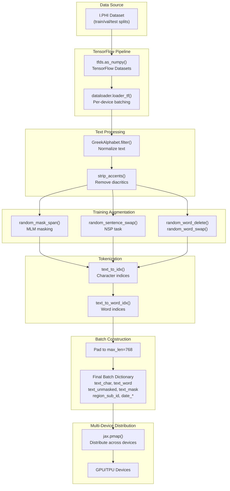

**Sources:** [train/experiment.py:171-196](), [ithaca/util/text.py:1-187]()

## TensorFlow Datasets Integration

The data loading system uses TensorFlow Datasets (TFDS) for efficient I/O and automatic prefetching. The `dataloader.loader_tf()` function creates a TFDS pipeline that reads from the I.PHI dataset files and applies the necessary transformations.

### Data Pipeline Construction

The training data pipeline is constructed in the `_build_train_input()` method:

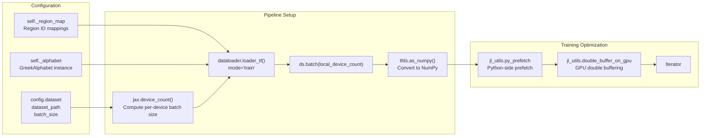

The batch size calculation ensures even distribution across devices:

| Component | Value | Description |
|-----------|-------|-------------|
| `global_batch_size` | From config | Total batch size across all devices |
| `num_devices` | `jax.device_count()` | Number of available GPUs/TPUs |
| `per_device_batch_size` | `global_batch_size // num_devices` | Batch size per device |
| `local_device_count` | `jax.local_device_count()` | Devices on current host |

The pipeline raises a `ValueError` if the global batch size is not divisible by the number of devices, ensuring balanced data distribution.

**Sources:** [train/experiment.py:171-196]()

### Evaluation Pipeline

The evaluation pipeline is similar but simpler, without augmentation or multi-device batching:

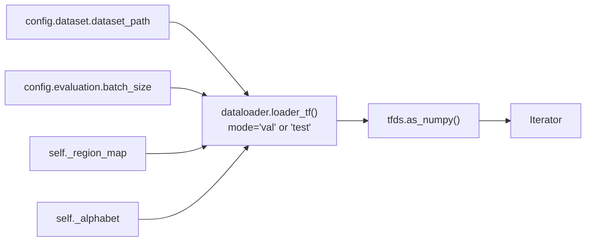

The evaluation mode parameter (`self.config.evaluation.mode`) determines which data split (validation or test) is loaded. The evaluation batch size is typically set to 1 to process each inscription independently.

**Sources:** [train/experiment.py:436-451]()

## Text Processing and Normalization

Before augmentation and tokenization, all text undergoes normalization to ensure consistency in the Greek alphabet representation.

### GreekAlphabet Filtering

The `GreekAlphabet.filter()` method performs several normalization operations:

| Operation | Description | Example |
|-----------|-------------|---------|
| Lowercasing | Convert to lowercase | `Α` → `α` |
| Tonos/Oxia | Unify Greek accent marks | `ά` → `ά` (standardized) |
| Sigma handling | Normalize final sigma | `ς` → `σ` in most positions |
| Diacritic removal | Strip accent marks (optional) | `ά` → `α` |

### Accent Stripping

The `strip_accents()` function removes all combining diacritical marks using Unicode normalization:

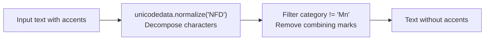

This operation uses Unicode NFD (Canonical Decomposition) to separate base characters from their combining marks, then filters out all marks in the "Mn" (Mark, nonspacing) category.

**Sources:** [ithaca/util/text.py:168-172]()

## Training Augmentation

During training, the pipeline applies three types of augmentation to improve model robustness and enable the multi-task learning objectives.

### Random Mask Span

The `random_mask_span()` function implements span-based masking for the masked language modeling task:

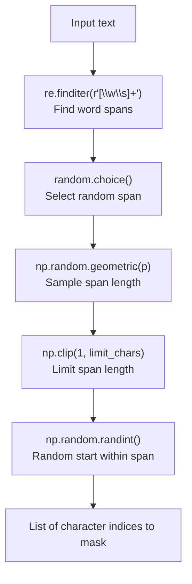

The function uses a geometric distribution to sample the span length, which naturally produces more short spans than long ones. The `geometric_p` parameter (default 0.2) controls this distribution.

**Parameters:**
- `t`: Input text string
- `geometric_p`: Probability parameter for geometric distribution (default 0.2)
- `limit_chars`: Maximum number of characters to mask (optional)

**Returns:** List of character indices to mask

**Sources:** [ithaca/util/text.py:49-86]()

### Random Sentence Swap

The `random_sentence_swap()` function swaps sentences to create training examples for the next sentence prediction (NSP) task:

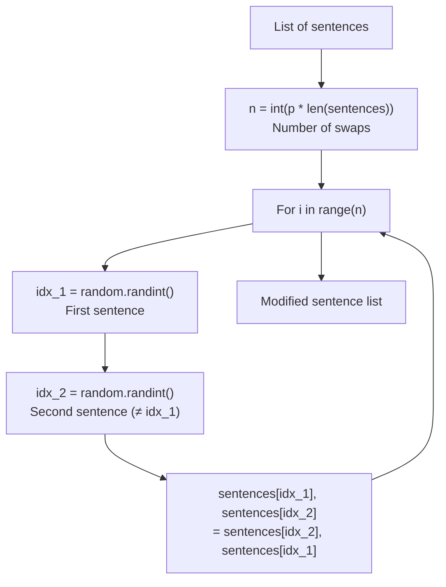

The function attempts up to 3 times to find a different sentence to swap with. If unsuccessful (e.g., only one sentence available), it returns the original list unchanged.

**Parameters:**
- `sentences`: List of sentence strings
- `p`: Probability/proportion of sentences to swap

**Sources:** [ithaca/util/text.py:88-111]()

### Random Word Operations

Two functions provide word-level augmentation for improved robustness:

**`random_word_delete(sentence, p)`**: Randomly deletes words from a sentence with probability `p`. If all words would be deleted, it returns a random word from the original sentence.

**`random_word_swap(sentence, p)`**: Randomly swaps word positions within a sentence. The number of swaps is `int(p * len(words))`.

Both functions:
1. Split the sentence into words using `' '.join()`/`' '.split()`
2. Apply random operations to individual words
3. Reconstruct the sentence

These augmentations help the model handle incomplete or damaged inscriptions during inference.

**Sources:** [ithaca/util/text.py:113-166]()

## Tokenization

After augmentation, text is converted to integer indices using two parallel tokenization schemes: character-level and word-level.

### Character-Level Tokenization

The `text_to_idx()` function converts text to character indices using the `GreekAlphabet` vocabulary:

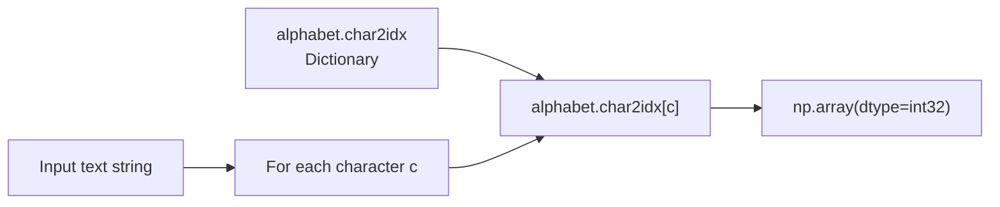

This produces a sequence of integer indices, one per character, suitable for the character-level embedding layer.

### Word-Level Tokenization

The `text_to_word_idx()` function uses regular expressions to identify word boundaries and map words to indices:

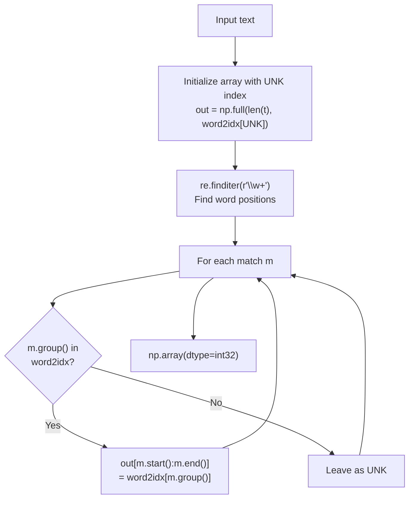

This produces a sequence of word indices aligned with character positions. Each character belonging to a word receives that word's index; non-word characters (spaces, punctuation) receive the unknown token index.

**Sources:** [ithaca/util/text.py:174-186]()

## Batch Construction

The final batches combine multiple data elements required for the multi-task training objectives:

### Batch Dictionary Structure

| Key | Shape | Type | Description |
|-----|-------|------|-------------|
| `text_char` | `[B, T]` | int32 | Character-level token indices |
| `text_word` | `[B, T]` | int32 | Word-level token indices |
| `text_unmasked` | `[B, T]` | int32 | Original character indices (before masking) |
| `text_mask` | `[B, T]` | bool | Mask indicating which positions are masked |
| `next_sentence_mask` | `[B, S]` | bool | Mask for NSP predictions |
| `next_sentence_label` | `[B, S]` | int32 | NSP labels (0=original, 1=swapped) |
| `region_sub_id` | `[B]` | int32 | Subregion ID (0-83) |
| `date_min` | `[B]` | float32 | Minimum date bound (BCE/CE) |
| `date_max` | `[B]` | float32 | Maximum date bound (BCE/CE) |
| `date_dist` | `[B, D]` | float32 | Date distribution (log probabilities) |
| `date_available` | `[B]` | bool | Whether date information is available |
| `id` | `[B]` | string | PHI inscription ID |

Where:
- `B` = batch size
- `T` = sequence length (typically 768)
- `S` = number of sentences
- `D` = number of date bins

### Padding Strategy

All sequences are padded to a fixed length (`max_len`, typically 768 characters) to enable efficient batched processing:

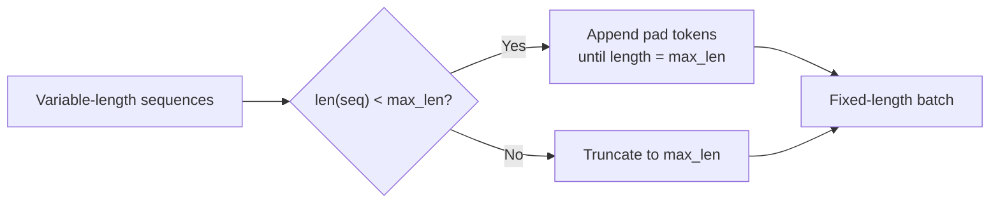

The padding index is `alphabet.pad_idx` (typically 0). The model learns to ignore padded positions through attention masking.

**Sources:** [train/experiment.py:198-333]()

## Multi-Device Data Distribution

For distributed training across multiple GPUs or TPUs, the batch dimension is split using JAX's `pmap` (parallel map):

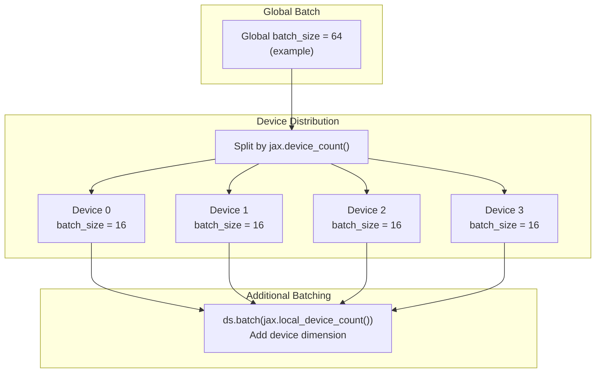

The pipeline performs two batching operations:
1. `dataloader.loader_tf()` batches with `per_device_batch_size`
2. `ds.batch(jax.local_device_count())` adds a device dimension

This produces batches with shape `[num_local_devices, per_device_batch_size, ...]` suitable for `jax.pmap()`.

### Prefetching and Buffering

To minimize device idle time, the pipeline uses two optimization techniques:

**Python-side prefetching** (`jl_utils.py_prefetch`): Prepares the next batch in Python while the current batch is being processed.

**GPU double buffering** (`jl_utils.double_buffer_on_gpu`): Maintains two batches in GPU memory, allowing data transfer to overlap with computation.

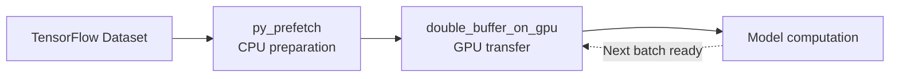

This pipeline achieves near-zero data loading overhead, ensuring GPUs/TPUs remain fully utilized during training.

**Sources:** [train/experiment.py:168-170]()

## Summary

The data loading and augmentation system provides:

1. **Efficient I/O**: TensorFlow Datasets with prefetching and GPU buffering
2. **Text normalization**: Greek alphabet filtering and accent removal
3. **Task-specific augmentation**: Masking for MLM, sentence swapping for NSP, word operations for robustness
4. **Dual tokenization**: Character and word-level representations
5. **Multi-task batch construction**: All labels and metadata in a single batch
6. **Distributed training support**: Automatic batch splitting across devices

The pipeline is configured through `config.dataset` and operates in two modes: `train` (with augmentation) and `val`/`test` (without augmentation). All transformations preserve the original text in `text_unmasked` for loss computation.

**Sources:** [train/experiment.py:1-680](), [ithaca/util/text.py:1-187](), [README.md:116-122]()

---

