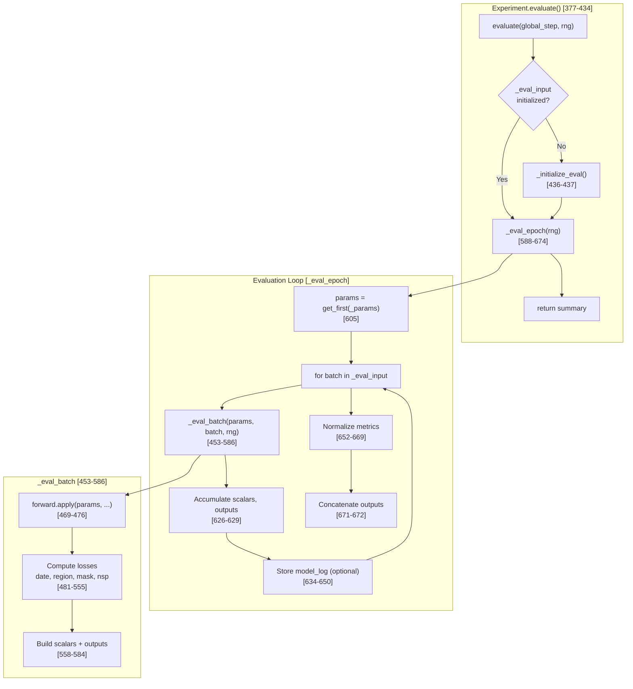
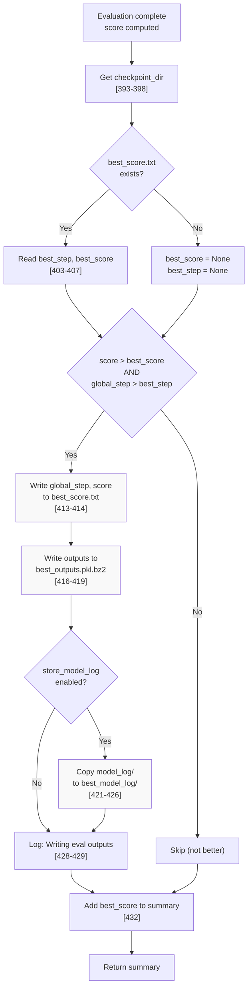
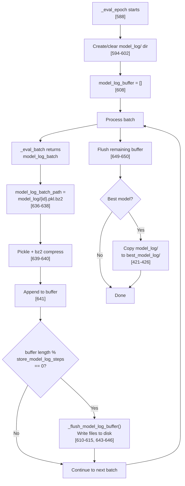

<!-- source: DeepWiki mcp.deepwiki.com · repo google-deepmind/ithaca · page 4.6 Evaluation and Checkpointing · fetched 2026-10-26 -->

# Evaluation and Checkpointing

<details>
<summary>Relevant source files</summary>

The following files were used as context for generating this wiki page:

- [.gitignore](.gitignore)
- [train/experiment.py](train/experiment.py)

</details>


This document describes the evaluation and checkpointing systems used during Ithaca model training. It covers how trained models are periodically evaluated on validation data, how composite scores determine the best model, and how checkpoints and outputs are saved for resumption and deployment.

**Scope**: This page focuses on evaluation during training and checkpoint management. For information about training loops and optimization, see [Training Overview](#4.1). For inference-time evaluation after training, see [Inference System](#5).

---

## Overview

The evaluation and checkpointing system performs three primary functions:

1. **Periodic Evaluation**: Validates model performance on held-out data
2. **Checkpoint Management**: Saves model state for training resumption
3. **Best Model Selection**: Tracks and persists the best-performing model for deployment

The system is implemented in the `Experiment` class [train/experiment.py:50-679]() and integrates with the JAXline platform for distributed training coordination.

**Sources**: [train/experiment.py:50-679]()

---

## Checkpoint Attributes

The `Experiment` class defines which attributes are saved to checkpoints via the `CHECKPOINT_ATTRS` dictionary:

```python
CHECKPOINT_ATTRS = {
    '_params': 'params',
    '_opt_state': 'opt_state',
}
```

These attributes contain:
- **`_params`**: Model parameters (weights, biases, layer normalization parameters)
- **`_opt_state`**: Optimizer state (momentum buffers, variance estimates for Adam)

Both are stored as sharded device arrays distributed across available accelerators. JAXline automatically handles serialization and loading of these checkpointed attributes.

**Note**: The alphabet, region maps, and model configuration are not checkpointed. These must be provided via configuration files when resuming training or performing inference.

**Sources**: [train/experiment.py:56-59]()

---

## Evaluation Workflow



### Evaluation Entry Point

The `evaluate()` method [train/experiment.py:377-434]() is called periodically by JAXline during training. It:

1. **Initializes evaluation input** (once) via `_initialize_eval()` [train/experiment.py:436-437]()
2. **Evaluates full epoch** via `_eval_epoch()` [train/experiment.py:588-674]()
3. **Manages best model tracking** (see [Best Model Selection](#best-model-selection))
4. **Returns summary metrics** for logging

### Batch Evaluation

The `_eval_batch()` method [train/experiment.py:453-586]() processes individual batches:

| Component | Lines | Description |
|-----------|-------|-------------|
| Forward pass | 469-476 | Applies model with `is_training=False` (no dropout) |
| Date loss | 494-515 | L1 loss and KL divergence on date predictions |
| Region loss | 518-523 | Cross-entropy on 84 subregion classifications |
| Mask loss | 526-539 | Cross-entropy on masked character predictions |
| NSP loss | 542-555 | Cross-entropy on next sentence prediction |
| Output construction | 575-584 | Builds dictionaries for logging and analysis |

Unlike training (`_loss_fn` [train/experiment.py:198-333]()), evaluation:
- Uses **no label smoothing** on mask loss [train/experiment.py:529]()
- Uses **cross_entropy_loss** (not label smoothing) for regions [train/experiment.py:520]()
- **Does not scale loss** by device count (no distributed gradient accumulation)
- **Sums losses** across batches for final normalization [train/experiment.py:558-573]()

**Sources**: [train/experiment.py:377-434](), [train/experiment.py:453-586](), [train/experiment.py:588-674]()

---

## Composite Scoring

The evaluation system uses a **composite score** to balance multiple task objectives:

```python
score = mask_accuracy + subregion_accuracy - date_l1_loss * 0.01
```

This formula appears in two places:
- **Per-batch**: [train/experiment.py:559-560]()
- **Epoch aggregation**: [train/experiment.py:665-667]()

### Score Components

| Component | Weight | Range | Interpretation |
|-----------|--------|-------|----------------|
| `mask_accuracy` | +1.0 | [0, 1] | Fraction of correctly restored masked characters |
| `subregion_accuracy` | +1.0 | [0, 1] | Fraction of correctly classified regions |
| `date_l1_loss` | -0.01 | [0, ∞) | Mean absolute error in years (negative contribution) |

### Rationale

The 0.01 weight on `date_l1_loss` scales years to comparable magnitude:
- Perfect region classification: +1.0
- Perfect mask restoration: +1.0
- 100-year date error: -1.0

This balances chronological attribution (continuous regression) with geographical attribution (discrete classification) and text restoration (discrete sequence prediction).

### Metric Normalization

Before computing the final score, individual metrics are normalized [train/experiment.py:652-669]():

```python
summary['loss/date'] /= summary['count/date']         # Per available date
summary['loss/date_l1'] /= summary['count/date']
summary['loss/mask'] /= summary['count/mask']         # Per masked character
summary['accuracy/mask'] /= summary['count/mask']
summary['loss/nsp'] /= summary['count/nsp']           # Per sentence pair
summary['accuracy/nsp'] /= summary['count/nsp']
summary['loss/subregion'] /= total_num_sequences      # Per inscription
summary['accuracy/subregion'] /= total_num_sequences
```

This accounts for variable batch sizes and varying numbers of masked tokens/dates across batches.

**Sources**: [train/experiment.py:559-560](), [train/experiment.py:652-669]()

---

## Best Model Selection



The best model selection logic [train/experiment.py:401-433]() maintains two pieces of persistent state:

### State Files

| File Path | Content | Format |
|-----------|---------|--------|
| `{checkpoint_dir}/best_score.txt` | `{global_step} {best_score}` | Text (two space-separated numbers) |
| `{checkpoint_dir}/best_outputs.pkl.bz2` | Full evaluation outputs | Compressed pickle (protocol 2) |
| `{checkpoint_dir}/best_model_log/` | Per-batch model logs (optional) | Directory of `.pkl.bz2` files |

### Selection Criteria

A new model is saved as "best" if:
1. `best_score.txt` does not exist (first evaluation), **OR**
2. `score > best_score` **AND** `global_step > best_step`

The second condition prevents earlier checkpoints from overwriting better later checkpoints if training is restarted from an earlier step.

### Saved Outputs

When a new best model is detected, the system saves:

**Evaluation Outputs** [train/experiment.py:575-584]():
```python
outputs = {
    'outputs/id': phi_id,                              # PHI inscription IDs
    'outputs/date_pred': date_pred.astype('float16'),  # Date distributions
    'outputs/date_min': date_min,                      # Ground truth min dates
    'outputs/date_max': date_max,                      # Ground truth max dates
    'outputs/date_dist': date_dist.astype('float16'),  # Ground truth distributions
    'outputs/date_available': date_available,          # Date availability mask
    'outputs/subregion_logits': subregion_logits.astype('float16'),  # Region logits
    'outputs/subregion': subregion,                    # Ground truth regions
}
```

These outputs enable post-hoc analysis of model predictions across the entire validation set.

**Sources**: [train/experiment.py:401-433](), [train/experiment.py:575-584]()

---

## Model Logging

The optional model logging feature stores detailed per-batch outputs for analysis. Enable via configuration:

```python
config.evaluation.store_model_log = True
config.evaluation.store_model_log_steps = 10  # Flush buffer every 10 batches
```

### Logging Workflow



### Buffer Management

Model logs are accumulated in memory [train/experiment.py:608]() and flushed periodically [train/experiment.py:643-646]() to balance memory usage and I/O efficiency:

1. **Append to buffer**: After each batch, compress and add to `model_log_buffer`
2. **Periodic flush**: When `len(buffer) % store_model_log_steps == 0`, write all files
3. **Final flush**: After epoch, write any remaining buffered logs

### File Structure

```
{checkpoint_dir}/
├── model_log/              # Current evaluation
│   ├── {inscription_id_1}.pkl.bz2
│   ├── {inscription_id_2}.pkl.bz2
│   └── ...
└── best_model_log/         # Best evaluation (copied)
    ├── {inscription_id_1}.pkl.bz2
    ├── {inscription_id_2}.pkl.bz2
    └── ...
```

Each file is named by the PHI inscription ID [train/experiment.py:636-638]() and contains the `model_log_batch` dictionary from `_eval_batch()`.

**Note**: As of the provided code, `model_log` is initialized as an empty dictionary [train/experiment.py:479]() and not populated. This suggests the feature may be a placeholder for future extensions (e.g., attention weights, intermediate activations).

**Sources**: [train/experiment.py:594-602](), [train/experiment.py:608-650](), [train/experiment.py:421-426]()

---

## Checkpoint Directory Structure

The complete checkpoint directory managed by JAXline contains:

```
{checkpoint_dir}/
├── checkpoint_{step}/         # JAXline-managed checkpoints
│   ├── params                # Model parameters
│   └── opt_state             # Optimizer state
├── best_score.txt            # Best score tracking
├── best_outputs.pkl.bz2      # Best model outputs
├── model_log/                # Current evaluation logs (optional)
│   └── *.pkl.bz2
└── best_model_log/           # Best evaluation logs (optional)
    └── *.pkl.bz2
```

### JAXline Integration

The `Experiment` class inherits from `jaxline.experiment.AbstractExperiment` [train/experiment.py:50]() which provides:
- **Automatic checkpoint saving**: Periodic saves during training
- **Checkpoint restoration**: Load `_params` and `_opt_state` when resuming
- **Distributed coordination**: Synchronizes checkpoints across devices/hosts

The `CHECKPOINT_ATTRS` dictionary [train/experiment.py:56-59]() tells JAXline which attributes to save and under what names in the checkpoint files.

**Sources**: [train/experiment.py:50-59](), [train/experiment.py:393-399]()

---

## Evaluation Configuration

Evaluation behavior is controlled through the experiment configuration:

| Configuration Path | Type | Description |
|-------------------|------|-------------|
| `config.evaluation.batch_size` | int | Batch size for evaluation (typically 1) |
| `config.evaluation.mode` | str | Dataset split: 'val', 'test' |
| `config.evaluation.use_jit` | bool | Whether to JIT-compile `_eval_batch` |
| `config.evaluation.store_model_log` | bool | Enable per-batch model logging |
| `config.evaluation.store_model_log_steps` | int | Flush buffer every N batches |

The evaluation input pipeline [train/experiment.py:439-451]() uses the same `dataloader.loader_tf()` as training but with:
- **Different split**: Controlled by `config.evaluation.mode`
- **No augmentation**: Text masking, sentence swap, etc. are disabled for evaluation
- **Single-device batching**: No need for `pmap` distribution

**Sources**: [train/experiment.py:92-93](), [train/experiment.py:439-451](), [train/experiment.py:598-602](), [train/experiment.py:644-645]()

---

## Relationship to Inference

The evaluation system differs from inference [ithaca/eval/inference.py]() in several ways:

| Aspect | Evaluation (Training) | Inference (Deployment) |
|--------|----------------------|------------------------|
| **Purpose** | Measure model performance | Generate predictions for new texts |
| **Mode** | Periodic during training | On-demand after training |
| **Dependencies** | JAXline, TensorFlow Datasets | Minimal (JAX, Flax, model only) |
| **Checkpoints** | Managed by JAXline platform | Loaded from `.pkl` file |
| **Outputs** | Aggregated metrics, compressed pickles | `AttributionResults`, `RestorationResults` |
| **Features** | Composite scoring, best model tracking | Beam search, saliency maps |

The checkpoint format differs between training and inference:
- **Training checkpoints**: JAXline format with `params` and `opt_state` separate
- **Inference checkpoints**: Single `.pkl` file with model config, params, alphabet, regions

For converting training checkpoints to inference format, see [Inference Overview](#5.1).

**Sources**: [train/experiment.py](), [.gitignore:7]()

---

## Summary

The evaluation and checkpointing system provides:

1. **Periodic Validation**: Regular evaluation during training via `evaluate()` method
2. **Multi-Task Scoring**: Composite metric balancing restoration, attribution, and dating
3. **Best Model Tracking**: Automatic selection and persistence of best-performing checkpoint
4. **Output Persistence**: Compressed storage of predictions for post-hoc analysis
5. **Optional Logging**: Detailed per-batch model logs for debugging

This infrastructure ensures that the best model is automatically identified and saved for downstream deployment, while comprehensive outputs enable detailed error analysis and model understanding.

**Sources**: [train/experiment.py:50-679]()

---

