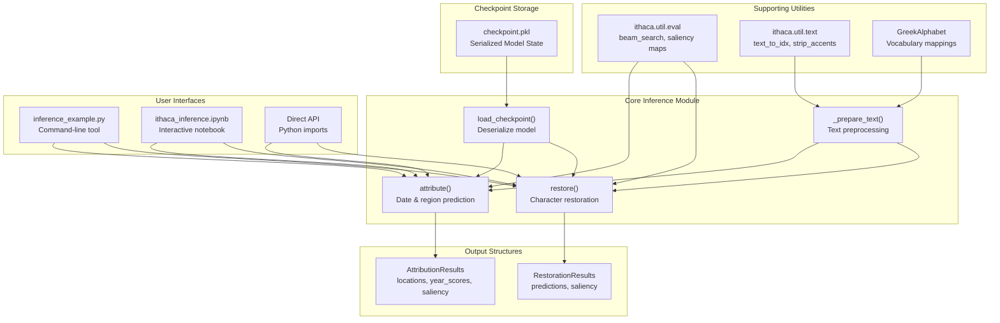
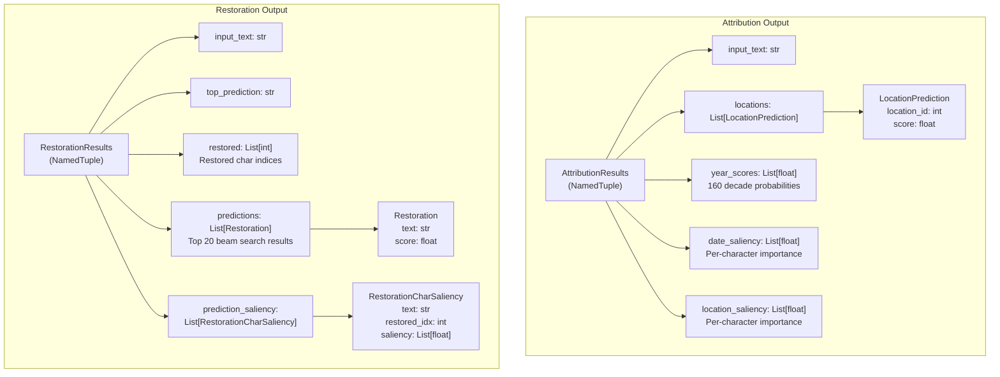
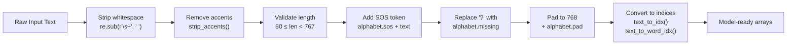
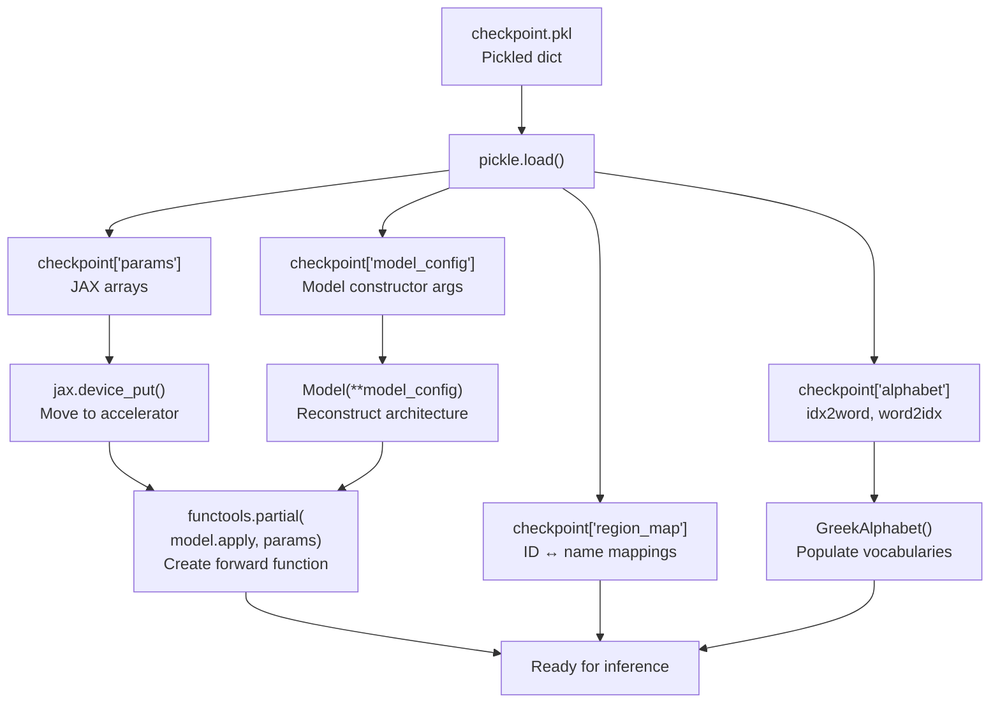
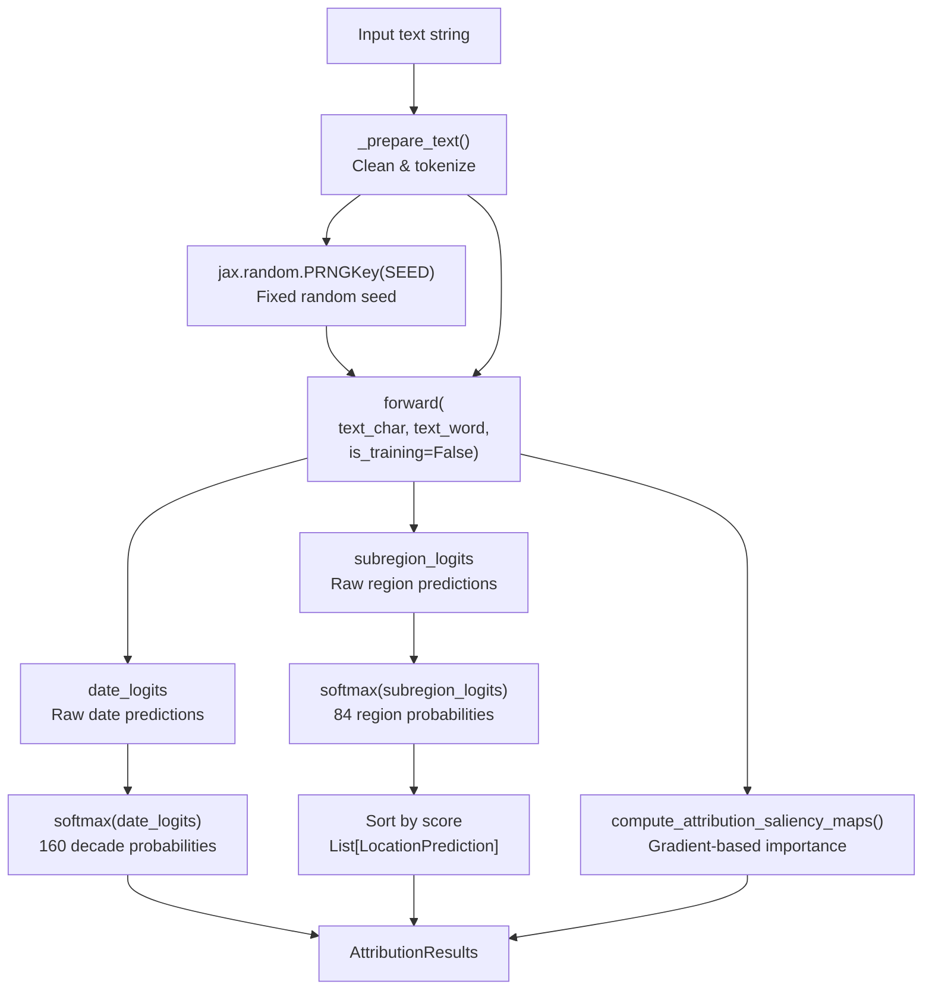
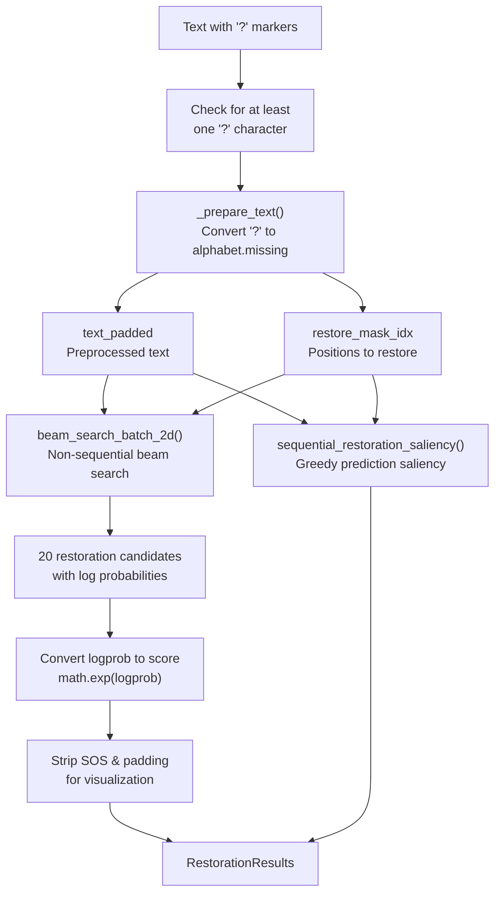
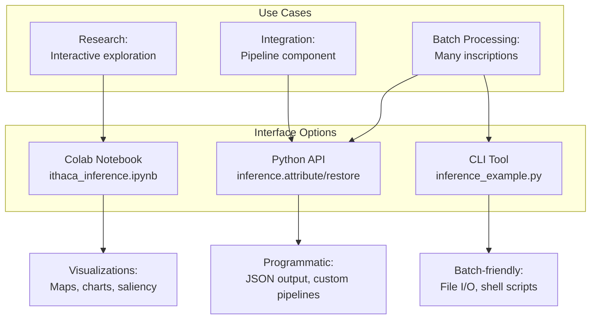

<!-- source: DeepWiki mcp.deepwiki.com · repo google-deepmind/ithaca · page 5 Inference System · fetched 2026-10-26 -->

# Inference System

<details>
<summary>Relevant source files</summary>

The following files were used as context for generating this wiki page:

- [colabs/ithaca_inference.ipynb](colabs/ithaca_inference.ipynb)
- [inference_example.py](inference_example.py)
- [ithaca/eval/inference.py](ithaca/eval/inference.py)

</details>


This document describes the Ithaca inference system, which uses trained models to perform two tasks on ancient Greek inscriptions: **attribution** (predicting date and geographical origin) and **restoration** (filling in missing characters). The inference system is designed to be lightweight and deployable without training infrastructure dependencies.

For information about training models, see [Training System](#4). For details about the model architecture, see [Model Architecture](#3).

## Overview

The inference system provides a clean separation between model deployment and training. It operates on pre-trained model checkpoints and exposes functionality through three interfaces:

**Sources:** [ithaca/eval/inference.py:1-269](), [inference_example.py:1-130](), [colabs/ithaca_inference.ipynb:1-100]()

### System Architecture



**Sources:** [ithaca/eval/inference.py:14-21](), [inference_example.py:40-74]()

## Core Components

### Entry Points

The inference module provides two main functions in `ithaca.eval.inference`:

| Function | Purpose | Input | Output |
|----------|---------|-------|--------|
| `attribute()` | Predict date and geographical origin | Text string | `AttributionResults` |
| `restore()` | Fill missing characters (marked with `?`) | Text with `?` placeholders | `RestorationResults` |

Both functions require a `forward` callable, which is the model's apply function bound to trained parameters.

**Sources:** [ithaca/eval/inference.py:186-224](), [ithaca/eval/inference.py:226-268]()

### Key Constants

[ithaca/eval/inference.py:130-140]() defines critical inference parameters:

| Constant | Value | Purpose |
|----------|-------|---------|
| `MIN_TEXT_LEN` | 50 | Minimum input text length |
| `TEXT_LEN` | 768 | Fixed model sequence length |
| `DATE_MIN` | -800 | Earliest year (800 BCE) |
| `DATE_MAX` | 800 | Latest year (800 CE) |
| `DATE_INTERVAL` | 10 | Date binning interval (decades) |
| `RESTORATION_BEAM_WIDTH` | 20 | Number of beam search candidates |
| `ALPHABET_MISSING_RESTORE` | `'?'` | Character marking restoration target |

**Sources:** [ithaca/eval/inference.py:130-140]()

### Data Structures



**Sources:** [ithaca/eval/inference.py:35-128]()

## Text Preprocessing

The `_prepare_text()` function [ithaca/eval/inference.py:142-183]() performs critical input preparation:

### Preprocessing Pipeline



The function returns an 8-tuple:
1. `text` - Cleaned text (no SOS/padding)
2. `text_sos` - With start-of-sequence token
3. `text_padded` - Padded to `TEXT_LEN`
4. `text_char` - Character indices (shape: 1 × 768)
5. `text_word` - Word indices (shape: 1 × 768)
6. `text_len` - Actual text length (list of 1 element)
7. `padding` - Binary mask (1 for real tokens, 0 for padding)
8. `restore_mask_idx` - Indices of `?` characters to restore

**Sources:** [ithaca/eval/inference.py:142-183](), [ithaca/util/text.py]()

## Checkpoint Loading

The `load_checkpoint()` function in [inference_example.py:40-73]() demonstrates how to deserialize a trained model:



The checkpoint contains:
- `params`: Trained model parameters (JAX pytrees)
- `model_config`: Dictionary of model hyperparameters
- `alphabet`: Vocabulary mappings (`idx2word`, `word2idx`)
- `region_map`: Geographical region metadata

**Sources:** [inference_example.py:40-73]()

## Attribution

The `attribute()` function [ithaca/eval/inference.py:186-224]() predicts when and where an inscription was written.

### Attribution Flow



### Date Predictions

The model outputs 160 values representing probability distribution over decades from 800 BCE to 800 CE:

- Index 0: 800-790 BCE
- Index 1: 790-780 BCE
- ...
- Index 159: 790-800 CE

The `year_scores` field contains these probabilities after softmax normalization.

### Region Predictions

The model classifies among 84 ancient world subregions. The `locations` field contains `LocationPrediction` objects sorted by decreasing probability:

```python
LocationPrediction(location_id=42, score=0.723)  # Highest probability
LocationPrediction(location_id=15, score=0.134)  # Second highest
...
```

Region IDs map to names via `region_map['sub']['ids_inv']` and `region_map['sub']['names_inv']`.

**Sources:** [ithaca/eval/inference.py:186-224](), [colabs/ithaca_inference.ipynb:291-292]()

## Restoration

The `restore()` function [ithaca/eval/inference.py:226-268]() fills in missing characters marked with `?` in the input text.

### Restoration Flow



### Non-Sequential Beam Search

The restoration uses **non-sequential beam search** [ithaca/util/eval.py]() which:

1. Starts with highest-confidence character prediction
2. Iteratively fills in remaining `?` positions by confidence
3. Maintains top-k hypotheses at each step
4. Returns 20 final candidates ranked by joint probability

This differs from left-to-right sequential generation, allowing the model to first predict characters it is most confident about.

### Restoration Output

The `predictions` field contains 20 `Restoration` objects:

```python
Restoration(text="εδοξεν τηι βουληι...", score=0.661)  # Top hypothesis
Restoration(text="εδοξεν τηι βουληι...", score=0.001)  # Alternative
...
```

Scores sum to approximately 1.0 across all candidates (normalized probabilities).

**Sources:** [ithaca/eval/inference.py:226-268](), [colabs/ithaca_inference.ipynb:425-557]()

## Saliency Maps

Both `attribute()` and `restore()` compute **saliency maps** - per-character importance scores showing which input characters most influenced each prediction.

### Attribution Saliency

[ithaca/eval/inference.py:213-215]() computes two saliency maps via `compute_attribution_saliency_maps()`:

- `date_saliency`: Which characters influenced date prediction
- `location_saliency`: Which characters influenced region prediction

Each is a list of floats (length = input text length), with values in [0, 1] representing relative importance.

### Restoration Saliency

[ithaca/eval/inference.py:255-257]() computes saliency for each restored character via `sequential_restoration_saliency()`. The `prediction_saliency` field contains one `RestorationCharSaliency` entry per restored position, showing which input characters influenced that specific character prediction.

### Visualization

The Colab notebook [colabs/ithaca_inference.ipynb:302-339]() provides visualization helpers:

```python
def generate_saliency(text, saliency, snippet=False):
    """Generates HTML with background color intensity proportional to saliency."""
    snippet_html = SALIENCY_SNIPPET_TEMPLATE.render(
        pairs=list(zip(text, saliency)))
    # Purple shading: rgba(171,71,188, score)
```

Higher saliency scores result in darker purple highlighting.

**Sources:** [ithaca/eval/inference.py:213-223](), [ithaca/eval/inference.py:255-257](), [colabs/ithaca_inference.ipynb:302-339]()

## User Interfaces

### Programmatic API

Direct Python imports for custom applications:

```python
from ithaca.eval import inference
from ithaca.models.model import Model
from ithaca.util.alphabet import GreekAlphabet

# Load checkpoint (see load_checkpoint example above)
# ...

# Attribution
attribution_results = inference.attribute(
    text=input_text,
    forward=forward,
    params=params,
    alphabet=alphabet,
    region_map=region_map,
    vocab_char_size=vocab_char_size,
    vocab_word_size=vocab_word_size
)

# Restoration
restoration_results = inference.restore(
    text=input_text,
    forward=forward,
    params=params,
    alphabet=alphabet,
    vocab_char_size=vocab_char_size,
    vocab_word_size=vocab_word_size
)
```

**Sources:** [ithaca/eval/inference.py:186-268]()

### Command-Line Interface

[inference_example.py:1-130]() provides a CLI tool:

```bash
# Direct text input
python inference_example.py \
    --input="εδοξεν τηι βουληι..." \
    --checkpoint_path=checkpoint.pkl \
    --attribute_json=attribution.json \
    --restore_json=restoration.json

# File input
python inference_example.py \
    --input_file=inscription.txt \
    --checkpoint_path=checkpoint.pkl
```

**Command-line Flags:**

| Flag | Required | Default | Description |
|------|----------|---------|-------------|
| `--input` | One of input/input_file | - | Direct text string |
| `--input_file` | One of input/input_file | - | Path to text file |
| `--checkpoint_path` | No | `checkpoint.pkl` | Checkpoint location |
| `--attribute_json` | No | - | Save attribution JSON to path |
| `--restore_json` | No | - | Save restoration JSON to path |

If JSON paths are not specified, results print to stdout.

**Sources:** [inference_example.py:28-126]()

### Interactive Notebook

[colabs/ithaca_inference.ipynb:1-1500]() provides a Google Colab notebook with:

1. **Setup cells**: Install dependencies and download checkpoint
2. **Input cell**: Text input field (50-750 characters)
3. **Restoration section**: 
   - Top-20 hypotheses table (scrollable)
   - Per-character saliency visualization
4. **Attribution section**:
   - Bar chart of top-10 regions
   - Interactive map with folium
   - Date distribution plot (800 BCE - 800 CE)
   - Date and location saliency maps

The notebook includes helper functions:

```python
def get_subregion_name(id, region_map):
    """Maps region ID to human-readable name."""
    
def bce_ad(d):
    """Formats year as '430 BCE' or '120 AD'."""
    
def generate_saliency(text, saliency, snippet=False):
    """Generates HTML saliency visualization."""
```

**Input Conventions:**
- `-` (dash): Missing characters to skip (not predicted)
- `?` (question mark): Missing characters to predict
- Text length: 50-750 characters

**Sources:** [colabs/ithaca_inference.ipynb:20-1500]()

## Interface Comparison



| Interface | Best For | Pros | Cons |
|-----------|----------|------|------|
| Colab Notebook | Exploratory research | Rich visualizations, interactive | Manual, one-at-a-time |
| Python API | Custom applications | Full control, embeddable | Requires Python integration |
| CLI | Batch processing | Shell scriptable, I/O redirection | Limited visualization |

**Sources:** [colabs/ithaca_inference.ipynb:104-136](), [inference_example.py:76-126](), [ithaca/eval/inference.py:14-21]()

## JSON Output Format

Both `AttributionResults` and `RestorationResults` provide `.json()` methods [ithaca/eval/inference.py:72-73](), [ithaca/eval/inference.py:126-127]() for serialization:

### Attribution JSON

```json
{
  "input_text": "εδοξεν τηι βουληι...",
  "locations": [
    {"location_id": 42, "score": 0.723},
    {"location_id": 15, "score": 0.134}
  ],
  "year_scores": [0.001, 0.002, ..., 0.018],
  "date_saliency": [0.12, 0.45, ..., 0.03],
  "location_saliency": [0.08, 0.52, ..., 0.11]
}
```

### Restoration JSON

```json
{
  "input_text": "εδοξεν τηι ?????...",
  "top_prediction": "εδοξεν τηι βουληι...",
  "restored": [11, 12, 13, 14, 15],
  "predictions": [
    {"text": "εδοξεν τηι βουληι...", "score": 0.661},
    {"text": "εδοξεν τηι βουλης...", "score": 0.001}
  ],
  "prediction_saliency": [
    {
      "text": "εδοξεν τηι β????...",
      "restored_idx": 11,
      "saliency": [0.12, 0.03, ...]
    }
  ]
}
```

**Sources:** [ithaca/eval/inference.py:63-73](), [ithaca/eval/inference.py:112-127]()

## Error Handling

The inference system validates inputs and raises clear errors:

| Condition | Exception | Message |
|-----------|-----------|---------|
| Text too short | `ValueError` | "Input text too short." (< 50 chars) |
| Text too long | `ValueError` | "Input text too long." (≥ 767 chars) |
| No `?` in restore | `ValueError` | "At least one character must be missing." |
| Missing checkpoint | `FileNotFoundError` | Standard Python file error |

**Sources:** [ithaca/eval/inference.py:162-166](), [ithaca/eval/inference.py:230-231](), [inference_example.py:88-91]()

---

