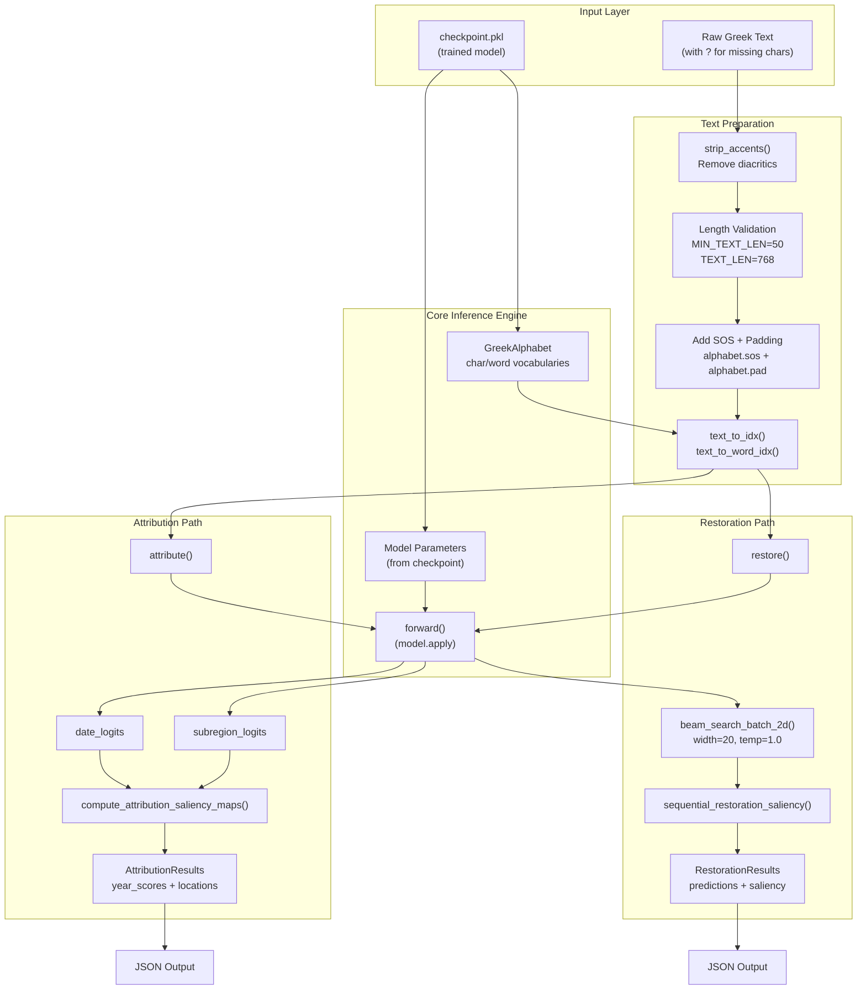
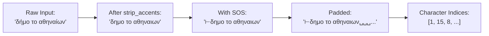
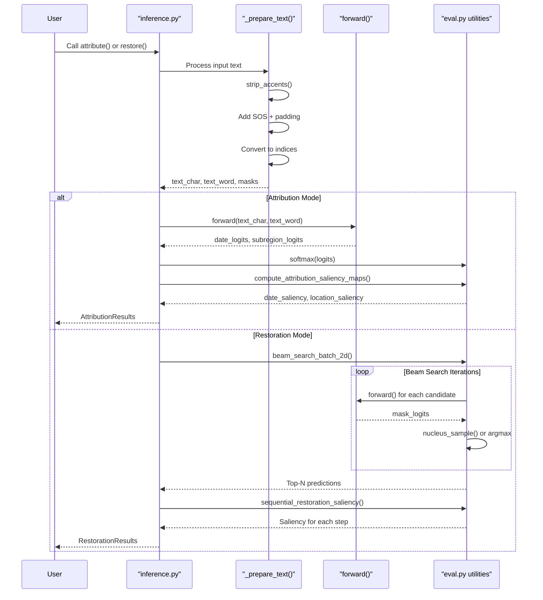

<!-- source: DeepWiki mcp.deepwiki.com · repo google-deepmind/ithaca · page 5.1 Inference Overview · fetched 2026-10-26 -->

# Inference Overview

<details>
<summary>Relevant source files</summary>

The following files were used as context for generating this wiki page:

- [README.md](README.md)
- [ithaca/eval/inference.py](ithaca/eval/inference.py)

</details>


This document provides a high-level overview of the Ithaca inference system, which enables predictions on ancient Greek inscriptions using trained models. Inference encompasses two primary capabilities: **attribution** (predicting date and geographical origin) and **restoration** (reconstructing missing characters).

For detailed documentation of individual inference functions, see [Attribution](#5.2) and [Restoration](#5.3). For information on model interpretability features, see [Saliency Maps and Interpretability](#5.4).

---

## Purpose and Scope

The inference system allows users to apply trained Ithaca models to new ancient Greek text without requiring training infrastructure or dependencies. The system is designed to be lightweight, requiring only the core model architecture and a pre-trained checkpoint file.

Inference operates in two distinct modes:

| Mode | Purpose | Primary Function | Output Type |
|------|---------|------------------|-------------|
| **Attribution** | Predict when and where an inscription was written | `attribute()` | `AttributionResults` |
| **Restoration** | Fill in missing or damaged characters | `restore()` | `RestorationResults` |

**Sources:** [ithaca/eval/inference.py:14-21](), [README.md:67-114]()

---

## System Architecture

The following diagram illustrates the high-level inference workflow, showing how components interact from checkpoint loading to prediction output:



**Key Components:**

- **`_prepare_text()`** [ithaca/eval/inference.py:142-183](): Normalizes input text, adds sequence markers, converts to model-compatible indices
- **`forward()`**: Model application function, typically created as `functools.partial(model.apply, params)`
- **`attribute()`** [ithaca/eval/inference.py:186-223](): Entry point for date/region prediction
- **`restore()`** [ithaca/eval/inference.py:226-268](): Entry point for text restoration with beam search

**Sources:** [ithaca/eval/inference.py:14-21](), [ithaca/eval/inference.py:142-183](), [ithaca/eval/inference.py:186-268]()

---

## Input Requirements and Constraints

The inference system enforces specific constraints on input text to ensure compatibility with the model architecture:

### Text Length Requirements

```python
MIN_TEXT_LEN = 50      # Minimum characters (excluding SOS/padding)
TEXT_LEN = 768         # Fixed sequence length after padding
```

Input text must satisfy: `50 ≤ len(text) < 767` (accounting for start-of-sequence symbol).

**Sources:** [ithaca/eval/inference.py:131-132]()

### Text Normalization

The `_prepare_text()` function applies the following transformations:

1. **Whitespace normalization**: Collapse multiple spaces to single space
2. **Accent stripping**: Remove diacritical marks using `strip_accents()`
3. **Missing character markers**: Convert `?` to `alphabet.missing` for restoration
4. **Padding**: Append `alphabet.pad` characters to reach `TEXT_LEN`



**Sources:** [ithaca/eval/inference.py:142-183](), [ithaca/eval/inference.py:159-160]()

### Restoration-Specific Requirements

For restoration mode, input text must contain at least one `?` character indicating missing text. The system identifies all positions marked with `?` and uses beam search to predict plausible character sequences.

```python
ALPHABET_MISSING_RESTORE = '?'  # User-facing missing character marker
restore_mask_idx = [i for i, c in enumerate(text_padded) 
                    if c == ALPHABET_MISSING_RESTORE]
```

**Sources:** [ithaca/eval/inference.py:139](), [ithaca/eval/inference.py:173-176](), [ithaca/eval/inference.py:230-231]()

---

## Output Data Structures

The inference system uses strongly-typed `NamedTuple` structures to return results, ensuring consistent interfaces and enabling JSON serialization.

### AttributionResults Structure

```python
class AttributionResults(NamedTuple):
    input_text: str                       # Original input (no SOS/padding)
    locations: List[LocationPrediction]   # Sorted by score, descending
    year_scores: List[float]              # 160 probabilities (decades -800 to 800)
    date_saliency: List[float]            # Per-character influence on date
    location_saliency: List[float]        # Per-character influence on region
```

Each `LocationPrediction` contains:
- `location_id` (int): Region identifier from `region_map['sub']['ids']`
- `score` (float): Softmax probability for that region

**Sources:** [ithaca/eval/inference.py:48-73](), [ithaca/eval/inference.py:35-45]()

### RestorationResults Structure

```python
class RestorationResults(NamedTuple):
    input_text: str                                # Original input with ? markers
    top_prediction: str                            # Best beam search result
    restored: List[int]                            # Indices of restored characters
    predictions: List[Restoration]                 # Top-N beam search candidates
    prediction_saliency: List[RestorationCharSaliency]  # Saliency for each restored char
```

Each `Restoration` candidate contains:
- `text` (str): Full restored text
- `score` (float): Exponential of log probability (higher is better)

**Sources:** [ithaca/eval/inference.py:99-127](), [ithaca/eval/inference.py:76-82]()

### JSON Serialization

Both result types provide `.json()` and `.build_json()` methods for serialization:

```python
results = attribute(text, forward, params, alphabet, vocab_char_size, 
                    vocab_word_size, region_map)
json_output = results.json(indent=2)  # Pretty-printed JSON string
```

**Sources:** [ithaca/eval/inference.py:63-73](), [ithaca/eval/inference.py:112-127]()

---

## Inference Modes Comparison

The following table contrasts the two primary inference modes:

| Aspect | Attribution | Restoration |
|--------|-------------|-------------|
| **Primary Function** | `attribute()` | `restore()` |
| **Model Outputs Used** | `date_logits`, `subregion_logits` | `mask_logits` (via beam search) |
| **Search Strategy** | Single forward pass | Beam search (width=20) |
| **Computational Cost** | Low (one pass + gradient computation) | High (multiple forward passes) |
| **Saliency Computation** | `compute_attribution_saliency_maps()` | `sequential_restoration_saliency()` |
| **Output Structure** | `AttributionResults` | `RestorationResults` |
| **Typical Use Case** | Dating/locating inscriptions | Filling damaged text |
| **Input Requirement** | Any valid Greek text | Must contain `?` characters |

**Sources:** [ithaca/eval/inference.py:186-223](), [ithaca/eval/inference.py:226-268]()

---

## Model Forward Function

Both inference modes require a `forward` function that wraps the model's `apply` method with fixed parameters. This function signature is central to the inference API:

```python
def forward(text_char, text_word, rngs, is_training):
    """
    Args:
        text_char: Character indices, shape (batch_size, TEXT_LEN)
        text_word: Word indices, shape (batch_size, TEXT_LEN)
        rngs: Dictionary with 'dropout' key for RNG
        is_training: Boolean, always False for inference
    
    Returns:
        (date_logits, subregion_logits, mask_logits, nsp_logits)
    """
    pass
```

The function is typically constructed using `functools.partial`:

```python
forward = functools.partial(model.apply, params)
```

During inference, `is_training=False` disables dropout and other training-specific behaviors.

**Sources:** [ithaca/eval/inference.py:18-20](), [ithaca/eval/inference.py:193-198]()

---

## Execution Flow Diagram

The following diagram maps the complete execution flow from user input to output for both inference modes:



**Sources:** [ithaca/eval/inference.py:186-268](), [ithaca/eval/inference.py:142-183]()

---

## Configuration Constants

The inference module defines several fixed constants that determine model behavior:

```python
MIN_TEXT_LEN = 50                    # Minimum input length
TEXT_LEN = 768                       # Fixed sequence length
DATE_MIN = -800                      # Earliest year BCE
DATE_MAX = 800                       # Latest year CE
DATE_INTERVAL = 10                   # Decade intervals
RESTORATION_BEAM_WIDTH = 20          # Beam search width
RESTORATION_TEMPERATURE = 1.0        # Sampling temperature
SEED = 1                            # Random seed for reproducibility
ALPHABET_MISSING_RESTORE = '?'       # User-facing missing char marker
```

These constants match the training configuration and cannot be changed without retraining the model.

**Sources:** [ithaca/eval/inference.py:131-139]()

---

## Integration Points

The inference system integrates with multiple utility modules:

| Module | Functions Used | Purpose |
|--------|----------------|---------|
| `ithaca.util.text` | `strip_accents()`, `text_to_idx()`, `text_to_word_idx()` | Text normalization and tokenization |
| `ithaca.util.eval` | `softmax()`, `beam_search_batch_2d()`, `compute_attribution_saliency_maps()`, `sequential_restoration_saliency()` | Prediction decoding and interpretability |
| `ithaca.util.alphabet` | `GreekAlphabet` class | Character/word vocabularies and special tokens |
| JAX | `jax.random.PRNGKey()` | Deterministic random number generation |
| NumPy | Array operations | Batch construction and result processing |

**Sources:** [ithaca/eval/inference.py:28-32]()

---

## Usage Interfaces

The inference system provides three user interfaces, all of which ultimately call `attribute()` and `restore()`:

### Programmatic API

Direct function calls for integration into Python applications:

```python
from ithaca.eval.inference import attribute, restore

# Attribution
results = attribute(text, forward, params, alphabet, 
                   vocab_char_size, vocab_word_size, region_map)

# Restoration  
results = restore(text, forward, params, alphabet,
                 vocab_char_size, vocab_word_size)
```

**Sources:** [ithaca/eval/inference.py:186-268]()

### Command-Line Interface

The `inference_example.py` script provides a CLI wrapper:

```bash
python inference_example.py --input="δημο το αθηναιων" \
    --attribute_json=output.json
```

**Sources:** [README.md:89-114]()

### Interactive Notebook

The Colab notebook `ithaca_inference.ipynb` provides a GUI with visualization:

- Interactive text input widgets
- Real-time prediction display
- Saliency map visualizations
- Region map overlays

**Sources:** [README.md:67-72]()

---

## Performance Characteristics

| Operation | Computational Cost | Typical Duration |
|-----------|-------------------|------------------|
| Text preparation | O(n) where n=text length | < 1ms |
| Single forward pass | O(n²) attention (sparse via BigBird) | 10-50ms |
| Attribution | 1 forward + gradient computation | 50-200ms |
| Restoration (20-width beam) | 20 × num_missing × forward passes | 1-10s |
| Saliency computation | O(n) × forward passes | 100-500ms per character |

Beam search dominates restoration time, scaling linearly with the number of missing characters and beam width.

**Sources:** [ithaca/eval/inference.py:136](), [ithaca/eval/inference.py:236-243]()

---

## Error Handling

The inference functions validate inputs and raise descriptive errors:

```python
# Text too short
if len(text) < MIN_TEXT_LEN:
    raise ValueError('Input text too short.')

# Text too long (accounting for SOS)
if len(text) >= TEXT_LEN - 1:
    raise ValueError('Input text too long.')

# No missing characters for restoration
if ALPHABET_MISSING_RESTORE not in text:
    raise ValueError('At least one character must be missing.')
```

These checks occur in `_prepare_text()` and at the entry points of `restore()`.

**Sources:** [ithaca/eval/inference.py:162-166](), [ithaca/eval/inference.py:230-231]()

---

