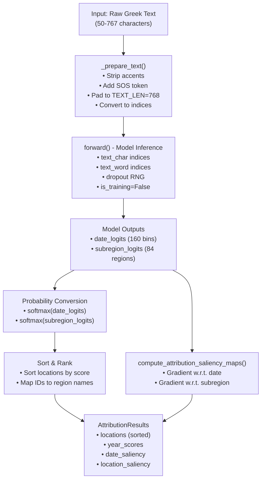
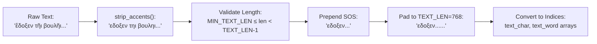
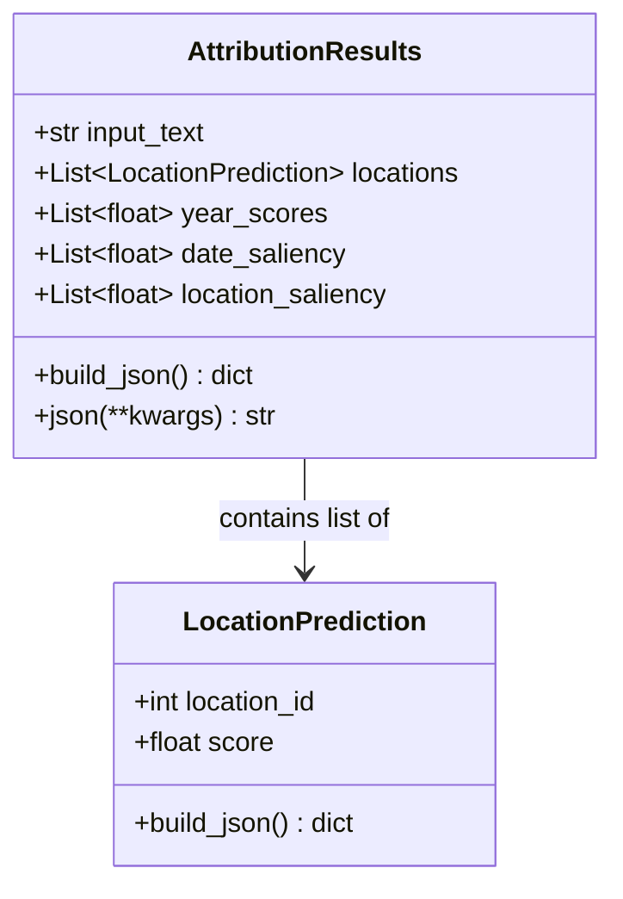
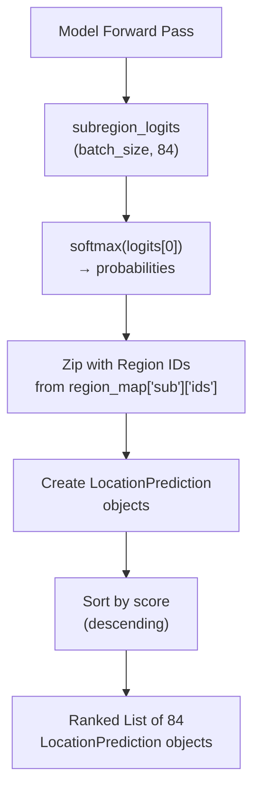
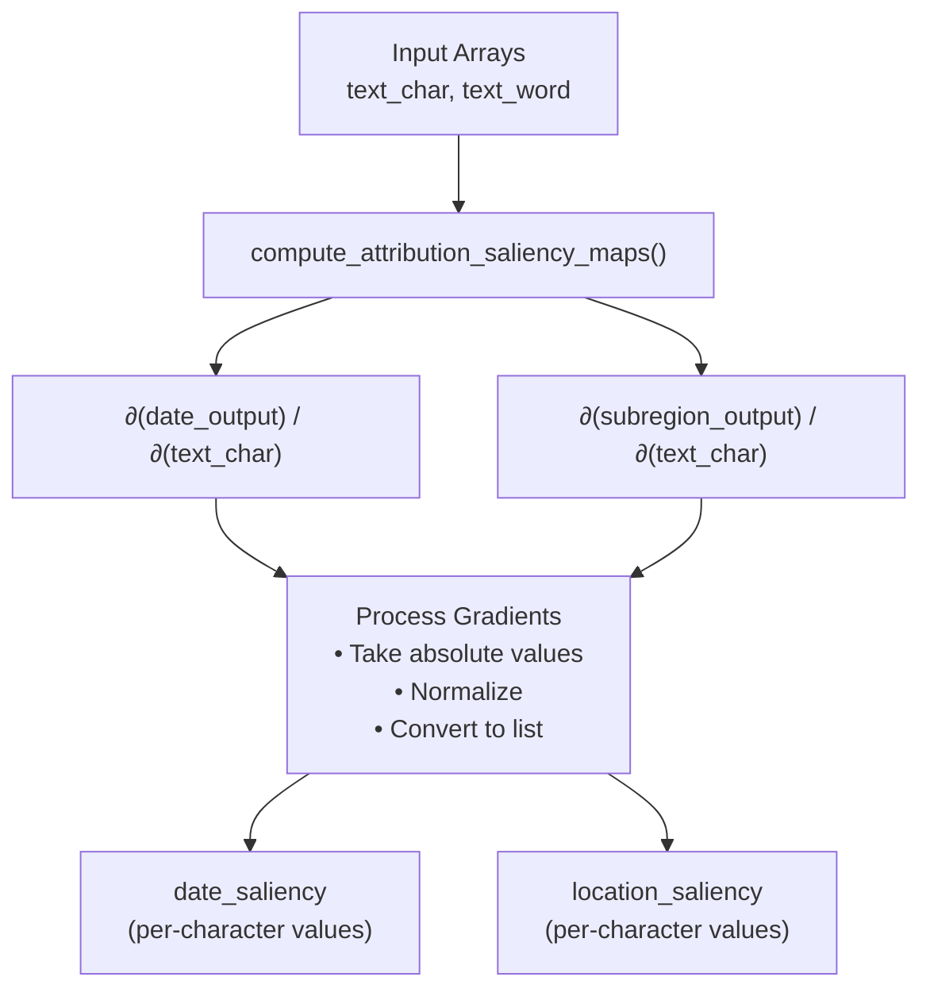
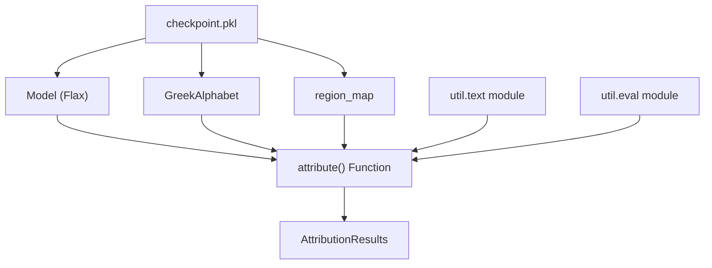

<!-- source: DeepWiki mcp.deepwiki.com · repo google-deepmind/ithaca · page 5.2 Attribution · fetched 2026-10-26 -->

# Attribution

<details>
<summary>Relevant source files</summary>

The following files were used as context for generating this wiki page:

- [colabs/ithaca_inference.ipynb](colabs/ithaca_inference.ipynb)
- [ithaca/eval/inference.py](ithaca/eval/inference.py)

</details>


## Purpose and Scope

This page documents the attribution functionality in Ithaca's inference system. Attribution predicts the **geographical origin** (among 84 ancient regions) and **chronological date** (decade-level predictions from 800 BCE to 800 CE) of ancient Greek inscriptions based on their textual content.

For information about text restoration (predicting missing characters), see [Restoration](#5.3). For details on the interpretability mechanisms used here, see [Saliency Maps and Interpretability](#5.4).

**Sources:** [ithaca/eval/inference.py:186-224]()

---

## Overview

Attribution in Ithaca is a multi-task prediction problem where the model simultaneously predicts:

1. **Geographical attribution**: Probability distribution over 84 subregions of the ancient world
2. **Chronological attribution**: Probability distribution over 160 decades (10-year intervals from 800 BCE to 800 CE)
3. **Interpretability**: Saliency maps showing which input characters influenced each prediction

The attribution system is exposed through the `attribute()` function, which takes preprocessed text and a trained model, then returns structured predictions with confidence scores.

**Sources:** [ithaca/eval/inference.py:186-224](), [colabs/ithaca_inference.ipynb:188-194]()

---

## Attribution Workflow



**Diagram: Attribution Workflow from Input to Output**

**Sources:** [ithaca/eval/inference.py:186-224]()

---

## Function Signature and Parameters

### `attribute()` Function

```python
def attribute(text, forward, params, alphabet, vocab_char_size, vocab_word_size,
              region_map) -> AttributionResults
```

| Parameter | Type | Description |
|-----------|------|-------------|
| `text` | `str` | Raw input text (50-767 characters) with no special preprocessing |
| `forward` | `Callable` | JAX function created with `functools.partial(Model.apply, params)` |
| `params` | `dict` | Model parameters from checkpoint |
| `alphabet` | `GreekAlphabet` | Vocabulary object with character/word mappings |
| `vocab_char_size` | `int` | Size of character vocabulary (~50) |
| `vocab_word_size` | `int` | Size of word vocabulary (~100k) |
| `region_map` | `dict` | Region ID-to-name mappings with structure `{'sub': {'ids': [...], 'ids_inv': {...}, 'names_inv': {...}}}` |

**Returns:** `AttributionResults` - NamedTuple containing predictions and saliency maps

**Sources:** [ithaca/eval/inference.py:186-188](), [colabs/ithaca_inference.ipynb:351-367]()

---

## Input Processing

Before inference, the raw text undergoes several preprocessing steps in `_prepare_text()`:



**Diagram: Text Preprocessing Pipeline**

| Step | Function | Purpose |
|------|----------|---------|
| Whitespace normalization | `re.sub(r'\s+', ' ', text.strip())` | Collapse multiple spaces |
| Accent stripping | `util_text.strip_accents()` | Remove diacritical marks |
| Length validation | Check `MIN_TEXT_LEN=50` to `TEXT_LEN-1=767` | Ensure valid input size |
| SOS addition | Prepend `alphabet.sos` | Add start-of-sequence token |
| Padding | Append `alphabet.pad` | Reach fixed length of 768 |
| Index conversion | `text_to_idx()`, `text_to_word_idx()` | Convert to model-ready arrays |

**Sources:** [ithaca/eval/inference.py:142-184]()

---

## AttributionResults Data Structure

The `AttributionResults` NamedTuple encapsulates all attribution predictions:



**Diagram: AttributionResults Structure**

### Field Descriptions

| Field | Type | Length | Description |
|-------|------|--------|-------------|
| `input_text` | `str` | Variable | Original input text (without SOS or padding) |
| `locations` | `List[LocationPrediction]` | 84 | All 84 regions sorted by probability (highest first) |
| `year_scores` | `List[float]` | 160 | Probability for each decade from -800 to 800 (10-year bins) |
| `date_saliency` | `List[float]` | len(input_text) | Per-character importance for date prediction |
| `location_saliency` | `List[float]` | len(input_text) | Per-character importance for location prediction |

**Sources:** [ithaca/eval/inference.py:48-74](), [ithaca/eval/inference.py:35-45]()

---

## Geographical Attribution

### Location Prediction Process

The model outputs a 84-dimensional logit vector for geographical subregions, which is converted to probabilities:



**Diagram: Location Prediction Flow**

### Region Mapping

The `region_map` dictionary provides the mapping between numeric IDs and region names:

| Key | Description | Example |
|-----|-------------|---------|
| `region_map['sub']['ids']` | List of 84 region IDs | `[0, 1, 2, ..., 83]` |
| `region_map['sub']['ids_inv']` | Mapping from ID to region code | `{0: 'Attica', 1: 'Boeotia', ...}` |
| `region_map['sub']['names_inv']` | Mapping from region code to display name | `{'Attica': 'Attica', ...}` |

**Sources:** [ithaca/eval/inference.py:200-207](), [colabs/ithaca_inference.ipynb:286-292]()

---

## Chronological Attribution

### Date Representation

Dates are represented as probability distributions over 160 decade bins:


**Diagram: Date Binning Structure (160 bins)**

### Date Constants

| Constant | Value | Description |
|----------|-------|-------------|
| `DATE_MIN` | -800 | Earliest date (800 BCE) |
| `DATE_MAX` | 800 | Latest date (800 CE) |
| `DATE_INTERVAL` | 10 | Bin width in years (decades) |
| Number of bins | 160 | `(DATE_MAX - DATE_MIN) / DATE_INTERVAL` |

### Date Prediction Computation

```python
# From inference.py:210
date_pred_probs = eval_util.softmax(date_logits[0])
```

The model outputs raw logits for each of the 160 bins, which are converted to probabilities using the softmax function. The result is a valid probability distribution summing to 1.0.

**Sources:** [ithaca/eval/inference.py:133-135](), [ithaca/eval/inference.py:210](), [colabs/ithaca_inference.ipynb:286-289]()

---

## Saliency Map Computation

Saliency maps provide interpretability by showing which input characters contributed most to each prediction. They are computed using gradient-based attribution:



**Diagram: Saliency Map Computation via Gradients**

### Implementation Details

The saliency computation is delegated to `eval_util.compute_attribution_saliency_maps()`, which:

1. Computes gradients of the model's date and subregion outputs with respect to character embeddings
2. Aggregates gradients across the embedding dimension
3. Normalizes values to [0, 1] range for visualization
4. Returns per-character saliency scores

The first character (SOS token) is excluded from the returned saliency maps:

```python
# From inference.py:218-223
return AttributionResults(
    input_text=text,
    locations=location_predictions,
    year_scores=date_pred_probs.tolist(),
    date_saliency=date_saliency.tolist()[1:],      # Skip SOS
    location_saliency=subregion_saliency.tolist()[1:])  # Skip SOS
```

**Sources:** [ithaca/eval/inference.py:213-215](), [ithaca/eval/inference.py:218-223]()

---

## Usage Example

### Basic Attribution

```python
# Load checkpoint
with open("checkpoint.pkl", "rb") as f:
    checkpoint = pkl.load(f)

# Setup model
params = jax.device_put(checkpoint['params'])
alphabet = GreekAlphabet()
alphabet.idx2word = checkpoint['alphabet']['idx2word']
alphabet.word2idx = checkpoint['alphabet']['word2idx']
region_map = checkpoint['region_map']
forward = functools.partial(Model(**model_config).apply, params)

# Perform attribution
text = "εδοξεν τηι βουληι και τωι δημωι..."
results = inference.attribute(
    text=text,
    forward=forward,
    params=params,
    alphabet=alphabet,
    vocab_char_size=checkpoint['model_config']['vocab_char_size'],
    vocab_word_size=checkpoint['model_config']['vocab_word_size'],
    region_map=region_map
)

# Access results
top_location = results.locations[0]
print(f"Top location: {top_location.location_id} (score: {top_location.score:.3f})")
print(f"Number of date bins: {len(results.year_scores)}")
print(f"Saliency map length: {len(results.date_saliency)}")
```

**Sources:** [colabs/ithaca_inference.ipynb:351-367](), [ithaca/eval/inference.py:186-224]()

### Visualization in Colab

The Colab notebook demonstrates how attribution results are visualized:

1. **Top 10 regions**: Bar chart showing highest-probability locations
2. **Geographic map**: Folium map with region boundaries colored by probability
3. **Date distribution**: Line plot showing probability across all 160 decades
4. **Saliency maps**: HTML rendering with purple highlighting for influential characters

**Sources:** [colabs/ithaca_inference.ipynb:188-194]()

---

## Technical Constants

The following constants are defined in `inference.py` and affect attribution behavior:

| Constant | Value | Purpose |
|----------|-------|---------|
| `MIN_TEXT_LEN` | 50 | Minimum acceptable input length (characters) |
| `TEXT_LEN` | 768 | Fixed model sequence length (including SOS and padding) |
| `DATE_MIN` | -800 | Start of date range (800 BCE) |
| `DATE_MAX` | 800 | End of date range (800 CE) |
| `DATE_INTERVAL` | 10 | Width of date bins in years |
| `SEED` | 1 | Random seed for reproducible dropout during inference |

**Sources:** [ithaca/eval/inference.py:131-139]()

---

## Error Handling

The `attribute()` function validates inputs through `_prepare_text()`:

### Input Validation

```python
# Too short
if len(text) < MIN_TEXT_LEN:
    raise ValueError('Input text too short.')

# Too long (must leave room for SOS token)
if len(text) >= TEXT_LEN - 1:
    raise ValueError('Input text too long.')
```

| Error Condition | Exception | Message |
|-----------------|-----------|---------|
| Text < 50 characters | `ValueError` | "Input text too short." |
| Text ≥ 767 characters | `ValueError` | "Input text too long." |

**Sources:** [ithaca/eval/inference.py:162-166]()

---

## Integration with Other Components



**Diagram: Attribution Function Dependencies**

### Key Dependencies

- **Model checkpoint**: Provides trained parameters, vocabulary, and region mappings
- **GreekAlphabet**: Converts text to indices and handles special tokens
- **util.text**: Handles accent stripping and index conversion
- **util.eval**: Computes softmax and saliency maps
- **region_map**: Maps numeric location IDs to region names

**Sources:** [ithaca/eval/inference.py:1-32](), [colabs/ithaca_inference.ipynb:351-367]()

---

## Performance Characteristics

### Computational Complexity

- **Forward pass**: O(1) for fixed-length input (always padded to 768)
- **Saliency computation**: O(n) where n is input length, involves backward pass through model
- **Sorting locations**: O(84 log 84) ≈ O(1) since region count is constant

### Memory Requirements

- **Input tensors**: Shape `(1, 768)` for both character and word indices
- **Model outputs**: Shape `(1, 160)` for dates, `(1, 84)` for locations
- **Saliency maps**: Shape `(1, 768)` for each of date and location

### Execution Mode

Attribution runs synchronously with `is_training=False`, using a fixed RNG seed for reproducible dropout behavior during inference.

**Sources:** [ithaca/eval/inference.py:193-198]()

---

