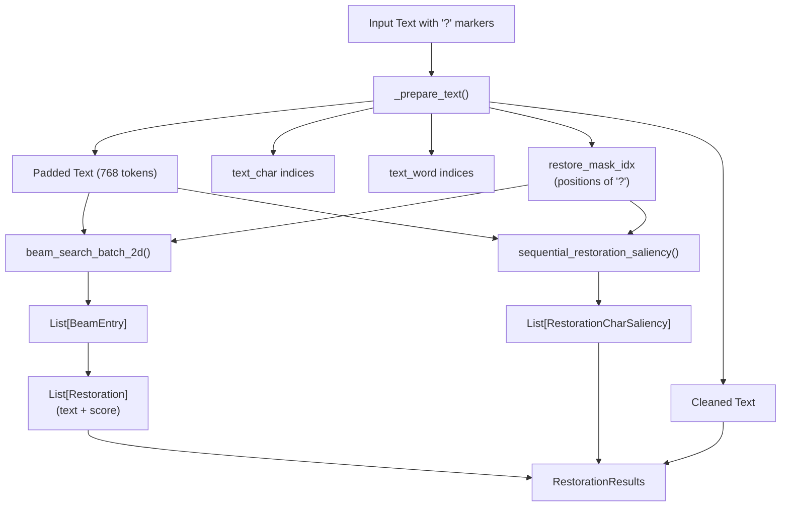
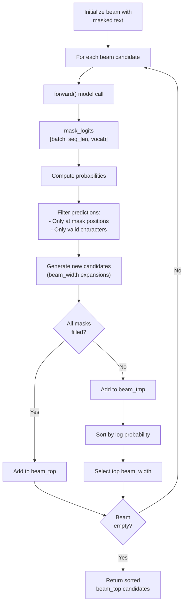
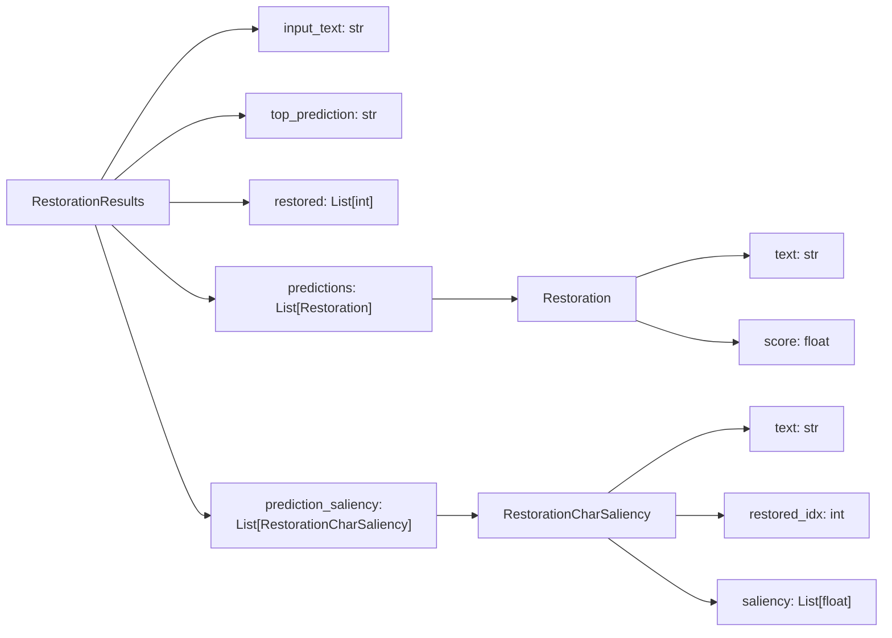
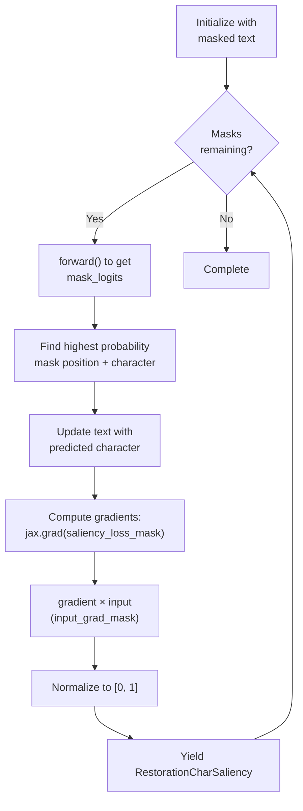

<!-- source: DeepWiki mcp.deepwiki.com · repo google-deepmind/ithaca · page 5.3 Restoration · fetched 2026-10-26 -->

# Restoration

<details>
<summary>Relevant source files</summary>

The following files were used as context for generating this wiki page:

- [colabs/ithaca_inference.ipynb](colabs/ithaca_inference.ipynb)
- [ithaca/eval/inference.py](ithaca/eval/inference.py)
- [ithaca/util/eval.py](ithaca/util/eval.py)

</details>


This page documents Ithaca's text restoration functionality, which uses beam search to predict missing characters in ancient Greek inscriptions. The `restore()` function processes input text with missing characters marked as `?` and returns multiple hypotheses ranked by probability. For information about predicting dates and regions, see [Attribution](#5.2). For detailed explanations of interpretability features, see [Saliency Maps and Interpretability](#5.4). For beam search algorithm details, see [Beam Search](#5.5).

## Overview

The restoration system fills in missing characters in ancient Greek inscriptions using a non-sequential beam search algorithm. Unlike traditional left-to-right generation, Ithaca predicts characters in order of confidence, restoring the most certain positions first. This approach leverages bidirectional context from the Transformer encoder to make more accurate predictions.

The main entry point is the `restore()` function at [ithaca/eval/inference.py:226-268](), which coordinates text preparation, beam search execution, and saliency map generation.

**Sources:** [ithaca/eval/inference.py:14-21](), [ithaca/eval/inference.py:226-268]()

## Input Format

Input text must meet the following requirements:

| Requirement | Value | Description |
|------------|-------|-------------|
| Minimum length | 50 characters | Enforced by `MIN_TEXT_LEN` constant |
| Maximum length | 767 characters | Model sequence length (768) minus SOS token |
| Missing character marker | `?` | Characters to be predicted by the model |
| Skip marker | `-` | Missing characters to skip (not predicted) |
| Text preprocessing | Automatic | Accents stripped, whitespace normalized |

The input text is processed by `_prepare_text()` at [ithaca/eval/inference.py:142-183](), which:
1. Strips accents using `util_text.strip_accents()`
2. Normalizes whitespace with regex `r'\s+'`
3. Adds start-of-sequence token (`alphabet.sos`)
4. Pads to fixed length (`TEXT_LEN = 768`)
5. Converts `?` markers to `alphabet.missing` for model input
6. Generates character and word indices for the model

**Sources:** [ithaca/eval/inference.py:130-140](), [ithaca/eval/inference.py:142-183]()

## Restoration Workflow

The following diagram shows the data flow through the restoration process:



**Sources:** [ithaca/eval/inference.py:226-268]()

## Beam Search Process

The restoration uses `beam_search_batch_2d()` at [ithaca/util/eval.py:117-237](), which implements non-sequential beam search:



### Key Constants and Parameters

| Parameter | Default Value | Description |
|-----------|--------------|-------------|
| `RESTORATION_BEAM_WIDTH` | 20 | Number of candidate sequences to maintain |
| `RESTORATION_TEMPERATURE` | 1.0 | Temperature for softmax (no scaling) |
| `SEED` | 1 | Random seed for reproducibility |

The beam search operates in batches to improve efficiency. At each iteration:
1. All beam candidates are batched together for parallel model evaluation
2. Predictions are generated at the highest-confidence mask position
3. Candidates are expanded, sorted by log probability
4. The top `beam_width` candidates are retained

**Sources:** [ithaca/eval/inference.py:136-137](), [ithaca/util/eval.py:117-237]()

## Output Structure

The `restore()` function returns a `RestorationResults` object containing:



### Data Structure Details

**`Restoration`** [ithaca/eval/inference.py:76-82]():
- `text`: Restored text with predicted characters filled in
- `score`: Exponential of log probability (ranges 0-1)

**`RestorationCharSaliency`** [ithaca/eval/inference.py:85-96]():
- `text`: Text state after restoring this character
- `restored_idx`: Position of the newly predicted character
- `saliency`: Per-character importance scores (length = text length)

**`RestorationResults`** [ithaca/eval/inference.py:99-127]():
- `input_text`: Original input (without SOS or padding)
- `top_prediction`: Best restoration hypothesis
- `restored`: List of character indices that were originally marked with `?`
- `predictions`: Top 20 restoration candidates sorted by score
- `prediction_saliency`: Step-by-step saliency maps for the greedy prediction

The restoration results are converted to JSON using the `json()` method at [ithaca/eval/inference.py:126-127]().

**Sources:** [ithaca/eval/inference.py:76-127]()

## Post-Processing

After beam search completes, the results are post-processed at [ithaca/eval/inference.py:246-262]():

1. **Strip formatting symbols**: Remove start-of-sequence token and padding
   ```python
   text=beam_entry.text_pred[1:].rstrip(alphabet.pad)
   ```

2. **Convert log probabilities to scores**: Exponentiate for human-readable probabilities
   ```python
   score=math.exp(beam_entry.pred_logprob)
   ```

3. **Adjust indices**: Account for removed SOS token
   ```python
   restored_indices = [i - 1 for i in restore_mask_idx]
   ```

**Sources:** [ithaca/eval/inference.py:246-252]()

## Sequential Restoration Saliency

For interpretability, the system generates per-step saliency maps showing which input characters influenced each prediction. This uses `sequential_restoration_saliency()` at [ithaca/util/eval.py:492-562]().

### Greedy Restoration Process



The saliency computation:
1. Predicts the next character greedily (non-sequentially)
2. Computes gradients of that prediction with respect to character and word embeddings
3. Multiplies gradients by embeddings (gradient × input)
4. Normalizes to [0, 1] range for visualization
5. Combines character and word saliency maps

The `saliency_loss_mask()` function at [ithaca/util/eval.py:471-483]() defines the loss for a specific character prediction:
```python
mask_logits[0, char_pos, char_idx]
```
This is the model's confidence in predicting character `char_idx` at position `char_pos`.

**Sources:** [ithaca/util/eval.py:471-483](), [ithaca/util/eval.py:492-562]()

## Example Usage

### Programmatic Usage

```python
from ithaca.eval import inference
from ithaca.models.model import Model
import functools

# Load model and create forward function
forward = functools.partial(Model(**model_config).apply, params)

# Text with missing characters marked as '?'
text = "εδοξεν τηι βουληι ????????? προξενον"

# Perform restoration
results = inference.restore(
    text=text,
    forward=forward,
    params=params,
    alphabet=alphabet,
    vocab_char_size=vocab_char_size,
    vocab_word_size=vocab_word_size
)

# Access top prediction
print(results.top_prediction)

# Iterate through all hypotheses
for i, pred in enumerate(results.predictions[:5], 1):
    print(f"Hypothesis {i}: {pred.text} (score: {pred.score:.3f})")
```

### Colab Notebook Example

The Colab notebook at [colabs/ithaca_inference.ipynb:424-558]() demonstrates interactive restoration with visualization:

1. **Input text cell** [colabs/ithaca_inference.ipynb:388-399](): User provides text with `?` markers
2. **Restoration hypotheses** [colabs/ithaca_inference.ipynb:424-558](): Displays top 20 ranked predictions in a scrollable table
3. **Saliency visualization** [colabs/ithaca_inference.ipynb:831-970](): Shows per-step saliency maps with purple highlighting

The notebook renders predictions in a sticky-header table with:
- Input text showing predicted regions in gray
- Each hypothesis with probability percentage
- Horizontal scrolling for long inscriptions
- "Jump to restoration area" button for navigation

**Sources:** [colabs/ithaca_inference.ipynb:378-411](), [colabs/ithaca_inference.ipynb:424-558](), [colabs/ithaca_inference.ipynb:831-970]()

## Comparison: Sequential vs Non-Sequential Beam Search

The codebase includes two beam search implementations:

| Feature | `beam_search_batch_2d` | `beam_search_batch_1d` |
|---------|------------------------|------------------------|
| Location | [ithaca/util/eval.py:117-237]() | [ithaca/util/eval.py:240-349]() |
| Strategy | Non-sequential (highest confidence first) | Sequential (left-to-right) |
| Used for | Main restoration | Alternative (not used by default) |
| Advantage | Better utilizes bidirectional context | Simpler, more traditional |

The non-sequential approach (`beam_search_batch_2d`) is preferred because:
- The BigBird encoder provides full bidirectional context
- Predicting high-confidence characters first reduces compounding errors
- Better aligns with how epigraphists work (filling obvious gaps first)

**Sources:** [ithaca/util/eval.py:117-237](), [ithaca/util/eval.py:240-349]()

## Performance Considerations

### Computational Complexity

For a text with `n` missing characters and beam width `k`:
- **Beam search iterations**: `n` (one per missing character)
- **Model forward passes per iteration**: `k` (batched)
- **Total forward passes**: `O(n × k)`

With default `RESTORATION_BEAM_WIDTH = 20`, restoring 10 missing characters requires ~200 model forward passes.

### Optimization Techniques

1. **Batched evaluation** [ithaca/util/eval.py:142-164](): All beam candidates processed in parallel
2. **Early termination**: Completed sequences moved to `beam_top` immediately
3. **Efficient filtering** [ithaca/util/eval.py:174-212](): Only valid alphabet characters considered
4. **Dictionary deduplication** [ithaca/util/eval.py:214-225](): Prevents duplicate sequences in beam

**Sources:** [ithaca/util/eval.py:117-237]()

## Error Handling

The `restore()` function validates input at [ithaca/eval/inference.py:230-234]():

```python
if ALPHABET_MISSING_RESTORE not in text:
    raise ValueError('At least one character must be missing.')
```

Additional validation occurs in `_prepare_text()` at [ithaca/eval/inference.py:162-166]():
- Text too short: `ValueError('Input text too short.')`
- Text too long: `ValueError('Input text too long.')`

These constraints ensure the model operates within its training parameters.

**Sources:** [ithaca/eval/inference.py:142-183](), [ithaca/eval/inference.py:226-234]()

---

