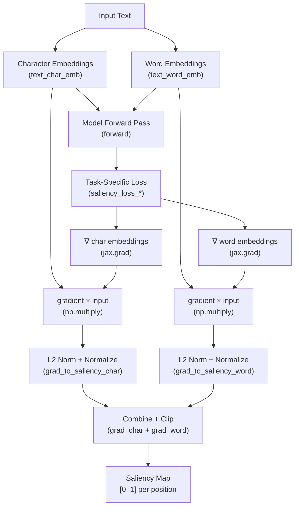
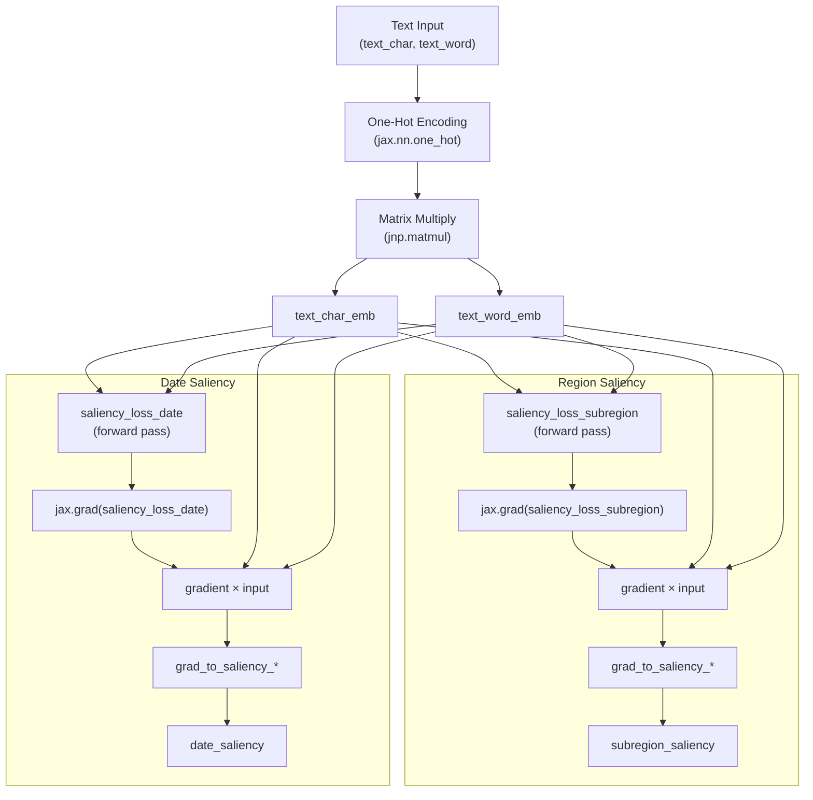
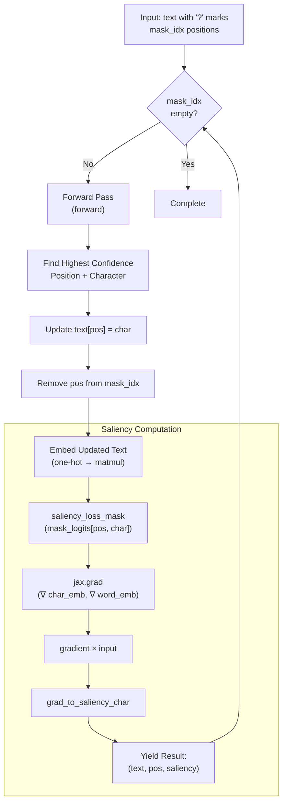
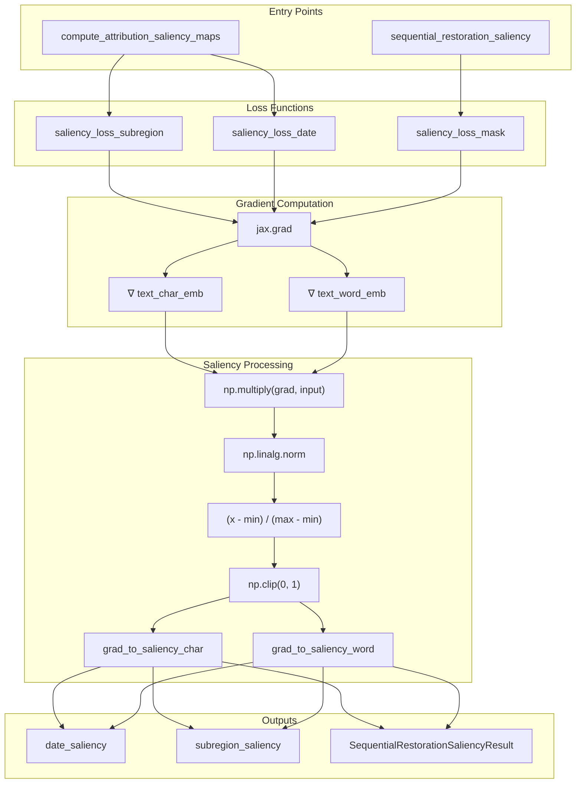

<!-- source: DeepWiki mcp.deepwiki.com · repo google-deepmind/ithaca · page 5.4 Saliency Maps and Interpretability · fetched 2026-10-26 -->

# Saliency Maps and Interpretability

<details>
<summary>Relevant source files</summary>

The following files were used as context for generating this wiki page:

- [colabs/ithaca_inference.ipynb](colabs/ithaca_inference.ipynb)
- [ithaca/util/eval.py](ithaca/util/eval.py)

</details>


This page documents how Ithaca generates saliency maps to explain model predictions, showing which input characters and words most influenced the model's decisions. Saliency maps provide interpretability for all three prediction tasks: text restoration, geographical attribution, and chronological attribution.

For information about the inference functions that generate these saliency maps, see [Inference Overview](#5.1). For details about the attribution and restoration prediction tasks themselves, see [Attribution](#5.2) and [Restoration](#5.3).

## Overview

Saliency maps in Ithaca use gradient-based attribution to highlight which portions of the input text most influenced a particular prediction. The intensity of highlighting (displayed as purple shading in visualizations) indicates how strongly each character position contributed to the model's decision.

Three types of saliency maps are generated:

| Saliency Type | Task | Purpose |
|---------------|------|---------|
| **Date Saliency** | Chronological attribution | Shows which text features influenced the predicted date |
| **Region Saliency** | Geographical attribution | Shows which text features influenced the predicted region |
| **Restoration Saliency** | Text restoration | Shows which surrounding text influenced each restored character |

**Sources:** [ithaca/util/eval.py:352-468](), [colabs/ithaca_inference.ipynb:842-970]()

## Gradient-Based Saliency Computation

### Core Technique

Ithaca computes saliency maps using the **gradient × input** method. For a given prediction, the technique:

1. Computes gradients of the loss with respect to input embeddings
2. Multiplies gradients by the input embeddings (element-wise)
3. Computes the L2 norm across embedding dimensions
4. Normalizes to [0, 1] range
5. Combines character-level and word-level saliency



**Sources:** [ithaca/util/eval.py:400-468](), [ithaca/util/eval.py:37-83]()

### Character-Level Saliency Processing

The `grad_to_saliency_char()` function converts character embedding gradients to visualization-ready saliency values:

```
gradient_char: [batch, seq_len, char_emb_dim]
            ↓ L2 norm across embedding dimension
saliency_raw: [seq_len]
            ↓ mask non-alphabet positions
            ↓ normalize to [0, 1]
saliency_char: [seq_len]
```

Key steps in [ithaca/util/eval.py:37-54]():
- Computes `np.linalg.norm(gradient_char, axis=2)` to get per-position importance
- Masks special tokens (padding, SOS) using `alphabet.alphabet_start_idx` and `alphabet.alphabet_end_idx`
- Normalizes unmasked positions: `(x - min) / (max - min + ε)`

**Sources:** [ithaca/util/eval.py:37-54]()

### Word-Level Saliency Processing

The `grad_to_saliency_word()` function handles word-level gradients with special processing for unknown words:

```
gradient_word: [batch, seq_len, word_emb_dim]
            ↓ L2 norm across embedding dimension
            ↓ accumulate saliency across word spans
saliency_word: [seq_len]
            ↓ mask UNK positions
            ↓ normalize to [0, 1]
saliency_word_normalized: [seq_len]
```

Special handling in [ithaca/util/eval.py:57-82]():
- When consecutive positions belong to a single word (not UNK), their saliency values are summed
- UNK token positions are masked to 0
- Remaining positions normalized independently

**Sources:** [ithaca/util/eval.py:57-82]()

## Attribution Saliency Maps

### Computation Workflow

The `compute_attribution_saliency_maps()` function generates saliency maps for both date and region predictions simultaneously:



**Sources:** [ithaca/util/eval.py:400-468]()

### Loss Functions for Gradient Computation

Two specialized loss functions enable gradient computation:

**Region Loss** ([ithaca/util/eval.py:352-368]()):
```python
def saliency_loss_subregion(forward, text_char_emb, text_word_emb, 
                            padding, rng, subregion=None):
    _, subregion_logits, _, _ = forward(...)
    if subregion is None:
        subregion = subregion_logits.argmax(axis=-1)[0]
    return subregion_logits[0, subregion]
```
- Returns the logit for the predicted (or specified) subregion
- Gradients show what input features support that region prediction

**Date Loss** ([ithaca/util/eval.py:371-382]()):
```python
def saliency_loss_date(forward, text_char_emb, text_word_emb, padding, rng):
    date_pred, _, _, _ = forward(...)
    date_pred_argmax = date_pred.argmax(axis=-1)
    return date_pred[0, date_pred_argmax[0]]
```
- Returns the probability for the predicted date bin
- Gradients show what input features support that date prediction

**Sources:** [ithaca/util/eval.py:352-382]()

### Output Data Structure

Attribution saliency maps are returned as numpy arrays aligned with the input text:

```
date_saliency:      [text_len] float values in [0, 1]
subregion_saliency: [text_len] float values in [0, 1]
```

Each position `i` has a saliency value indicating its importance to the prediction. Higher values (closer to 1.0) indicate stronger influence.

**Sources:** [ithaca/util/eval.py:400-468]()

## Restoration Saliency Maps

### Sequential Restoration with Saliency

The `sequential_restoration_saliency()` function performs greedy, non-sequential text restoration while computing a saliency map for each restored character:



**Sources:** [ithaca/util/eval.py:492-562]()

### Restoration Loss Function

The `saliency_loss_mask()` function computes gradients for a specific restored character:

```python
def saliency_loss_mask(forward, text_char_emb, text_word_emb, 
                       padding, rng, char_pos, char_idx):
    _, _, mask_logits, _ = forward(...)
    return mask_logits[0, char_pos, char_idx]
```

**Parameters:**
- `char_pos`: position in sequence being restored
- `char_idx`: character index that was predicted

**Returns:** the logit value for predicting `char_idx` at position `char_pos`, enabling gradient computation with respect to input embeddings.

**Sources:** [ithaca/util/eval.py:471-483]()

### Restoration Saliency Result

Each restoration step yields a `SequentialRestorationSaliencyResult`:

```python
class SequentialRestorationSaliencyResult(NamedTuple):
    text: str              # Updated text with one more character restored
    pred_char_pos: int     # Position of the newly restored character
    saliency_map: np.ndarray  # Saliency values for all positions
```

The generator function [ithaca/util/eval.py:492-562]() yields one result per restored character, allowing step-by-step visualization of the restoration process.

**Sources:** [ithaca/util/eval.py:486-490](), [ithaca/util/eval.py:559-562]()

## Visualization and Interpretation

### Colab Notebook Visualization

The interactive notebook [colabs/ithaca_inference.ipynb]() provides HTML-based visualizations with purple shading intensity proportional to saliency:

```
rgba(171, 71, 188, α)  where α = saliency value in [0, 1]
```

**Attribution Saliency Display** ([colabs/ithaca_inference.ipynb:1179-1367]()):
- Geographical saliency: shows which text features indicate the region
- Chronological saliency: shows which text features indicate the date
- Both rendered as highlighted text with hover tooltips

**Restoration Saliency Display** ([colabs/ithaca_inference.ipynb:842-970]()):
- Step-by-step table showing each restoration iteration
- For each step, displays:
  - The character being restored (in header column)
  - Full text with saliency highlighting
  - The restored position highlighted in green on hover
  - Surrounding context saliency in purple shading

### Saliency Generation Template

The notebook uses Jinja2 templates to generate HTML visualizations:

```python
SALIENCY_SNIPPET_TEMPLATE = jinja2.Template("""
<div class="saliency">
  
    <span style="background-color: rgba(171,71,188,{{'%.2f'|format(score)}});"
          title="Saliency score {{'%.2f'|format(score)}}">{{ char }}</span>
  
</div>
""")
```

The template ([colabs/ithaca_inference.ipynb:302-310]()) iterates over (character, saliency_score) pairs, rendering each character with background intensity proportional to its saliency.

**Sources:** [colabs/ithaca_inference.ipynb:302-339](), [colabs/ithaca_inference.ipynb:842-970]()

## Implementation Details

### Key Functions and Data Flow



**Sources:** [ithaca/util/eval.py:37-562]()

### Integration with Inference

Saliency maps are computed during inference and returned as part of result structures:

**AttributionResults** (returned by `inference.attribute()`):
```python
AttributionResults(
    date_pred_distribution: np.ndarray,  # Date probability distribution
    date_saliency: np.ndarray,           # Date saliency map
    subregion_logits: np.ndarray,        # Region logits
    subregion_saliency: np.ndarray,      # Region saliency map
    ...
)
```

**RestorationResults** (returned by `inference.restore()`):
```python
RestorationResults(
    input_text: str,                     # Original input
    predictions: List[Prediction],       # Top-K restored texts
    prediction_saliency: List[SequentialRestorationSaliencyResult],
    ...
)
```

The saliency computation is tightly integrated with the forward pass, using JAX's automatic differentiation to compute gradients efficiently on GPU/TPU.

**Sources:** [ithaca/eval/inference.py]() (referenced but not shown in provided files)

### Performance Considerations

| Aspect | Details |
|--------|---------|
| **Computation Cost** | Two additional forward passes (one per gradient computation) |
| **Memory Usage** | Stores full gradient tensors: [batch, seq_len, emb_dim] |
| **Parallelization** | JAX automatically parallelizes gradient computation |
| **Restoration Saliency** | Computed sequentially for each restored character (more expensive) |

Saliency computation adds minimal overhead to inference because:
- JAX's `jax.grad` is highly optimized for automatic differentiation
- Only requires backpropagation through the encoder (not beam search)
- Results are cached and reused for visualization

**Sources:** [ithaca/util/eval.py:400-562]()

---

