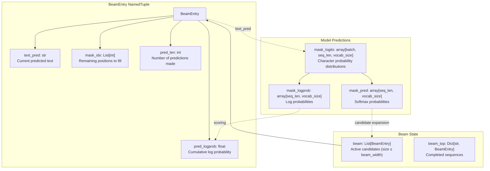
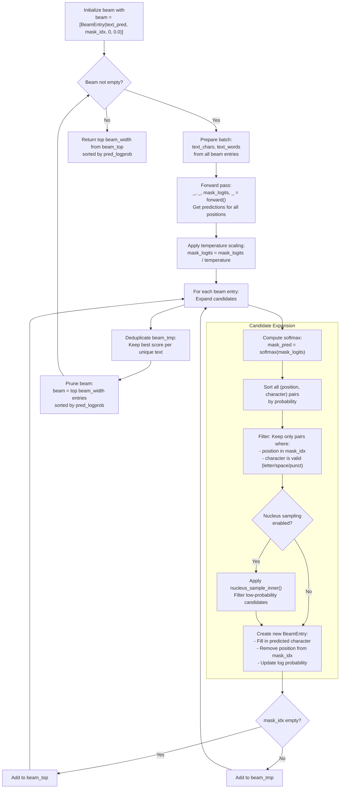
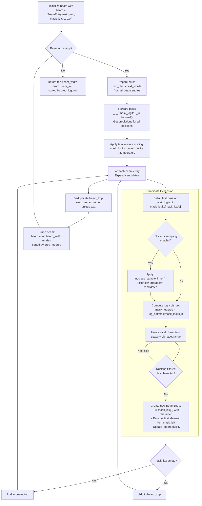
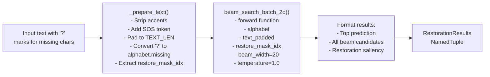

<!-- source: DeepWiki mcp.deepwiki.com · repo google-deepmind/ithaca · page 5.5 Beam Search · fetched 2026-10-26 -->

# Beam Search

<details>
<summary>Relevant source files</summary>

The following files were used as context for generating this wiki page:

- [ithaca/eval/inference.py](ithaca/eval/inference.py)
- [ithaca/util/eval.py](ithaca/util/eval.py)

</details>


This document provides detailed technical documentation of the beam search algorithms used in Ithaca for text restoration. Beam search is the core decoding strategy that fills in missing characters (marked with `?` in the input) by exploring multiple candidate sequences and selecting the most probable completions.

For information about the higher-level restoration API that uses beam search, see [Restoration](#5.3). For the text processing utilities that prepare inputs for beam search, see [Text Processing](#6.1).

## Overview

Beam search in Ithaca is implemented as two distinct algorithms located in [ithaca/util/eval.py](). Both algorithms maintain a "beam" of candidate sequences and iteratively expand them by predicting missing characters until all gaps are filled.

**Key Functions:**
- `beam_search_batch_2d()` - Non-sequential beam search (default)
- `beam_search_batch_1d()` - Sequential beam search
- `nucleus_sample_inner()` - Nucleus (top-p) sampling for diversity
- `BeamEntry` - Data structure for beam candidates

The beam search is invoked by the `restore()` function in [ithaca/eval/inference.py:226-268](), which prepares the input text, runs beam search, and formats the results.

**Sources:** [ithaca/util/eval.py:110-349](), [ithaca/eval/inference.py:226-268]()

## Beam Search Data Structures



**Diagram: Beam Search Data Structures and Flow**

The `BeamEntry` NamedTuple [ithaca/util/eval.py:110-114]() tracks each candidate sequence with four fields:
- `text_pred`: The current state of the text with some positions filled
- `mask_idx`: List of character positions that still need to be predicted
- `pred_len`: Count of characters predicted so far (for tracking progress)
- `pred_logprob`: Cumulative log probability score for ranking candidates

**Sources:** [ithaca/util/eval.py:110-114]()

## Non-Sequential Beam Search (2D)

The default beam search algorithm `beam_search_batch_2d()` [ithaca/util/eval.py:117-237]() predicts missing characters in any order, selecting the most confident prediction across all remaining positions at each step.



**Diagram: Non-Sequential Beam Search Algorithm Flow**

### Algorithm Details

**Initialization** [ithaca/util/eval.py:129-132]():
```python
beam = [BeamEntry(text_pred, mask_idx, 0, 0.)]
beam_top = {}
text_len = len(text_pred.rstrip(alphabet.pad))
```

**Batched Forward Pass** [ithaca/util/eval.py:142-164]():
The algorithm batches all current beam entries into a single forward pass for efficiency. This reduces the number of model invocations from `beam_width * num_steps` to `num_steps`.

**Candidate Expansion** [ithaca/util/eval.py:166-212]():
For each beam entry, the algorithm:
1. Computes softmax probabilities across all positions and characters
2. Sorts all (position, character) pairs by descending probability using `np.unravel_index`
3. Iterates through sorted pairs, keeping only valid predictions:
   - Position must be in `mask_idx` (a position that needs filling)
   - Character must be space, or within alphabet range `[alphabet_start_idx, punctuation[-1]]`
4. Creates a new candidate by filling in the character and removing the position from `mask_idx`
5. Updates cumulative log probability: `pred_logprob_i = pred_logprob + mask_logprob[pos, char]`

**Beam Pruning** [ithaca/util/eval.py:214-228]():
After expanding all candidates, the algorithm:
1. Deduplicates by text string, keeping the best score for each unique text
2. Sorts candidates by `pred_logprob` (higher is better)
3. Selects the top `beam_width` candidates to continue

**Termination** [ithaca/util/eval.py:234-237]():
When a candidate has no remaining positions in `mask_idx`, it's moved to `beam_top`. The algorithm terminates when `beam` is empty, meaning all active candidates have been completed.

**Sources:** [ithaca/util/eval.py:117-237]()

## Sequential Beam Search (1D)

The sequential beam search algorithm `beam_search_batch_1d()` [ithaca/util/eval.py:240-349]() predicts missing characters in left-to-right order, always filling the first remaining position in `mask_idx`.



**Diagram: Sequential Beam Search Algorithm Flow**

### Key Differences from Non-Sequential

1. **Position Selection** [ithaca/util/eval.py:290](): Always predicts `mask_idx[0]` (first remaining position) instead of considering all positions
2. **Character Iteration** [ithaca/util/eval.py:297-324](): Iterates through valid characters for the single position, rather than sorting all (position, character) pairs
3. **Beam Width**: Each beam entry generates at most `|valid_chars|` candidates (typically ~40) instead of `|mask_idx| * |valid_chars|`

The sequential approach is simpler and more predictable but may miss better solutions that require filling positions in a different order.

**Sources:** [ithaca/util/eval.py:240-349]()

## Nucleus Sampling

Nucleus sampling (top-p sampling) is an optional feature that promotes diversity by filtering out low-probability candidates [ithaca/util/eval.py:97-107]().

```python
def nucleus_sample_inner(logits, top_p=0.95, temp=1.0):
  sorted_logits = np.sort(logits)
  sorted_probs = softmax(sorted_logits)
  threshold_idx = np.argmax(np.cumsum(sorted_probs, -1) >= 1 - top_p)
  threshold_largest_logits = sorted_logits[..., [threshold_idx]]
  mask = logits >= threshold_largest_logits
  logits += (1 - mask) * -1e12  # Set unused logits to -inf
  logits /= np.maximum(temp, 1e-12)
  return logits
```

### How It Works

1. **Sort and Cumulate**: Sort logits by value and compute cumulative probability distribution
2. **Find Threshold**: Identify the threshold where cumulative probability reaches `1 - top_p`
3. **Mask Low Probability**: Set all logits below threshold to `-1e12` (effectively -∞)
4. **Temperature Scaling**: Apply temperature to remaining logits

With `top_p=0.95`, the algorithm only considers the smallest set of candidates whose cumulative probability is at least 95%, filtering out the long tail of unlikely options.

**Usage in Beam Search:**
- Non-sequential [ithaca/util/eval.py:188-195](): Applied per position before creating candidates
- Sequential [ithaca/util/eval.py:291-304](): Applied to the single position being predicted

**Sources:** [ithaca/util/eval.py:97-107](), [ithaca/util/eval.py:188-195](), [ithaca/util/eval.py:291-304]()

## Temperature Scaling

Temperature scaling controls the sharpness of the probability distribution [ithaca/util/eval.py:163]():

```python
mask_logits = mask_logits / temperature
```

| Temperature | Effect | Use Case |
|-------------|--------|----------|
| `< 1.0` | Sharpens distribution (more confident) | When model is well-calibrated |
| `= 1.0` | No change (default) | Standard inference |
| `> 1.0` | Smooths distribution (more diverse) | Exploration, avoiding local optima |

The default temperature used by `restore()` is `RESTORATION_TEMPERATURE = 1.0` [ithaca/eval/inference.py:137]().

**Sources:** [ithaca/util/eval.py:163](), [ithaca/util/eval.py:284](), [ithaca/eval/inference.py:137]()

## Integration with Restoration

The `restore()` function in [ithaca/eval/inference.py:226-268]() provides the high-level interface:



**Diagram: Restoration Pipeline Using Beam Search**

**Key Parameters** [ithaca/eval/inference.py:131-137]():
- `MIN_TEXT_LEN = 50` - Minimum input text length
- `TEXT_LEN = 768` - Fixed model sequence length
- `RESTORATION_BEAM_WIDTH = 20` - Number of candidates to maintain
- `RESTORATION_TEMPERATURE = 1.0` - Temperature for probability scaling
- `ALPHABET_MISSING_RESTORE = '?'` - Character marking missing positions

**Sources:** [ithaca/eval/inference.py:226-268](), [ithaca/eval/inference.py:131-140]()

## Algorithm Comparison

| Aspect | Non-Sequential (`beam_search_batch_2d`) | Sequential (`beam_search_batch_1d`) |
|--------|----------------------------------------|-------------------------------------|
| **Position Order** | Any order (most confident first) | Left-to-right (`mask_idx[0]`) |
| **Search Space** | All (position, char) pairs per step | All chars for fixed position |
| **Candidates per Entry** | Variable, typically 100s | ~40 (alphabet size) |
| **Complexity** | Higher (sorts all pairs) | Lower (iterates chars) |
| **Quality** | Generally better (optimal ordering) | May miss better solutions |
| **Use Case** | Default for restoration | Alternative if order matters |
| **Location** | [ithaca/util/eval.py:117-237]() | [ithaca/util/eval.py:240-349]() |

**Sources:** [ithaca/util/eval.py:117-349]()

## Batching Strategy

Both beam search variants use batching to improve efficiency [ithaca/util/eval.py:142-155]():

```python
# Non-sequential example
text_chars = []
text_words = []
for text_pred, mask_idx, pred_len, pred_logprob in beam:
  text_char = text_to_idx(text_pred, alphabet).reshape(1, -1)
  text_word = text_to_word_idx(text_pred, alphabet).reshape(1, -1)
  text_chars.append(text_char)
  text_words.append(text_word)
text_chars = np.vstack(text_chars)
text_words = np.vstack(text_words)

_, _, mask_logits, _ = forward(
    text_char=text_chars,
    text_word=text_words,
    rngs={'dropout': rng},
    is_training=False)
```

This batching strategy:
1. Converts all beam entries to character and word indices
2. Stacks them into batch arrays
3. Performs a single forward pass for all entries
4. Distributes results back to individual entries

**Performance Impact:**
- Without batching: `O(beam_width * num_missing_chars)` forward passes
- With batching: `O(num_missing_chars)` forward passes
- Speedup: ~20x for default `beam_width=20`

**Sources:** [ithaca/util/eval.py:142-164](), [ithaca/util/eval.py:263-275]()

## Beam Management

### Candidate Deduplication

After expanding candidates, duplicates are removed [ithaca/util/eval.py:215-225]():

```python
beam_tmp_kv = {}
for text_pred, mask_idx, pred_len, pred_logprob in beam_tmp:
  if (text_pred not in beam_tmp_kv) or (
      text_pred in beam_tmp_kv and
      beam_tmp_kv[text_pred].pred_logprob > pred_logprob):
    beam_tmp_kv[text_pred] = BeamEntry(text_pred, mask_idx, pred_len,
                                       pred_logprob)
```

Only the highest-scoring version of each unique text string is kept.

### Beam Pruning

After deduplication, candidates are sorted and pruned [ithaca/util/eval.py:222-228]():

```python
beam_tmp = sorted(
    beam_tmp_kv.values(),
    key=lambda entry: entry.pred_logprob,
    reverse=True)
beam = beam_tmp[:beam_width]
```

The beam is maintained at size `beam_width` (default 20) by keeping only the top-scoring candidates.

**Sources:** [ithaca/util/eval.py:215-228](), [ithaca/util/eval.py:327-340]()

## Valid Character Constraints

Both beam search variants restrict predictions to valid Greek alphabet characters [ithaca/util/eval.py:176-179]():

```python
if (mask_pred_argmax[i][0] in mask_idx and
    (mask_pred_argmax[i][1] == alphabet.char2idx[alphabet.space] or
     (mask_pred_argmax[i][1] >= alphabet.alphabet_start_idx and
      mask_pred_argmax[i][1] <= alphabet.char2idx[alphabet.punctuation[-1]]))):
```

**Valid Characters:**
- Space character (`alphabet.space`)
- Greek alphabet range: `[alphabet_start_idx, alphabet.char2idx[punctuation[-1]]]`

This excludes special tokens like `pad`, `sos`, `unk`, `mask` from being predicted.

**Sources:** [ithaca/util/eval.py:175-179](), [ithaca/util/eval.py:297-300]()

## Return Value Format

Both functions return a list of `BeamEntry` objects sorted by score [ithaca/util/eval.py:234-237]():

```python
return sorted(
    beam_top.values(), key=lambda entry: entry.pred_logprob,
    reverse=True)[:beam_width]
```

The `restore()` function converts these to `Restoration` objects [ithaca/eval/inference.py:247-251]():

```python
predictions = [
    Restoration(
        text=beam_entry.text_pred[1:].rstrip(alphabet.pad),
        score=math.exp(beam_entry.pred_logprob)) for beam_entry in beam_result
]
```

**Transformations:**
- Strip start-of-sequence token (first character)
- Strip padding from the end
- Convert log probability to probability via `math.exp()`

**Sources:** [ithaca/util/eval.py:234-237](), [ithaca/util/eval.py:346-349](), [ithaca/eval/inference.py:247-251]()

## Progress Tracking

Both beam search functions support optional progress tracking via `tqdm` [ithaca/util/eval.py:135-136]():

```python
if display_progress:
  pbar = tqdm.tqdm(total=len(mask_idx))
```

The progress bar is updated after each iteration [ithaca/util/eval.py:231-232]():

```python
if display_progress:
  pbar.update(1)
```

This is useful for long restoration tasks with many missing characters.

**Sources:** [ithaca/util/eval.py:135-136](), [ithaca/util/eval.py:231-232](), [ithaca/util/eval.py:256-257](), [ithaca/util/eval.py:342-344]()

---

