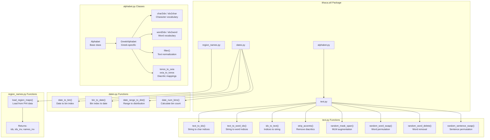
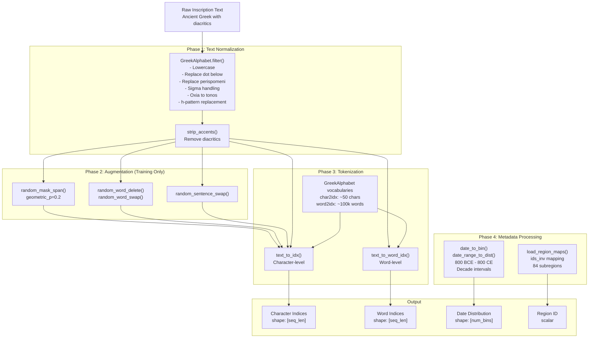
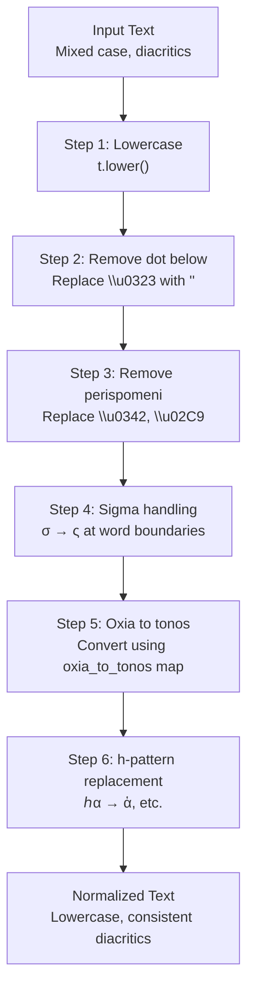
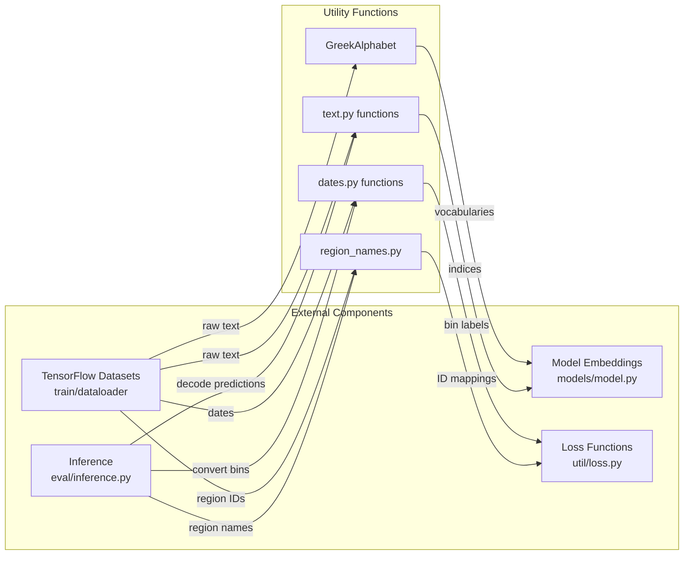

<!-- source: DeepWiki mcp.deepwiki.com · repo google-deepmind/ithaca · page 6 Data Processing Utilities · fetched 2026-10-26 -->

# Data Processing Utilities

<details>
<summary>Relevant source files</summary>

The following files were used as context for generating this wiki page:

- [ithaca/util/alphabet.py](ithaca/util/alphabet.py)
- [ithaca/util/dates.py](ithaca/util/dates.py)
- [ithaca/util/region_names.py](ithaca/util/region_names.py)
- [ithaca/util/text.py](ithaca/util/text.py)

</details>


## Purpose and Scope

This document provides comprehensive documentation of the data processing utilities in the Ithaca codebase, located in [ithaca/util/](). These utilities handle text manipulation, vocabulary management, date processing, and geographical region mappings required for training and inference with ancient Greek inscriptions.

The utilities form the foundation of the data pipeline, transforming raw inscription text into model-ready tensors. This page covers the architecture and interactions between utility modules. For detailed information about specific subsystems, see:
- Text manipulation functions: [Text Processing](#6.1)
- Greek character handling: [Greek Alphabet](#6.2)
- Date binning and conversion: [Date Processing](#6.3)
- Geographical region handling: [Region Mappings](#6.4)
- Additional evaluation utilities: [Evaluation Utilities](#6.5)

For training data pipeline details, see [Data Loading and Augmentation](#4.5). For inference usage, see [Inference System](#5).

**Sources:** [ithaca/util/alphabet.py](), [ithaca/util/text.py](), [ithaca/util/dates.py](), [ithaca/util/region_names.py]()

## Module Organization

The utility modules are organized into four primary functional areas:

| Module | File | Primary Purpose | Key Classes/Functions |
|--------|------|-----------------|----------------------|
| **Text Processing** | `text.py` | Text manipulation, augmentation, and conversion | `text_to_idx()`, `text_to_word_idx()`, `strip_accents()`, `random_mask_span()`, `random_word_swap()`, `random_word_delete()`, `random_sentence_swap()` |
| **Alphabet** | `alphabet.py` | Vocabulary management and Greek text normalization | `Alphabet`, `GreekAlphabet`, `filter()` |
| **Date Processing** | `dates.py` | Temporal binning and conversion | `date_to_bin()`, `bin_to_date()`, `date_range_to_dist()`, `date_num_bins()` |
| **Region Mappings** | `region_names.py` | Geographical region ID management | `load_region_maps()` |

These modules are imported throughout the codebase by training scripts, data loaders, inference code, and evaluation utilities.

**Sources:** [ithaca/util/alphabet.py:1-172](), [ithaca/util/text.py:1-187](), [ithaca/util/dates.py:1-68](), [ithaca/util/region_names.py:1-45]()

## Utility Module Architecture



**Sources:** [ithaca/util/alphabet.py:21-172](), [ithaca/util/text.py:23-187](), [ithaca/util/dates.py:18-68](), [ithaca/util/region_names.py:21-45]()

## Data Processing Pipeline Flow

The following diagram illustrates how raw inscription text flows through the utility functions to produce model inputs:



**Sources:** [ithaca/util/alphabet.py:113-171](), [ithaca/util/text.py:168-186](), [ithaca/util/text.py:49-166](), [ithaca/util/dates.py:25-67](), [ithaca/util/region_names.py:21-44]()

## Vocabulary System

The vocabulary system manages three distinct vocabularies simultaneously:

### Character Vocabulary

Defined in `GreekAlphabet.__init__()` and stored in `idx2char` and `char2idx`:

| Index Range | Content | Example |
|-------------|---------|---------|
| 0 | Padding token | `#` |
| 1 | Start-of-sequence token | `<` |
| 2 | Unknown token | `^` |
| 3 | Space character | ` ` |
| 4 | Missing character | `-` |
| 5-31 | Greek alphabet | `αβγδεζηθικλμνξοπρςστυφχψωϙϛ` |
| 32 | Numerals | `0` |
| 33 | Punctuation | `.` |

Total vocabulary size: ~50 tokens (retrieved via `GreekAlphabet.size_char()`)

### Word Vocabulary

Defined from wordlist file and stored in `idx2word` and `word2idx`:

| Index Range | Content |
|-------------|---------|
| 0 | Padding token (`#`) |
| 1 | Start-of-sequence token (`<`) |
| 2 | Unknown token (`^`) |
| 3-100002 | Most frequent words from corpus |

Total vocabulary size: 100,003 tokens (configurable via `wordlist_size` parameter)

### Special Character Indices

Stored as class attributes for fast lookup:

```python
alphabet.pad_idx         # Index of padding token
alphabet.sos_idx         # Index of start-of-sequence token
alphabet.unk_idx         # Index of unknown token
alphabet.alphabet_start_idx  # First alphabet character
alphabet.alphabet_end_idx    # Last numeral character
```

**Sources:** [ithaca/util/alphabet.py:24-78](), [ithaca/util/alphabet.py:84-90]()

## Text Normalization Pipeline

The `GreekAlphabet.filter()` method implements a comprehensive normalization pipeline for ancient Greek text:



### Tonos-Oxia Conversion

Ancient Greek uses two different Unicode representations for accents: tonos (modern) and oxia (polytonic). The `GreekAlphabet` maintains bidirectional mappings:

- `tonos_to_oxia`: Maps 10 tonos characters to oxia equivalents
- `oxia_to_tonos`: Reverse mapping for normalization

Example mappings:
- `ά` (tonos, U+03AC) ↔ `ἅ` (oxia, U+1F71)
- `έ` (tonos, U+03AD) ↔ `ἕ` (oxia, U+1F73)

The `filter()` method converts all oxia to tonos for consistency [ithaca/util/alphabet.py:128-129]().

### H-Pattern Replacement

The `filter()` method handles the special character `ℎ` (U+210E), which represents aspiration in ancient Greek. It combines with vowels to produce aspirated forms:

- `ℎε` → `ἑ` (aspirated epsilon)
- `ℎα` → `ἁ` (aspirated alpha)
- `ℎι` → `ἱ` (aspirated iota)

The implementation uses a pattern dictionary and regex replacement [ithaca/util/alphabet.py:132-169]().

**Sources:** [ithaca/util/alphabet.py:113-171](), [ithaca/util/alphabet.py:91-111]()

## Augmentation Functions

The text processing module provides four augmentation functions for training data:

### Masked Language Modeling

`random_mask_span(t, geometric_p=0.2, limit_chars=None)` implements span-based masking:

1. Identifies all word spans using regex `[\w\s]+`
2. Randomly selects one span
3. Samples span length from geometric distribution (p=0.2)
4. Returns list of character indices to mask

This generates training data for the masked language modeling task [ithaca/util/text.py:49-85]().

### Word-Level Augmentation

Two functions provide word-level robustness:

- `random_word_delete(sentence, p)`: Removes words with probability `p` [ithaca/util/text.py:113-135]()
- `random_word_swap(sentence, p)`: Swaps `p * len(words)` random word pairs [ithaca/util/text.py:138-165]()

Both preserve at least one word to prevent empty outputs.

### Sentence-Level Augmentation

`random_sentence_swap(sentences, p)` permutes sentences for next-sentence prediction:

1. Calculates `n = p * len(sentences)` swaps
2. For each swap, randomly selects two distinct sentence indices
3. Swaps the sentences in place
4. Returns modified sentence list [ithaca/util/text.py:88-110]()

**Sources:** [ithaca/util/text.py:49-166]()

## Date Binning System

The date processing module implements temporal binning for the period 800 BCE to 800 CE:

### Bin Configuration

| Parameter | Value | Description |
|-----------|-------|-------------|
| `date_min` | -800 | Minimum year (800 BCE) |
| `date_max` | 800 | Maximum year (800 CE) |
| `date_interval` | 10 | Decade bins |
| `unknown_bin` | True | Extra bin for unknown dates |

Total bins: 160 known date bins + 1 unknown bin = 161 bins

### Core Functions

**`date_to_bin(date_cur, date_min, date_max, date_interval, date_bins)`**

Converts a year to its bin index using `np.digitize()` [ithaca/util/dates.py:25-32]():
- Valid dates: Assigned to appropriate decade bin
- Invalid dates (outside range): Assigned to unknown bin (index = `date_bins - 1`)

**`bin_to_date(date_cur_bin, date_min, date_interval)`**

Converts bin index to the midpoint year of that decade [ithaca/util/dates.py:35-36]():
```
year = date_min + date_cur_bin * date_interval + date_interval // 2
```

Example: Bin 0 → -795 BCE (midpoint of -800 to -790)

**`date_range_to_dist(date_min_cur, date_max_cur, ...)`**

Converts a date range to a uniform probability distribution over bins [ithaca/util/dates.py:39-67]():
1. Converts min/max dates to bin indices
2. Creates uniform distribution over that range
3. Optionally returns log-space (logits) for training

This enables supervision with uncertain dates (e.g., "300-250 BCE").

**Sources:** [ithaca/util/dates.py:18-67]()

## Region Mapping System

The region processing module manages geographical region IDs from the PHI dataset:

### PHI Region Structure

The I.PHI dataset contains hierarchical geographical data:
- **Regions**: Top-level areas (e.g., "Attica")
- **Subregions**: Specific locations (e.g., "Athens")
- **Region IDs**: Unique integer identifiers from PHI

The model predicts among **84 subregions** after filtering unknown/unspecified entries.

### `load_region_maps(region_file)`

Processes a region file (format: `name_id;frequency`) and returns three mappings [ithaca/util/region_names.py:21-44]():

| Key | Type | Purpose | Example |
|-----|------|---------|---------|
| `ids` | `list[int]` | Original PHI region IDs | `[42, 103, 256, ...]` |
| `ids_inv` | `dict[int, int]` | PHI ID → continuous index | `{42: 0, 103: 1, ...}` |
| `names_inv` | `dict[int, str]` | Continuous index → name | `{0: 'Attica', ...}` |

### Filtered Regions

Three categories are excluded [ithaca/util/region_names.py:32-35]():
- "Unknown Provenances" (ID 884)
- "unspecified subregion" (IDs 885, 1439)

This ensures all model predictions correspond to specific, known locations.

### Usage Pattern

```python
region_maps = load_region_maps(region_file)
phi_id = 103                           # Original PHI ID
model_idx = region_maps['ids_inv'][phi_id]  # Continuous index for model
name = region_maps['names_inv'][model_idx]  # Human-readable name
```

**Sources:** [ithaca/util/region_names.py:21-44]()

## Conversion Functions

### Text to Indices

Two functions handle text-to-index conversion:

**`text_to_idx(t, alphabet)`**

Converts string to character-level indices [ithaca/util/text.py:174-176]():
```python
indices = np.array([alphabet.char2idx[c] for c in t], dtype=np.int32)
```

**`text_to_word_idx(t, alphabet)`**

Converts string to word-level indices [ithaca/util/text.py:179-185]():
1. Initializes array with unknown token
2. Uses regex `\w+` to find word boundaries
3. Maps known words to their indices
4. Preserves unknown token for OOV words

Both functions return `np.int32` arrays compatible with JAX/Flax embedding layers.

### Indices to Text

**`idx_to_text(idxs, alphabet, strip_sos=True, strip_pad=True)`**

Converts index array to string [ithaca/util/text.py:23-35]():
- Strips start-of-sequence token if `strip_sos=True`
- Stops at first padding token if `strip_pad=True`
- Used for decoding model predictions

**`idx_to_text_batch(idxs, alphabet, lengths=None)`**

Batched version supporting length masking [ithaca/util/text.py:38-46]().

**Sources:** [ithaca/util/text.py:23-186]()

## Integration with Data Pipeline

The utilities integrate with the broader data pipeline as follows:



**Key Integration Points:**

1. **Training Data Pipeline**: [Data Loading and Augmentation](#4.5) uses utilities to preprocess text and create labels
2. **Model Input**: [Model Architecture](#3) consumes character and word indices from `text_to_idx()` and `text_to_word_idx()`
3. **Loss Computation**: [Loss Functions](#4.4) use date bins and region IDs for supervision
4. **Inference**: [Inference System](#5) uses `idx_to_text()` for decoding and region mappings for output formatting

**Sources:** [ithaca/util/alphabet.py](), [ithaca/util/text.py](), [ithaca/util/dates.py](), [ithaca/util/region_names.py]()

## Usage Examples

### Basic Text Processing

```python
# Initialize alphabet
from ithaca.util.alphabet import GreekAlphabet
alphabet = GreekAlphabet(wordlist_file=open('wordlist.txt'), wordlist_size=100000)

# Normalize text
raw_text = "Ἀθήνα"
normalized = alphabet.filter(raw_text)  # "αθηνα"

# Convert to indices
from ithaca.util.text import text_to_idx, text_to_word_idx
char_indices = text_to_idx(normalized, alphabet)
word_indices = text_to_word_idx(normalized, alphabet)

# Convert back to text
from ithaca.util.text import idx_to_text
reconstructed = idx_to_text(char_indices, alphabet)
```

### Date Processing

```python
from ithaca.util.dates import date_to_bin, bin_to_date, date_range_to_dist

# Configuration
date_min, date_max = -800, 800
date_interval = 10
date_bins = 161

# Convert year to bin
year = -450  # 450 BCE
bin_idx = date_to_bin(year, date_min, date_max, date_interval, date_bins)

# Convert bin to year
midpoint_year = bin_to_date(bin_idx, date_min, date_interval)

# Create distribution for uncertain date
dist = date_range_to_dist(-500, -400, date_min, date_max, date_interval, date_bins)
```

### Region Processing

```python
from ithaca.util.region_names import load_region_maps

# Load mappings
region_maps = load_region_maps(open('regions.txt'))

# Convert PHI ID to model index
phi_id = 42
model_idx = region_maps['ids_inv'][phi_id]

# Get human-readable name
region_name = region_maps['names_inv'][model_idx]
```

**Sources:** [ithaca/util/alphabet.py:84-171](), [ithaca/util/text.py:168-186](), [ithaca/util/dates.py:18-67](), [ithaca/util/region_names.py:21-44]()

---

